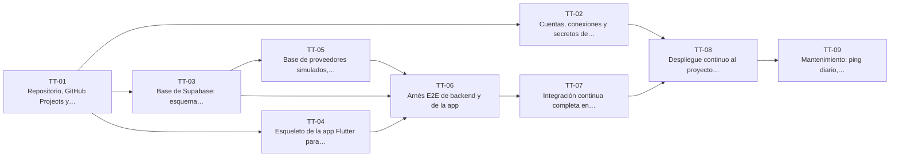

# E-01 · Cimientos y calidad continua

| Campo | Valor |
|---|---|
| Objetivo | Dejar listo todo lo que las demás épicas necesitan para construirse y entregarse sin romper nada: repositorio y tablero, servicios conectados, base de Supabase, esqueleto de la app, proveedores simulados, pruebas de punta a punta, integración y despliegue continuos y respaldo. |
| Documentación fuente | docs/05 · docs/15 · docs/16 |
| Módulos (docs/17) | M-19, M-20 |
| Depende de | — |
| Entregas en las que avanza | R1 |
| Etiquetas | `epica` · `E-01` |

## Capacidades

Tomadas de `docs/14` §2:

- Repositorio listo (16)
- Proyectos Supabase (local, MVP, demo opcional)
- Esquema `private`, extensiones y Vault
- Esqueleto Flutter (Android + web, `com.ritech.inversiones`, Riverpod, go_router, códigos de error)
- Proveedores simulados
- Arnés E2E (backend y app)
- Flujos de CI/CD, wiki y mantenimiento funcionando
- Despliegue web (Firebase Hosting) y APK (App Distribution)
- Respaldo cifrado
- `CLAUDE.md` y registro de errores en uso

## Tareas técnicas

Según `docs/16` §6.1, esta épica se crea como **tareas técnicas** (formulario `tarea-tecnica.yml`): trabajo necesario sin valor directo para un rol, por eso no llevan narrativa. Cada una tiene su criterio de terminado, sus tareas y sus relaciones.

| ID | Tarea técnica | Entrega | Prioridad | Depende de |
|---|---|---|---|---|
| [TT-01](TT-01-repositorio-github-projects-y-wiki.md) | Repositorio, GitHub Projects y wiki | R1 | Alta | — |
| [TT-02](TT-02-cuentas-conexiones-y-secretos-de-los-servicios-externos.md) | Cuentas, conexiones y secretos de los servicios externos | R1 | Alta | [TT-01](TT-01-repositorio-github-projects-y-wiki.md) |
| [TT-03](TT-03-base-de-supabase-esquema-private-extensiones-vault-y-ping.md) | Base de Supabase: esquema private, extensiones, Vault y ping | R1 | Alta | [TT-01](TT-01-repositorio-github-projects-y-wiki.md) |
| [TT-04](TT-04-esqueleto-de-la-app-flutter-para-android-y-web.md) | Esqueleto de la app Flutter para Android y web | R1 | Alta | [TT-01](TT-01-repositorio-github-projects-y-wiki.md) |
| [TT-05](TT-05-base-de-proveedores-simulados-reloj-controlable-y-datos-de-prueba.md) | Base de proveedores simulados, reloj controlable y datos de prueba | R1 | Alta | [TT-03](TT-03-base-de-supabase-esquema-private-extensiones-vault-y-ping.md) |
| [TT-06](TT-06-arnes-e2e-de-backend-y-de-la-app.md) | Arnés E2E de backend y de la app | R1 | Alta | [TT-03](TT-03-base-de-supabase-esquema-private-extensiones-vault-y-ping.md), [TT-04](TT-04-esqueleto-de-la-app-flutter-para-android-y-web.md), [TT-05](TT-05-base-de-proveedores-simulados-reloj-controlable-y-datos-de-prueba.md) |
| [TT-07](TT-07-integracion-continua-completa-en-cada-pr.md) | Integración continua completa en cada PR | R1 | Alta | [TT-06](TT-06-arnes-e2e-de-backend-y-de-la-app.md) |
| [TT-08](TT-08-despliegue-continuo-al-proyecto-mvp-con-prueba-de-humo.md) | Despliegue continuo al proyecto MVP con prueba de humo | R1 | Alta | [TT-02](TT-02-cuentas-conexiones-y-secretos-de-los-servicios-externos.md), [TT-07](TT-07-integracion-continua-completa-en-cada-pr.md) |
| [TT-09](TT-09-mantenimiento-ping-diario-respaldo-cifrado-y-prueba-real-semanal.md) | Mantenimiento: ping diario, respaldo cifrado y prueba real semanal | R1 | Media | [TT-08](TT-08-despliegue-continuo-al-proyecto-mvp-con-prueba-de-humo.md) |

## Relaciones

Una flecha `A --> B` significa que B depende de A. Los nodos con borde punteado son ítems de otras épicas.

## Requisitos funcionales de la épica

| ID | Requisito | Rol o actor | Lo implementan |
|---|---|---|---|
| [FR-001](../requisitos-funcionales/FR-001-aplicacion-en-android-y-web.md) | Aplicación en Android y web | Usuario, Analista y Administrador | [TT-08](TT-08-despliegue-continuo-al-proyecto-mvp-con-prueba-de-humo.md) |
| [FR-002](../requisitos-funcionales/FR-002-mensajes-de-error-en-espanol-por-codigo.md) | Mensajes de error en español por código | Usuario, Analista y Administrador | [TT-04](TT-04-esqueleto-de-la-app-flutter-para-android-y-web.md) |
| [FR-003](../requisitos-funcionales/FR-003-formato-de-dinero-y-de-horas.md) | Formato de dinero y de horas | Usuario, Analista y Administrador | [TT-04](TT-04-esqueleto-de-la-app-flutter-para-android-y-web.md) |
| [FR-004](../requisitos-funcionales/FR-004-proveedores-simulados-por-integracion.md) | Proveedores simulados por integración | Sistema | [TT-05](TT-05-base-de-proveedores-simulados-reloj-controlable-y-datos-de-prueba.md) |
| [FR-005](../requisitos-funcionales/FR-005-rechazo-de-proveedores-simulados-en-el-proyecto-mvp.md) | Rechazo de proveedores simulados en el proyecto MVP | Sistema | [TT-05](TT-05-base-de-proveedores-simulados-reloj-controlable-y-datos-de-prueba.md) |
| [FR-006](../requisitos-funcionales/FR-006-reloj-controlable-solo-en-local-y-ci.md) | Reloj controlable solo en local y CI | Sistema | [TT-05](TT-05-base-de-proveedores-simulados-reloj-controlable-y-datos-de-prueba.md) |
| [FR-007](../requisitos-funcionales/FR-007-usuarios-de-prueba-solo-en-local-y-ci.md) | Usuarios de prueba solo en local y CI | Sistema | [HU-002](../E-02-identidad-y-acceso/HU-002-alta-solo-con-invitacion-vigente.md) |
| [FR-008](../requisitos-funcionales/FR-008-latido-del-proyecto.md) | Latido del proyecto | Flujo de mantenimiento (GitHub Actions) | [TT-03](TT-03-base-de-supabase-esquema-private-extensiones-vault-y-ping.md), [TT-09](TT-09-mantenimiento-ping-diario-respaldo-cifrado-y-prueba-real-semanal.md) |
| [FR-009](../requisitos-funcionales/FR-009-prueba-de-humo-tras-cada-despliegue.md) | Prueba de humo tras cada despliegue | Flujo de despliegue (GitHub Actions) | [TT-08](TT-08-despliegue-continuo-al-proyecto-mvp-con-prueba-de-humo.md), [HU-114](../E-12-seguridad-auditoria-y-cumplimiento/HU-114-lista-de-verificacion-antes-de-abrir-el-mvp-al-equipo.md) |
| [FR-010](../requisitos-funcionales/FR-010-respaldo-diario-cifrado.md) | Respaldo diario cifrado | Flujo de mantenimiento (GitHub Actions) | [TT-09](TT-09-mantenimiento-ping-diario-respaldo-cifrado-y-prueba-real-semanal.md), [HU-113](../E-12-seguridad-auditoria-y-cumplimiento/HU-113-simulacro-de-restauracion-de-un-respaldo.md) |
| [FR-011](../requisitos-funcionales/FR-011-prueba-real-semanal-de-proveedores.md) | Prueba real semanal de proveedores | Flujo de mantenimiento (GitHub Actions) | [TT-09](TT-09-mantenimiento-ping-diario-respaldo-cifrado-y-prueba-real-semanal.md) |
