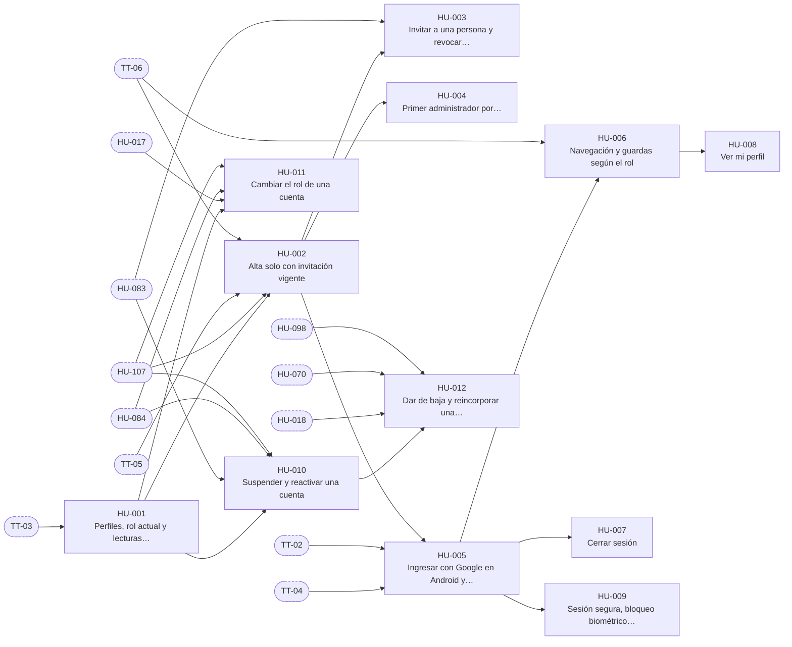

# E-02 · Identidad y acceso

| Campo | Valor |
|---|---|
| Objetivo | Que solo las personas invitadas de RiTech entren con su cuenta de Google, cada una con un rol, y que ese rol se haga cumplir en la base de datos durante todo el ciclo de vida de la cuenta. |
| Documentación fuente | docs/03 · docs/04 |
| Módulos (docs/17) | M-01, M-02 |
| Depende de | E-01 |
| Entregas en las que avanza | R1, R2, R6 |
| Etiquetas | `epica` · `E-02` |

## Capacidades

Tomadas de `docs/14` §2:

- Google Cloud (consentimiento, clientes)
- Ingreso nativo y web
- Invitaciones y primer admin
- Hooks y trigger de alta
- Perfiles, `rol_actual()`, RLS base
- Guardas de navegación
- Sesión segura y bloqueo biométrico
- Suspender, reactivar, baja, reincorporar
- Cambio de rol

## Historias de usuario

Cada historia tiene su narrativa, sus criterios de aceptación, sus tareas y sus relaciones en su propio archivo.

| ID | Historia | Rol | Entrega | Prioridad | Depende de |
|---|---|---|---|---|---|
| [HU-001](HU-001-perfiles-rol-actual-y-lecturas-por-rol.md) | Perfiles, rol actual y lecturas por rol | Administrador | R1 | Alta | [TT-03](../E-01-cimientos-y-calidad-continua/TT-03-base-de-supabase-esquema-private-extensiones-vault-y-ping.md) |
| [HU-002](HU-002-alta-solo-con-invitacion-vigente.md) | Alta solo con invitación vigente | Administrador | R1 | Alta | [HU-001](HU-001-perfiles-rol-actual-y-lecturas-por-rol.md), [HU-107](../E-12-seguridad-auditoria-y-cumplimiento/HU-107-bitacora-inmutable-con-cadena-de-hash.md), [TT-05](../E-01-cimientos-y-calidad-continua/TT-05-base-de-proveedores-simulados-reloj-controlable-y-datos-de-prueba.md), [TT-06](../E-01-cimientos-y-calidad-continua/TT-06-arnes-e2e-de-backend-y-de-la-app.md) |
| [HU-003](HU-003-invitar-a-una-persona-y-revocar-invitaciones.md) | Invitar a una persona y revocar invitaciones | Administrador | R1 | Alta | [HU-002](HU-002-alta-solo-con-invitacion-vigente.md), [HU-083](../E-09-tiempo-real-y-notificaciones/HU-083-canales-privados-de-tiempo-real.md) |
| [HU-004](HU-004-primer-administrador-por-configuracion-de-despliegue.md) | Primer administrador por configuración de despliegue | Administrador | R1 | Alta | [HU-002](HU-002-alta-solo-con-invitacion-vigente.md) |
| [HU-005](HU-005-ingresar-con-google-en-android-y-web.md) | Ingresar con Google en Android y web | Usuario | R1 | Alta | [TT-04](../E-01-cimientos-y-calidad-continua/TT-04-esqueleto-de-la-app-flutter-para-android-y-web.md), [TT-02](../E-01-cimientos-y-calidad-continua/TT-02-cuentas-conexiones-y-secretos-de-los-servicios-externos.md), [HU-002](HU-002-alta-solo-con-invitacion-vigente.md) |
| [HU-006](HU-006-navegacion-y-guardas-segun-el-rol.md) | Navegación y guardas según el rol | Usuario | R1 | Alta | [HU-005](HU-005-ingresar-con-google-en-android-y-web.md), [TT-06](../E-01-cimientos-y-calidad-continua/TT-06-arnes-e2e-de-backend-y-de-la-app.md) |
| [HU-007](HU-007-cerrar-sesion.md) | Cerrar sesión | Usuario | R1 | Media | [HU-005](HU-005-ingresar-con-google-en-android-y-web.md) |
| [HU-008](HU-008-ver-mi-perfil.md) | Ver mi perfil | Usuario | R1 | Baja | [HU-006](HU-006-navegacion-y-guardas-segun-el-rol.md) |
| [HU-009](HU-009-sesion-segura-bloqueo-biometrico-y-confirmacion-de-acciones-sensibles.md) | Sesión segura, bloqueo biométrico y confirmación de acciones sensibles | Usuario | R2 | Alta | [HU-005](HU-005-ingresar-con-google-en-android-y-web.md) |
| [HU-010](HU-010-suspender-y-reactivar-una-cuenta.md) | Suspender y reactivar una cuenta | Administrador | R2 | Alta | [HU-001](HU-001-perfiles-rol-actual-y-lecturas-por-rol.md), [HU-083](../E-09-tiempo-real-y-notificaciones/HU-083-canales-privados-de-tiempo-real.md), [HU-084](../E-09-tiempo-real-y-notificaciones/HU-084-gestor-de-tiempo-real-en-la-app.md), [HU-107](../E-12-seguridad-auditoria-y-cumplimiento/HU-107-bitacora-inmutable-con-cadena-de-hash.md) |
| [HU-011](HU-011-cambiar-el-rol-de-una-cuenta.md) | Cambiar el rol de una cuenta | Administrador | R2 | Media | [HU-001](HU-001-perfiles-rol-actual-y-lecturas-por-rol.md), [HU-017](../E-03-fondo-y-libro-contable/HU-017-cupo-al-aceptar-la-invitacion.md), [HU-084](../E-09-tiempo-real-y-notificaciones/HU-084-gestor-de-tiempo-real-en-la-app.md), [HU-107](../E-12-seguridad-auditoria-y-cumplimiento/HU-107-bitacora-inmutable-con-cadena-de-hash.md) |
| [HU-012](HU-012-dar-de-baja-y-reincorporar-una-cuenta.md) | Dar de baja y reincorporar una cuenta | Administrador | R6 | Media | [HU-010](HU-010-suspender-y-reactivar-una-cuenta.md), [HU-018](../E-03-fondo-y-libro-contable/HU-018-asignar-y-reducir-cupos.md), [HU-070](../E-07-sugerencias-y-decisiones/HU-070-aprobar-las-ventas-de-liquidacion.md), [HU-098](../E-11-administracion/HU-098-pantalla-de-usuarios-e-invitaciones.md) |

## Relaciones

Una flecha `A --> B` significa que B depende de A. Los nodos con borde punteado son ítems de otras épicas.

## Requisitos funcionales de la épica

| ID | Requisito | Rol o actor | Lo implementan |
|---|---|---|---|
| [FR-012](../requisitos-funcionales/FR-012-inicio-de-sesion-con-google.md) | Inicio de sesión con Google | Usuario, Analista y Administrador | [HU-005](HU-005-ingresar-con-google-en-android-y-web.md) |
| [FR-013](../requisitos-funcionales/FR-013-alta-solo-con-invitacion-vigente.md) | Alta solo con invitación vigente | Google Workspace y Sistema (hook de alta) | [HU-002](HU-002-alta-solo-con-invitacion-vigente.md) |
| [FR-014](../requisitos-funcionales/FR-014-perfil-activo-al-aceptar-la-invitacion.md) | Perfil activo al aceptar la invitación | Sistema | [HU-002](HU-002-alta-solo-con-invitacion-vigente.md) |
| [FR-015](../requisitos-funcionales/FR-015-invitacion-de-una-persona.md) | Invitación de una persona | Administrador | [HU-003](HU-003-invitar-a-una-persona-y-revocar-invitaciones.md) |
| [FR-016](../requisitos-funcionales/FR-016-revocacion-y-vencimiento-de-invitaciones.md) | Revocación y vencimiento de invitaciones | Administrador | [HU-003](HU-003-invitar-a-una-persona-y-revocar-invitaciones.md) |
| [FR-017](../requisitos-funcionales/FR-017-primer-administrador-por-configuracion-de-despliegue.md) | Primer administrador por configuración de despliegue | Sistema | [HU-004](HU-004-primer-administrador-por-configuracion-de-despliegue.md) |
| [FR-018](../requisitos-funcionales/FR-018-rol-y-estado-en-el-token-de-sesion.md) | Rol y estado en el token de sesión | Sistema | [HU-001](HU-001-perfiles-rol-actual-y-lecturas-por-rol.md) |
| [FR-019](../requisitos-funcionales/FR-019-autorizacion-por-perfil-activo.md) | Autorización por perfil activo | Sistema | [HU-001](HU-001-perfiles-rol-actual-y-lecturas-por-rol.md), [HU-003](HU-003-invitar-a-una-persona-y-revocar-invitaciones.md) |
| [FR-020](../requisitos-funcionales/FR-020-lecturas-filtradas-por-rol-y-dueno.md) | Lecturas filtradas por rol y dueño | Sistema | [HU-001](HU-001-perfiles-rol-actual-y-lecturas-por-rol.md), [HU-109](../E-12-seguridad-auditoria-y-cumplimiento/HU-109-aislamiento-verificado-por-tabla-y-por-funcion.md) |
| [FR-021](../requisitos-funcionales/FR-021-navegacion-segun-el-rol.md) | Navegación según el rol | Usuario, Analista y Administrador | [HU-006](HU-006-navegacion-y-guardas-segun-el-rol.md) |
| [FR-022](../requisitos-funcionales/FR-022-mensajes-de-error-de-ingreso.md) | Mensajes de error de ingreso | Usuario, Analista y Administrador | [HU-005](HU-005-ingresar-con-google-en-android-y-web.md) |
| [FR-023](../requisitos-funcionales/FR-023-cierre-de-sesion.md) | Cierre de sesión | Usuario, Analista y Administrador | [HU-007](HU-007-cerrar-sesion.md), [HU-087](../E-09-tiempo-real-y-notificaciones/HU-087-registrar-mi-dispositivo-para-push.md) |
| [FR-024](../requisitos-funcionales/FR-024-consulta-del-perfil-propio.md) | Consulta del perfil propio | Usuario, Analista y Administrador | [HU-008](HU-008-ver-mi-perfil.md) |
| [FR-025](../requisitos-funcionales/FR-025-sincronizacion-del-correo-cambiado-en-workspace.md) | Sincronización del correo cambiado en Workspace | Google Workspace y Sistema | [HU-002](HU-002-alta-solo-con-invitacion-vigente.md) |
| [FR-026](../requisitos-funcionales/FR-026-sesion-en-almacenamiento-seguro.md) | Sesión en almacenamiento seguro | Usuario, Analista y Administrador | [HU-009](HU-009-sesion-segura-bloqueo-biometrico-y-confirmacion-de-acciones-sensibles.md) |
| [FR-027](../requisitos-funcionales/FR-027-bloqueo-biometrico-de-la-app.md) | Bloqueo biométrico de la app | Usuario, Analista y Administrador | [HU-009](HU-009-sesion-segura-bloqueo-biometrico-y-confirmacion-de-acciones-sensibles.md) |
| [FR-028](../requisitos-funcionales/FR-028-confirmacion-de-acciones-sensibles.md) | Confirmación de acciones sensibles | Usuario, Analista y Administrador | [HU-009](HU-009-sesion-segura-bloqueo-biometrico-y-confirmacion-de-acciones-sensibles.md) |
| [FR-029](../requisitos-funcionales/FR-029-suspension-de-una-cuenta.md) | Suspensión de una cuenta | Administrador | [HU-010](HU-010-suspender-y-reactivar-una-cuenta.md), [HU-067](../E-07-sugerencias-y-decisiones/HU-067-invalidacion-por-precio-y-por-cambio-de-situacion.md), [HU-087](../E-09-tiempo-real-y-notificaciones/HU-087-registrar-mi-dispositivo-para-push.md) |
| [FR-030](../requisitos-funcionales/FR-030-cupo-congelado-durante-la-suspension.md) | Cupo congelado durante la suspensión | Sistema | [HU-010](HU-010-suspender-y-reactivar-una-cuenta.md), [HU-037](../E-05-motor-de-politicas-y-configuracion/HU-037-motor-de-politicas-reglas-de-la-propuesta.md), [HU-077](../E-08-ejecucion-y-broker/HU-077-proteccion-nativa-en-compras-de-acciones-enteras.md) |
| [FR-031](../requisitos-funcionales/FR-031-reactivacion-de-una-cuenta.md) | Reactivación de una cuenta | Administrador | [HU-010](HU-010-suspender-y-reactivar-una-cuenta.md) |
| [FR-032](../requisitos-funcionales/FR-032-proteccion-del-ultimo-administrador-y-de-la-accion-sobre-uno-mismo.md) | Protección del último administrador y de la acción sobre uno mismo | Administrador | [HU-010](HU-010-suspender-y-reactivar-una-cuenta.md), [HU-011](HU-011-cambiar-el-rol-de-una-cuenta.md), [HU-012](HU-012-dar-de-baja-y-reincorporar-una-cuenta.md) |
| [FR-033](../requisitos-funcionales/FR-033-cambio-de-rol.md) | Cambio de rol | Administrador | [HU-011](HU-011-cambiar-el-rol-de-una-cuenta.md) |
| [FR-034](../requisitos-funcionales/FR-034-navegacion-actualizada-al-cambiar-el-rol.md) | Navegación actualizada al cambiar el rol | Usuario, Analista y Administrador | [HU-011](HU-011-cambiar-el-rol-de-una-cuenta.md) |
| [FR-035](../requisitos-funcionales/FR-035-cierre-de-la-sesion-revocada.md) | Cierre de la sesión revocada | Usuario, Analista y Administrador | [HU-010](HU-010-suspender-y-reactivar-una-cuenta.md) |
| [FR-036](../requisitos-funcionales/FR-036-baja-de-una-cuenta.md) | Baja de una cuenta | Administrador | [HU-012](HU-012-dar-de-baja-y-reincorporar-una-cuenta.md) |
| [FR-037](../requisitos-funcionales/FR-037-reincorporacion-de-una-cuenta.md) | Reincorporación de una cuenta | Administrador | [HU-012](HU-012-dar-de-baja-y-reincorporar-una-cuenta.md) |
