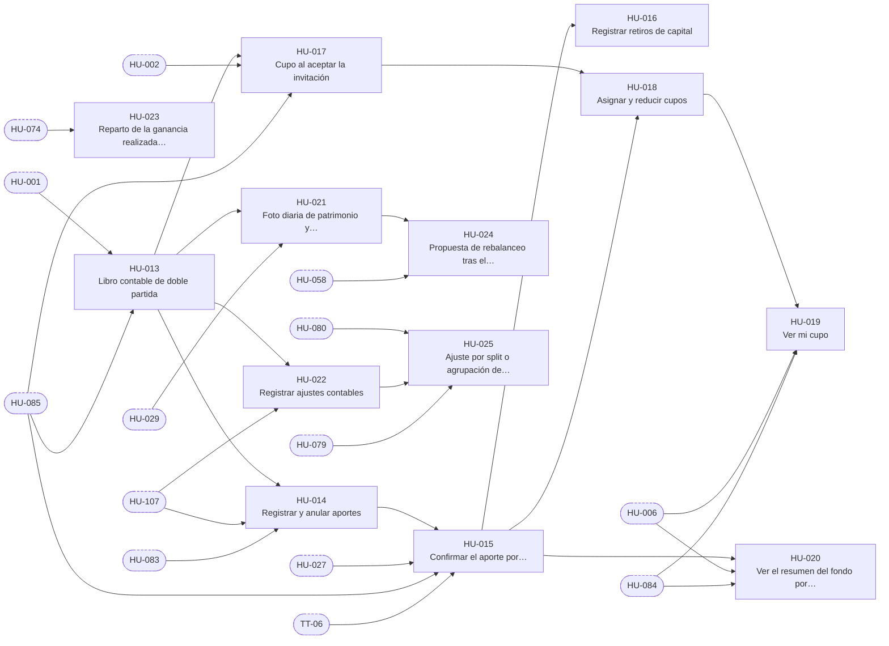

# E-03 · Fondo y libro contable

| Campo | Valor |
|---|---|
| Objetivo | Que el dinero del fondo se cuente en un solo lugar, con un libro de doble partida, y que aportes, retiros, cupos, repartos de ganancia y rebalanceos sigan las reglas del 50/25/25. |
| Documentación fuente | docs/02 · docs/06 §4 |
| Módulos (docs/17) | M-03, M-04, M-12, M-15 |
| Depende de | E-02 |
| Entregas en las que avanza | R2, R4, R6 |
| Etiquetas | `epica` · `E-03` |

## Capacidades

Tomadas de `docs/14` §2:

- Libro e invariantes
- Aportes (con confirmación por conciliación de efectivo) y retiros
- Cupos
- Reparto de ganancias
- Ajustes
- `resumen_fondo()`, `mi_cupo()`
- Fotos diarias y TWR
- Rebalanceo

## Historias de usuario

Cada historia tiene su narrativa, sus criterios de aceptación, sus tareas y sus relaciones en su propio archivo.

| ID | Historia | Rol | Entrega | Prioridad | Depende de |
|---|---|---|---|---|---|
| [HU-013](HU-013-libro-contable-de-doble-partida.md) | Libro contable de doble partida | Administrador | R2 | Alta | [HU-001](../E-02-identidad-y-acceso/HU-001-perfiles-rol-actual-y-lecturas-por-rol.md), [HU-085](../E-09-tiempo-real-y-notificaciones/HU-085-alertas-del-sistema-por-audiencia.md) |
| [HU-014](HU-014-registrar-y-anular-aportes.md) | Registrar y anular aportes | Administrador | R2 | Alta | [HU-013](HU-013-libro-contable-de-doble-partida.md), [HU-107](../E-12-seguridad-auditoria-y-cumplimiento/HU-107-bitacora-inmutable-con-cadena-de-hash.md), [HU-083](../E-09-tiempo-real-y-notificaciones/HU-083-canales-privados-de-tiempo-real.md) |
| [HU-015](HU-015-confirmar-el-aporte-por-conciliacion-y-repartirlo-50-25-25.md) | Confirmar el aporte por conciliación y repartirlo 50/25/25 | Administrador | R2 | Alta | [HU-014](HU-014-registrar-y-anular-aportes.md), [HU-027](../E-04-datos-de-mercado/HU-027-calendario-reloj-y-estado-del-mercado.md), [HU-085](../E-09-tiempo-real-y-notificaciones/HU-085-alertas-del-sistema-por-audiencia.md), [TT-06](../E-01-cimientos-y-calidad-continua/TT-06-arnes-e2e-de-backend-y-de-la-app.md) |
| [HU-016](HU-016-registrar-retiros-de-capital.md) | Registrar retiros de capital | Administrador | R2 | Media | [HU-015](HU-015-confirmar-el-aporte-por-conciliacion-y-repartirlo-50-25-25.md) |
| [HU-017](HU-017-cupo-al-aceptar-la-invitacion.md) | Cupo al aceptar la invitación | Usuario | R2 | Alta | [HU-013](HU-013-libro-contable-de-doble-partida.md), [HU-002](../E-02-identidad-y-acceso/HU-002-alta-solo-con-invitacion-vigente.md), [HU-085](../E-09-tiempo-real-y-notificaciones/HU-085-alertas-del-sistema-por-audiencia.md) |
| [HU-018](HU-018-asignar-y-reducir-cupos.md) | Asignar y reducir cupos | Administrador | R2 | Alta | [HU-017](HU-017-cupo-al-aceptar-la-invitacion.md), [HU-015](HU-015-confirmar-el-aporte-por-conciliacion-y-repartirlo-50-25-25.md) |
| [HU-019](HU-019-ver-mi-cupo.md) | Ver mi cupo | Usuario | R2 | Alta | [HU-018](HU-018-asignar-y-reducir-cupos.md), [HU-006](../E-02-identidad-y-acceso/HU-006-navegacion-y-guardas-segun-el-rol.md), [HU-084](../E-09-tiempo-real-y-notificaciones/HU-084-gestor-de-tiempo-real-en-la-app.md) |
| [HU-020](HU-020-ver-el-resumen-del-fondo-por-bolsillos.md) | Ver el resumen del fondo por bolsillos | Usuario | R2 | Alta | [HU-015](HU-015-confirmar-el-aporte-por-conciliacion-y-repartirlo-50-25-25.md), [HU-006](../E-02-identidad-y-acceso/HU-006-navegacion-y-guardas-segun-el-rol.md), [HU-084](../E-09-tiempo-real-y-notificaciones/HU-084-gestor-de-tiempo-real-en-la-app.md) |
| [HU-021](HU-021-foto-diaria-de-patrimonio-y-rendimiento-twr.md) | Foto diaria de patrimonio y rendimiento TWR | Administrador | R2 | Media | [HU-013](HU-013-libro-contable-de-doble-partida.md), [HU-029](../E-04-datos-de-mercado/HU-029-barra-diaria-tras-el-cierre-y-retencion-de-barras-de-minuto.md) |
| [HU-022](HU-022-registrar-ajustes-contables.md) | Registrar ajustes contables | Administrador | R2 | Baja | [HU-013](HU-013-libro-contable-de-doble-partida.md), [HU-107](../E-12-seguridad-auditoria-y-cumplimiento/HU-107-bitacora-inmutable-con-cadena-de-hash.md) |
| [HU-023](HU-023-reparto-de-la-ganancia-realizada-y-absorcion-de-perdidas.md) | Reparto de la ganancia realizada y absorción de pérdidas | Usuario | R4 | Alta | [HU-074](../E-08-ejecucion-y-broker/HU-074-sincronizar-ordenes-y-aplicar-llenados.md) |
| [HU-024](HU-024-propuesta-de-rebalanceo-tras-el-cierre.md) | Propuesta de rebalanceo tras el cierre | Administrador | R6 | Media | [HU-021](HU-021-foto-diaria-de-patrimonio-y-rendimiento-twr.md), [HU-058](../E-07-sugerencias-y-decisiones/HU-058-sugerencia-de-compra-para-arriesgadas.md) |
| [HU-025](HU-025-ajuste-por-split-o-agrupacion-de-acciones.md) | Ajuste por split o agrupación de acciones | Administrador | R6 | Baja | [HU-080](../E-08-ejecucion-y-broker/HU-080-conciliacion-completa-con-pausa-automatica.md), [HU-022](HU-022-registrar-ajustes-contables.md), [HU-079](../E-08-ejecucion-y-broker/HU-079-ajustar-el-stop-y-el-objetivo-de-una-posicion.md) |

## Relaciones

Una flecha `A --> B` significa que B depende de A. Los nodos con borde punteado son ítems de otras épicas.

## Requisitos funcionales de la épica

| ID | Requisito | Rol o actor | Lo implementan |
|---|---|---|---|
| [FR-038](../requisitos-funcionales/FR-038-fondo-unico-con-subcuentas.md) | Fondo único con subcuentas | Sistema | [HU-013](HU-013-libro-contable-de-doble-partida.md) |
| [FR-039](../requisitos-funcionales/FR-039-movimientos-de-doble-partida.md) | Movimientos de doble partida | Sistema | [HU-013](HU-013-libro-contable-de-doble-partida.md) |
| [FR-040](../requisitos-funcionales/FR-040-saldos-nunca-negativos.md) | Saldos nunca negativos | Sistema | [HU-013](HU-013-libro-contable-de-doble-partida.md) |
| [FR-041](../requisitos-funcionales/FR-041-libro-inmutable.md) | Libro inmutable | Sistema | [HU-013](HU-013-libro-contable-de-doble-partida.md) |
| [FR-042](../requisitos-funcionales/FR-042-verificacion-diaria-del-libro.md) | Verificación diaria del libro | Sistema | [HU-013](HU-013-libro-contable-de-doble-partida.md) |
| [FR-043](../requisitos-funcionales/FR-043-registro-de-un-aporte.md) | Registro de un aporte | Administrador | [HU-014](HU-014-registrar-y-anular-aportes.md) |
| [FR-044](../requisitos-funcionales/FR-044-anulacion-de-un-aporte-no-confirmado.md) | Anulación de un aporte no confirmado | Administrador | [HU-014](HU-014-registrar-y-anular-aportes.md) |
| [FR-045](../requisitos-funcionales/FR-045-confirmacion-del-aporte-por-conciliacion.md) | Confirmación del aporte por conciliación | Sistema (conciliación) y Broker (Alpaca paper) | [HU-015](HU-015-confirmar-el-aporte-por-conciliacion-y-repartirlo-50-25-25.md) |
| [FR-046](../requisitos-funcionales/FR-046-reparto-del-aporte-confirmado.md) | Reparto del aporte confirmado | Sistema | [HU-015](HU-015-confirmar-el-aporte-por-conciliacion-y-repartirlo-50-25-25.md) |
| [FR-047](../requisitos-funcionales/FR-047-fondo-sin-capital.md) | Fondo sin capital | Usuario, Analista y Administrador | [HU-019](HU-019-ver-mi-cupo.md), [HU-034](../E-05-motor-de-politicas-y-configuracion/HU-034-encender-y-apagar-los-interruptores-del-fondo.md) |
| [FR-048](../requisitos-funcionales/FR-048-registro-de-un-retiro.md) | Registro de un retiro | Administrador | [HU-016](HU-016-registrar-retiros-de-capital.md) |
| [FR-049](../requisitos-funcionales/FR-049-cupo-al-aceptar-la-invitacion.md) | Cupo al aceptar la invitación | Sistema | [HU-017](HU-017-cupo-al-aceptar-la-invitacion.md) |
| [FR-050](../requisitos-funcionales/FR-050-asignacion-de-cupo.md) | Asignación de cupo | Administrador | [HU-018](HU-018-asignar-y-reducir-cupos.md) |
| [FR-051](../requisitos-funcionales/FR-051-reduccion-de-cupo.md) | Reducción de cupo | Administrador | [HU-018](HU-018-asignar-y-reducir-cupos.md) |
| [FR-052](../requisitos-funcionales/FR-052-consulta-de-mi-cupo.md) | Consulta de mi cupo | Usuario | [HU-019](HU-019-ver-mi-cupo.md) |
| [FR-053](../requisitos-funcionales/FR-053-resumen-agregado-del-fondo.md) | Resumen agregado del fondo | Usuario, Analista y Administrador | [HU-020](HU-020-ver-el-resumen-del-fondo-por-bolsillos.md) |
| [FR-054](../requisitos-funcionales/FR-054-foto-diaria-de-patrimonio.md) | Foto diaria de patrimonio | Sistema | [HU-021](HU-021-foto-diaria-de-patrimonio-y-rendimiento-twr.md) |
| [FR-055](../requisitos-funcionales/FR-055-rendimiento-ponderado-en-el-tiempo.md) | Rendimiento ponderado en el tiempo | Sistema | [HU-021](HU-021-foto-diaria-de-patrimonio-y-rendimiento-twr.md) |
| [FR-056](../requisitos-funcionales/FR-056-ajuste-contable.md) | Ajuste contable | Administrador | [HU-022](HU-022-registrar-ajustes-contables.md) |
| [FR-057](../requisitos-funcionales/FR-057-reparto-de-la-ganancia-realizada.md) | Reparto de la ganancia realizada | Sistema | [HU-023](HU-023-reparto-de-la-ganancia-realizada-y-absorcion-de-perdidas.md) |
| [FR-058](../requisitos-funcionales/FR-058-costo-y-perdida-de-una-venta.md) | Costo y pérdida de una venta | Sistema | [HU-023](HU-023-reparto-de-la-ganancia-realizada-y-absorcion-de-perdidas.md) |
| [FR-059](../requisitos-funcionales/FR-059-propuesta-de-rebalanceo.md) | Propuesta de rebalanceo | Sistema | [HU-024](HU-024-propuesta-de-rebalanceo-tras-el-cierre.md) |
| [FR-060](../requisitos-funcionales/FR-060-ajuste-por-evento-corporativo.md) | Ajuste por evento corporativo | Administrador | [HU-025](HU-025-ajuste-por-split-o-agrupacion-de-acciones.md) |
