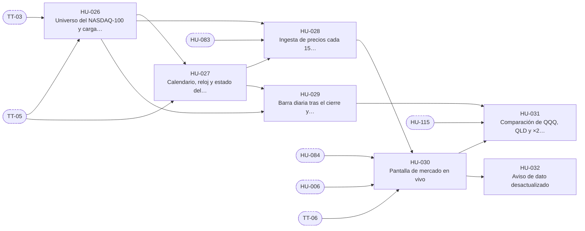

# E-04 · Datos de mercado

| Campo | Valor |
|---|---|
| Objetivo | Que todas las personas vean el NASDAQ-100 y sus ETFs moverse casi en tiempo real, con el estado del mercado, y que el resto del sistema tenga precios, barras y calendario confiables. |
| Documentación fuente | docs/09 §2 · docs/10 |
| Módulos (docs/17) | M-05 |
| Depende de | E-01 |
| Entregas en las que avanza | R1 |
| Etiquetas | `epica` · `E-04` |

## Capacidades

Tomadas de `docs/14` §2:

- Universo NASDAQ-100 (semilla, sectores, carga de 2 años de barras)
- Ingesta cada 15 s
- Calendario y reloj
- Atributos de activos
- `estado_mercado()`
- Pantalla de mercado (QQQ vs QLD vs ×2 teórico, universo)
- Dato desactualizado

## Historias de usuario

Cada historia tiene su narrativa, sus criterios de aceptación, sus tareas y sus relaciones en su propio archivo.

| ID | Historia | Rol | Entrega | Prioridad | Depende de |
|---|---|---|---|---|---|
| [HU-026](HU-026-universo-del-nasdaq-100-y-carga-historica-de-barras.md) | Universo del NASDAQ-100 y carga histórica de barras | Analista | R1 | Alta | [TT-03](../E-01-cimientos-y-calidad-continua/TT-03-base-de-supabase-esquema-private-extensiones-vault-y-ping.md), [TT-05](../E-01-cimientos-y-calidad-continua/TT-05-base-de-proveedores-simulados-reloj-controlable-y-datos-de-prueba.md) |
| [HU-027](HU-027-calendario-reloj-y-estado-del-mercado.md) | Calendario, reloj y estado del mercado | Usuario | R1 | Alta | [HU-026](HU-026-universo-del-nasdaq-100-y-carga-historica-de-barras.md), [TT-05](../E-01-cimientos-y-calidad-continua/TT-05-base-de-proveedores-simulados-reloj-controlable-y-datos-de-prueba.md) |
| [HU-028](HU-028-ingesta-de-precios-cada-15-segundos.md) | Ingesta de precios cada 15 segundos | Usuario | R1 | Alta | [HU-026](HU-026-universo-del-nasdaq-100-y-carga-historica-de-barras.md), [HU-027](HU-027-calendario-reloj-y-estado-del-mercado.md), [HU-083](../E-09-tiempo-real-y-notificaciones/HU-083-canales-privados-de-tiempo-real.md) |
| [HU-029](HU-029-barra-diaria-tras-el-cierre-y-retencion-de-barras-de-minuto.md) | Barra diaria tras el cierre y retención de barras de minuto | Analista | R1 | Media | [HU-026](HU-026-universo-del-nasdaq-100-y-carga-historica-de-barras.md), [HU-027](HU-027-calendario-reloj-y-estado-del-mercado.md) |
| [HU-030](HU-030-pantalla-de-mercado-en-vivo.md) | Pantalla de mercado en vivo | Usuario | R1 | Alta | [HU-028](HU-028-ingesta-de-precios-cada-15-segundos.md), [HU-084](../E-09-tiempo-real-y-notificaciones/HU-084-gestor-de-tiempo-real-en-la-app.md), [HU-006](../E-02-identidad-y-acceso/HU-006-navegacion-y-guardas-segun-el-rol.md), [TT-06](../E-01-cimientos-y-calidad-continua/TT-06-arnes-e2e-de-backend-y-de-la-app.md) |
| [HU-031](HU-031-comparacion-de-qqq-qld-y-x2-teorico.md) | Comparación de QQQ, QLD y ×2 teórico | Usuario | R1 | Media | [HU-030](HU-030-pantalla-de-mercado-en-vivo.md), [HU-029](HU-029-barra-diaria-tras-el-cierre-y-retencion-de-barras-de-minuto.md), [HU-115](../E-13-transicion-desde-la-v2/HU-115-motor-x2-teorico-de-la-v2-con-sus-pruebas.md) |
| [HU-032](HU-032-aviso-de-dato-desactualizado.md) | Aviso de dato desactualizado | Usuario | R1 | Alta | [HU-030](HU-030-pantalla-de-mercado-en-vivo.md) |

## Relaciones

Una flecha `A --> B` significa que B depende de A. Los nodos con borde punteado son ítems de otras épicas.

## Requisitos funcionales de la épica

| ID | Requisito | Rol o actor | Lo implementan |
|---|---|---|---|
| [FR-061](../requisitos-funcionales/FR-061-universo-de-simbolos.md) | Universo de símbolos | Sistema | [HU-026](HU-026-universo-del-nasdaq-100-y-carga-historica-de-barras.md) |
| [FR-062](../requisitos-funcionales/FR-062-carga-historica-de-barras.md) | Carga histórica de barras | Sistema y Datos de mercado (Alpaca) | [HU-026](HU-026-universo-del-nasdaq-100-y-carga-historica-de-barras.md) |
| [FR-063](../requisitos-funcionales/FR-063-calendario-y-reloj-de-mercado.md) | Calendario y reloj de mercado | Sistema y Broker (Alpaca) | [HU-027](HU-027-calendario-reloj-y-estado-del-mercado.md) |
| [FR-064](../requisitos-funcionales/FR-064-estado-del-mercado.md) | Estado del mercado | Usuario, Analista y Administrador | [HU-027](HU-027-calendario-reloj-y-estado-del-mercado.md) |
| [FR-065](../requisitos-funcionales/FR-065-atributos-de-los-activos.md) | Atributos de los activos | Sistema y Broker (Alpaca) | [HU-027](HU-027-calendario-reloj-y-estado-del-mercado.md), [HU-085](../E-09-tiempo-real-y-notificaciones/HU-085-alertas-del-sistema-por-audiencia.md) |
| [FR-066](../requisitos-funcionales/FR-066-ingesta-de-precios.md) | Ingesta de precios | Sistema y Datos de mercado (Alpaca) | [HU-028](HU-028-ingesta-de-precios-cada-15-segundos.md) |
| [FR-067](../requisitos-funcionales/FR-067-descarte-de-precios-invalidos.md) | Descarte de precios inválidos | Sistema | [HU-028](HU-028-ingesta-de-precios-cada-15-segundos.md) |
| [FR-068](../requisitos-funcionales/FR-068-sin-consulta-fuera-de-horario.md) | Sin consulta fuera de horario | Sistema | [HU-028](HU-028-ingesta-de-precios-cada-15-segundos.md) |
| [FR-069](../requisitos-funcionales/FR-069-difusion-de-precios-en-vivo.md) | Difusión de precios en vivo | Sistema | [HU-028](HU-028-ingesta-de-precios-cada-15-segundos.md) |
| [FR-070](../requisitos-funcionales/FR-070-barras-diarias-y-de-minuto.md) | Barras diarias y de minuto | Sistema | [HU-029](HU-029-barra-diaria-tras-el-cierre-y-retencion-de-barras-de-minuto.md) |
| [FR-071](../requisitos-funcionales/FR-071-pantalla-de-mercado.md) | Pantalla de mercado | Usuario, Analista y Administrador | [HU-030](HU-030-pantalla-de-mercado-en-vivo.md) |
| [FR-072](../requisitos-funcionales/FR-072-consulta-de-la-lista-blanca.md) | Consulta de la lista blanca | Usuario, Analista y Administrador | [HU-030](HU-030-pantalla-de-mercado-en-vivo.md) |
| [FR-073](../requisitos-funcionales/FR-073-comparacion-qqq-qld-y-x2-teorico.md) | Comparación QQQ, QLD y ×2 teórico | Usuario, Analista y Administrador | [HU-031](HU-031-comparacion-de-qqq-qld-y-x2-teorico.md) |
| [FR-074](../requisitos-funcionales/FR-074-advertencia-sobre-el-etf-apalancado.md) | Advertencia sobre el ETF apalancado | Usuario, Analista y Administrador | [HU-031](HU-031-comparacion-de-qqq-qld-y-x2-teorico.md) |
| [FR-075](../requisitos-funcionales/FR-075-dato-desactualizado.md) | Dato desactualizado | Usuario, Analista y Administrador | [HU-032](HU-032-aviso-de-dato-desactualizado.md) |
