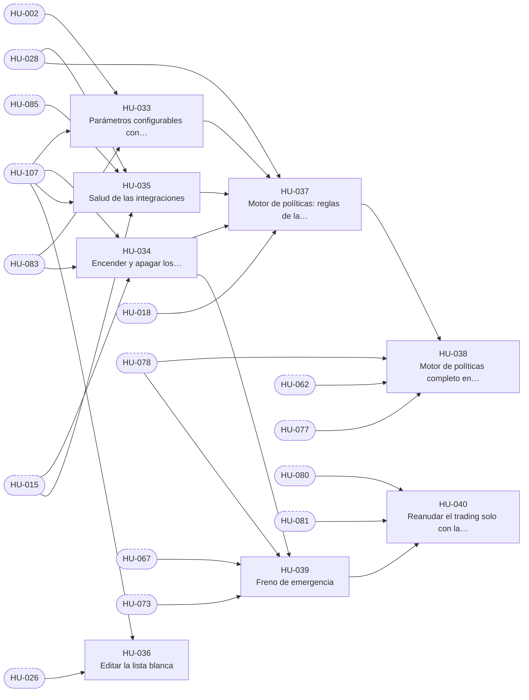

# E-05 · Motor de políticas y configuración

| Campo | Valor |
|---|---|
| Objetivo | Que toda operación pase por las mismas reglas de riesgo deterministas y que el Administrador gobierne parámetros, lista blanca e interruptores sin desplegar código. |
| Documentación fuente | docs/02 §9 · docs/02 §10 · docs/08 §6 |
| Módulos (docs/17) | M-08, M-18 |
| Depende de | E-03, E-04 |
| Entregas en las que avanza | R2, R3, R4, R5 |
| Etiquetas | `epica` · `E-05` |

## Capacidades

Tomadas de `docs/14` §2:

- `validar_operacion` (RR-01 a RR-22)
- Parámetros con historial
- Lista blanca
- Interruptores y freno
- Salud de integraciones

## Historias de usuario

Cada historia tiene su narrativa, sus criterios de aceptación, sus tareas y sus relaciones en su propio archivo.

| ID | Historia | Rol | Entrega | Prioridad | Depende de |
|---|---|---|---|---|---|
| [HU-033](HU-033-parametros-configurables-con-rango-e-historial.md) | Parámetros configurables con rango e historial | Administrador | R2 | Alta | [HU-002](../E-02-identidad-y-acceso/HU-002-alta-solo-con-invitacion-vigente.md), [HU-107](../E-12-seguridad-auditoria-y-cumplimiento/HU-107-bitacora-inmutable-con-cadena-de-hash.md), [HU-083](../E-09-tiempo-real-y-notificaciones/HU-083-canales-privados-de-tiempo-real.md) |
| [HU-034](HU-034-encender-y-apagar-los-interruptores-del-fondo.md) | Encender y apagar los interruptores del fondo | Administrador | R2 | Alta | [HU-015](../E-03-fondo-y-libro-contable/HU-015-confirmar-el-aporte-por-conciliacion-y-repartirlo-50-25-25.md), [HU-107](../E-12-seguridad-auditoria-y-cumplimiento/HU-107-bitacora-inmutable-con-cadena-de-hash.md), [HU-083](../E-09-tiempo-real-y-notificaciones/HU-083-canales-privados-de-tiempo-real.md) |
| [HU-035](HU-035-salud-de-las-integraciones.md) | Salud de las integraciones | Administrador | R3 | Alta | [HU-028](../E-04-datos-de-mercado/HU-028-ingesta-de-precios-cada-15-segundos.md), [HU-015](../E-03-fondo-y-libro-contable/HU-015-confirmar-el-aporte-por-conciliacion-y-repartirlo-50-25-25.md), [HU-085](../E-09-tiempo-real-y-notificaciones/HU-085-alertas-del-sistema-por-audiencia.md), [HU-107](../E-12-seguridad-auditoria-y-cumplimiento/HU-107-bitacora-inmutable-con-cadena-de-hash.md) |
| [HU-036](HU-036-editar-la-lista-blanca.md) | Editar la lista blanca | Administrador | R3 | Media | [HU-026](../E-04-datos-de-mercado/HU-026-universo-del-nasdaq-100-y-carga-historica-de-barras.md), [HU-107](../E-12-seguridad-auditoria-y-cumplimiento/HU-107-bitacora-inmutable-con-cadena-de-hash.md) |
| [HU-037](HU-037-motor-de-politicas-reglas-de-la-propuesta.md) | Motor de políticas: reglas de la propuesta | Analista | R3 | Alta | [HU-033](HU-033-parametros-configurables-con-rango-e-historial.md), [HU-034](HU-034-encender-y-apagar-los-interruptores-del-fondo.md), [HU-035](HU-035-salud-de-las-integraciones.md), [HU-028](../E-04-datos-de-mercado/HU-028-ingesta-de-precios-cada-15-segundos.md), [HU-018](../E-03-fondo-y-libro-contable/HU-018-asignar-y-reducir-cupos.md) |
| [HU-038](HU-038-motor-de-politicas-completo-en-los-cuatro-momentos.md) | Motor de políticas completo en los cuatro momentos | Analista | R4 | Alta | [HU-037](HU-037-motor-de-politicas-reglas-de-la-propuesta.md), [HU-062](../E-07-sugerencias-y-decisiones/HU-062-aprobar-una-sugerencia-de-mi-cupo.md), [HU-077](../E-08-ejecucion-y-broker/HU-077-proteccion-nativa-en-compras-de-acciones-enteras.md), [HU-078](../E-08-ejecucion-y-broker/HU-078-proteccion-virtual-en-compras-fraccionales.md) |
| [HU-039](HU-039-freno-de-emergencia.md) | Freno de emergencia | Analista | R5 | Alta | [HU-034](HU-034-encender-y-apagar-los-interruptores-del-fondo.md), [HU-067](../E-07-sugerencias-y-decisiones/HU-067-invalidacion-por-precio-y-por-cambio-de-situacion.md), [HU-073](../E-08-ejecucion-y-broker/HU-073-enviar-al-broker-las-ordenes-aprobadas.md), [HU-078](../E-08-ejecucion-y-broker/HU-078-proteccion-virtual-en-compras-fraccionales.md) |
| [HU-040](HU-040-reanudar-el-trading-solo-con-la-conciliacion-en-ok.md) | Reanudar el trading solo con la conciliación en ok | Administrador | R5 | Alta | [HU-039](HU-039-freno-de-emergencia.md), [HU-080](../E-08-ejecucion-y-broker/HU-080-conciliacion-completa-con-pausa-automatica.md), [HU-081](../E-08-ejecucion-y-broker/HU-081-revisar-un-descuadre-y-lanzar-una-conciliacion.md) |

## Relaciones

Una flecha `A --> B` significa que B depende de A. Los nodos con borde punteado son ítems de otras épicas.

## Requisitos funcionales de la épica

| ID | Requisito | Rol o actor | Lo implementan |
|---|---|---|---|
| [FR-076](../requisitos-funcionales/FR-076-cambio-de-un-parametro.md) | Cambio de un parámetro | Administrador | [HU-033](HU-033-parametros-configurables-con-rango-e-historial.md) |
| [FR-077](../requisitos-funcionales/FR-077-porcentajes-de-reparto-consistentes.md) | Porcentajes de reparto consistentes | Administrador | [HU-033](HU-033-parametros-configurables-con-rango-e-historial.md) |
| [FR-078](../requisitos-funcionales/FR-078-consulta-de-parametros-vigentes.md) | Consulta de parámetros vigentes | Usuario, Analista y Administrador | [HU-033](HU-033-parametros-configurables-con-rango-e-historial.md) |
| [FR-079](../requisitos-funcionales/FR-079-interruptores-del-fondo.md) | Interruptores del fondo | Sistema | [HU-034](HU-034-encender-y-apagar-los-interruptores-del-fondo.md) |
| [FR-080](../requisitos-funcionales/FR-080-encendido-de-un-interruptor.md) | Encendido de un interruptor | Administrador | [HU-034](HU-034-encender-y-apagar-los-interruptores-del-fondo.md), [HU-040](HU-040-reanudar-el-trading-solo-con-la-conciliacion-en-ok.md) |
| [FR-081](../requisitos-funcionales/FR-081-salud-de-las-integraciones.md) | Salud de las integraciones | Sistema | [HU-035](HU-035-salud-de-las-integraciones.md) |
| [FR-082](../requisitos-funcionales/FR-082-alerta-por-integracion-caida.md) | Alerta por integración caída | Sistema | [HU-035](HU-035-salud-de-las-integraciones.md) |
| [FR-083](../requisitos-funcionales/FR-083-consulta-de-la-salud.md) | Consulta de la salud | Analista y Administrador | [HU-035](HU-035-salud-de-las-integraciones.md) |
| [FR-084](../requisitos-funcionales/FR-084-edicion-de-la-lista-blanca.md) | Edición de la lista blanca | Administrador | [HU-036](HU-036-editar-la-lista-blanca.md) |
| [FR-085](../requisitos-funcionales/FR-085-motor-de-politicas-unico.md) | Motor de políticas único | Sistema | [HU-037](HU-037-motor-de-politicas-reglas-de-la-propuesta.md), [HU-038](HU-038-motor-de-politicas-completo-en-los-cuatro-momentos.md) |
| [FR-086](../requisitos-funcionales/FR-086-reglas-de-riesgo-de-las-compras.md) | Reglas de riesgo de las compras | Sistema | [HU-037](HU-037-motor-de-politicas-reglas-de-la-propuesta.md) |
| [FR-087](../requisitos-funcionales/FR-087-reglas-de-riesgo-generales.md) | Reglas de riesgo generales | Sistema | [HU-037](HU-037-motor-de-politicas-reglas-de-la-propuesta.md) |
| [FR-088](../requisitos-funcionales/FR-088-reglas-de-horario-precio-y-salud.md) | Reglas de horario, precio y salud | Sistema | [HU-037](HU-037-motor-de-politicas-reglas-de-la-propuesta.md) |
| [FR-089](../requisitos-funcionales/FR-089-confianza-minima-de-las-sugerencias-de-la-ia.md) | Confianza mínima de las sugerencias de la IA | Sistema | [HU-037](HU-037-motor-de-politicas-reglas-de-la-propuesta.md) |
| [FR-090](../requisitos-funcionales/FR-090-registro-de-la-regla-violada.md) | Registro de la regla violada | Sistema | [HU-037](HU-037-motor-de-politicas-reglas-de-la-propuesta.md) |
| [FR-091](../requisitos-funcionales/FR-091-reglas-que-dependen-de-lo-ya-operado.md) | Reglas que dependen de lo ya operado | Sistema | [HU-038](HU-038-motor-de-politicas-completo-en-los-cuatro-momentos.md) |
| [FR-092](../requisitos-funcionales/FR-092-copia-congelada-de-parametros.md) | Copia congelada de parámetros | Sistema | [HU-038](HU-038-motor-de-politicas-completo-en-los-cuatro-momentos.md), [HU-058](../E-07-sugerencias-y-decisiones/HU-058-sugerencia-de-compra-para-arriesgadas.md), [HU-059](../E-07-sugerencias-y-decisiones/HU-059-reparto-de-una-senal-de-usuarios-en-sugerencias-por-cupo.md), [HU-075](../E-08-ejecucion-y-broker/HU-075-crear-una-orden-manual-en-mi-cupo.md) |
| [FR-093](../requisitos-funcionales/FR-093-freno-de-emergencia.md) | Freno de emergencia | Analista y Administrador | [HU-039](HU-039-freno-de-emergencia.md) |
| [FR-094](../requisitos-funcionales/FR-094-efectos-de-apagar-los-interruptores.md) | Efectos de apagar los interruptores | Sistema | [HU-039](HU-039-freno-de-emergencia.md) |
| [FR-095](../requisitos-funcionales/FR-095-reanudacion-de-la-operacion.md) | Reanudación de la operación | Administrador | [HU-040](HU-040-reanudar-el-trading-solo-con-la-conciliacion-en-ok.md) |
