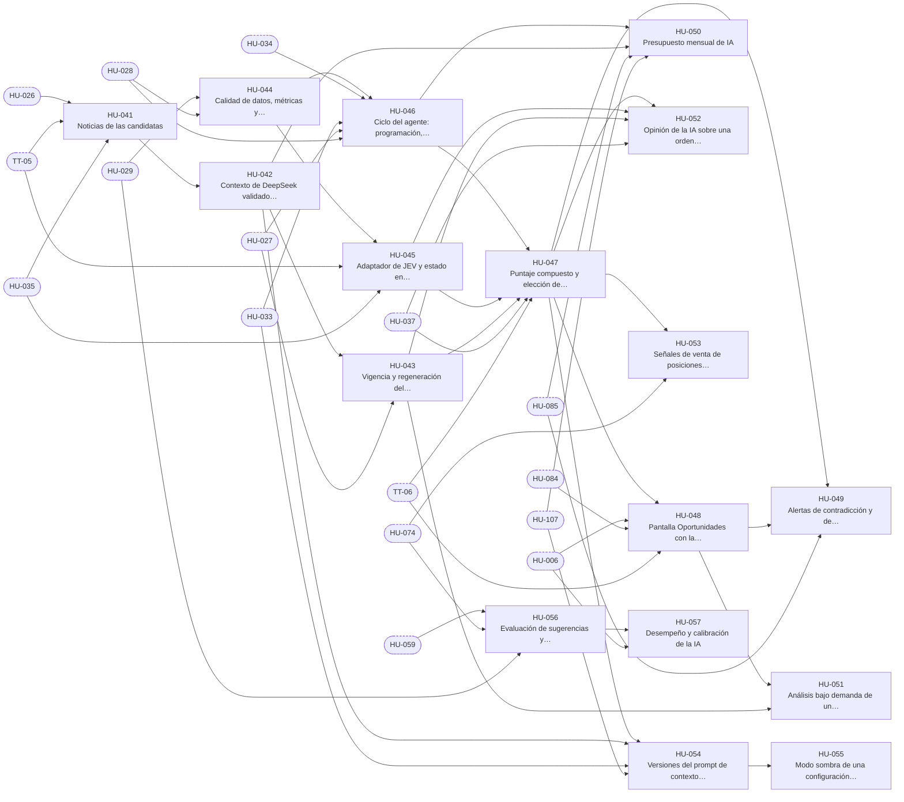

# E-06 · IA: contexto y decisión

| Campo | Valor |
|---|---|
| Objetivo | Que la IA principal recopile y verifique los datos, DeepSeek explique el contexto con noticias reales y JEV decida con confianza calibrada, y que cada evaluación quede explicada y medida. |
| Documentación fuente | docs/07 |
| Módulos (docs/17) | M-06, M-07 |
| Depende de | E-04, E-05 |
| Entregas en las que avanza | R3, R4, R6 |
| Etiquetas | `epica` · `E-06` |

## Capacidades

Tomadas de `docs/14` §2:

- Noticias (Alpaca News)
- Contexto con DeepSeek y su validación
- Métricas, etiquetas y calidad de datos
- Adaptador JEV (TypeSafe / Cloudflare / simulado)
- Preguntas, puntaje compuesto y reglas
- Configuración versionada y modo sombra
- Pantalla Oportunidades
- Alertas de contradicción
- Opinión sobre órdenes manuales
- Análisis bajo demanda
- Presupuesto
- Evaluación y calibración

## Historias de usuario

Cada historia tiene su narrativa, sus criterios de aceptación, sus tareas y sus relaciones en su propio archivo.

| ID | Historia | Rol | Entrega | Prioridad | Depende de |
|---|---|---|---|---|---|
| [HU-041](HU-041-noticias-de-las-candidatas.md) | Noticias de las candidatas | Analista | R3 | Alta | [HU-026](../E-04-datos-de-mercado/HU-026-universo-del-nasdaq-100-y-carga-historica-de-barras.md), [TT-05](../E-01-cimientos-y-calidad-continua/TT-05-base-de-proveedores-simulados-reloj-controlable-y-datos-de-prueba.md), [HU-035](../E-05-motor-de-politicas-y-configuracion/HU-035-salud-de-las-integraciones.md) |
| [HU-042](HU-042-contexto-de-deepseek-validado-contra-sus-fuentes.md) | Contexto de DeepSeek validado contra sus fuentes | Analista | R3 | Alta | [HU-041](HU-041-noticias-de-las-candidatas.md) |
| [HU-043](HU-043-vigencia-y-regeneracion-del-contexto.md) | Vigencia y regeneración del contexto | Analista | R3 | Alta | [HU-042](HU-042-contexto-de-deepseek-validado-contra-sus-fuentes.md), [HU-027](../E-04-datos-de-mercado/HU-027-calendario-reloj-y-estado-del-mercado.md) |
| [HU-044](HU-044-calidad-de-datos-metricas-y-puntaje-cuantitativo.md) | Calidad de datos, métricas y puntaje cuantitativo | Analista | R3 | Alta | [HU-029](../E-04-datos-de-mercado/HU-029-barra-diaria-tras-el-cierre-y-retencion-de-barras-de-minuto.md), [HU-028](../E-04-datos-de-mercado/HU-028-ingesta-de-precios-cada-15-segundos.md) |
| [HU-045](HU-045-adaptador-de-jev-y-estado-en-etiquetas.md) | Adaptador de JEV y estado en etiquetas | Analista | R3 | Alta | [HU-044](HU-044-calidad-de-datos-metricas-y-puntaje-cuantitativo.md), [TT-05](../E-01-cimientos-y-calidad-continua/TT-05-base-de-proveedores-simulados-reloj-controlable-y-datos-de-prueba.md), [HU-035](../E-05-motor-de-politicas-y-configuracion/HU-035-salud-de-las-integraciones.md) |
| [HU-046](HU-046-ciclo-del-agente-programacion-uno-a-la-vez-y-omisiones.md) | Ciclo del agente: programación, uno a la vez y omisiones | Analista | R3 | Alta | [HU-044](HU-044-calidad-de-datos-metricas-y-puntaje-cuantitativo.md), [HU-034](../E-05-motor-de-politicas-y-configuracion/HU-034-encender-y-apagar-los-interruptores-del-fondo.md), [HU-033](../E-05-motor-de-politicas-y-configuracion/HU-033-parametros-configurables-con-rango-e-historial.md), [HU-027](../E-04-datos-de-mercado/HU-027-calendario-reloj-y-estado-del-mercado.md), [HU-028](../E-04-datos-de-mercado/HU-028-ingesta-de-precios-cada-15-segundos.md) |
| [HU-047](HU-047-puntaje-compuesto-y-eleccion-de-la-mejor-opcion.md) | Puntaje compuesto y elección de la mejor opción | Analista | R3 | Alta | [HU-046](HU-046-ciclo-del-agente-programacion-uno-a-la-vez-y-omisiones.md), [HU-045](HU-045-adaptador-de-jev-y-estado-en-etiquetas.md), [HU-043](HU-043-vigencia-y-regeneracion-del-contexto.md), [HU-037](../E-05-motor-de-politicas-y-configuracion/HU-037-motor-de-politicas-reglas-de-la-propuesta.md), [TT-06](../E-01-cimientos-y-calidad-continua/TT-06-arnes-e2e-de-backend-y-de-la-app.md) |
| [HU-048](HU-048-pantalla-oportunidades-con-la-explicacion-de-cada-evaluacion.md) | Pantalla Oportunidades con la explicación de cada evaluación | Usuario | R3 | Alta | [HU-047](HU-047-puntaje-compuesto-y-eleccion-de-la-mejor-opcion.md), [HU-006](../E-02-identidad-y-acceso/HU-006-navegacion-y-guardas-segun-el-rol.md), [HU-084](../E-09-tiempo-real-y-notificaciones/HU-084-gestor-de-tiempo-real-en-la-app.md), [TT-06](../E-01-cimientos-y-calidad-continua/TT-06-arnes-e2e-de-backend-y-de-la-app.md) |
| [HU-049](HU-049-alertas-de-contradiccion-y-de-mercado.md) | Alertas de contradicción y de mercado | Analista | R3 | Media | [HU-047](HU-047-puntaje-compuesto-y-eleccion-de-la-mejor-opcion.md), [HU-048](HU-048-pantalla-oportunidades-con-la-explicacion-de-cada-evaluacion.md), [HU-085](../E-09-tiempo-real-y-notificaciones/HU-085-alertas-del-sistema-por-audiencia.md) |
| [HU-050](HU-050-presupuesto-mensual-de-ia.md) | Presupuesto mensual de IA | Administrador | R3 | Media | [HU-046](HU-046-ciclo-del-agente-programacion-uno-a-la-vez-y-omisiones.md), [HU-042](HU-042-contexto-de-deepseek-validado-contra-sus-fuentes.md), [HU-085](../E-09-tiempo-real-y-notificaciones/HU-085-alertas-del-sistema-por-audiencia.md), [HU-107](../E-12-seguridad-auditoria-y-cumplimiento/HU-107-bitacora-inmutable-con-cadena-de-hash.md) |
| [HU-051](HU-051-analisis-bajo-demanda-de-un-simbolo.md) | Análisis bajo demanda de un símbolo | Analista | R3 | Media | [HU-048](HU-048-pantalla-oportunidades-con-la-explicacion-de-cada-evaluacion.md), [HU-043](HU-043-vigencia-y-regeneracion-del-contexto.md) |
| [HU-052](HU-052-opinion-de-la-ia-sobre-una-orden-manual.md) | Opinión de la IA sobre una orden manual | Usuario | R4 | Alta | [HU-047](HU-047-puntaje-compuesto-y-eleccion-de-la-mejor-opcion.md), [HU-045](HU-045-adaptador-de-jev-y-estado-en-etiquetas.md), [HU-043](HU-043-vigencia-y-regeneracion-del-contexto.md), [HU-037](../E-05-motor-de-politicas-y-configuracion/HU-037-motor-de-politicas-reglas-de-la-propuesta.md) |
| [HU-053](HU-053-senales-de-venta-de-posiciones-abiertas.md) | Señales de venta de posiciones abiertas | Analista | R4 | Alta | [HU-047](HU-047-puntaje-compuesto-y-eleccion-de-la-mejor-opcion.md), [HU-074](../E-08-ejecucion-y-broker/HU-074-sincronizar-ordenes-y-aplicar-llenados.md) |
| [HU-054](HU-054-versiones-del-prompt-de-contexto-y-de-la-configuracion-de-decision.md) | Versiones del prompt de contexto y de la configuración de decisión | Administrador | R6 | Media | [HU-047](HU-047-puntaje-compuesto-y-eleccion-de-la-mejor-opcion.md), [HU-042](HU-042-contexto-de-deepseek-validado-contra-sus-fuentes.md), [HU-033](../E-05-motor-de-politicas-y-configuracion/HU-033-parametros-configurables-con-rango-e-historial.md), [HU-107](../E-12-seguridad-auditoria-y-cumplimiento/HU-107-bitacora-inmutable-con-cadena-de-hash.md) |
| [HU-055](HU-055-modo-sombra-de-una-configuracion-candidata.md) | Modo sombra de una configuración candidata | Administrador | R6 | Media | [HU-054](HU-054-versiones-del-prompt-de-contexto-y-de-la-configuracion-de-decision.md) |
| [HU-056](HU-056-evaluacion-de-sugerencias-y-candidatas-tras-el-cierre.md) | Evaluación de sugerencias y candidatas tras el cierre | Analista | R6 | Alta | [HU-059](../E-07-sugerencias-y-decisiones/HU-059-reparto-de-una-senal-de-usuarios-en-sugerencias-por-cupo.md), [HU-074](../E-08-ejecucion-y-broker/HU-074-sincronizar-ordenes-y-aplicar-llenados.md), [HU-029](../E-04-datos-de-mercado/HU-029-barra-diaria-tras-el-cierre-y-retencion-de-barras-de-minuto.md) |
| [HU-057](HU-057-desempeno-y-calibracion-de-la-ia.md) | Desempeño y calibración de la IA | Analista | R6 | Alta | [HU-056](HU-056-evaluacion-de-sugerencias-y-candidatas-tras-el-cierre.md), [HU-006](../E-02-identidad-y-acceso/HU-006-navegacion-y-guardas-segun-el-rol.md) |

## Relaciones

Una flecha `A --> B` significa que B depende de A. Los nodos con borde punteado son ítems de otras épicas.

## Requisitos funcionales de la épica

| ID | Requisito | Rol o actor | Lo implementan |
|---|---|---|---|
| [FR-096](../requisitos-funcionales/FR-096-descarga-de-noticias.md) | Descarga de noticias | Sistema y Noticias (Alpaca News) | [HU-041](HU-041-noticias-de-las-candidatas.md) |
| [FR-097](../requisitos-funcionales/FR-097-generacion-del-contexto-con-deepseek.md) | Generación del contexto con DeepSeek | Sistema y DeepSeek | [HU-042](HU-042-contexto-de-deepseek-validado-contra-sus-fuentes.md) |
| [FR-098](../requisitos-funcionales/FR-098-validacion-del-contexto-contra-sus-fuentes.md) | Validación del contexto contra sus fuentes | Sistema | [HU-042](HU-042-contexto-de-deepseek-validado-contra-sus-fuentes.md) |
| [FR-099](../requisitos-funcionales/FR-099-vigencia-del-contexto.md) | Vigencia del contexto | Sistema | [HU-043](HU-043-vigencia-y-regeneracion-del-contexto.md) |
| [FR-100](../requisitos-funcionales/FR-100-regeneracion-programada-y-a-pedido-del-contexto.md) | Regeneración programada y a pedido del contexto | Sistema, Analista y Administrador | [HU-043](HU-043-vigencia-y-regeneracion-del-contexto.md) |
| [FR-101](../requisitos-funcionales/FR-101-tolerancia-a-fallos-de-noticias-y-de-deepseek.md) | Tolerancia a fallos de noticias y de DeepSeek | Sistema | [HU-043](HU-043-vigencia-y-regeneracion-del-contexto.md) |
| [FR-102](../requisitos-funcionales/FR-102-verificacion-de-calidad-de-datos.md) | Verificación de calidad de datos | Sistema (IA principal) | [HU-044](HU-044-calidad-de-datos-metricas-y-puntaje-cuantitativo.md) |
| [FR-103](../requisitos-funcionales/FR-103-metricas-y-puntaje-cuantitativo.md) | Métricas y puntaje cuantitativo | Sistema (IA principal) | [HU-044](HU-044-calidad-de-datos-metricas-y-puntaje-cuantitativo.md) |
| [FR-104](../requisitos-funcionales/FR-104-seleccion-de-candidatas.md) | Selección de candidatas | Sistema (IA principal) | [HU-044](HU-044-calidad-de-datos-metricas-y-puntaje-cuantitativo.md) |
| [FR-105](../requisitos-funcionales/FR-105-estado-en-etiquetas-para-jev.md) | Estado en etiquetas para JEV | Sistema (IA principal) y JEV | [HU-045](HU-045-adaptador-de-jev-y-estado-en-etiquetas.md) |
| [FR-106](../requisitos-funcionales/FR-106-sin-datos-personales-hacia-las-ias.md) | Sin datos personales hacia las IAs | Sistema | [HU-042](HU-042-contexto-de-deepseek-validado-contra-sus-fuentes.md), [HU-045](HU-045-adaptador-de-jev-y-estado-en-etiquetas.md) |
| [FR-107](../requisitos-funcionales/FR-107-consulta-a-jev.md) | Consulta a JEV | Sistema (IA principal) y JEV | [HU-045](HU-045-adaptador-de-jev-y-estado-en-etiquetas.md) |
| [FR-108](../requisitos-funcionales/FR-108-reaccion-a-fallos-de-jev.md) | Reacción a fallos de JEV | Sistema | [HU-045](HU-045-adaptador-de-jev-y-estado-en-etiquetas.md) |
| [FR-109](../requisitos-funcionales/FR-109-ciclo-programado-del-agente.md) | Ciclo programado del agente | Sistema (IA principal) | [HU-046](HU-046-ciclo-del-agente-programacion-uno-a-la-vez-y-omisiones.md) |
| [FR-110](../requisitos-funcionales/FR-110-ciclo-por-evento-de-mercado.md) | Ciclo por evento de mercado | Sistema (IA principal) | [HU-046](HU-046-ciclo-del-agente-programacion-uno-a-la-vez-y-omisiones.md) |
| [FR-111](../requisitos-funcionales/FR-111-omision-del-ciclo.md) | Omisión del ciclo | Sistema (IA principal) | [HU-046](HU-046-ciclo-del-agente-programacion-uno-a-la-vez-y-omisiones.md) |
| [FR-112](../requisitos-funcionales/FR-112-ciclo-manual.md) | Ciclo manual | Administrador | [HU-046](HU-046-ciclo-del-agente-programacion-uno-a-la-vez-y-omisiones.md) |
| [FR-113](../requisitos-funcionales/FR-113-puntaje-compuesto.md) | Puntaje compuesto | Sistema (IA principal) | [HU-047](HU-047-puntaje-compuesto-y-eleccion-de-la-mejor-opcion.md) |
| [FR-114](../requisitos-funcionales/FR-114-reglas-de-decision-de-compra.md) | Reglas de decisión de compra | Sistema (IA principal) | [HU-047](HU-047-puntaje-compuesto-y-eleccion-de-la-mejor-opcion.md) |
| [FR-115](../requisitos-funcionales/FR-115-tamano-stop-y-objetivo-de-la-senal.md) | Tamaño, stop y objetivo de la señal | Sistema (IA principal) | [HU-047](HU-047-puntaje-compuesto-y-eleccion-de-la-mejor-opcion.md) |
| [FR-116](../requisitos-funcionales/FR-116-una-senal-de-compra-por-bolsillo-por-ciclo.md) | Una señal de compra por bolsillo por ciclo | Sistema (IA principal) | [HU-047](HU-047-puntaje-compuesto-y-eleccion-de-la-mejor-opcion.md) |
| [FR-117](../requisitos-funcionales/FR-117-senales-validadas-por-el-motor-de-politicas.md) | Señales validadas por el motor de políticas | Sistema (IA principal) | [HU-047](HU-047-puntaje-compuesto-y-eleccion-de-la-mejor-opcion.md) |
| [FR-118](../requisitos-funcionales/FR-118-registro-de-cada-evaluacion.md) | Registro de cada evaluación | Sistema (IA principal) | [HU-047](HU-047-puntaje-compuesto-y-eleccion-de-la-mejor-opcion.md) |
| [FR-119](../requisitos-funcionales/FR-119-pantalla-oportunidades.md) | Pantalla Oportunidades | Usuario, Analista y Administrador | [HU-048](HU-048-pantalla-oportunidades-con-la-explicacion-de-cada-evaluacion.md) |
| [FR-120](../requisitos-funcionales/FR-120-explicacion-de-cada-decision.md) | Explicación de cada decisión | Sistema (IA principal) | [HU-048](HU-048-pantalla-oportunidades-con-la-explicacion-de-cada-evaluacion.md) |
| [FR-121](../requisitos-funcionales/FR-121-alerta-de-contradiccion-entre-datos-y-contexto.md) | Alerta de contradicción entre datos y contexto | Sistema (IA principal) | [HU-049](HU-049-alertas-de-contradiccion-y-de-mercado.md) |
| [FR-122](../requisitos-funcionales/FR-122-alertas-de-mercado.md) | Alertas de mercado | Sistema (IA principal) | [HU-049](HU-049-alertas-de-contradiccion-y-de-mercado.md) |
| [FR-123](../requisitos-funcionales/FR-123-presupuesto-mensual-de-ia.md) | Presupuesto mensual de IA | Sistema | [HU-050](HU-050-presupuesto-mensual-de-ia.md) |
| [FR-124](../requisitos-funcionales/FR-124-analisis-bajo-demanda.md) | Análisis bajo demanda | Analista | [HU-051](HU-051-analisis-bajo-demanda-de-un-simbolo.md) |
| [FR-125](../requisitos-funcionales/FR-125-opinion-sobre-una-orden-manual.md) | Opinión sobre una orden manual | Usuario | [HU-052](HU-052-opinion-de-la-ia-sobre-una-orden-manual.md) |
| [FR-126](../requisitos-funcionales/FR-126-la-opinion-no-bloquea-la-orden.md) | La opinión no bloquea la orden | Usuario | [HU-052](HU-052-opinion-de-la-ia-sobre-una-orden-manual.md) |
| [FR-127](../requisitos-funcionales/FR-127-senales-de-venta.md) | Señales de venta | Sistema (IA principal) | [HU-053](HU-053-senales-de-venta-de-posiciones-abiertas.md) |
| [FR-128](../requisitos-funcionales/FR-128-versiones-del-prompt-de-contexto.md) | Versiones del prompt de contexto | Administrador | [HU-054](HU-054-versiones-del-prompt-de-contexto-y-de-la-configuracion-de-decision.md) |
| [FR-129](../requisitos-funcionales/FR-129-versiones-de-la-configuracion-de-decision.md) | Versiones de la configuración de decisión | Administrador | [HU-054](HU-054-versiones-del-prompt-de-contexto-y-de-la-configuracion-de-decision.md) |
| [FR-130](../requisitos-funcionales/FR-130-modelos-de-la-lista-permitida.md) | Modelos de la lista permitida | Administrador | [HU-054](HU-054-versiones-del-prompt-de-contexto-y-de-la-configuracion-de-decision.md) |
| [FR-131](../requisitos-funcionales/FR-131-modo-sombra.md) | Modo sombra | Sistema (IA principal) | [HU-055](HU-055-modo-sombra-de-una-configuracion-candidata.md) |
| [FR-132](../requisitos-funcionales/FR-132-evaluacion-de-sugerencias-y-candidatas.md) | Evaluación de sugerencias y candidatas | Sistema | [HU-056](HU-056-evaluacion-de-sugerencias-y-candidatas-tras-el-cierre.md) |
| [FR-133](../requisitos-funcionales/FR-133-desempeno-y-calibracion-de-la-ia.md) | Desempeño y calibración de la IA | Analista y Administrador | [HU-057](HU-057-desempeno-y-calibracion-de-la-ia.md) |
