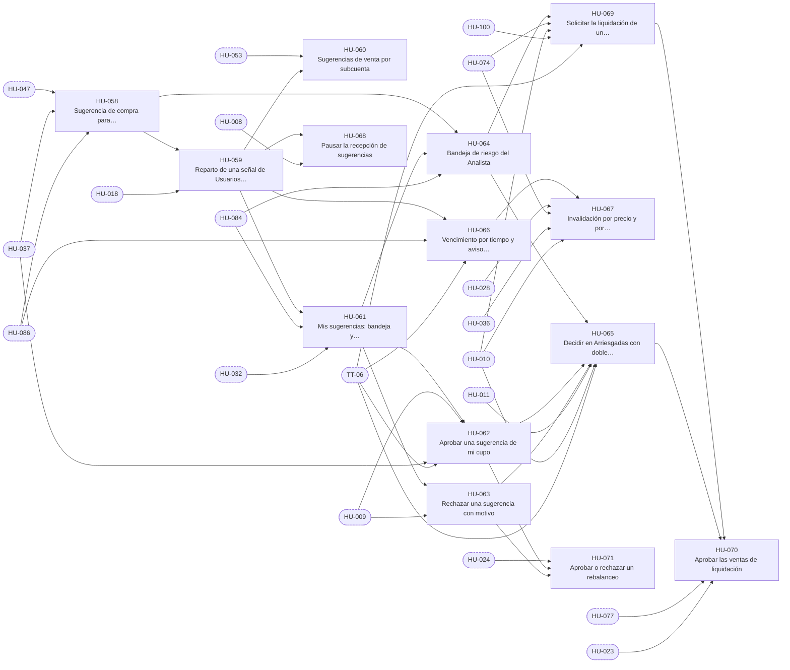

# E-07 · Sugerencias y decisiones

| Campo | Valor |
|---|---|
| Objetivo | Que cada señal de la IA llegue como una sugerencia concreta a quien debe decidirla y que esa persona la apruebe o la rechace con todas las validaciones. |
| Documentación fuente | docs/08 §1 · docs/07 §7 |
| Módulos (docs/17) | M-09 |
| Depende de | E-05, E-06 |
| Entregas en las que avanza | R4, R6 |
| Etiquetas | `epica` · `E-07` |

## Capacidades

Tomadas de `docs/14` §2:

- Señales y reparto en cupos
- Bandeja del Usuario
- Bandeja de riesgo
- Detalle con explicación
- Aprobar y rechazar
- Doble aprobación
- Vencimiento e invalidación
- Rebalanceo (admin)
- Liquidación (analistas)

## Historias de usuario

Cada historia tiene su narrativa, sus criterios de aceptación, sus tareas y sus relaciones en su propio archivo.

| ID | Historia | Rol | Entrega | Prioridad | Depende de |
|---|---|---|---|---|---|
| [HU-058](HU-058-sugerencia-de-compra-para-arriesgadas.md) | Sugerencia de compra para Arriesgadas | Analista | R4 | Alta | [HU-047](../E-06-ia-contexto-y-decision/HU-047-puntaje-compuesto-y-eleccion-de-la-mejor-opcion.md), [HU-037](../E-05-motor-de-politicas-y-configuracion/HU-037-motor-de-politicas-reglas-de-la-propuesta.md), [HU-086](../E-09-tiempo-real-y-notificaciones/HU-086-bandeja-de-notificaciones.md) |
| [HU-059](HU-059-reparto-de-una-senal-de-usuarios-en-sugerencias-por-cupo.md) | Reparto de una señal de Usuarios en sugerencias por cupo | Usuario | R4 | Alta | [HU-058](HU-058-sugerencia-de-compra-para-arriesgadas.md), [HU-018](../E-03-fondo-y-libro-contable/HU-018-asignar-y-reducir-cupos.md) |
| [HU-060](HU-060-sugerencias-de-venta-por-subcuenta.md) | Sugerencias de venta por subcuenta | Usuario | R4 | Media | [HU-053](../E-06-ia-contexto-y-decision/HU-053-senales-de-venta-de-posiciones-abiertas.md), [HU-059](HU-059-reparto-de-una-senal-de-usuarios-en-sugerencias-por-cupo.md) |
| [HU-061](HU-061-mis-sugerencias-bandeja-y-detalle-con-explicacion.md) | Mis sugerencias: bandeja y detalle con explicación | Usuario | R4 | Alta | [HU-059](HU-059-reparto-de-una-senal-de-usuarios-en-sugerencias-por-cupo.md), [HU-084](../E-09-tiempo-real-y-notificaciones/HU-084-gestor-de-tiempo-real-en-la-app.md), [HU-032](../E-04-datos-de-mercado/HU-032-aviso-de-dato-desactualizado.md) |
| [HU-062](HU-062-aprobar-una-sugerencia-de-mi-cupo.md) | Aprobar una sugerencia de mi cupo | Usuario | R4 | Alta | [HU-061](HU-061-mis-sugerencias-bandeja-y-detalle-con-explicacion.md), [HU-009](../E-02-identidad-y-acceso/HU-009-sesion-segura-bloqueo-biometrico-y-confirmacion-de-acciones-sensibles.md), [HU-037](../E-05-motor-de-politicas-y-configuracion/HU-037-motor-de-politicas-reglas-de-la-propuesta.md), [TT-06](../E-01-cimientos-y-calidad-continua/TT-06-arnes-e2e-de-backend-y-de-la-app.md) |
| [HU-063](HU-063-rechazar-una-sugerencia-con-motivo.md) | Rechazar una sugerencia con motivo | Usuario | R4 | Media | [HU-061](HU-061-mis-sugerencias-bandeja-y-detalle-con-explicacion.md), [HU-009](../E-02-identidad-y-acceso/HU-009-sesion-segura-bloqueo-biometrico-y-confirmacion-de-acciones-sensibles.md) |
| [HU-064](HU-064-bandeja-de-riesgo-del-analista.md) | Bandeja de riesgo del Analista | Analista | R4 | Alta | [HU-058](HU-058-sugerencia-de-compra-para-arriesgadas.md), [HU-061](HU-061-mis-sugerencias-bandeja-y-detalle-con-explicacion.md), [HU-084](../E-09-tiempo-real-y-notificaciones/HU-084-gestor-de-tiempo-real-en-la-app.md) |
| [HU-065](HU-065-decidir-en-arriesgadas-con-doble-aprobacion.md) | Decidir en Arriesgadas con doble aprobación | Analista | R4 | Alta | [HU-064](HU-064-bandeja-de-riesgo-del-analista.md), [HU-062](HU-062-aprobar-una-sugerencia-de-mi-cupo.md), [HU-063](HU-063-rechazar-una-sugerencia-con-motivo.md), [HU-011](../E-02-identidad-y-acceso/HU-011-cambiar-el-rol-de-una-cuenta.md), [HU-010](../E-02-identidad-y-acceso/HU-010-suspender-y-reactivar-una-cuenta.md), [TT-06](../E-01-cimientos-y-calidad-continua/TT-06-arnes-e2e-de-backend-y-de-la-app.md) |
| [HU-066](HU-066-vencimiento-por-tiempo-y-aviso-previo.md) | Vencimiento por tiempo y aviso previo | Usuario | R4 | Alta | [HU-059](HU-059-reparto-de-una-senal-de-usuarios-en-sugerencias-por-cupo.md), [HU-086](../E-09-tiempo-real-y-notificaciones/HU-086-bandeja-de-notificaciones.md), [TT-06](../E-01-cimientos-y-calidad-continua/TT-06-arnes-e2e-de-backend-y-de-la-app.md) |
| [HU-067](HU-067-invalidacion-por-precio-y-por-cambio-de-situacion.md) | Invalidación por precio y por cambio de situación | Usuario | R4 | Alta | [HU-066](HU-066-vencimiento-por-tiempo-y-aviso-previo.md), [HU-028](../E-04-datos-de-mercado/HU-028-ingesta-de-precios-cada-15-segundos.md), [HU-074](../E-08-ejecucion-y-broker/HU-074-sincronizar-ordenes-y-aplicar-llenados.md), [HU-036](../E-05-motor-de-politicas-y-configuracion/HU-036-editar-la-lista-blanca.md), [HU-010](../E-02-identidad-y-acceso/HU-010-suspender-y-reactivar-una-cuenta.md) |
| [HU-068](HU-068-pausar-la-recepcion-de-sugerencias.md) | Pausar la recepción de sugerencias | Usuario | R4 | Baja | [HU-059](HU-059-reparto-de-una-senal-de-usuarios-en-sugerencias-por-cupo.md), [HU-008](../E-02-identidad-y-acceso/HU-008-ver-mi-perfil.md) |
| [HU-069](HU-069-solicitar-la-liquidacion-de-un-cupo.md) | Solicitar la liquidación de un cupo | Administrador | R6 | Media | [HU-064](HU-064-bandeja-de-riesgo-del-analista.md), [HU-074](../E-08-ejecucion-y-broker/HU-074-sincronizar-ordenes-y-aplicar-llenados.md), [HU-010](../E-02-identidad-y-acceso/HU-010-suspender-y-reactivar-una-cuenta.md), [HU-100](../E-11-administracion/HU-100-pantalla-de-cupos.md), [TT-06](../E-01-cimientos-y-calidad-continua/TT-06-arnes-e2e-de-backend-y-de-la-app.md) |
| [HU-070](HU-070-aprobar-las-ventas-de-liquidacion.md) | Aprobar las ventas de liquidación | Analista | R6 | Media | [HU-069](HU-069-solicitar-la-liquidacion-de-un-cupo.md), [HU-065](HU-065-decidir-en-arriesgadas-con-doble-aprobacion.md), [HU-077](../E-08-ejecucion-y-broker/HU-077-proteccion-nativa-en-compras-de-acciones-enteras.md), [HU-023](../E-03-fondo-y-libro-contable/HU-023-reparto-de-la-ganancia-realizada-y-absorcion-de-perdidas.md) |
| [HU-071](HU-071-aprobar-o-rechazar-un-rebalanceo.md) | Aprobar o rechazar un rebalanceo | Administrador | R6 | Media | [HU-024](../E-03-fondo-y-libro-contable/HU-024-propuesta-de-rebalanceo-tras-el-cierre.md), [HU-062](HU-062-aprobar-una-sugerencia-de-mi-cupo.md), [HU-063](HU-063-rechazar-una-sugerencia-con-motivo.md) |

## Relaciones

Una flecha `A --> B` significa que B depende de A. Los nodos con borde punteado son ítems de otras épicas.

## Requisitos funcionales de la épica

| ID | Requisito | Rol o actor | Lo implementan |
|---|---|---|---|
| [FR-134](../requisitos-funcionales/FR-134-sugerencia-de-compra-en-arriesgadas.md) | Sugerencia de compra en Arriesgadas | Sistema | [HU-058](HU-058-sugerencia-de-compra-para-arriesgadas.md) |
| [FR-135](../requisitos-funcionales/FR-135-marca-de-doble-aprobacion.md) | Marca de doble aprobación | Sistema | [HU-058](HU-058-sugerencia-de-compra-para-arriesgadas.md) |
| [FR-136](../requisitos-funcionales/FR-136-reparto-de-la-senal-de-usuarios-en-cupos.md) | Reparto de la señal de Usuarios en cupos | Sistema | [HU-059](HU-059-reparto-de-una-senal-de-usuarios-en-sugerencias-por-cupo.md) |
| [FR-137](../requisitos-funcionales/FR-137-tamano-de-la-orden-sugerida.md) | Tamaño de la orden sugerida | Sistema | [HU-058](HU-058-sugerencia-de-compra-para-arriesgadas.md), [HU-059](HU-059-reparto-de-una-senal-de-usuarios-en-sugerencias-por-cupo.md) |
| [FR-138](../requisitos-funcionales/FR-138-sugerencias-de-venta.md) | Sugerencias de venta | Sistema | [HU-060](HU-060-sugerencias-de-venta-por-subcuenta.md) |
| [FR-139](../requisitos-funcionales/FR-139-vencimiento-y-precios-de-la-sugerencia.md) | Vencimiento y precios de la sugerencia | Sistema | [HU-058](HU-058-sugerencia-de-compra-para-arriesgadas.md), [HU-059](HU-059-reparto-de-una-senal-de-usuarios-en-sugerencias-por-cupo.md) |
| [FR-140](../requisitos-funcionales/FR-140-bandeja-de-sugerencias-del-usuario.md) | Bandeja de sugerencias del Usuario | Usuario | [HU-061](HU-061-mis-sugerencias-bandeja-y-detalle-con-explicacion.md) |
| [FR-141](../requisitos-funcionales/FR-141-detalle-de-la-sugerencia.md) | Detalle de la sugerencia | Usuario y Analista | [HU-061](HU-061-mis-sugerencias-bandeja-y-detalle-con-explicacion.md), [HU-064](HU-064-bandeja-de-riesgo-del-analista.md) |
| [FR-142](../requisitos-funcionales/FR-142-aprobacion-de-una-sugerencia-de-mi-cupo.md) | Aprobación de una sugerencia de mi cupo | Usuario | [HU-062](HU-062-aprobar-una-sugerencia-de-mi-cupo.md) |
| [FR-143](../requisitos-funcionales/FR-143-retencion-de-fondos-al-aprobar.md) | Retención de fondos al aprobar | Sistema | [HU-062](HU-062-aprobar-una-sugerencia-de-mi-cupo.md), [HU-065](HU-065-decidir-en-arriesgadas-con-doble-aprobacion.md) |
| [FR-144](../requisitos-funcionales/FR-144-rechazo-de-una-sugerencia-con-motivo.md) | Rechazo de una sugerencia con motivo | Usuario, Analista y Administrador | [HU-063](HU-063-rechazar-una-sugerencia-con-motivo.md) |
| [FR-145](../requisitos-funcionales/FR-145-decision-unica-e-idempotente.md) | Decisión única e idempotente | Sistema | [HU-062](HU-062-aprobar-una-sugerencia-de-mi-cupo.md), [HU-063](HU-063-rechazar-una-sugerencia-con-motivo.md) |
| [FR-146](../requisitos-funcionales/FR-146-bandeja-de-riesgo.md) | Bandeja de riesgo | Analista (Administrador en solo lectura) | [HU-064](HU-064-bandeja-de-riesgo-del-analista.md) |
| [FR-147](../requisitos-funcionales/FR-147-decision-de-un-analista-sobre-arriesgadas.md) | Decisión de un Analista sobre Arriesgadas | Analista | [HU-065](HU-065-decidir-en-arriesgadas-con-doble-aprobacion.md) |
| [FR-148](../requisitos-funcionales/FR-148-doble-aprobacion.md) | Doble aprobación | Analista | [HU-065](HU-065-decidir-en-arriesgadas-con-doble-aprobacion.md) |
| [FR-149](../requisitos-funcionales/FR-149-anulacion-de-la-primera-aprobacion.md) | Anulación de la primera aprobación | Sistema | [HU-065](HU-065-decidir-en-arriesgadas-con-doble-aprobacion.md) |
| [FR-150](../requisitos-funcionales/FR-150-vencimiento-por-tiempo.md) | Vencimiento por tiempo | Sistema | [HU-066](HU-066-vencimiento-por-tiempo-y-aviso-previo.md) |
| [FR-151](../requisitos-funcionales/FR-151-aviso-de-sugerencia-por-vencer.md) | Aviso de sugerencia por vencer | Sistema | [HU-066](HU-066-vencimiento-por-tiempo-y-aviso-previo.md) |
| [FR-152](../requisitos-funcionales/FR-152-invalidacion-por-banda-de-precio.md) | Invalidación por banda de precio | Sistema | [HU-067](HU-067-invalidacion-por-precio-y-por-cambio-de-situacion.md) |
| [FR-153](../requisitos-funcionales/FR-153-invalidacion-por-cambio-de-situacion.md) | Invalidación por cambio de situación | Sistema | [HU-067](HU-067-invalidacion-por-precio-y-por-cambio-de-situacion.md) |
| [FR-154](../requisitos-funcionales/FR-154-pausa-de-la-recepcion-de-sugerencias.md) | Pausa de la recepción de sugerencias | Usuario | [HU-068](HU-068-pausar-la-recepcion-de-sugerencias.md) |
| [FR-155](../requisitos-funcionales/FR-155-solicitud-de-liquidacion-de-un-cupo.md) | Solicitud de liquidación de un cupo | Administrador | [HU-069](HU-069-solicitar-la-liquidacion-de-un-cupo.md) |
| [FR-156](../requisitos-funcionales/FR-156-decision-de-las-ventas-de-liquidacion.md) | Decisión de las ventas de liquidación | Analista | [HU-070](HU-070-aprobar-las-ventas-de-liquidacion.md) |
| [FR-157](../requisitos-funcionales/FR-157-decision-de-un-rebalanceo.md) | Decisión de un rebalanceo | Administrador | [HU-071](HU-071-aprobar-o-rechazar-un-rebalanceo.md) |
