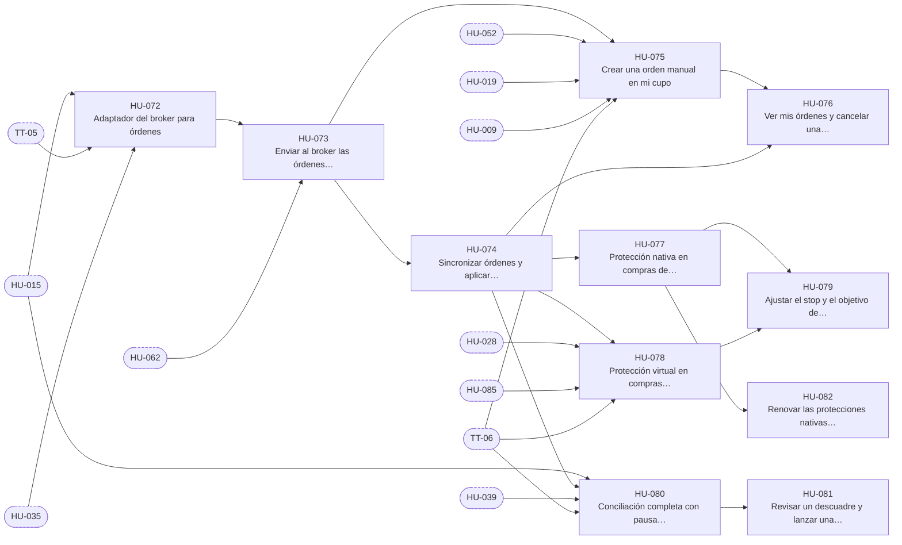

# E-08 · Ejecución y broker

| Campo | Valor |
|---|---|
| Objetivo | Que toda orden aprobada o manual se ejecute en Alpaca paper sin duplicarse, quede protegida con stop-loss y take-profit y que el libro coincida siempre con el broker. |
| Documentación fuente | docs/10 · docs/08 §2 · docs/08 §3 |
| Módulos (docs/17) | M-10, M-11, M-12 |
| Depende de | E-03, E-07 |
| Entregas en las que avanza | R4, R5, R6 |
| Etiquetas | `epica` · `E-08` |

## Capacidades

Tomadas de `docs/14` §2:

- Adaptador Alpaca paper y simulado
- Cola y ejecutor
- Órdenes manuales
- Sincronización y `aplicar_llenado`
- Protecciones nativas y virtuales
- Ajuste de protección
- Renovación a los 80 días
- Conciliación de posiciones y órdenes

## Historias de usuario

Cada historia tiene su narrativa, sus criterios de aceptación, sus tareas y sus relaciones en su propio archivo.

| ID | Historia | Rol | Entrega | Prioridad | Depende de |
|---|---|---|---|---|---|
| [HU-072](HU-072-adaptador-del-broker-para-ordenes.md) | Adaptador del broker para órdenes | Administrador | R4 | Alta | [HU-015](../E-03-fondo-y-libro-contable/HU-015-confirmar-el-aporte-por-conciliacion-y-repartirlo-50-25-25.md), [TT-05](../E-01-cimientos-y-calidad-continua/TT-05-base-de-proveedores-simulados-reloj-controlable-y-datos-de-prueba.md), [HU-035](../E-05-motor-de-politicas-y-configuracion/HU-035-salud-de-las-integraciones.md) |
| [HU-073](HU-073-enviar-al-broker-las-ordenes-aprobadas.md) | Enviar al broker las órdenes aprobadas | Usuario | R4 | Alta | [HU-072](HU-072-adaptador-del-broker-para-ordenes.md), [HU-062](../E-07-sugerencias-y-decisiones/HU-062-aprobar-una-sugerencia-de-mi-cupo.md) |
| [HU-074](HU-074-sincronizar-ordenes-y-aplicar-llenados.md) | Sincronizar órdenes y aplicar llenados | Usuario | R4 | Alta | [HU-073](HU-073-enviar-al-broker-las-ordenes-aprobadas.md) |
| [HU-075](HU-075-crear-una-orden-manual-en-mi-cupo.md) | Crear una orden manual en mi cupo | Usuario | R4 | Alta | [HU-073](HU-073-enviar-al-broker-las-ordenes-aprobadas.md), [HU-052](../E-06-ia-contexto-y-decision/HU-052-opinion-de-la-ia-sobre-una-orden-manual.md), [HU-019](../E-03-fondo-y-libro-contable/HU-019-ver-mi-cupo.md), [HU-009](../E-02-identidad-y-acceso/HU-009-sesion-segura-bloqueo-biometrico-y-confirmacion-de-acciones-sensibles.md), [TT-06](../E-01-cimientos-y-calidad-continua/TT-06-arnes-e2e-de-backend-y-de-la-app.md) |
| [HU-076](HU-076-ver-mis-ordenes-y-cancelar-una-que-no-se-ha-llenado.md) | Ver mis órdenes y cancelar una que no se ha llenado | Usuario | R4 | Media | [HU-075](HU-075-crear-una-orden-manual-en-mi-cupo.md), [HU-074](HU-074-sincronizar-ordenes-y-aplicar-llenados.md) |
| [HU-077](HU-077-proteccion-nativa-en-compras-de-acciones-enteras.md) | Protección nativa en compras de acciones enteras | Usuario | R4 | Alta | [HU-074](HU-074-sincronizar-ordenes-y-aplicar-llenados.md) |
| [HU-078](HU-078-proteccion-virtual-en-compras-fraccionales.md) | Protección virtual en compras fraccionales | Usuario | R4 | Alta | [HU-074](HU-074-sincronizar-ordenes-y-aplicar-llenados.md), [HU-028](../E-04-datos-de-mercado/HU-028-ingesta-de-precios-cada-15-segundos.md), [HU-085](../E-09-tiempo-real-y-notificaciones/HU-085-alertas-del-sistema-por-audiencia.md), [TT-06](../E-01-cimientos-y-calidad-continua/TT-06-arnes-e2e-de-backend-y-de-la-app.md) |
| [HU-079](HU-079-ajustar-el-stop-y-el-objetivo-de-una-posicion.md) | Ajustar el stop y el objetivo de una posición | Usuario | R4 | Media | [HU-077](HU-077-proteccion-nativa-en-compras-de-acciones-enteras.md), [HU-078](HU-078-proteccion-virtual-en-compras-fraccionales.md) |
| [HU-080](HU-080-conciliacion-completa-con-pausa-automatica.md) | Conciliación completa con pausa automática | Administrador | R5 | Alta | [HU-015](../E-03-fondo-y-libro-contable/HU-015-confirmar-el-aporte-por-conciliacion-y-repartirlo-50-25-25.md), [HU-074](HU-074-sincronizar-ordenes-y-aplicar-llenados.md), [HU-039](../E-05-motor-de-politicas-y-configuracion/HU-039-freno-de-emergencia.md), [TT-06](../E-01-cimientos-y-calidad-continua/TT-06-arnes-e2e-de-backend-y-de-la-app.md) |
| [HU-081](HU-081-revisar-un-descuadre-y-lanzar-una-conciliacion.md) | Revisar un descuadre y lanzar una conciliación | Administrador | R5 | Media | [HU-080](HU-080-conciliacion-completa-con-pausa-automatica.md) |
| [HU-082](HU-082-renovar-las-protecciones-nativas-a-los-80-dias.md) | Renovar las protecciones nativas a los 80 días | Usuario | R6 | Baja | [HU-077](HU-077-proteccion-nativa-en-compras-de-acciones-enteras.md) |

## Relaciones

Una flecha `A --> B` significa que B depende de A. Los nodos con borde punteado son ítems de otras épicas.

## Requisitos funcionales de la épica

| ID | Requisito | Rol o actor | Lo implementan |
|---|---|---|---|
| [FR-158](../requisitos-funcionales/FR-158-adaptador-del-broker.md) | Adaptador del broker | Sistema y Broker (Alpaca paper) | [HU-072](HU-072-adaptador-del-broker-para-ordenes.md) |
| [FR-159](../requisitos-funcionales/FR-159-la-ia-no-ejecuta.md) | La IA no ejecuta | Sistema | [HU-072](HU-072-adaptador-del-broker-para-ordenes.md) |
| [FR-160](../requisitos-funcionales/FR-160-envio-de-ordenes-desde-una-cola.md) | Envío de órdenes desde una cola | Sistema (ejecutor de órdenes) | [HU-073](HU-073-enviar-al-broker-las-ordenes-aprobadas.md) |
| [FR-161](../requisitos-funcionales/FR-161-envio-idempotente.md) | Envío idempotente | Sistema (ejecutor de órdenes) | [HU-073](HU-073-enviar-al-broker-las-ordenes-aprobadas.md) |
| [FR-162](../requisitos-funcionales/FR-162-tipos-de-orden.md) | Tipos de orden | Sistema (ejecutor de órdenes) | [HU-073](HU-073-enviar-al-broker-las-ordenes-aprobadas.md) |
| [FR-163](../requisitos-funcionales/FR-163-tratamiento-de-los-errores-del-broker.md) | Tratamiento de los errores del broker | Sistema (ejecutor de órdenes) | [HU-073](HU-073-enviar-al-broker-las-ordenes-aprobadas.md) |
| [FR-164](../requisitos-funcionales/FR-164-reintentos-de-la-cola-de-ordenes.md) | Reintentos de la cola de órdenes | Sistema | [HU-073](HU-073-enviar-al-broker-las-ordenes-aprobadas.md) |
| [FR-165](../requisitos-funcionales/FR-165-sincronizacion-de-ordenes.md) | Sincronización de órdenes | Sistema y Broker (Alpaca paper) | [HU-074](HU-074-sincronizar-ordenes-y-aplicar-llenados.md) |
| [FR-166](../requisitos-funcionales/FR-166-aplicacion-de-llenados.md) | Aplicación de llenados | Sistema | [HU-074](HU-074-sincronizar-ordenes-y-aplicar-llenados.md) |
| [FR-167](../requisitos-funcionales/FR-167-tiempo-maximo-de-llenado.md) | Tiempo máximo de llenado | Sistema | [HU-074](HU-074-sincronizar-ordenes-y-aplicar-llenados.md) |
| [FR-168](../requisitos-funcionales/FR-168-cierre-de-la-orden-y-de-su-sugerencia.md) | Cierre de la orden y de su sugerencia | Sistema | [HU-074](HU-074-sincronizar-ordenes-y-aplicar-llenados.md) |
| [FR-169](../requisitos-funcionales/FR-169-orden-manual.md) | Orden manual | Usuario | [HU-075](HU-075-crear-una-orden-manual-en-mi-cupo.md) |
| [FR-170](../requisitos-funcionales/FR-170-orden-manual-sin-duplicados.md) | Orden manual sin duplicados | Usuario | [HU-075](HU-075-crear-una-orden-manual-en-mi-cupo.md) |
| [FR-171](../requisitos-funcionales/FR-171-cancelacion-de-una-orden-propia.md) | Cancelación de una orden propia | Usuario | [HU-076](HU-076-ver-mis-ordenes-y-cancelar-una-que-no-se-ha-llenado.md) |
| [FR-172](../requisitos-funcionales/FR-172-proteccion-nativa.md) | Protección nativa | Sistema y Broker (Alpaca paper) | [HU-077](HU-077-proteccion-nativa-en-compras-de-acciones-enteras.md) |
| [FR-173](../requisitos-funcionales/FR-173-venta-de-una-posicion-con-proteccion-nativa.md) | Venta de una posición con protección nativa | Sistema | [HU-077](HU-077-proteccion-nativa-en-compras-de-acciones-enteras.md) |
| [FR-174](../requisitos-funcionales/FR-174-proteccion-virtual.md) | Protección virtual | Sistema | [HU-078](HU-078-proteccion-virtual-en-compras-fraccionales.md) |
| [FR-175](../requisitos-funcionales/FR-175-protecciones-sin-aprobacion-ni-freno.md) | Protecciones sin aprobación ni freno | Sistema | [HU-077](HU-077-proteccion-nativa-en-compras-de-acciones-enteras.md), [HU-078](HU-078-proteccion-virtual-en-compras-fraccionales.md) |
| [FR-176](../requisitos-funcionales/FR-176-alerta-de-proteccion-virtual-sin-vigilancia.md) | Alerta de protección virtual sin vigilancia | Sistema | [HU-078](HU-078-proteccion-virtual-en-compras-fraccionales.md) |
| [FR-177](../requisitos-funcionales/FR-177-llenado-parcial-de-un-bracket.md) | Llenado parcial de un bracket | Sistema | [HU-078](HU-078-proteccion-virtual-en-compras-fraccionales.md) |
| [FR-178](../requisitos-funcionales/FR-178-ajuste-de-la-proteccion.md) | Ajuste de la protección | Usuario y Analista | [HU-079](HU-079-ajustar-el-stop-y-el-objetivo-de-una-posicion.md) |
| [FR-179](../requisitos-funcionales/FR-179-conciliacion-con-el-broker.md) | Conciliación con el broker | Sistema y Broker (Alpaca paper) | [HU-080](HU-080-conciliacion-completa-con-pausa-automatica.md) |
| [FR-180](../requisitos-funcionales/FR-180-excedente-no-asignado.md) | Excedente no asignado | Sistema | [HU-080](HU-080-conciliacion-completa-con-pausa-automatica.md) |
| [FR-181](../requisitos-funcionales/FR-181-pausa-automatica-por-descuadre-critico.md) | Pausa automática por descuadre crítico | Sistema | [HU-080](HU-080-conciliacion-completa-con-pausa-automatica.md) |
| [FR-182](../requisitos-funcionales/FR-182-revision-de-un-descuadre.md) | Revisión de un descuadre | Administrador | [HU-081](HU-081-revisar-un-descuadre-y-lanzar-una-conciliacion.md) |
| [FR-183](../requisitos-funcionales/FR-183-conciliacion-manual.md) | Conciliación manual | Administrador | [HU-081](HU-081-revisar-un-descuadre-y-lanzar-una-conciliacion.md) |
| [FR-184](../requisitos-funcionales/FR-184-consulta-de-conciliaciones.md) | Consulta de conciliaciones | Analista y Administrador | [HU-081](HU-081-revisar-un-descuadre-y-lanzar-una-conciliacion.md) |
| [FR-185](../requisitos-funcionales/FR-185-renovacion-de-protecciones-nativas.md) | Renovación de protecciones nativas | Sistema | [HU-082](HU-082-renovar-las-protecciones-nativas-a-los-80-dias.md) |
