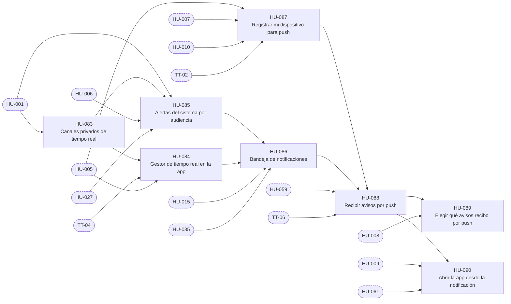

# E-09 · Tiempo real y notificaciones

| Campo | Valor |
|---|---|
| Objetivo | Que cada persona vea en vivo lo que le corresponde y reciba avisos dentro de la app y por push, sin que ningún evento revele montos. |
| Documentación fuente | docs/09 |
| Módulos (docs/17) | M-13, M-14, M-18 |
| Depende de | E-02 |
| Entregas en las que avanza | R1, R2, R3, R5 |
| Etiquetas | `epica` · `E-09` |

## Capacidades

Tomadas de `docs/14` §2:

- Canales y políticas
- Eventos por entidad
- Gestor de Realtime en la app
- Bandeja de notificaciones
- FCM y dispositivos
- Preferencias
- Deep links

## Historias de usuario

Cada historia tiene su narrativa, sus criterios de aceptación, sus tareas y sus relaciones en su propio archivo.

| ID | Historia | Rol | Entrega | Prioridad | Depende de |
|---|---|---|---|---|---|
| [HU-083](HU-083-canales-privados-de-tiempo-real.md) | Canales privados de tiempo real | Usuario | R1 | Alta | [HU-001](../E-02-identidad-y-acceso/HU-001-perfiles-rol-actual-y-lecturas-por-rol.md) |
| [HU-084](HU-084-gestor-de-tiempo-real-en-la-app.md) | Gestor de tiempo real en la app | Usuario | R1 | Alta | [HU-083](HU-083-canales-privados-de-tiempo-real.md), [TT-04](../E-01-cimientos-y-calidad-continua/TT-04-esqueleto-de-la-app-flutter-para-android-y-web.md), [HU-005](../E-02-identidad-y-acceso/HU-005-ingresar-con-google-en-android-y-web.md) |
| [HU-085](HU-085-alertas-del-sistema-por-audiencia.md) | Alertas del sistema por audiencia | Usuario | R2 | Alta | [HU-001](../E-02-identidad-y-acceso/HU-001-perfiles-rol-actual-y-lecturas-por-rol.md), [HU-083](HU-083-canales-privados-de-tiempo-real.md), [HU-006](../E-02-identidad-y-acceso/HU-006-navegacion-y-guardas-segun-el-rol.md), [HU-027](../E-04-datos-de-mercado/HU-027-calendario-reloj-y-estado-del-mercado.md) |
| [HU-086](HU-086-bandeja-de-notificaciones.md) | Bandeja de notificaciones | Usuario | R3 | Alta | [HU-085](HU-085-alertas-del-sistema-por-audiencia.md), [HU-084](HU-084-gestor-de-tiempo-real-en-la-app.md), [HU-015](../E-03-fondo-y-libro-contable/HU-015-confirmar-el-aporte-por-conciliacion-y-repartirlo-50-25-25.md), [HU-035](../E-05-motor-de-politicas-y-configuracion/HU-035-salud-de-las-integraciones.md) |
| [HU-087](HU-087-registrar-mi-dispositivo-para-push.md) | Registrar mi dispositivo para push | Usuario | R5 | Alta | [HU-005](../E-02-identidad-y-acceso/HU-005-ingresar-con-google-en-android-y-web.md), [HU-007](../E-02-identidad-y-acceso/HU-007-cerrar-sesion.md), [HU-010](../E-02-identidad-y-acceso/HU-010-suspender-y-reactivar-una-cuenta.md), [TT-02](../E-01-cimientos-y-calidad-continua/TT-02-cuentas-conexiones-y-secretos-de-los-servicios-externos.md) |
| [HU-088](HU-088-recibir-avisos-por-push.md) | Recibir avisos por push | Usuario | R5 | Alta | [HU-087](HU-087-registrar-mi-dispositivo-para-push.md), [HU-086](HU-086-bandeja-de-notificaciones.md), [HU-059](../E-07-sugerencias-y-decisiones/HU-059-reparto-de-una-senal-de-usuarios-en-sugerencias-por-cupo.md), [TT-06](../E-01-cimientos-y-calidad-continua/TT-06-arnes-e2e-de-backend-y-de-la-app.md) |
| [HU-089](HU-089-elegir-que-avisos-recibo-por-push.md) | Elegir qué avisos recibo por push | Usuario | R5 | Baja | [HU-088](HU-088-recibir-avisos-por-push.md), [HU-008](../E-02-identidad-y-acceso/HU-008-ver-mi-perfil.md) |
| [HU-090](HU-090-abrir-la-app-desde-la-notificacion.md) | Abrir la app desde la notificación | Usuario | R5 | Media | [HU-088](HU-088-recibir-avisos-por-push.md), [HU-009](../E-02-identidad-y-acceso/HU-009-sesion-segura-bloqueo-biometrico-y-confirmacion-de-acciones-sensibles.md), [HU-061](../E-07-sugerencias-y-decisiones/HU-061-mis-sugerencias-bandeja-y-detalle-con-explicacion.md) |

## Relaciones

Una flecha `A --> B` significa que B depende de A. Los nodos con borde punteado son ítems de otras épicas.

## Requisitos funcionales de la épica

| ID | Requisito | Rol o actor | Lo implementan |
|---|---|---|---|
| [FR-186](../requisitos-funcionales/FR-186-canales-privados-por-rol.md) | Canales privados por rol | Sistema | [HU-083](HU-083-canales-privados-de-tiempo-real.md) |
| [FR-187](../requisitos-funcionales/FR-187-eventos-sin-montos.md) | Eventos sin montos | Sistema | [HU-083](HU-083-canales-privados-de-tiempo-real.md) |
| [FR-188](../requisitos-funcionales/FR-188-actualizacion-en-vivo-con-foto-y-eventos.md) | Actualización en vivo con foto y eventos | Usuario, Analista y Administrador | [HU-084](HU-084-gestor-de-tiempo-real-en-la-app.md) |
| [FR-189](../requisitos-funcionales/FR-189-indicador-de-conexion.md) | Indicador de conexión | Usuario, Analista y Administrador | [HU-084](HU-084-gestor-de-tiempo-real-en-la-app.md) |
| [FR-190](../requisitos-funcionales/FR-190-reloj-corregido-con-el-servidor.md) | Reloj corregido con el servidor | Usuario, Analista y Administrador | [HU-084](HU-084-gestor-de-tiempo-real-en-la-app.md) |
| [FR-191](../requisitos-funcionales/FR-191-alertas-por-audiencia.md) | Alertas por audiencia | Usuario, Analista y Administrador | [HU-085](HU-085-alertas-del-sistema-por-audiencia.md) |
| [FR-192](../requisitos-funcionales/FR-192-bandeja-de-notificaciones.md) | Bandeja de notificaciones | Usuario, Analista y Administrador | [HU-086](HU-086-bandeja-de-notificaciones.md) |
| [FR-193](../requisitos-funcionales/FR-193-registro-del-dispositivo.md) | Registro del dispositivo | Usuario, Analista y Administrador | [HU-087](HU-087-registrar-mi-dispositivo-para-push.md) |
| [FR-194](../requisitos-funcionales/FR-194-envio-de-push.md) | Envío de push | Sistema y Firebase (FCM) | [HU-088](HU-088-recibir-avisos-por-push.md) |
| [FR-195](../requisitos-funcionales/FR-195-preferencias-de-notificacion.md) | Preferencias de notificación | Usuario, Analista y Administrador | [HU-089](HU-089-elegir-que-avisos-recibo-por-push.md) |
| [FR-196](../requisitos-funcionales/FR-196-apertura-desde-la-notificacion.md) | Apertura desde la notificación | Usuario, Analista y Administrador | [HU-090](HU-090-abrir-la-app-desde-la-notificacion.md) |
| [FR-197](../requisitos-funcionales/FR-197-aviso-dentro-de-la-app.md) | Aviso dentro de la app | Usuario, Analista y Administrador | [HU-090](HU-090-abrir-la-app-desde-la-notificacion.md) |
