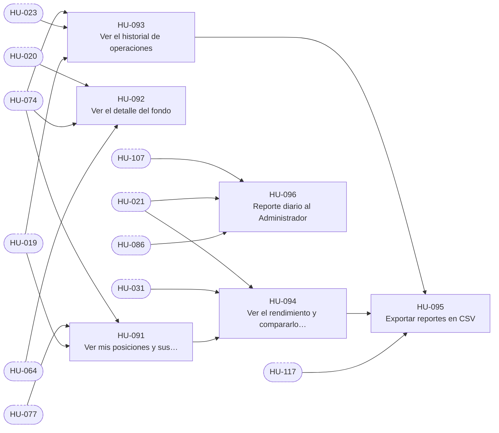

# E-10 · Cartera y reportes

| Campo | Valor |
|---|---|
| Objetivo | Que cada persona vea su cartera o la del fondo, su historial y su rendimiento, y pueda exportarlos. |
| Documentación fuente | docs/02 §13 · docs/03 §3 |
| Módulos (docs/17) | M-15 |
| Depende de | E-03, E-08 |
| Entregas en las que avanza | R4, R6 |
| Etiquetas | `epica` · `E-10` |

## Capacidades

Tomadas de `docs/14` §2:

- Mi cupo
- Fondo (resumen y detalle)
- Historial
- Exportación CSV
- Reporte diario al admin

## Historias de usuario

Cada historia tiene su narrativa, sus criterios de aceptación, sus tareas y sus relaciones en su propio archivo.

| ID | Historia | Rol | Entrega | Prioridad | Depende de |
|---|---|---|---|---|---|
| [HU-091](HU-091-ver-mis-posiciones-y-sus-protecciones.md) | Ver mis posiciones y sus protecciones | Usuario | R4 | Alta | [HU-074](../E-08-ejecucion-y-broker/HU-074-sincronizar-ordenes-y-aplicar-llenados.md), [HU-077](../E-08-ejecucion-y-broker/HU-077-proteccion-nativa-en-compras-de-acciones-enteras.md), [HU-019](../E-03-fondo-y-libro-contable/HU-019-ver-mi-cupo.md) |
| [HU-092](HU-092-ver-el-detalle-del-fondo.md) | Ver el detalle del fondo | Analista | R4 | Alta | [HU-020](../E-03-fondo-y-libro-contable/HU-020-ver-el-resumen-del-fondo-por-bolsillos.md), [HU-074](../E-08-ejecucion-y-broker/HU-074-sincronizar-ordenes-y-aplicar-llenados.md), [HU-064](../E-07-sugerencias-y-decisiones/HU-064-bandeja-de-riesgo-del-analista.md) |
| [HU-093](HU-093-ver-el-historial-de-operaciones.md) | Ver el historial de operaciones | Usuario | R4 | Media | [HU-074](../E-08-ejecucion-y-broker/HU-074-sincronizar-ordenes-y-aplicar-llenados.md), [HU-023](../E-03-fondo-y-libro-contable/HU-023-reparto-de-la-ganancia-realizada-y-absorcion-de-perdidas.md), [HU-019](../E-03-fondo-y-libro-contable/HU-019-ver-mi-cupo.md) |
| [HU-094](HU-094-ver-el-rendimiento-y-compararlo-con-el-nasdaq-100.md) | Ver el rendimiento y compararlo con el NASDAQ-100 | Usuario | R6 | Media | [HU-021](../E-03-fondo-y-libro-contable/HU-021-foto-diaria-de-patrimonio-y-rendimiento-twr.md), [HU-031](../E-04-datos-de-mercado/HU-031-comparacion-de-qqq-qld-y-x2-teorico.md), [HU-091](HU-091-ver-mis-posiciones-y-sus-protecciones.md) |
| [HU-095](HU-095-exportar-reportes-en-csv.md) | Exportar reportes en CSV | Usuario | R6 | Media | [HU-093](HU-093-ver-el-historial-de-operaciones.md), [HU-094](HU-094-ver-el-rendimiento-y-compararlo-con-el-nasdaq-100.md), [HU-117](../E-13-transicion-desde-la-v2/HU-117-exportador-de-reportes-de-la-v2-con-sus-pruebas.md) |
| [HU-096](HU-096-reporte-diario-al-administrador.md) | Reporte diario al Administrador | Administrador | R6 | Media | [HU-107](../E-12-seguridad-auditoria-y-cumplimiento/HU-107-bitacora-inmutable-con-cadena-de-hash.md), [HU-021](../E-03-fondo-y-libro-contable/HU-021-foto-diaria-de-patrimonio-y-rendimiento-twr.md), [HU-086](../E-09-tiempo-real-y-notificaciones/HU-086-bandeja-de-notificaciones.md) |

## Relaciones

Una flecha `A --> B` significa que B depende de A. Los nodos con borde punteado son ítems de otras épicas.

## Requisitos funcionales de la épica

| ID | Requisito | Rol o actor | Lo implementan |
|---|---|---|---|
| [FR-198](../requisitos-funcionales/FR-198-posiciones-valoradas-de-mi-cupo.md) | Posiciones valoradas de mi cupo | Usuario | [HU-091](HU-091-ver-mis-posiciones-y-sus-protecciones.md) |
| [FR-199](../requisitos-funcionales/FR-199-protecciones-visibles.md) | Protecciones visibles | Usuario y Analista | [HU-091](HU-091-ver-mis-posiciones-y-sus-protecciones.md), [HU-092](HU-092-ver-el-detalle-del-fondo.md) |
| [FR-200](../requisitos-funcionales/FR-200-detalle-del-fondo-para-supervision.md) | Detalle del fondo para supervisión | Analista y Administrador | [HU-092](HU-092-ver-el-detalle-del-fondo.md) |
| [FR-201](../requisitos-funcionales/FR-201-historial-de-operaciones.md) | Historial de operaciones | Usuario, Analista y Administrador | [HU-093](HU-093-ver-el-historial-de-operaciones.md) |
| [FR-202](../requisitos-funcionales/FR-202-rendimiento-y-comparacion.md) | Rendimiento y comparación | Usuario, Analista y Administrador | [HU-094](HU-094-ver-el-rendimiento-y-compararlo-con-el-nasdaq-100.md) |
| [FR-203](../requisitos-funcionales/FR-203-exportacion-csv.md) | Exportación CSV | Usuario, Analista y Administrador | [HU-095](HU-095-exportar-reportes-en-csv.md), [HU-117](../E-13-transicion-desde-la-v2/HU-117-exportador-de-reportes-de-la-v2-con-sus-pruebas.md) |
| [FR-204](../requisitos-funcionales/FR-204-advertencia-de-paper-trading.md) | Advertencia de paper trading | Usuario, Analista y Administrador | [HU-095](HU-095-exportar-reportes-en-csv.md) |
| [FR-205](../requisitos-funcionales/FR-205-reporte-diario-al-administrador.md) | Reporte diario al Administrador | Administrador | [HU-096](HU-096-reporte-diario-al-administrador.md) |
