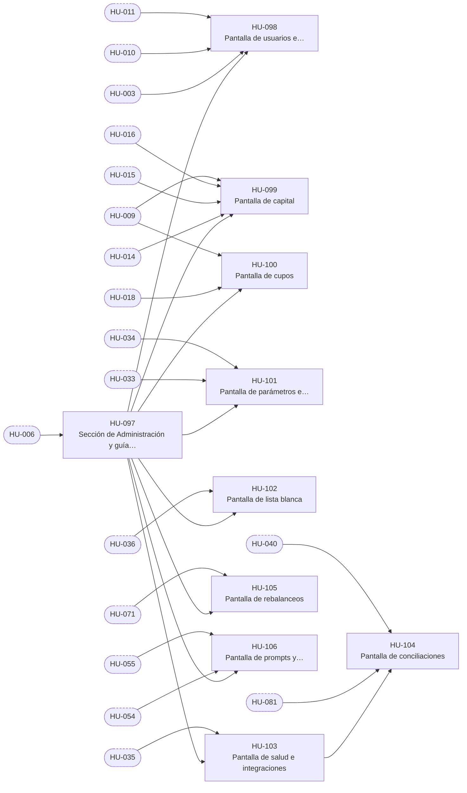

# E-11 · Administración

| Campo | Valor |
|---|---|
| Objetivo | Que el Administrador tenga las pantallas para gobernar cuentas, dinero y reglas sobre las capacidades de las demás épicas. |
| Documentación fuente | docs/03 §2 · docs/03 §3 |
| Módulos (docs/17) | M-16 |
| Depende de | E-02 |
| Entregas en las que avanza | R2, R3, R5, R6 |
| Etiquetas | `epica` · `E-11` |

## Capacidades

Tomadas de `docs/14` §2:

- Pantallas del admin sobre las capacidades de las demás épicas

## Historias de usuario

Cada historia tiene su narrativa, sus criterios de aceptación, sus tareas y sus relaciones en su propio archivo.

| ID | Historia | Rol | Entrega | Prioridad | Depende de |
|---|---|---|---|---|---|
| [HU-097](HU-097-seccion-de-administracion-y-guia-de-primeros-pasos.md) | Sección de Administración y guía de primeros pasos | Administrador | R2 | Alta | [HU-006](../E-02-identidad-y-acceso/HU-006-navegacion-y-guardas-segun-el-rol.md) |
| [HU-098](HU-098-pantalla-de-usuarios-e-invitaciones.md) | Pantalla de usuarios e invitaciones | Administrador | R2 | Alta | [HU-097](HU-097-seccion-de-administracion-y-guia-de-primeros-pasos.md), [HU-003](../E-02-identidad-y-acceso/HU-003-invitar-a-una-persona-y-revocar-invitaciones.md), [HU-010](../E-02-identidad-y-acceso/HU-010-suspender-y-reactivar-una-cuenta.md), [HU-011](../E-02-identidad-y-acceso/HU-011-cambiar-el-rol-de-una-cuenta.md) |
| [HU-099](HU-099-pantalla-de-capital.md) | Pantalla de capital | Administrador | R2 | Alta | [HU-097](HU-097-seccion-de-administracion-y-guia-de-primeros-pasos.md), [HU-014](../E-03-fondo-y-libro-contable/HU-014-registrar-y-anular-aportes.md), [HU-015](../E-03-fondo-y-libro-contable/HU-015-confirmar-el-aporte-por-conciliacion-y-repartirlo-50-25-25.md), [HU-016](../E-03-fondo-y-libro-contable/HU-016-registrar-retiros-de-capital.md), [HU-009](../E-02-identidad-y-acceso/HU-009-sesion-segura-bloqueo-biometrico-y-confirmacion-de-acciones-sensibles.md) |
| [HU-100](HU-100-pantalla-de-cupos.md) | Pantalla de cupos | Administrador | R2 | Alta | [HU-097](HU-097-seccion-de-administracion-y-guia-de-primeros-pasos.md), [HU-018](../E-03-fondo-y-libro-contable/HU-018-asignar-y-reducir-cupos.md), [HU-009](../E-02-identidad-y-acceso/HU-009-sesion-segura-bloqueo-biometrico-y-confirmacion-de-acciones-sensibles.md) |
| [HU-101](HU-101-pantalla-de-parametros-e-interruptores.md) | Pantalla de parámetros e interruptores | Administrador | R2 | Media | [HU-097](HU-097-seccion-de-administracion-y-guia-de-primeros-pasos.md), [HU-033](../E-05-motor-de-politicas-y-configuracion/HU-033-parametros-configurables-con-rango-e-historial.md), [HU-034](../E-05-motor-de-politicas-y-configuracion/HU-034-encender-y-apagar-los-interruptores-del-fondo.md) |
| [HU-102](HU-102-pantalla-de-lista-blanca.md) | Pantalla de lista blanca | Administrador | R3 | Media | [HU-097](HU-097-seccion-de-administracion-y-guia-de-primeros-pasos.md), [HU-036](../E-05-motor-de-politicas-y-configuracion/HU-036-editar-la-lista-blanca.md) |
| [HU-103](HU-103-pantalla-de-salud-e-integraciones.md) | Pantalla de salud e integraciones | Administrador | R3 | Media | [HU-097](HU-097-seccion-de-administracion-y-guia-de-primeros-pasos.md), [HU-035](../E-05-motor-de-politicas-y-configuracion/HU-035-salud-de-las-integraciones.md) |
| [HU-104](HU-104-pantalla-de-conciliaciones.md) | Pantalla de conciliaciones | Administrador | R5 | Media | [HU-103](HU-103-pantalla-de-salud-e-integraciones.md), [HU-081](../E-08-ejecucion-y-broker/HU-081-revisar-un-descuadre-y-lanzar-una-conciliacion.md), [HU-040](../E-05-motor-de-politicas-y-configuracion/HU-040-reanudar-el-trading-solo-con-la-conciliacion-en-ok.md) |
| [HU-105](HU-105-pantalla-de-rebalanceos.md) | Pantalla de rebalanceos | Administrador | R6 | Media | [HU-097](HU-097-seccion-de-administracion-y-guia-de-primeros-pasos.md), [HU-071](../E-07-sugerencias-y-decisiones/HU-071-aprobar-o-rechazar-un-rebalanceo.md) |
| [HU-106](HU-106-pantalla-de-prompts-y-configuraciones-de-decision.md) | Pantalla de prompts y configuraciones de decisión | Administrador | R6 | Media | [HU-097](HU-097-seccion-de-administracion-y-guia-de-primeros-pasos.md), [HU-054](../E-06-ia-contexto-y-decision/HU-054-versiones-del-prompt-de-contexto-y-de-la-configuracion-de-decision.md), [HU-055](../E-06-ia-contexto-y-decision/HU-055-modo-sombra-de-una-configuracion-candidata.md) |

## Relaciones

Una flecha `A --> B` significa que B depende de A. Los nodos con borde punteado son ítems de otras épicas.

## Requisitos funcionales de la épica

| ID | Requisito | Rol o actor | Lo implementan |
|---|---|---|---|
| [FR-206](../requisitos-funcionales/FR-206-seccion-de-administracion.md) | Sección de Administración | Administrador | [HU-097](HU-097-seccion-de-administracion-y-guia-de-primeros-pasos.md) |
| [FR-207](../requisitos-funcionales/FR-207-guia-de-primeros-pasos.md) | Guía de primeros pasos | Administrador | [HU-097](HU-097-seccion-de-administracion-y-guia-de-primeros-pasos.md) |
| [FR-208](../requisitos-funcionales/FR-208-pantalla-de-usuarios-e-invitaciones.md) | Pantalla de usuarios e invitaciones | Administrador | [HU-098](HU-098-pantalla-de-usuarios-e-invitaciones.md) |
| [FR-209](../requisitos-funcionales/FR-209-pantalla-de-capital.md) | Pantalla de capital | Administrador | [HU-099](HU-099-pantalla-de-capital.md) |
| [FR-210](../requisitos-funcionales/FR-210-pantalla-de-cupos.md) | Pantalla de cupos | Administrador | [HU-100](HU-100-pantalla-de-cupos.md) |
| [FR-211](../requisitos-funcionales/FR-211-pantalla-de-parametros.md) | Pantalla de parámetros | Administrador | [HU-101](HU-101-pantalla-de-parametros-e-interruptores.md) |
| [FR-212](../requisitos-funcionales/FR-212-pantalla-de-interruptores.md) | Pantalla de interruptores | Administrador | [HU-101](HU-101-pantalla-de-parametros-e-interruptores.md) |
| [FR-213](../requisitos-funcionales/FR-213-pantalla-de-lista-blanca.md) | Pantalla de lista blanca | Administrador | [HU-102](HU-102-pantalla-de-lista-blanca.md) |
| [FR-214](../requisitos-funcionales/FR-214-pantalla-de-salud-e-integraciones.md) | Pantalla de salud e integraciones | Administrador (Analista en solo lectura) | [HU-103](HU-103-pantalla-de-salud-e-integraciones.md) |
| [FR-215](../requisitos-funcionales/FR-215-pantalla-de-conciliaciones.md) | Pantalla de conciliaciones | Administrador (Analista en solo lectura) | [HU-104](HU-104-pantalla-de-conciliaciones.md) |
| [FR-216](../requisitos-funcionales/FR-216-pantalla-de-rebalanceos.md) | Pantalla de rebalanceos | Administrador | [HU-105](HU-105-pantalla-de-rebalanceos.md) |
| [FR-217](../requisitos-funcionales/FR-217-pantalla-de-prompts-y-configuraciones.md) | Pantalla de prompts y configuraciones | Administrador (Analista en solo lectura) | [HU-106](HU-106-pantalla-de-prompts-y-configuraciones-de-decision.md) |
