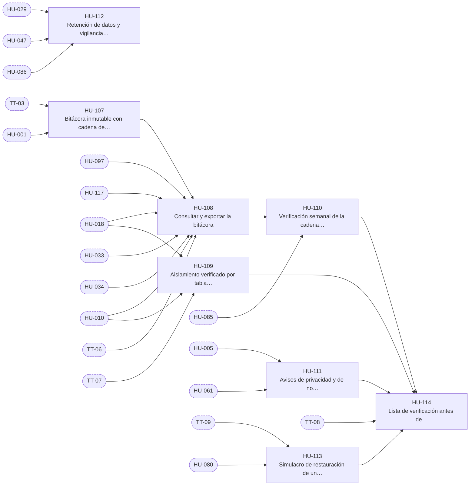

# E-12 · Seguridad, auditoría y cumplimiento

| Campo | Valor |
|---|---|
| Objetivo | Que toda acción sensible quede en una bitácora inmutable, que el aislamiento entre personas esté demostrado con pruebas y que el MVP cumpla la lista de verificación antes de abrirse al equipo. |
| Documentación fuente | docs/11 |
| Módulos (docs/17) | M-02, M-17, M-20 |
| Depende de | — (transversal; acompaña a E-03) |
| Entregas en las que avanza | R1, R2, R6 |
| Etiquetas | `epica` · `E-12` |

## Capacidades

Tomadas de `docs/14` §2:

- Bitácora con cadena de hash
- Pantalla de bitácora
- Suite RLS transversal
- Avisos (privacidad, "no es asesoría")
- Simulacro de restauración
- Lista de verificación de 11 §10

## Historias de usuario

Cada historia tiene su narrativa, sus criterios de aceptación, sus tareas y sus relaciones en su propio archivo.

| ID | Historia | Rol | Entrega | Prioridad | Depende de |
|---|---|---|---|---|---|
| [HU-107](HU-107-bitacora-inmutable-con-cadena-de-hash.md) | Bitácora inmutable con cadena de hash | Administrador | R1 | Alta | [TT-03](../E-01-cimientos-y-calidad-continua/TT-03-base-de-supabase-esquema-private-extensiones-vault-y-ping.md), [HU-001](../E-02-identidad-y-acceso/HU-001-perfiles-rol-actual-y-lecturas-por-rol.md) |
| [HU-108](HU-108-consultar-y-exportar-la-bitacora.md) | Consultar y exportar la bitácora | Administrador | R2 | Alta | [HU-107](HU-107-bitacora-inmutable-con-cadena-de-hash.md), [HU-097](../E-11-administracion/HU-097-seccion-de-administracion-y-guia-de-primeros-pasos.md), [HU-117](../E-13-transicion-desde-la-v2/HU-117-exportador-de-reportes-de-la-v2-con-sus-pruebas.md), [HU-018](../E-03-fondo-y-libro-contable/HU-018-asignar-y-reducir-cupos.md), [HU-033](../E-05-motor-de-politicas-y-configuracion/HU-033-parametros-configurables-con-rango-e-historial.md), [HU-034](../E-05-motor-de-politicas-y-configuracion/HU-034-encender-y-apagar-los-interruptores-del-fondo.md), [HU-010](../E-02-identidad-y-acceso/HU-010-suspender-y-reactivar-una-cuenta.md), [TT-06](../E-01-cimientos-y-calidad-continua/TT-06-arnes-e2e-de-backend-y-de-la-app.md) |
| [HU-109](HU-109-aislamiento-verificado-por-tabla-y-por-funcion.md) | Aislamiento verificado por tabla y por función | Administrador | R2 | Alta | [HU-010](../E-02-identidad-y-acceso/HU-010-suspender-y-reactivar-una-cuenta.md), [HU-018](../E-03-fondo-y-libro-contable/HU-018-asignar-y-reducir-cupos.md), [TT-07](../E-01-cimientos-y-calidad-continua/TT-07-integracion-continua-completa-en-cada-pr.md) |
| [HU-110](HU-110-verificacion-semanal-de-la-cadena-de-hash.md) | Verificación semanal de la cadena de hash | Administrador | R6 | Media | [HU-108](HU-108-consultar-y-exportar-la-bitacora.md), [HU-085](../E-09-tiempo-real-y-notificaciones/HU-085-alertas-del-sistema-por-audiencia.md) |
| [HU-111](HU-111-avisos-de-privacidad-y-de-no-asesoria.md) | Avisos de privacidad y de no asesoría | Usuario | R6 | Media | [HU-005](../E-02-identidad-y-acceso/HU-005-ingresar-con-google-en-android-y-web.md), [HU-061](../E-07-sugerencias-y-decisiones/HU-061-mis-sugerencias-bandeja-y-detalle-con-explicacion.md) |
| [HU-112](HU-112-retencion-de-datos-y-vigilancia-del-tamano-de-la-base.md) | Retención de datos y vigilancia del tamaño de la base | Administrador | R6 | Baja | [HU-029](../E-04-datos-de-mercado/HU-029-barra-diaria-tras-el-cierre-y-retencion-de-barras-de-minuto.md), [HU-047](../E-06-ia-contexto-y-decision/HU-047-puntaje-compuesto-y-eleccion-de-la-mejor-opcion.md), [HU-086](../E-09-tiempo-real-y-notificaciones/HU-086-bandeja-de-notificaciones.md) |
| [HU-113](HU-113-simulacro-de-restauracion-de-un-respaldo.md) | Simulacro de restauración de un respaldo | Administrador | R6 | Media | [TT-09](../E-01-cimientos-y-calidad-continua/TT-09-mantenimiento-ping-diario-respaldo-cifrado-y-prueba-real-semanal.md), [HU-080](../E-08-ejecucion-y-broker/HU-080-conciliacion-completa-con-pausa-automatica.md) |
| [HU-114](HU-114-lista-de-verificacion-antes-de-abrir-el-mvp-al-equipo.md) | Lista de verificación antes de abrir el MVP al equipo | Administrador | R6 | Alta | [HU-111](HU-111-avisos-de-privacidad-y-de-no-asesoria.md), [HU-113](HU-113-simulacro-de-restauracion-de-un-respaldo.md), [HU-109](HU-109-aislamiento-verificado-por-tabla-y-por-funcion.md), [HU-110](HU-110-verificacion-semanal-de-la-cadena-de-hash.md), [TT-08](../E-01-cimientos-y-calidad-continua/TT-08-despliegue-continuo-al-proyecto-mvp-con-prueba-de-humo.md) |

## Relaciones

Una flecha `A --> B` significa que B depende de A. Los nodos con borde punteado son ítems de otras épicas.

## Requisitos funcionales de la épica

| ID | Requisito | Rol o actor | Lo implementan |
|---|---|---|---|
| [FR-218](../requisitos-funcionales/FR-218-bitacora-de-acciones-sensibles.md) | Bitácora de acciones sensibles | Sistema | [HU-107](HU-107-bitacora-inmutable-con-cadena-de-hash.md), [HU-108](HU-108-consultar-y-exportar-la-bitacora.md) |
| [FR-219](../requisitos-funcionales/FR-219-bitacora-inmutable-y-encadenada.md) | Bitácora inmutable y encadenada | Sistema | [HU-107](HU-107-bitacora-inmutable-con-cadena-de-hash.md) |
| [FR-220](../requisitos-funcionales/FR-220-verificacion-semanal-de-la-cadena.md) | Verificación semanal de la cadena | Sistema | [HU-110](HU-110-verificacion-semanal-de-la-cadena-de-hash.md) |
| [FR-221](../requisitos-funcionales/FR-221-consulta-de-la-bitacora.md) | Consulta de la bitácora | Administrador | [HU-108](HU-108-consultar-y-exportar-la-bitacora.md) |
| [FR-222](../requisitos-funcionales/FR-222-aislamiento-verificado-por-tabla-y-por-funcion.md) | Aislamiento verificado por tabla y por función | Sistema | [HU-109](HU-109-aislamiento-verificado-por-tabla-y-por-funcion.md), [HU-114](HU-114-lista-de-verificacion-antes-de-abrir-el-mvp-al-equipo.md) |
| [FR-223](../requisitos-funcionales/FR-223-aviso-de-privacidad.md) | Aviso de privacidad | Usuario, Analista y Administrador | [HU-111](HU-111-avisos-de-privacidad-y-de-no-asesoria.md) |
| [FR-224](../requisitos-funcionales/FR-224-aviso-de-que-no-es-asesoria-financiera.md) | Aviso de que no es asesoría financiera | Usuario y Analista | [HU-061](../E-07-sugerencias-y-decisiones/HU-061-mis-sugerencias-bandeja-y-detalle-con-explicacion.md), [HU-111](HU-111-avisos-de-privacidad-y-de-no-asesoria.md) |
| [FR-225](../requisitos-funcionales/FR-225-retencion-de-datos.md) | Retención de datos | Sistema | [HU-112](HU-112-retencion-de-datos-y-vigilancia-del-tamano-de-la-base.md) |
| [FR-226](../requisitos-funcionales/FR-226-vigilancia-del-tamano-de-la-base-de-datos.md) | Vigilancia del tamaño de la base de datos | Sistema | [HU-112](HU-112-retencion-de-datos-y-vigilancia-del-tamano-de-la-base.md) |
