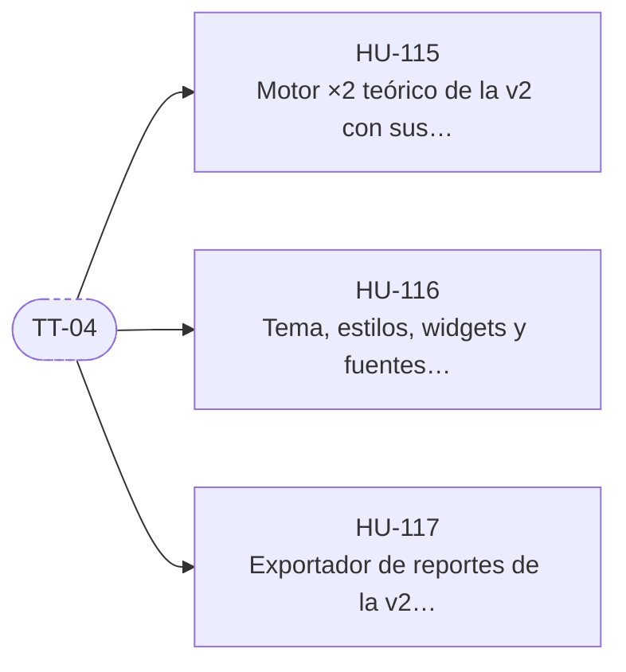

# E-13 · Transición desde la v2

| Campo | Valor |
|---|---|
| Objetivo | Reutilizar del repositorio v2 lo que ya funciona y está probado: el motor ×2, la interfaz y el exportador. |
| Documentación fuente | docs/05 §11 |
| Módulos (docs/17) | M-05, M-15, M-20 |
| Depende de | — (en paralelo con E-01) |
| Entregas en las que avanza | R1 |
| Etiquetas | `epica` · `E-13` |

## Capacidades

Tomadas de `docs/14` §2:

- Copiar del repositorio v2 el motor ×2, widgets, tema, fuentes y exportador, con sus pruebas

## Historias de usuario

Cada historia tiene su narrativa, sus criterios de aceptación, sus tareas y sus relaciones en su propio archivo.

| ID | Historia | Rol | Entrega | Prioridad | Depende de |
|---|---|---|---|---|---|
| [HU-115](HU-115-motor-x2-teorico-de-la-v2-con-sus-pruebas.md) | Motor ×2 teórico de la v2 con sus pruebas | Usuario | R1 | Media | [TT-04](../E-01-cimientos-y-calidad-continua/TT-04-esqueleto-de-la-app-flutter-para-android-y-web.md) |
| [HU-116](HU-116-tema-estilos-widgets-y-fuentes-de-la-v2.md) | Tema, estilos, widgets y fuentes de la v2 | Usuario | R1 | Baja | [TT-04](../E-01-cimientos-y-calidad-continua/TT-04-esqueleto-de-la-app-flutter-para-android-y-web.md) |
| [HU-117](HU-117-exportador-de-reportes-de-la-v2-con-sus-pruebas.md) | Exportador de reportes de la v2 con sus pruebas | Administrador | R1 | Baja | [TT-04](../E-01-cimientos-y-calidad-continua/TT-04-esqueleto-de-la-app-flutter-para-android-y-web.md) |

## Relaciones

Una flecha `A --> B` significa que B depende de A. Los nodos con borde punteado son ítems de otras épicas.

## Requisitos funcionales de la épica

| ID | Requisito | Rol o actor | Lo implementan |
|---|---|---|---|
| [FR-227](../requisitos-funcionales/FR-227-linea-x2-teorico.md) | Línea ×2 teórico | Sistema | [HU-115](HU-115-motor-x2-teorico-de-la-v2-con-sus-pruebas.md) |
