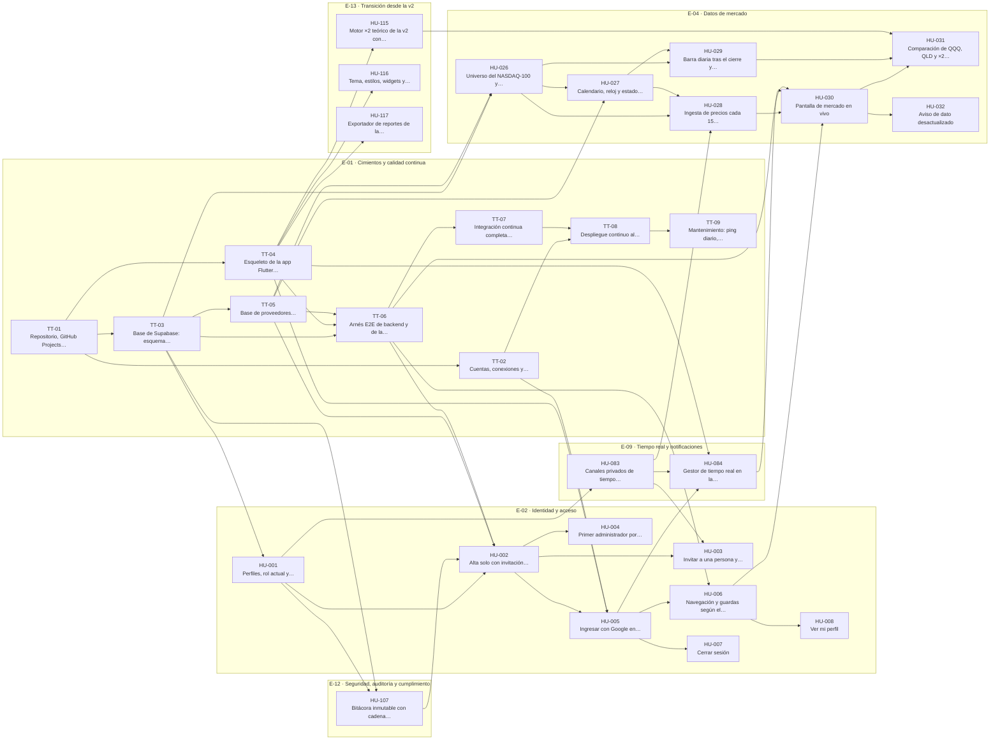
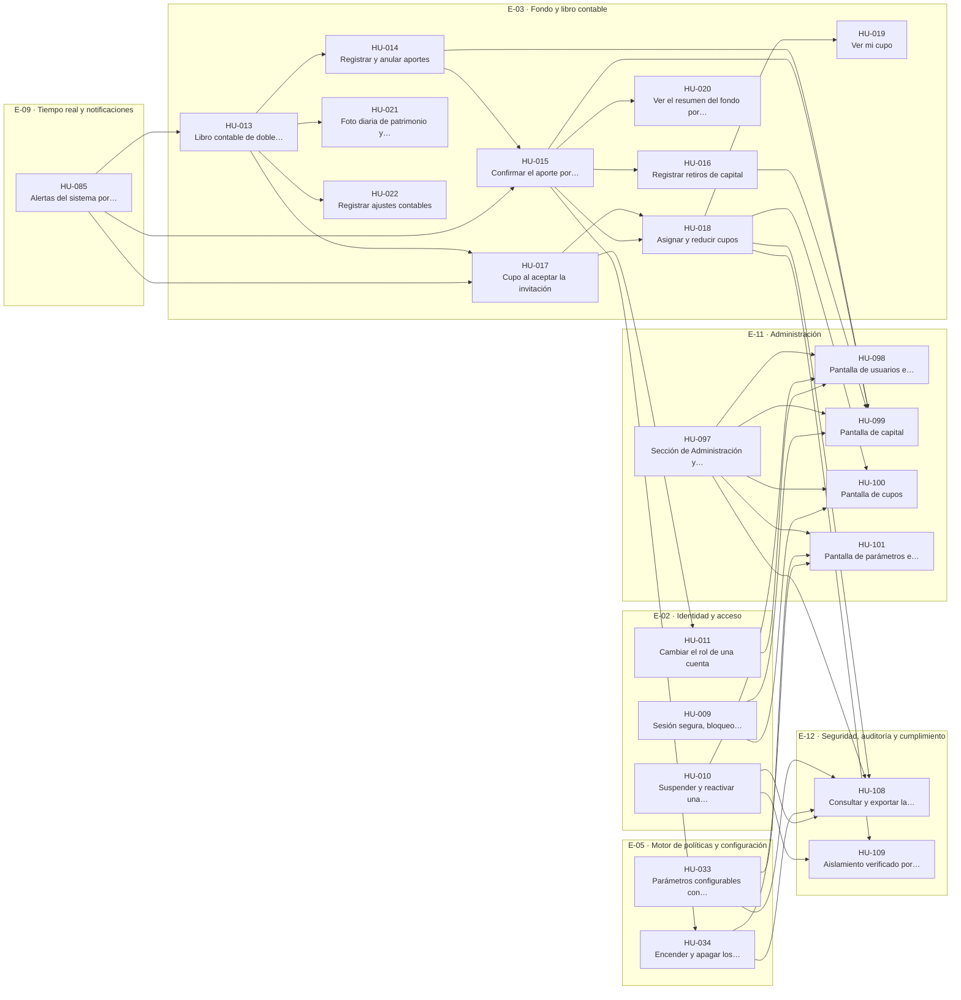
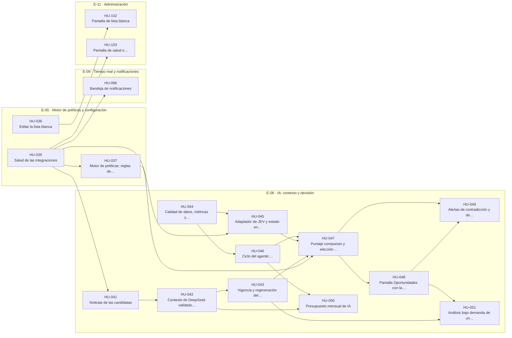
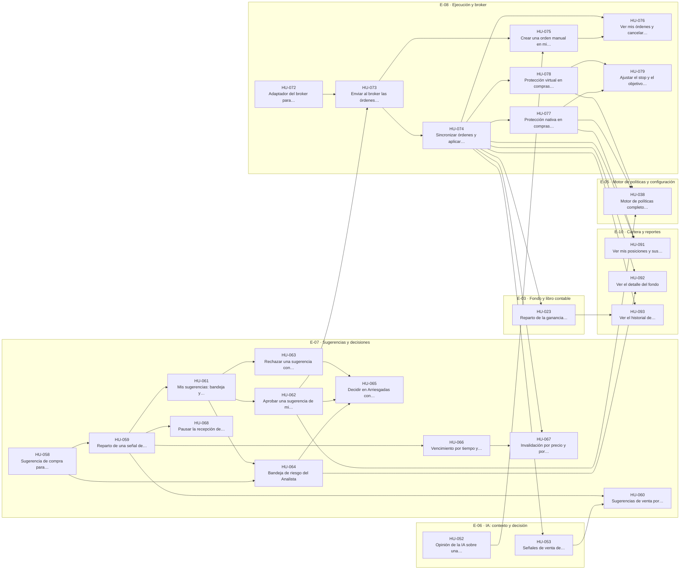
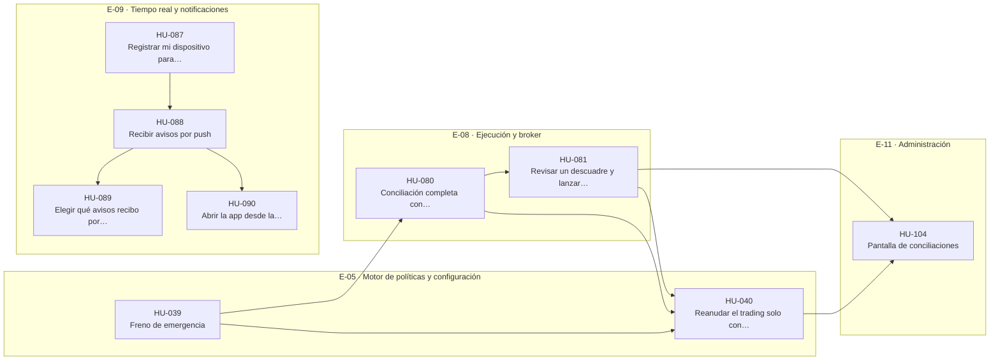
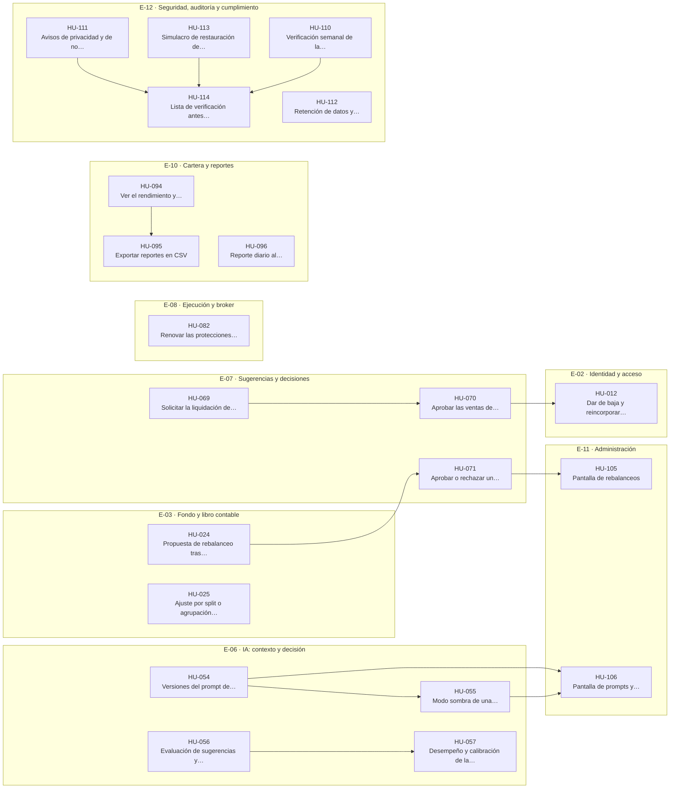

# Backlog · RiTech SAS · Plataforma de inversión asistida por IA (MVP)

Esta carpeta es la **etapa de planeación** del proyecto en archivos `.md`: los requisitos funcionales, las épicas y sus historias de usuario con criterios de aceptación, tareas y relaciones. Sirve para revisar el backlog completo antes de publicarlo como issues en GitHub Projects.

Todo sale de la especificación de [`docs/`](../docs/README.md), que sigue siendo la fuente de verdad. Aquí no se decide nada nuevo: cada requisito y cada historia cita la regla, el permiso o el caso borde de donde viene. Donde `docs/` no alcanza para escribir una historia, queda anotado en [Dudas e inconsistencias](#dudas-e-inconsistencias-encontradas-en-docs).

## Contenido

| Qué | Dónde | Cuántos |
|---|---|---|
| Requisitos funcionales | [requisitos-funcionales/](requisitos-funcionales/README.md) | 227 |
| Épicas | Una carpeta `E-xx-nombre/` por épica, con su `README.md` | 13 |
| Historias de usuario | Dentro de la carpeta de su épica (`HU-xxx-nombre.md`) | 117 |
| Tareas técnicas | Dentro de E-01 (`TT-xx-nombre.md`) | 9 |
| Qué tiene spec-kit y cómo encaja | [spec-kit.md](spec-kit.md) | — |

```
backlog/
  README.md                          este archivo
  spec-kit.md                        la herramienta spec-kit y su relación con el backlog
  requisitos-funcionales/
    README.md                        índice de requisitos por épica
    FR-001-<nombre>.md               un requisito por archivo
  E-01-cimientos-y-calidad-continua/
    README.md                        la épica
    TT-01-<nombre>.md                una tarea técnica por archivo
  E-02-identidad-y-acceso/
    README.md                        la épica
    HU-001-<nombre>.md               una historia por archivo
  …                                  hasta E-13
```

## Épicas

Son las de `docs/14` §2. E-14 está retirada y no se crea.

| Épica | Ítems | Requisitos | Entregas | Depende de |
|---|---|---|---|---|
| [E-01 · Cimientos y calidad continua](E-01-cimientos-y-calidad-continua/README.md) | 9 tareas técnicas | 11 | R1 | — |
| [E-02 · Identidad y acceso](E-02-identidad-y-acceso/README.md) | 12 historias | 26 | R1, R2, R6 | E-01 |
| [E-03 · Fondo y libro contable](E-03-fondo-y-libro-contable/README.md) | 13 historias | 23 | R2, R4, R6 | E-02 |
| [E-04 · Datos de mercado](E-04-datos-de-mercado/README.md) | 7 historias | 15 | R1 | E-01 |
| [E-05 · Motor de políticas y configuración](E-05-motor-de-politicas-y-configuracion/README.md) | 8 historias | 20 | R2, R3, R4, R5 | E-03, E-04 |
| [E-06 · IA: contexto y decisión](E-06-ia-contexto-y-decision/README.md) | 17 historias | 38 | R3, R4, R6 | E-04, E-05 |
| [E-07 · Sugerencias y decisiones](E-07-sugerencias-y-decisiones/README.md) | 14 historias | 24 | R4, R6 | E-05, E-06 |
| [E-08 · Ejecución y broker](E-08-ejecucion-y-broker/README.md) | 11 historias | 28 | R4, R5, R6 | E-03, E-07 |
| [E-09 · Tiempo real y notificaciones](E-09-tiempo-real-y-notificaciones/README.md) | 8 historias | 12 | R1, R2, R3, R5 | E-02 |
| [E-10 · Cartera y reportes](E-10-cartera-y-reportes/README.md) | 6 historias | 8 | R4, R6 | E-03, E-08 |
| [E-11 · Administración](E-11-administracion/README.md) | 10 historias | 12 | R2, R3, R5, R6 | E-02 |
| [E-12 · Seguridad, auditoría y cumplimiento](E-12-seguridad-auditoria-y-cumplimiento/README.md) | 8 historias | 9 | R1, R2, R6 | — (transversal; acompaña a E-03) |
| [E-13 · Transición desde la v2](E-13-transicion-desde-la-v2/README.md) | 3 historias | 1 | R1 | — (en paralelo con E-01) |

## Entregas

Son los hitos de `docs/14` §4. Cada historia pertenece a una.

| Entrega (hito) | Ítems | Épicas que avanzan (ítems) |
|---|---|---|
| R1 · Ver el mercado en vivo | 30 | E-01 (9), E-02 (8), E-04 (7), E-09 (2), E-12 (1), E-13 (3) |
| R2 · El fondo existe | 23 | E-02 (3), E-03 (10), E-05 (2), E-09 (1), E-11 (5), E-12 (2) |
| R3 · La IA analiza | 17 | E-05 (3), E-06 (11), E-09 (1), E-11 (2) |
| R4 · Decidir y operar en paper | 26 | E-03 (1), E-05 (1), E-06 (2), E-07 (11), E-08 (8), E-10 (3) |
| R5 · Protegido y avisado | 9 | E-05 (2), E-08 (2), E-09 (4), E-11 (1) |
| R6 · Medir y mejorar | 21 | E-02 (1), E-03 (2), E-06 (4), E-07 (3), E-08 (1), E-10 (3), E-11 (2), E-12 (5) |

## Cómo leer una historia

Cada historia usa los campos del formulario `.github/ISSUE_TEMPLATE/historia-de-usuario.yml` y de `docs/14` §5, más los requisitos funcionales, las tareas y las relaciones.

| Sección | Qué contiene |
|---|---|
| Tabla inicial | Épica, entrega (hito), rol, prioridad, módulos de `docs/17`, estimación y las etiquetas que llevará el issue |
| Historia | La narrativa: **Como** un rol, **quiero** una acción, **para** un beneficio |
| Requisitos funcionales | Los `FR-xxx` que implementa |
| Reglas | Las reglas de negocio (`RN`), de riesgo (`RR`), permisos (`PM`), decisiones (`D`) y secciones de `docs/` que aplican |
| Criterios de aceptación | Mínimo tres, en la forma *Dado … cuando … entonces …*. Los marcados "(caso borde)" citan un `CB` de `docs/12`; los marcados "(permiso)" o "(aislamiento)" comprueban que el rol o el dueño equivocado no pasa |
| Casos borde | Los `CB` que la historia cubre |
| Escenario E2E | El escenario de `docs/15` §4 que agrega ("nuevo") o extiende ("actualizado") |
| Tareas | Los pasos para construirla, en el orden del flujo de `CLAUDE.md`: migración y RLS, funciones de base de datos, Edge Functions, app, pruebas y E2E |
| Relaciones | De qué ítems depende y a cuáles habilita, con el motivo |
| Notas técnicas | Tablas, funciones, eventos y avisos que conviene tener presentes |
| Documentación a actualizar | "Ninguna", o lo que `docs/` debe precisar antes de implementar |
| Definición de terminado | La lista de `docs/14` §6 |

**Mínimos de toda historia:** narrativa completa, al menos tres criterios de aceptación, al menos una tarea y sus relaciones. La estimación queda por definir al refinar en el proyecto de GitHub.

Las **tareas técnicas** de E-01 usan los campos de `tarea-tecnica.yml`: qué hay que hacer y por qué, documentación fuente, criterio de terminado (mínimo tres), tareas y relaciones. No llevan narrativa porque son trabajo sin valor directo para un rol.

## Relaciones entre historias

Hay dos tipos, y uno es el inverso del otro:

- **Depende de**: la historia no se puede terminar sin la otra. Cada dependencia dice por qué.
- **Habilita**: la otra historia depende de esta.

Reglas que cumplen todas las relaciones de este backlog:

- Una historia nunca depende de otra de una entrega posterior. Así cada entrega se puede terminar sola.
- No hay ciclos.
- Si una historia extiende un escenario E2E ("actualizado"), depende de la historia que lo crea ("nuevo").

Las dependencias entre historias cruzan épicas en más sentidos que el diagrama de `docs/14` §3. Ese diagrama da el orden general de las épicas; como una épica avanza en varias entregas, una historia tardía de una épica puede depender de una épica posterior. Por ejemplo, dar de baja una cuenta (E-02, en R6) depende de la liquidación (E-07). E-09 (tiempo real y avisos), E-11 (pantallas del Administrador) y E-12 (bitácora) son transversales: casi todas las épicas las usan.

Cada relación está en tres sitios: en la sección "Relaciones" de cada historia, en la tabla y el diagrama del `README.md` de su épica, y en la tabla completa de este archivo.

## Ajustes al orden de entregas

`docs/14` §4 propone qué épicas entran en cada entrega y aclara que ese orden "se refina al crear el backlog". Al bajar a historias aparecieron estas diferencias, todas porque una historia de una entrega necesita algo que el documento ubica después:

| Ítem | `docs/14` §4 dice | En este backlog | Por qué |
|---|---|---|---|
| [HU-107](E-12-seguridad-auditoria-y-cumplimiento/HU-107-bitacora-inmutable-con-cadena-de-hash.md) | Bitácora (E-12) en R2 | R1 | El trigger de alta de `docs/04` §6, que es de R1, ya llama a `private.auditar`. La pantalla y el E2E-14 siguen en R2 ([HU-108](E-12-seguridad-auditoria-y-cumplimiento/HU-108-consultar-y-exportar-la-bitacora.md)). |
| [HU-085](E-09-tiempo-real-y-notificaciones/HU-085-alertas-del-sistema-por-audiencia.md) | Alertas de E-09 en R3 | R2 | R2 ya crea alertas: aporte sin confirmar (CB-11) y cupo inicial sin asignar (CB-15). Las alertas de la IA siguen en R3. |
| [HU-023](E-03-fondo-y-libro-contable/HU-023-reparto-de-la-ganancia-realizada-y-absorcion-de-perdidas.md) | E-03 (sin rebalanceo) en R2 | R4 | El reparto de ganancias vive dentro de `private.aplicar_llenado` y solo se puede probar con ventas, que llegan en R4. |
| [HU-037](E-05-motor-de-politicas-y-configuracion/HU-037-motor-de-politicas-reglas-de-la-propuesta.md) y [HU-038](E-05-motor-de-politicas-y-configuracion/HU-038-motor-de-politicas-completo-en-los-cuatro-momentos.md) | "Motor completo" de E-05 en R4 | R3 y R4 | En R3 la IA ya valida sus señales con el motor (`docs/07` §3). Van en R3 las reglas que se calculan con datos de R1 a R3 y en R4 las que miran sugerencias, órdenes y posiciones. |
| [HU-036](E-05-motor-de-politicas-y-configuracion/HU-036-editar-la-lista-blanca.md) | No la ubica | R3 | La lista blanca de Arriesgadas es el universo que evalúa la IA. |
| [HU-009](E-02-identidad-y-acceso/HU-009-sesion-segura-bloqueo-biometrico-y-confirmacion-de-acciones-sensibles.md), [HU-010](E-02-identidad-y-acceso/HU-010-suspender-y-reactivar-una-cuenta.md) y [HU-011](E-02-identidad-y-acceso/HU-011-cambiar-el-rol-de-una-cuenta.md) | De E-02 solo nombra ingreso, invitaciones, roles y navegación (R1) | R2 | La demostración de R2 incluye suspender a alguien; la confirmación biométrica hace falta desde el primer movimiento de dinero; y el cambio de rol necesita los cupos. |
| [HU-015](E-03-fondo-y-libro-contable/HU-015-confirmar-el-aporte-por-conciliacion-y-repartirlo-50-25-25.md) | Conciliación con pausa automática en R5 | R2 (solo efectivo) | `docs/14` §2 ya dice que los aportes se confirman "por conciliación de efectivo". La conciliación completa sigue en R5 ([HU-080](E-08-ejecucion-y-broker/HU-080-conciliacion-completa-con-pausa-automatica.md)). |

El adaptador del broker nace por partes, según lo va necesitando cada entrega: `calendario` en R1 ([HU-027](E-04-datos-de-mercado/HU-027-calendario-reloj-y-estado-del-mercado.md)), `cuenta` en R2 ([HU-015](E-03-fondo-y-libro-contable/HU-015-confirmar-el-aporte-por-conciliacion-y-repartirlo-50-25-25.md)) y las órdenes en R4 ([HU-072](E-08-ejecucion-y-broker/HU-072-adaptador-del-broker-para-ordenes.md)). Lo mismo pasa con las tablas: cada una la crea la primera historia que la necesita, y eso está escrito en sus tareas.

Las pantallas de Administración (E-11) van en la entrega de la capacidad que muestran: en R2 las que `docs/14` §4 nombra (capital, cupos y usuarios, más parámetros e interruptores) y después las demás.

## Mapa de dependencias por entrega

Una flecha `A --> B` significa que B depende de A. Cada diagrama muestra solo las dependencias entre ítems de la misma entrega.

### R1 · Ver el mercado en vivo

30 ítems. No dependen de entregas anteriores.



### R2 · El fondo existe

23 ítems. Además dependen de ítems de entregas anteriores (13); están en la tabla completa de más abajo.



### R3 · La IA analiza

17 ítems. Además dependen de ítems de entregas anteriores (15); están en la tabla completa de más abajo.



### R4 · Decidir y operar en paper

26 ítems. Además dependen de ítems de entregas anteriores (21); están en la tabla completa de más abajo.



### R5 · Protegido y avisado

9 ítems. Además dependen de ítems de entregas anteriores (17); están en la tabla completa de más abajo.



### R6 · Medir y mejorar

21 ítems. Además dependen de ítems de entregas anteriores (37); están en la tabla completa de más abajo.




## Por dónde empezar

Estos ítems no dependen de ningún otro:

- [TT-01 · Repositorio, GitHub Projects y wiki](E-01-cimientos-y-calidad-continua/TT-01-repositorio-github-projects-y-wiki.md) (R1)

## Tabla completa de relaciones

| ID | Título | Épica | Entrega | Depende de | Habilita |
|---|---|---|---|---|---|
| [TT-01](E-01-cimientos-y-calidad-continua/TT-01-repositorio-github-projects-y-wiki.md) | Repositorio, GitHub Projects y wiki | E-01 | R1 | — | [TT-02](E-01-cimientos-y-calidad-continua/TT-02-cuentas-conexiones-y-secretos-de-los-servicios-externos.md), [TT-03](E-01-cimientos-y-calidad-continua/TT-03-base-de-supabase-esquema-private-extensiones-vault-y-ping.md), [TT-04](E-01-cimientos-y-calidad-continua/TT-04-esqueleto-de-la-app-flutter-para-android-y-web.md) |
| [TT-02](E-01-cimientos-y-calidad-continua/TT-02-cuentas-conexiones-y-secretos-de-los-servicios-externos.md) | Cuentas, conexiones y secretos de los servicios externos | E-01 | R1 | [TT-01](E-01-cimientos-y-calidad-continua/TT-01-repositorio-github-projects-y-wiki.md) | [TT-08](E-01-cimientos-y-calidad-continua/TT-08-despliegue-continuo-al-proyecto-mvp-con-prueba-de-humo.md), [HU-005](E-02-identidad-y-acceso/HU-005-ingresar-con-google-en-android-y-web.md), [HU-087](E-09-tiempo-real-y-notificaciones/HU-087-registrar-mi-dispositivo-para-push.md) |
| [TT-03](E-01-cimientos-y-calidad-continua/TT-03-base-de-supabase-esquema-private-extensiones-vault-y-ping.md) | Base de Supabase: esquema private, extensiones, Vault y ping | E-01 | R1 | [TT-01](E-01-cimientos-y-calidad-continua/TT-01-repositorio-github-projects-y-wiki.md) | [TT-05](E-01-cimientos-y-calidad-continua/TT-05-base-de-proveedores-simulados-reloj-controlable-y-datos-de-prueba.md), [TT-06](E-01-cimientos-y-calidad-continua/TT-06-arnes-e2e-de-backend-y-de-la-app.md), [HU-001](E-02-identidad-y-acceso/HU-001-perfiles-rol-actual-y-lecturas-por-rol.md), [HU-026](E-04-datos-de-mercado/HU-026-universo-del-nasdaq-100-y-carga-historica-de-barras.md), [HU-107](E-12-seguridad-auditoria-y-cumplimiento/HU-107-bitacora-inmutable-con-cadena-de-hash.md) |
| [TT-04](E-01-cimientos-y-calidad-continua/TT-04-esqueleto-de-la-app-flutter-para-android-y-web.md) | Esqueleto de la app Flutter para Android y web | E-01 | R1 | [TT-01](E-01-cimientos-y-calidad-continua/TT-01-repositorio-github-projects-y-wiki.md) | [TT-06](E-01-cimientos-y-calidad-continua/TT-06-arnes-e2e-de-backend-y-de-la-app.md), [HU-005](E-02-identidad-y-acceso/HU-005-ingresar-con-google-en-android-y-web.md), [HU-084](E-09-tiempo-real-y-notificaciones/HU-084-gestor-de-tiempo-real-en-la-app.md), [HU-115](E-13-transicion-desde-la-v2/HU-115-motor-x2-teorico-de-la-v2-con-sus-pruebas.md), [HU-116](E-13-transicion-desde-la-v2/HU-116-tema-estilos-widgets-y-fuentes-de-la-v2.md), [HU-117](E-13-transicion-desde-la-v2/HU-117-exportador-de-reportes-de-la-v2-con-sus-pruebas.md) |
| [TT-05](E-01-cimientos-y-calidad-continua/TT-05-base-de-proveedores-simulados-reloj-controlable-y-datos-de-prueba.md) | Base de proveedores simulados, reloj controlable y datos de prueba | E-01 | R1 | [TT-03](E-01-cimientos-y-calidad-continua/TT-03-base-de-supabase-esquema-private-extensiones-vault-y-ping.md) | [TT-06](E-01-cimientos-y-calidad-continua/TT-06-arnes-e2e-de-backend-y-de-la-app.md), [HU-002](E-02-identidad-y-acceso/HU-002-alta-solo-con-invitacion-vigente.md), [HU-026](E-04-datos-de-mercado/HU-026-universo-del-nasdaq-100-y-carga-historica-de-barras.md), [HU-027](E-04-datos-de-mercado/HU-027-calendario-reloj-y-estado-del-mercado.md), [HU-041](E-06-ia-contexto-y-decision/HU-041-noticias-de-las-candidatas.md), [HU-045](E-06-ia-contexto-y-decision/HU-045-adaptador-de-jev-y-estado-en-etiquetas.md), [HU-072](E-08-ejecucion-y-broker/HU-072-adaptador-del-broker-para-ordenes.md) |
| [TT-06](E-01-cimientos-y-calidad-continua/TT-06-arnes-e2e-de-backend-y-de-la-app.md) | Arnés E2E de backend y de la app | E-01 | R1 | [TT-03](E-01-cimientos-y-calidad-continua/TT-03-base-de-supabase-esquema-private-extensiones-vault-y-ping.md), [TT-04](E-01-cimientos-y-calidad-continua/TT-04-esqueleto-de-la-app-flutter-para-android-y-web.md), [TT-05](E-01-cimientos-y-calidad-continua/TT-05-base-de-proveedores-simulados-reloj-controlable-y-datos-de-prueba.md) | [TT-07](E-01-cimientos-y-calidad-continua/TT-07-integracion-continua-completa-en-cada-pr.md), [HU-002](E-02-identidad-y-acceso/HU-002-alta-solo-con-invitacion-vigente.md), [HU-006](E-02-identidad-y-acceso/HU-006-navegacion-y-guardas-segun-el-rol.md), [HU-015](E-03-fondo-y-libro-contable/HU-015-confirmar-el-aporte-por-conciliacion-y-repartirlo-50-25-25.md), [HU-030](E-04-datos-de-mercado/HU-030-pantalla-de-mercado-en-vivo.md), [HU-047](E-06-ia-contexto-y-decision/HU-047-puntaje-compuesto-y-eleccion-de-la-mejor-opcion.md), [HU-048](E-06-ia-contexto-y-decision/HU-048-pantalla-oportunidades-con-la-explicacion-de-cada-evaluacion.md), [HU-062](E-07-sugerencias-y-decisiones/HU-062-aprobar-una-sugerencia-de-mi-cupo.md), [HU-065](E-07-sugerencias-y-decisiones/HU-065-decidir-en-arriesgadas-con-doble-aprobacion.md), [HU-066](E-07-sugerencias-y-decisiones/HU-066-vencimiento-por-tiempo-y-aviso-previo.md), [HU-069](E-07-sugerencias-y-decisiones/HU-069-solicitar-la-liquidacion-de-un-cupo.md), [HU-075](E-08-ejecucion-y-broker/HU-075-crear-una-orden-manual-en-mi-cupo.md), [HU-078](E-08-ejecucion-y-broker/HU-078-proteccion-virtual-en-compras-fraccionales.md), [HU-080](E-08-ejecucion-y-broker/HU-080-conciliacion-completa-con-pausa-automatica.md), [HU-088](E-09-tiempo-real-y-notificaciones/HU-088-recibir-avisos-por-push.md), [HU-108](E-12-seguridad-auditoria-y-cumplimiento/HU-108-consultar-y-exportar-la-bitacora.md) |
| [TT-07](E-01-cimientos-y-calidad-continua/TT-07-integracion-continua-completa-en-cada-pr.md) | Integración continua completa en cada PR | E-01 | R1 | [TT-06](E-01-cimientos-y-calidad-continua/TT-06-arnes-e2e-de-backend-y-de-la-app.md) | [TT-08](E-01-cimientos-y-calidad-continua/TT-08-despliegue-continuo-al-proyecto-mvp-con-prueba-de-humo.md), [HU-109](E-12-seguridad-auditoria-y-cumplimiento/HU-109-aislamiento-verificado-por-tabla-y-por-funcion.md) |
| [TT-08](E-01-cimientos-y-calidad-continua/TT-08-despliegue-continuo-al-proyecto-mvp-con-prueba-de-humo.md) | Despliegue continuo al proyecto MVP con prueba de humo | E-01 | R1 | [TT-02](E-01-cimientos-y-calidad-continua/TT-02-cuentas-conexiones-y-secretos-de-los-servicios-externos.md), [TT-07](E-01-cimientos-y-calidad-continua/TT-07-integracion-continua-completa-en-cada-pr.md) | [TT-09](E-01-cimientos-y-calidad-continua/TT-09-mantenimiento-ping-diario-respaldo-cifrado-y-prueba-real-semanal.md), [HU-114](E-12-seguridad-auditoria-y-cumplimiento/HU-114-lista-de-verificacion-antes-de-abrir-el-mvp-al-equipo.md) |
| [TT-09](E-01-cimientos-y-calidad-continua/TT-09-mantenimiento-ping-diario-respaldo-cifrado-y-prueba-real-semanal.md) | Mantenimiento: ping diario, respaldo cifrado y prueba real semanal | E-01 | R1 | [TT-08](E-01-cimientos-y-calidad-continua/TT-08-despliegue-continuo-al-proyecto-mvp-con-prueba-de-humo.md) | [HU-113](E-12-seguridad-auditoria-y-cumplimiento/HU-113-simulacro-de-restauracion-de-un-respaldo.md) |
| [HU-001](E-02-identidad-y-acceso/HU-001-perfiles-rol-actual-y-lecturas-por-rol.md) | Perfiles, rol actual y lecturas por rol | E-02 | R1 | [TT-03](E-01-cimientos-y-calidad-continua/TT-03-base-de-supabase-esquema-private-extensiones-vault-y-ping.md) | [HU-002](E-02-identidad-y-acceso/HU-002-alta-solo-con-invitacion-vigente.md), [HU-010](E-02-identidad-y-acceso/HU-010-suspender-y-reactivar-una-cuenta.md), [HU-011](E-02-identidad-y-acceso/HU-011-cambiar-el-rol-de-una-cuenta.md), [HU-013](E-03-fondo-y-libro-contable/HU-013-libro-contable-de-doble-partida.md), [HU-083](E-09-tiempo-real-y-notificaciones/HU-083-canales-privados-de-tiempo-real.md), [HU-085](E-09-tiempo-real-y-notificaciones/HU-085-alertas-del-sistema-por-audiencia.md), [HU-107](E-12-seguridad-auditoria-y-cumplimiento/HU-107-bitacora-inmutable-con-cadena-de-hash.md) |
| [HU-002](E-02-identidad-y-acceso/HU-002-alta-solo-con-invitacion-vigente.md) | Alta solo con invitación vigente | E-02 | R1 | [HU-001](E-02-identidad-y-acceso/HU-001-perfiles-rol-actual-y-lecturas-por-rol.md), [HU-107](E-12-seguridad-auditoria-y-cumplimiento/HU-107-bitacora-inmutable-con-cadena-de-hash.md), [TT-05](E-01-cimientos-y-calidad-continua/TT-05-base-de-proveedores-simulados-reloj-controlable-y-datos-de-prueba.md), [TT-06](E-01-cimientos-y-calidad-continua/TT-06-arnes-e2e-de-backend-y-de-la-app.md) | [HU-003](E-02-identidad-y-acceso/HU-003-invitar-a-una-persona-y-revocar-invitaciones.md), [HU-004](E-02-identidad-y-acceso/HU-004-primer-administrador-por-configuracion-de-despliegue.md), [HU-005](E-02-identidad-y-acceso/HU-005-ingresar-con-google-en-android-y-web.md), [HU-017](E-03-fondo-y-libro-contable/HU-017-cupo-al-aceptar-la-invitacion.md), [HU-033](E-05-motor-de-politicas-y-configuracion/HU-033-parametros-configurables-con-rango-e-historial.md) |
| [HU-003](E-02-identidad-y-acceso/HU-003-invitar-a-una-persona-y-revocar-invitaciones.md) | Invitar a una persona y revocar invitaciones | E-02 | R1 | [HU-002](E-02-identidad-y-acceso/HU-002-alta-solo-con-invitacion-vigente.md), [HU-083](E-09-tiempo-real-y-notificaciones/HU-083-canales-privados-de-tiempo-real.md) | [HU-098](E-11-administracion/HU-098-pantalla-de-usuarios-e-invitaciones.md) |
| [HU-004](E-02-identidad-y-acceso/HU-004-primer-administrador-por-configuracion-de-despliegue.md) | Primer administrador por configuración de despliegue | E-02 | R1 | [HU-002](E-02-identidad-y-acceso/HU-002-alta-solo-con-invitacion-vigente.md) | — |
| [HU-005](E-02-identidad-y-acceso/HU-005-ingresar-con-google-en-android-y-web.md) | Ingresar con Google en Android y web | E-02 | R1 | [TT-04](E-01-cimientos-y-calidad-continua/TT-04-esqueleto-de-la-app-flutter-para-android-y-web.md), [TT-02](E-01-cimientos-y-calidad-continua/TT-02-cuentas-conexiones-y-secretos-de-los-servicios-externos.md), [HU-002](E-02-identidad-y-acceso/HU-002-alta-solo-con-invitacion-vigente.md) | [HU-006](E-02-identidad-y-acceso/HU-006-navegacion-y-guardas-segun-el-rol.md), [HU-007](E-02-identidad-y-acceso/HU-007-cerrar-sesion.md), [HU-009](E-02-identidad-y-acceso/HU-009-sesion-segura-bloqueo-biometrico-y-confirmacion-de-acciones-sensibles.md), [HU-084](E-09-tiempo-real-y-notificaciones/HU-084-gestor-de-tiempo-real-en-la-app.md), [HU-087](E-09-tiempo-real-y-notificaciones/HU-087-registrar-mi-dispositivo-para-push.md), [HU-111](E-12-seguridad-auditoria-y-cumplimiento/HU-111-avisos-de-privacidad-y-de-no-asesoria.md) |
| [HU-006](E-02-identidad-y-acceso/HU-006-navegacion-y-guardas-segun-el-rol.md) | Navegación y guardas según el rol | E-02 | R1 | [HU-005](E-02-identidad-y-acceso/HU-005-ingresar-con-google-en-android-y-web.md), [TT-06](E-01-cimientos-y-calidad-continua/TT-06-arnes-e2e-de-backend-y-de-la-app.md) | [HU-008](E-02-identidad-y-acceso/HU-008-ver-mi-perfil.md), [HU-019](E-03-fondo-y-libro-contable/HU-019-ver-mi-cupo.md), [HU-020](E-03-fondo-y-libro-contable/HU-020-ver-el-resumen-del-fondo-por-bolsillos.md), [HU-030](E-04-datos-de-mercado/HU-030-pantalla-de-mercado-en-vivo.md), [HU-048](E-06-ia-contexto-y-decision/HU-048-pantalla-oportunidades-con-la-explicacion-de-cada-evaluacion.md), [HU-057](E-06-ia-contexto-y-decision/HU-057-desempeno-y-calibracion-de-la-ia.md), [HU-085](E-09-tiempo-real-y-notificaciones/HU-085-alertas-del-sistema-por-audiencia.md), [HU-097](E-11-administracion/HU-097-seccion-de-administracion-y-guia-de-primeros-pasos.md) |
| [HU-007](E-02-identidad-y-acceso/HU-007-cerrar-sesion.md) | Cerrar sesión | E-02 | R1 | [HU-005](E-02-identidad-y-acceso/HU-005-ingresar-con-google-en-android-y-web.md) | [HU-087](E-09-tiempo-real-y-notificaciones/HU-087-registrar-mi-dispositivo-para-push.md) |
| [HU-008](E-02-identidad-y-acceso/HU-008-ver-mi-perfil.md) | Ver mi perfil | E-02 | R1 | [HU-006](E-02-identidad-y-acceso/HU-006-navegacion-y-guardas-segun-el-rol.md) | [HU-068](E-07-sugerencias-y-decisiones/HU-068-pausar-la-recepcion-de-sugerencias.md), [HU-089](E-09-tiempo-real-y-notificaciones/HU-089-elegir-que-avisos-recibo-por-push.md) |
| [HU-009](E-02-identidad-y-acceso/HU-009-sesion-segura-bloqueo-biometrico-y-confirmacion-de-acciones-sensibles.md) | Sesión segura, bloqueo biométrico y confirmación de acciones sensibles | E-02 | R2 | [HU-005](E-02-identidad-y-acceso/HU-005-ingresar-con-google-en-android-y-web.md) | [HU-062](E-07-sugerencias-y-decisiones/HU-062-aprobar-una-sugerencia-de-mi-cupo.md), [HU-063](E-07-sugerencias-y-decisiones/HU-063-rechazar-una-sugerencia-con-motivo.md), [HU-075](E-08-ejecucion-y-broker/HU-075-crear-una-orden-manual-en-mi-cupo.md), [HU-090](E-09-tiempo-real-y-notificaciones/HU-090-abrir-la-app-desde-la-notificacion.md), [HU-099](E-11-administracion/HU-099-pantalla-de-capital.md), [HU-100](E-11-administracion/HU-100-pantalla-de-cupos.md) |
| [HU-010](E-02-identidad-y-acceso/HU-010-suspender-y-reactivar-una-cuenta.md) | Suspender y reactivar una cuenta | E-02 | R2 | [HU-001](E-02-identidad-y-acceso/HU-001-perfiles-rol-actual-y-lecturas-por-rol.md), [HU-083](E-09-tiempo-real-y-notificaciones/HU-083-canales-privados-de-tiempo-real.md), [HU-084](E-09-tiempo-real-y-notificaciones/HU-084-gestor-de-tiempo-real-en-la-app.md), [HU-107](E-12-seguridad-auditoria-y-cumplimiento/HU-107-bitacora-inmutable-con-cadena-de-hash.md) | [HU-012](E-02-identidad-y-acceso/HU-012-dar-de-baja-y-reincorporar-una-cuenta.md), [HU-065](E-07-sugerencias-y-decisiones/HU-065-decidir-en-arriesgadas-con-doble-aprobacion.md), [HU-067](E-07-sugerencias-y-decisiones/HU-067-invalidacion-por-precio-y-por-cambio-de-situacion.md), [HU-069](E-07-sugerencias-y-decisiones/HU-069-solicitar-la-liquidacion-de-un-cupo.md), [HU-087](E-09-tiempo-real-y-notificaciones/HU-087-registrar-mi-dispositivo-para-push.md), [HU-098](E-11-administracion/HU-098-pantalla-de-usuarios-e-invitaciones.md), [HU-108](E-12-seguridad-auditoria-y-cumplimiento/HU-108-consultar-y-exportar-la-bitacora.md), [HU-109](E-12-seguridad-auditoria-y-cumplimiento/HU-109-aislamiento-verificado-por-tabla-y-por-funcion.md) |
| [HU-011](E-02-identidad-y-acceso/HU-011-cambiar-el-rol-de-una-cuenta.md) | Cambiar el rol de una cuenta | E-02 | R2 | [HU-001](E-02-identidad-y-acceso/HU-001-perfiles-rol-actual-y-lecturas-por-rol.md), [HU-017](E-03-fondo-y-libro-contable/HU-017-cupo-al-aceptar-la-invitacion.md), [HU-084](E-09-tiempo-real-y-notificaciones/HU-084-gestor-de-tiempo-real-en-la-app.md), [HU-107](E-12-seguridad-auditoria-y-cumplimiento/HU-107-bitacora-inmutable-con-cadena-de-hash.md) | [HU-065](E-07-sugerencias-y-decisiones/HU-065-decidir-en-arriesgadas-con-doble-aprobacion.md), [HU-098](E-11-administracion/HU-098-pantalla-de-usuarios-e-invitaciones.md) |
| [HU-012](E-02-identidad-y-acceso/HU-012-dar-de-baja-y-reincorporar-una-cuenta.md) | Dar de baja y reincorporar una cuenta | E-02 | R6 | [HU-010](E-02-identidad-y-acceso/HU-010-suspender-y-reactivar-una-cuenta.md), [HU-018](E-03-fondo-y-libro-contable/HU-018-asignar-y-reducir-cupos.md), [HU-070](E-07-sugerencias-y-decisiones/HU-070-aprobar-las-ventas-de-liquidacion.md), [HU-098](E-11-administracion/HU-098-pantalla-de-usuarios-e-invitaciones.md) | — |
| [HU-013](E-03-fondo-y-libro-contable/HU-013-libro-contable-de-doble-partida.md) | Libro contable de doble partida | E-03 | R2 | [HU-001](E-02-identidad-y-acceso/HU-001-perfiles-rol-actual-y-lecturas-por-rol.md), [HU-085](E-09-tiempo-real-y-notificaciones/HU-085-alertas-del-sistema-por-audiencia.md) | [HU-014](E-03-fondo-y-libro-contable/HU-014-registrar-y-anular-aportes.md), [HU-017](E-03-fondo-y-libro-contable/HU-017-cupo-al-aceptar-la-invitacion.md), [HU-021](E-03-fondo-y-libro-contable/HU-021-foto-diaria-de-patrimonio-y-rendimiento-twr.md), [HU-022](E-03-fondo-y-libro-contable/HU-022-registrar-ajustes-contables.md) |
| [HU-014](E-03-fondo-y-libro-contable/HU-014-registrar-y-anular-aportes.md) | Registrar y anular aportes | E-03 | R2 | [HU-013](E-03-fondo-y-libro-contable/HU-013-libro-contable-de-doble-partida.md), [HU-107](E-12-seguridad-auditoria-y-cumplimiento/HU-107-bitacora-inmutable-con-cadena-de-hash.md), [HU-083](E-09-tiempo-real-y-notificaciones/HU-083-canales-privados-de-tiempo-real.md) | [HU-015](E-03-fondo-y-libro-contable/HU-015-confirmar-el-aporte-por-conciliacion-y-repartirlo-50-25-25.md), [HU-099](E-11-administracion/HU-099-pantalla-de-capital.md) |
| [HU-015](E-03-fondo-y-libro-contable/HU-015-confirmar-el-aporte-por-conciliacion-y-repartirlo-50-25-25.md) | Confirmar el aporte por conciliación y repartirlo 50/25/25 | E-03 | R2 | [HU-014](E-03-fondo-y-libro-contable/HU-014-registrar-y-anular-aportes.md), [HU-027](E-04-datos-de-mercado/HU-027-calendario-reloj-y-estado-del-mercado.md), [HU-085](E-09-tiempo-real-y-notificaciones/HU-085-alertas-del-sistema-por-audiencia.md), [TT-06](E-01-cimientos-y-calidad-continua/TT-06-arnes-e2e-de-backend-y-de-la-app.md) | [HU-016](E-03-fondo-y-libro-contable/HU-016-registrar-retiros-de-capital.md), [HU-018](E-03-fondo-y-libro-contable/HU-018-asignar-y-reducir-cupos.md), [HU-020](E-03-fondo-y-libro-contable/HU-020-ver-el-resumen-del-fondo-por-bolsillos.md), [HU-034](E-05-motor-de-politicas-y-configuracion/HU-034-encender-y-apagar-los-interruptores-del-fondo.md), [HU-035](E-05-motor-de-politicas-y-configuracion/HU-035-salud-de-las-integraciones.md), [HU-072](E-08-ejecucion-y-broker/HU-072-adaptador-del-broker-para-ordenes.md), [HU-080](E-08-ejecucion-y-broker/HU-080-conciliacion-completa-con-pausa-automatica.md), [HU-086](E-09-tiempo-real-y-notificaciones/HU-086-bandeja-de-notificaciones.md), [HU-099](E-11-administracion/HU-099-pantalla-de-capital.md) |
| [HU-016](E-03-fondo-y-libro-contable/HU-016-registrar-retiros-de-capital.md) | Registrar retiros de capital | E-03 | R2 | [HU-015](E-03-fondo-y-libro-contable/HU-015-confirmar-el-aporte-por-conciliacion-y-repartirlo-50-25-25.md) | [HU-099](E-11-administracion/HU-099-pantalla-de-capital.md) |
| [HU-017](E-03-fondo-y-libro-contable/HU-017-cupo-al-aceptar-la-invitacion.md) | Cupo al aceptar la invitación | E-03 | R2 | [HU-013](E-03-fondo-y-libro-contable/HU-013-libro-contable-de-doble-partida.md), [HU-002](E-02-identidad-y-acceso/HU-002-alta-solo-con-invitacion-vigente.md), [HU-085](E-09-tiempo-real-y-notificaciones/HU-085-alertas-del-sistema-por-audiencia.md) | [HU-011](E-02-identidad-y-acceso/HU-011-cambiar-el-rol-de-una-cuenta.md), [HU-018](E-03-fondo-y-libro-contable/HU-018-asignar-y-reducir-cupos.md) |
| [HU-018](E-03-fondo-y-libro-contable/HU-018-asignar-y-reducir-cupos.md) | Asignar y reducir cupos | E-03 | R2 | [HU-017](E-03-fondo-y-libro-contable/HU-017-cupo-al-aceptar-la-invitacion.md), [HU-015](E-03-fondo-y-libro-contable/HU-015-confirmar-el-aporte-por-conciliacion-y-repartirlo-50-25-25.md) | [HU-012](E-02-identidad-y-acceso/HU-012-dar-de-baja-y-reincorporar-una-cuenta.md), [HU-019](E-03-fondo-y-libro-contable/HU-019-ver-mi-cupo.md), [HU-037](E-05-motor-de-politicas-y-configuracion/HU-037-motor-de-politicas-reglas-de-la-propuesta.md), [HU-059](E-07-sugerencias-y-decisiones/HU-059-reparto-de-una-senal-de-usuarios-en-sugerencias-por-cupo.md), [HU-100](E-11-administracion/HU-100-pantalla-de-cupos.md), [HU-108](E-12-seguridad-auditoria-y-cumplimiento/HU-108-consultar-y-exportar-la-bitacora.md), [HU-109](E-12-seguridad-auditoria-y-cumplimiento/HU-109-aislamiento-verificado-por-tabla-y-por-funcion.md) |
| [HU-019](E-03-fondo-y-libro-contable/HU-019-ver-mi-cupo.md) | Ver mi cupo | E-03 | R2 | [HU-018](E-03-fondo-y-libro-contable/HU-018-asignar-y-reducir-cupos.md), [HU-006](E-02-identidad-y-acceso/HU-006-navegacion-y-guardas-segun-el-rol.md), [HU-084](E-09-tiempo-real-y-notificaciones/HU-084-gestor-de-tiempo-real-en-la-app.md) | [HU-075](E-08-ejecucion-y-broker/HU-075-crear-una-orden-manual-en-mi-cupo.md), [HU-091](E-10-cartera-y-reportes/HU-091-ver-mis-posiciones-y-sus-protecciones.md), [HU-093](E-10-cartera-y-reportes/HU-093-ver-el-historial-de-operaciones.md) |
| [HU-020](E-03-fondo-y-libro-contable/HU-020-ver-el-resumen-del-fondo-por-bolsillos.md) | Ver el resumen del fondo por bolsillos | E-03 | R2 | [HU-015](E-03-fondo-y-libro-contable/HU-015-confirmar-el-aporte-por-conciliacion-y-repartirlo-50-25-25.md), [HU-006](E-02-identidad-y-acceso/HU-006-navegacion-y-guardas-segun-el-rol.md), [HU-084](E-09-tiempo-real-y-notificaciones/HU-084-gestor-de-tiempo-real-en-la-app.md) | [HU-092](E-10-cartera-y-reportes/HU-092-ver-el-detalle-del-fondo.md) |
| [HU-021](E-03-fondo-y-libro-contable/HU-021-foto-diaria-de-patrimonio-y-rendimiento-twr.md) | Foto diaria de patrimonio y rendimiento TWR | E-03 | R2 | [HU-013](E-03-fondo-y-libro-contable/HU-013-libro-contable-de-doble-partida.md), [HU-029](E-04-datos-de-mercado/HU-029-barra-diaria-tras-el-cierre-y-retencion-de-barras-de-minuto.md) | [HU-024](E-03-fondo-y-libro-contable/HU-024-propuesta-de-rebalanceo-tras-el-cierre.md), [HU-094](E-10-cartera-y-reportes/HU-094-ver-el-rendimiento-y-compararlo-con-el-nasdaq-100.md), [HU-096](E-10-cartera-y-reportes/HU-096-reporte-diario-al-administrador.md) |
| [HU-022](E-03-fondo-y-libro-contable/HU-022-registrar-ajustes-contables.md) | Registrar ajustes contables | E-03 | R2 | [HU-013](E-03-fondo-y-libro-contable/HU-013-libro-contable-de-doble-partida.md), [HU-107](E-12-seguridad-auditoria-y-cumplimiento/HU-107-bitacora-inmutable-con-cadena-de-hash.md) | [HU-025](E-03-fondo-y-libro-contable/HU-025-ajuste-por-split-o-agrupacion-de-acciones.md) |
| [HU-023](E-03-fondo-y-libro-contable/HU-023-reparto-de-la-ganancia-realizada-y-absorcion-de-perdidas.md) | Reparto de la ganancia realizada y absorción de pérdidas | E-03 | R4 | [HU-074](E-08-ejecucion-y-broker/HU-074-sincronizar-ordenes-y-aplicar-llenados.md) | [HU-070](E-07-sugerencias-y-decisiones/HU-070-aprobar-las-ventas-de-liquidacion.md), [HU-093](E-10-cartera-y-reportes/HU-093-ver-el-historial-de-operaciones.md) |
| [HU-024](E-03-fondo-y-libro-contable/HU-024-propuesta-de-rebalanceo-tras-el-cierre.md) | Propuesta de rebalanceo tras el cierre | E-03 | R6 | [HU-021](E-03-fondo-y-libro-contable/HU-021-foto-diaria-de-patrimonio-y-rendimiento-twr.md), [HU-058](E-07-sugerencias-y-decisiones/HU-058-sugerencia-de-compra-para-arriesgadas.md) | [HU-071](E-07-sugerencias-y-decisiones/HU-071-aprobar-o-rechazar-un-rebalanceo.md) |
| [HU-025](E-03-fondo-y-libro-contable/HU-025-ajuste-por-split-o-agrupacion-de-acciones.md) | Ajuste por split o agrupación de acciones | E-03 | R6 | [HU-080](E-08-ejecucion-y-broker/HU-080-conciliacion-completa-con-pausa-automatica.md), [HU-022](E-03-fondo-y-libro-contable/HU-022-registrar-ajustes-contables.md), [HU-079](E-08-ejecucion-y-broker/HU-079-ajustar-el-stop-y-el-objetivo-de-una-posicion.md) | — |
| [HU-026](E-04-datos-de-mercado/HU-026-universo-del-nasdaq-100-y-carga-historica-de-barras.md) | Universo del NASDAQ-100 y carga histórica de barras | E-04 | R1 | [TT-03](E-01-cimientos-y-calidad-continua/TT-03-base-de-supabase-esquema-private-extensiones-vault-y-ping.md), [TT-05](E-01-cimientos-y-calidad-continua/TT-05-base-de-proveedores-simulados-reloj-controlable-y-datos-de-prueba.md) | [HU-027](E-04-datos-de-mercado/HU-027-calendario-reloj-y-estado-del-mercado.md), [HU-028](E-04-datos-de-mercado/HU-028-ingesta-de-precios-cada-15-segundos.md), [HU-029](E-04-datos-de-mercado/HU-029-barra-diaria-tras-el-cierre-y-retencion-de-barras-de-minuto.md), [HU-036](E-05-motor-de-politicas-y-configuracion/HU-036-editar-la-lista-blanca.md), [HU-041](E-06-ia-contexto-y-decision/HU-041-noticias-de-las-candidatas.md) |
| [HU-027](E-04-datos-de-mercado/HU-027-calendario-reloj-y-estado-del-mercado.md) | Calendario, reloj y estado del mercado | E-04 | R1 | [HU-026](E-04-datos-de-mercado/HU-026-universo-del-nasdaq-100-y-carga-historica-de-barras.md), [TT-05](E-01-cimientos-y-calidad-continua/TT-05-base-de-proveedores-simulados-reloj-controlable-y-datos-de-prueba.md) | [HU-015](E-03-fondo-y-libro-contable/HU-015-confirmar-el-aporte-por-conciliacion-y-repartirlo-50-25-25.md), [HU-028](E-04-datos-de-mercado/HU-028-ingesta-de-precios-cada-15-segundos.md), [HU-029](E-04-datos-de-mercado/HU-029-barra-diaria-tras-el-cierre-y-retencion-de-barras-de-minuto.md), [HU-043](E-06-ia-contexto-y-decision/HU-043-vigencia-y-regeneracion-del-contexto.md), [HU-046](E-06-ia-contexto-y-decision/HU-046-ciclo-del-agente-programacion-uno-a-la-vez-y-omisiones.md), [HU-085](E-09-tiempo-real-y-notificaciones/HU-085-alertas-del-sistema-por-audiencia.md) |
| [HU-028](E-04-datos-de-mercado/HU-028-ingesta-de-precios-cada-15-segundos.md) | Ingesta de precios cada 15 segundos | E-04 | R1 | [HU-026](E-04-datos-de-mercado/HU-026-universo-del-nasdaq-100-y-carga-historica-de-barras.md), [HU-027](E-04-datos-de-mercado/HU-027-calendario-reloj-y-estado-del-mercado.md), [HU-083](E-09-tiempo-real-y-notificaciones/HU-083-canales-privados-de-tiempo-real.md) | [HU-030](E-04-datos-de-mercado/HU-030-pantalla-de-mercado-en-vivo.md), [HU-035](E-05-motor-de-politicas-y-configuracion/HU-035-salud-de-las-integraciones.md), [HU-037](E-05-motor-de-politicas-y-configuracion/HU-037-motor-de-politicas-reglas-de-la-propuesta.md), [HU-044](E-06-ia-contexto-y-decision/HU-044-calidad-de-datos-metricas-y-puntaje-cuantitativo.md), [HU-046](E-06-ia-contexto-y-decision/HU-046-ciclo-del-agente-programacion-uno-a-la-vez-y-omisiones.md), [HU-067](E-07-sugerencias-y-decisiones/HU-067-invalidacion-por-precio-y-por-cambio-de-situacion.md), [HU-078](E-08-ejecucion-y-broker/HU-078-proteccion-virtual-en-compras-fraccionales.md) |
| [HU-029](E-04-datos-de-mercado/HU-029-barra-diaria-tras-el-cierre-y-retencion-de-barras-de-minuto.md) | Barra diaria tras el cierre y retención de barras de minuto | E-04 | R1 | [HU-026](E-04-datos-de-mercado/HU-026-universo-del-nasdaq-100-y-carga-historica-de-barras.md), [HU-027](E-04-datos-de-mercado/HU-027-calendario-reloj-y-estado-del-mercado.md) | [HU-021](E-03-fondo-y-libro-contable/HU-021-foto-diaria-de-patrimonio-y-rendimiento-twr.md), [HU-031](E-04-datos-de-mercado/HU-031-comparacion-de-qqq-qld-y-x2-teorico.md), [HU-044](E-06-ia-contexto-y-decision/HU-044-calidad-de-datos-metricas-y-puntaje-cuantitativo.md), [HU-056](E-06-ia-contexto-y-decision/HU-056-evaluacion-de-sugerencias-y-candidatas-tras-el-cierre.md), [HU-112](E-12-seguridad-auditoria-y-cumplimiento/HU-112-retencion-de-datos-y-vigilancia-del-tamano-de-la-base.md) |
| [HU-030](E-04-datos-de-mercado/HU-030-pantalla-de-mercado-en-vivo.md) | Pantalla de mercado en vivo | E-04 | R1 | [HU-028](E-04-datos-de-mercado/HU-028-ingesta-de-precios-cada-15-segundos.md), [HU-084](E-09-tiempo-real-y-notificaciones/HU-084-gestor-de-tiempo-real-en-la-app.md), [HU-006](E-02-identidad-y-acceso/HU-006-navegacion-y-guardas-segun-el-rol.md), [TT-06](E-01-cimientos-y-calidad-continua/TT-06-arnes-e2e-de-backend-y-de-la-app.md) | [HU-031](E-04-datos-de-mercado/HU-031-comparacion-de-qqq-qld-y-x2-teorico.md), [HU-032](E-04-datos-de-mercado/HU-032-aviso-de-dato-desactualizado.md) |
| [HU-031](E-04-datos-de-mercado/HU-031-comparacion-de-qqq-qld-y-x2-teorico.md) | Comparación de QQQ, QLD y ×2 teórico | E-04 | R1 | [HU-030](E-04-datos-de-mercado/HU-030-pantalla-de-mercado-en-vivo.md), [HU-029](E-04-datos-de-mercado/HU-029-barra-diaria-tras-el-cierre-y-retencion-de-barras-de-minuto.md), [HU-115](E-13-transicion-desde-la-v2/HU-115-motor-x2-teorico-de-la-v2-con-sus-pruebas.md) | [HU-094](E-10-cartera-y-reportes/HU-094-ver-el-rendimiento-y-compararlo-con-el-nasdaq-100.md) |
| [HU-032](E-04-datos-de-mercado/HU-032-aviso-de-dato-desactualizado.md) | Aviso de dato desactualizado | E-04 | R1 | [HU-030](E-04-datos-de-mercado/HU-030-pantalla-de-mercado-en-vivo.md) | [HU-061](E-07-sugerencias-y-decisiones/HU-061-mis-sugerencias-bandeja-y-detalle-con-explicacion.md) |
| [HU-033](E-05-motor-de-politicas-y-configuracion/HU-033-parametros-configurables-con-rango-e-historial.md) | Parámetros configurables con rango e historial | E-05 | R2 | [HU-002](E-02-identidad-y-acceso/HU-002-alta-solo-con-invitacion-vigente.md), [HU-107](E-12-seguridad-auditoria-y-cumplimiento/HU-107-bitacora-inmutable-con-cadena-de-hash.md), [HU-083](E-09-tiempo-real-y-notificaciones/HU-083-canales-privados-de-tiempo-real.md) | [HU-037](E-05-motor-de-politicas-y-configuracion/HU-037-motor-de-politicas-reglas-de-la-propuesta.md), [HU-046](E-06-ia-contexto-y-decision/HU-046-ciclo-del-agente-programacion-uno-a-la-vez-y-omisiones.md), [HU-054](E-06-ia-contexto-y-decision/HU-054-versiones-del-prompt-de-contexto-y-de-la-configuracion-de-decision.md), [HU-101](E-11-administracion/HU-101-pantalla-de-parametros-e-interruptores.md), [HU-108](E-12-seguridad-auditoria-y-cumplimiento/HU-108-consultar-y-exportar-la-bitacora.md) |
| [HU-034](E-05-motor-de-politicas-y-configuracion/HU-034-encender-y-apagar-los-interruptores-del-fondo.md) | Encender y apagar los interruptores del fondo | E-05 | R2 | [HU-015](E-03-fondo-y-libro-contable/HU-015-confirmar-el-aporte-por-conciliacion-y-repartirlo-50-25-25.md), [HU-107](E-12-seguridad-auditoria-y-cumplimiento/HU-107-bitacora-inmutable-con-cadena-de-hash.md), [HU-083](E-09-tiempo-real-y-notificaciones/HU-083-canales-privados-de-tiempo-real.md) | [HU-037](E-05-motor-de-politicas-y-configuracion/HU-037-motor-de-politicas-reglas-de-la-propuesta.md), [HU-039](E-05-motor-de-politicas-y-configuracion/HU-039-freno-de-emergencia.md), [HU-046](E-06-ia-contexto-y-decision/HU-046-ciclo-del-agente-programacion-uno-a-la-vez-y-omisiones.md), [HU-101](E-11-administracion/HU-101-pantalla-de-parametros-e-interruptores.md), [HU-108](E-12-seguridad-auditoria-y-cumplimiento/HU-108-consultar-y-exportar-la-bitacora.md) |
| [HU-035](E-05-motor-de-politicas-y-configuracion/HU-035-salud-de-las-integraciones.md) | Salud de las integraciones | E-05 | R3 | [HU-028](E-04-datos-de-mercado/HU-028-ingesta-de-precios-cada-15-segundos.md), [HU-015](E-03-fondo-y-libro-contable/HU-015-confirmar-el-aporte-por-conciliacion-y-repartirlo-50-25-25.md), [HU-085](E-09-tiempo-real-y-notificaciones/HU-085-alertas-del-sistema-por-audiencia.md), [HU-107](E-12-seguridad-auditoria-y-cumplimiento/HU-107-bitacora-inmutable-con-cadena-de-hash.md) | [HU-037](E-05-motor-de-politicas-y-configuracion/HU-037-motor-de-politicas-reglas-de-la-propuesta.md), [HU-041](E-06-ia-contexto-y-decision/HU-041-noticias-de-las-candidatas.md), [HU-045](E-06-ia-contexto-y-decision/HU-045-adaptador-de-jev-y-estado-en-etiquetas.md), [HU-072](E-08-ejecucion-y-broker/HU-072-adaptador-del-broker-para-ordenes.md), [HU-086](E-09-tiempo-real-y-notificaciones/HU-086-bandeja-de-notificaciones.md), [HU-103](E-11-administracion/HU-103-pantalla-de-salud-e-integraciones.md) |
| [HU-036](E-05-motor-de-politicas-y-configuracion/HU-036-editar-la-lista-blanca.md) | Editar la lista blanca | E-05 | R3 | [HU-026](E-04-datos-de-mercado/HU-026-universo-del-nasdaq-100-y-carga-historica-de-barras.md), [HU-107](E-12-seguridad-auditoria-y-cumplimiento/HU-107-bitacora-inmutable-con-cadena-de-hash.md) | [HU-067](E-07-sugerencias-y-decisiones/HU-067-invalidacion-por-precio-y-por-cambio-de-situacion.md), [HU-102](E-11-administracion/HU-102-pantalla-de-lista-blanca.md) |
| [HU-037](E-05-motor-de-politicas-y-configuracion/HU-037-motor-de-politicas-reglas-de-la-propuesta.md) | Motor de políticas: reglas de la propuesta | E-05 | R3 | [HU-033](E-05-motor-de-politicas-y-configuracion/HU-033-parametros-configurables-con-rango-e-historial.md), [HU-034](E-05-motor-de-politicas-y-configuracion/HU-034-encender-y-apagar-los-interruptores-del-fondo.md), [HU-035](E-05-motor-de-politicas-y-configuracion/HU-035-salud-de-las-integraciones.md), [HU-028](E-04-datos-de-mercado/HU-028-ingesta-de-precios-cada-15-segundos.md), [HU-018](E-03-fondo-y-libro-contable/HU-018-asignar-y-reducir-cupos.md) | [HU-038](E-05-motor-de-politicas-y-configuracion/HU-038-motor-de-politicas-completo-en-los-cuatro-momentos.md), [HU-047](E-06-ia-contexto-y-decision/HU-047-puntaje-compuesto-y-eleccion-de-la-mejor-opcion.md), [HU-052](E-06-ia-contexto-y-decision/HU-052-opinion-de-la-ia-sobre-una-orden-manual.md), [HU-058](E-07-sugerencias-y-decisiones/HU-058-sugerencia-de-compra-para-arriesgadas.md), [HU-062](E-07-sugerencias-y-decisiones/HU-062-aprobar-una-sugerencia-de-mi-cupo.md) |
| [HU-038](E-05-motor-de-politicas-y-configuracion/HU-038-motor-de-politicas-completo-en-los-cuatro-momentos.md) | Motor de políticas completo en los cuatro momentos | E-05 | R4 | [HU-037](E-05-motor-de-politicas-y-configuracion/HU-037-motor-de-politicas-reglas-de-la-propuesta.md), [HU-062](E-07-sugerencias-y-decisiones/HU-062-aprobar-una-sugerencia-de-mi-cupo.md), [HU-077](E-08-ejecucion-y-broker/HU-077-proteccion-nativa-en-compras-de-acciones-enteras.md), [HU-078](E-08-ejecucion-y-broker/HU-078-proteccion-virtual-en-compras-fraccionales.md) | — |
| [HU-039](E-05-motor-de-politicas-y-configuracion/HU-039-freno-de-emergencia.md) | Freno de emergencia | E-05 | R5 | [HU-034](E-05-motor-de-politicas-y-configuracion/HU-034-encender-y-apagar-los-interruptores-del-fondo.md), [HU-067](E-07-sugerencias-y-decisiones/HU-067-invalidacion-por-precio-y-por-cambio-de-situacion.md), [HU-073](E-08-ejecucion-y-broker/HU-073-enviar-al-broker-las-ordenes-aprobadas.md), [HU-078](E-08-ejecucion-y-broker/HU-078-proteccion-virtual-en-compras-fraccionales.md) | [HU-040](E-05-motor-de-politicas-y-configuracion/HU-040-reanudar-el-trading-solo-con-la-conciliacion-en-ok.md), [HU-080](E-08-ejecucion-y-broker/HU-080-conciliacion-completa-con-pausa-automatica.md) |
| [HU-040](E-05-motor-de-politicas-y-configuracion/HU-040-reanudar-el-trading-solo-con-la-conciliacion-en-ok.md) | Reanudar el trading solo con la conciliación en ok | E-05 | R5 | [HU-039](E-05-motor-de-politicas-y-configuracion/HU-039-freno-de-emergencia.md), [HU-080](E-08-ejecucion-y-broker/HU-080-conciliacion-completa-con-pausa-automatica.md), [HU-081](E-08-ejecucion-y-broker/HU-081-revisar-un-descuadre-y-lanzar-una-conciliacion.md) | [HU-104](E-11-administracion/HU-104-pantalla-de-conciliaciones.md) |
| [HU-041](E-06-ia-contexto-y-decision/HU-041-noticias-de-las-candidatas.md) | Noticias de las candidatas | E-06 | R3 | [HU-026](E-04-datos-de-mercado/HU-026-universo-del-nasdaq-100-y-carga-historica-de-barras.md), [TT-05](E-01-cimientos-y-calidad-continua/TT-05-base-de-proveedores-simulados-reloj-controlable-y-datos-de-prueba.md), [HU-035](E-05-motor-de-politicas-y-configuracion/HU-035-salud-de-las-integraciones.md) | [HU-042](E-06-ia-contexto-y-decision/HU-042-contexto-de-deepseek-validado-contra-sus-fuentes.md) |
| [HU-042](E-06-ia-contexto-y-decision/HU-042-contexto-de-deepseek-validado-contra-sus-fuentes.md) | Contexto de DeepSeek validado contra sus fuentes | E-06 | R3 | [HU-041](E-06-ia-contexto-y-decision/HU-041-noticias-de-las-candidatas.md) | [HU-043](E-06-ia-contexto-y-decision/HU-043-vigencia-y-regeneracion-del-contexto.md), [HU-050](E-06-ia-contexto-y-decision/HU-050-presupuesto-mensual-de-ia.md), [HU-054](E-06-ia-contexto-y-decision/HU-054-versiones-del-prompt-de-contexto-y-de-la-configuracion-de-decision.md) |
| [HU-043](E-06-ia-contexto-y-decision/HU-043-vigencia-y-regeneracion-del-contexto.md) | Vigencia y regeneración del contexto | E-06 | R3 | [HU-042](E-06-ia-contexto-y-decision/HU-042-contexto-de-deepseek-validado-contra-sus-fuentes.md), [HU-027](E-04-datos-de-mercado/HU-027-calendario-reloj-y-estado-del-mercado.md) | [HU-047](E-06-ia-contexto-y-decision/HU-047-puntaje-compuesto-y-eleccion-de-la-mejor-opcion.md), [HU-051](E-06-ia-contexto-y-decision/HU-051-analisis-bajo-demanda-de-un-simbolo.md), [HU-052](E-06-ia-contexto-y-decision/HU-052-opinion-de-la-ia-sobre-una-orden-manual.md) |
| [HU-044](E-06-ia-contexto-y-decision/HU-044-calidad-de-datos-metricas-y-puntaje-cuantitativo.md) | Calidad de datos, métricas y puntaje cuantitativo | E-06 | R3 | [HU-029](E-04-datos-de-mercado/HU-029-barra-diaria-tras-el-cierre-y-retencion-de-barras-de-minuto.md), [HU-028](E-04-datos-de-mercado/HU-028-ingesta-de-precios-cada-15-segundos.md) | [HU-045](E-06-ia-contexto-y-decision/HU-045-adaptador-de-jev-y-estado-en-etiquetas.md), [HU-046](E-06-ia-contexto-y-decision/HU-046-ciclo-del-agente-programacion-uno-a-la-vez-y-omisiones.md) |
| [HU-045](E-06-ia-contexto-y-decision/HU-045-adaptador-de-jev-y-estado-en-etiquetas.md) | Adaptador de JEV y estado en etiquetas | E-06 | R3 | [HU-044](E-06-ia-contexto-y-decision/HU-044-calidad-de-datos-metricas-y-puntaje-cuantitativo.md), [TT-05](E-01-cimientos-y-calidad-continua/TT-05-base-de-proveedores-simulados-reloj-controlable-y-datos-de-prueba.md), [HU-035](E-05-motor-de-politicas-y-configuracion/HU-035-salud-de-las-integraciones.md) | [HU-047](E-06-ia-contexto-y-decision/HU-047-puntaje-compuesto-y-eleccion-de-la-mejor-opcion.md), [HU-052](E-06-ia-contexto-y-decision/HU-052-opinion-de-la-ia-sobre-una-orden-manual.md) |
| [HU-046](E-06-ia-contexto-y-decision/HU-046-ciclo-del-agente-programacion-uno-a-la-vez-y-omisiones.md) | Ciclo del agente: programación, uno a la vez y omisiones | E-06 | R3 | [HU-044](E-06-ia-contexto-y-decision/HU-044-calidad-de-datos-metricas-y-puntaje-cuantitativo.md), [HU-034](E-05-motor-de-politicas-y-configuracion/HU-034-encender-y-apagar-los-interruptores-del-fondo.md), [HU-033](E-05-motor-de-politicas-y-configuracion/HU-033-parametros-configurables-con-rango-e-historial.md), [HU-027](E-04-datos-de-mercado/HU-027-calendario-reloj-y-estado-del-mercado.md), [HU-028](E-04-datos-de-mercado/HU-028-ingesta-de-precios-cada-15-segundos.md) | [HU-047](E-06-ia-contexto-y-decision/HU-047-puntaje-compuesto-y-eleccion-de-la-mejor-opcion.md), [HU-050](E-06-ia-contexto-y-decision/HU-050-presupuesto-mensual-de-ia.md) |
| [HU-047](E-06-ia-contexto-y-decision/HU-047-puntaje-compuesto-y-eleccion-de-la-mejor-opcion.md) | Puntaje compuesto y elección de la mejor opción | E-06 | R3 | [HU-046](E-06-ia-contexto-y-decision/HU-046-ciclo-del-agente-programacion-uno-a-la-vez-y-omisiones.md), [HU-045](E-06-ia-contexto-y-decision/HU-045-adaptador-de-jev-y-estado-en-etiquetas.md), [HU-043](E-06-ia-contexto-y-decision/HU-043-vigencia-y-regeneracion-del-contexto.md), [HU-037](E-05-motor-de-politicas-y-configuracion/HU-037-motor-de-politicas-reglas-de-la-propuesta.md), [TT-06](E-01-cimientos-y-calidad-continua/TT-06-arnes-e2e-de-backend-y-de-la-app.md) | [HU-048](E-06-ia-contexto-y-decision/HU-048-pantalla-oportunidades-con-la-explicacion-de-cada-evaluacion.md), [HU-049](E-06-ia-contexto-y-decision/HU-049-alertas-de-contradiccion-y-de-mercado.md), [HU-052](E-06-ia-contexto-y-decision/HU-052-opinion-de-la-ia-sobre-una-orden-manual.md), [HU-053](E-06-ia-contexto-y-decision/HU-053-senales-de-venta-de-posiciones-abiertas.md), [HU-054](E-06-ia-contexto-y-decision/HU-054-versiones-del-prompt-de-contexto-y-de-la-configuracion-de-decision.md), [HU-058](E-07-sugerencias-y-decisiones/HU-058-sugerencia-de-compra-para-arriesgadas.md), [HU-112](E-12-seguridad-auditoria-y-cumplimiento/HU-112-retencion-de-datos-y-vigilancia-del-tamano-de-la-base.md) |
| [HU-048](E-06-ia-contexto-y-decision/HU-048-pantalla-oportunidades-con-la-explicacion-de-cada-evaluacion.md) | Pantalla Oportunidades con la explicación de cada evaluación | E-06 | R3 | [HU-047](E-06-ia-contexto-y-decision/HU-047-puntaje-compuesto-y-eleccion-de-la-mejor-opcion.md), [HU-006](E-02-identidad-y-acceso/HU-006-navegacion-y-guardas-segun-el-rol.md), [HU-084](E-09-tiempo-real-y-notificaciones/HU-084-gestor-de-tiempo-real-en-la-app.md), [TT-06](E-01-cimientos-y-calidad-continua/TT-06-arnes-e2e-de-backend-y-de-la-app.md) | [HU-049](E-06-ia-contexto-y-decision/HU-049-alertas-de-contradiccion-y-de-mercado.md), [HU-051](E-06-ia-contexto-y-decision/HU-051-analisis-bajo-demanda-de-un-simbolo.md) |
| [HU-049](E-06-ia-contexto-y-decision/HU-049-alertas-de-contradiccion-y-de-mercado.md) | Alertas de contradicción y de mercado | E-06 | R3 | [HU-047](E-06-ia-contexto-y-decision/HU-047-puntaje-compuesto-y-eleccion-de-la-mejor-opcion.md), [HU-048](E-06-ia-contexto-y-decision/HU-048-pantalla-oportunidades-con-la-explicacion-de-cada-evaluacion.md), [HU-085](E-09-tiempo-real-y-notificaciones/HU-085-alertas-del-sistema-por-audiencia.md) | — |
| [HU-050](E-06-ia-contexto-y-decision/HU-050-presupuesto-mensual-de-ia.md) | Presupuesto mensual de IA | E-06 | R3 | [HU-046](E-06-ia-contexto-y-decision/HU-046-ciclo-del-agente-programacion-uno-a-la-vez-y-omisiones.md), [HU-042](E-06-ia-contexto-y-decision/HU-042-contexto-de-deepseek-validado-contra-sus-fuentes.md), [HU-085](E-09-tiempo-real-y-notificaciones/HU-085-alertas-del-sistema-por-audiencia.md), [HU-107](E-12-seguridad-auditoria-y-cumplimiento/HU-107-bitacora-inmutable-con-cadena-de-hash.md) | — |
| [HU-051](E-06-ia-contexto-y-decision/HU-051-analisis-bajo-demanda-de-un-simbolo.md) | Análisis bajo demanda de un símbolo | E-06 | R3 | [HU-048](E-06-ia-contexto-y-decision/HU-048-pantalla-oportunidades-con-la-explicacion-de-cada-evaluacion.md), [HU-043](E-06-ia-contexto-y-decision/HU-043-vigencia-y-regeneracion-del-contexto.md) | — |
| [HU-052](E-06-ia-contexto-y-decision/HU-052-opinion-de-la-ia-sobre-una-orden-manual.md) | Opinión de la IA sobre una orden manual | E-06 | R4 | [HU-047](E-06-ia-contexto-y-decision/HU-047-puntaje-compuesto-y-eleccion-de-la-mejor-opcion.md), [HU-045](E-06-ia-contexto-y-decision/HU-045-adaptador-de-jev-y-estado-en-etiquetas.md), [HU-043](E-06-ia-contexto-y-decision/HU-043-vigencia-y-regeneracion-del-contexto.md), [HU-037](E-05-motor-de-politicas-y-configuracion/HU-037-motor-de-politicas-reglas-de-la-propuesta.md) | [HU-075](E-08-ejecucion-y-broker/HU-075-crear-una-orden-manual-en-mi-cupo.md) |
| [HU-053](E-06-ia-contexto-y-decision/HU-053-senales-de-venta-de-posiciones-abiertas.md) | Señales de venta de posiciones abiertas | E-06 | R4 | [HU-047](E-06-ia-contexto-y-decision/HU-047-puntaje-compuesto-y-eleccion-de-la-mejor-opcion.md), [HU-074](E-08-ejecucion-y-broker/HU-074-sincronizar-ordenes-y-aplicar-llenados.md) | [HU-060](E-07-sugerencias-y-decisiones/HU-060-sugerencias-de-venta-por-subcuenta.md) |
| [HU-054](E-06-ia-contexto-y-decision/HU-054-versiones-del-prompt-de-contexto-y-de-la-configuracion-de-decision.md) | Versiones del prompt de contexto y de la configuración de decisión | E-06 | R6 | [HU-047](E-06-ia-contexto-y-decision/HU-047-puntaje-compuesto-y-eleccion-de-la-mejor-opcion.md), [HU-042](E-06-ia-contexto-y-decision/HU-042-contexto-de-deepseek-validado-contra-sus-fuentes.md), [HU-033](E-05-motor-de-politicas-y-configuracion/HU-033-parametros-configurables-con-rango-e-historial.md), [HU-107](E-12-seguridad-auditoria-y-cumplimiento/HU-107-bitacora-inmutable-con-cadena-de-hash.md) | [HU-055](E-06-ia-contexto-y-decision/HU-055-modo-sombra-de-una-configuracion-candidata.md), [HU-106](E-11-administracion/HU-106-pantalla-de-prompts-y-configuraciones-de-decision.md) |
| [HU-055](E-06-ia-contexto-y-decision/HU-055-modo-sombra-de-una-configuracion-candidata.md) | Modo sombra de una configuración candidata | E-06 | R6 | [HU-054](E-06-ia-contexto-y-decision/HU-054-versiones-del-prompt-de-contexto-y-de-la-configuracion-de-decision.md) | [HU-106](E-11-administracion/HU-106-pantalla-de-prompts-y-configuraciones-de-decision.md) |
| [HU-056](E-06-ia-contexto-y-decision/HU-056-evaluacion-de-sugerencias-y-candidatas-tras-el-cierre.md) | Evaluación de sugerencias y candidatas tras el cierre | E-06 | R6 | [HU-059](E-07-sugerencias-y-decisiones/HU-059-reparto-de-una-senal-de-usuarios-en-sugerencias-por-cupo.md), [HU-074](E-08-ejecucion-y-broker/HU-074-sincronizar-ordenes-y-aplicar-llenados.md), [HU-029](E-04-datos-de-mercado/HU-029-barra-diaria-tras-el-cierre-y-retencion-de-barras-de-minuto.md) | [HU-057](E-06-ia-contexto-y-decision/HU-057-desempeno-y-calibracion-de-la-ia.md) |
| [HU-057](E-06-ia-contexto-y-decision/HU-057-desempeno-y-calibracion-de-la-ia.md) | Desempeño y calibración de la IA | E-06 | R6 | [HU-056](E-06-ia-contexto-y-decision/HU-056-evaluacion-de-sugerencias-y-candidatas-tras-el-cierre.md), [HU-006](E-02-identidad-y-acceso/HU-006-navegacion-y-guardas-segun-el-rol.md) | — |
| [HU-058](E-07-sugerencias-y-decisiones/HU-058-sugerencia-de-compra-para-arriesgadas.md) | Sugerencia de compra para Arriesgadas | E-07 | R4 | [HU-047](E-06-ia-contexto-y-decision/HU-047-puntaje-compuesto-y-eleccion-de-la-mejor-opcion.md), [HU-037](E-05-motor-de-politicas-y-configuracion/HU-037-motor-de-politicas-reglas-de-la-propuesta.md), [HU-086](E-09-tiempo-real-y-notificaciones/HU-086-bandeja-de-notificaciones.md) | [HU-024](E-03-fondo-y-libro-contable/HU-024-propuesta-de-rebalanceo-tras-el-cierre.md), [HU-059](E-07-sugerencias-y-decisiones/HU-059-reparto-de-una-senal-de-usuarios-en-sugerencias-por-cupo.md), [HU-064](E-07-sugerencias-y-decisiones/HU-064-bandeja-de-riesgo-del-analista.md) |
| [HU-059](E-07-sugerencias-y-decisiones/HU-059-reparto-de-una-senal-de-usuarios-en-sugerencias-por-cupo.md) | Reparto de una señal de Usuarios en sugerencias por cupo | E-07 | R4 | [HU-058](E-07-sugerencias-y-decisiones/HU-058-sugerencia-de-compra-para-arriesgadas.md), [HU-018](E-03-fondo-y-libro-contable/HU-018-asignar-y-reducir-cupos.md) | [HU-056](E-06-ia-contexto-y-decision/HU-056-evaluacion-de-sugerencias-y-candidatas-tras-el-cierre.md), [HU-060](E-07-sugerencias-y-decisiones/HU-060-sugerencias-de-venta-por-subcuenta.md), [HU-061](E-07-sugerencias-y-decisiones/HU-061-mis-sugerencias-bandeja-y-detalle-con-explicacion.md), [HU-066](E-07-sugerencias-y-decisiones/HU-066-vencimiento-por-tiempo-y-aviso-previo.md), [HU-068](E-07-sugerencias-y-decisiones/HU-068-pausar-la-recepcion-de-sugerencias.md), [HU-088](E-09-tiempo-real-y-notificaciones/HU-088-recibir-avisos-por-push.md) |
| [HU-060](E-07-sugerencias-y-decisiones/HU-060-sugerencias-de-venta-por-subcuenta.md) | Sugerencias de venta por subcuenta | E-07 | R4 | [HU-053](E-06-ia-contexto-y-decision/HU-053-senales-de-venta-de-posiciones-abiertas.md), [HU-059](E-07-sugerencias-y-decisiones/HU-059-reparto-de-una-senal-de-usuarios-en-sugerencias-por-cupo.md) | — |
| [HU-061](E-07-sugerencias-y-decisiones/HU-061-mis-sugerencias-bandeja-y-detalle-con-explicacion.md) | Mis sugerencias: bandeja y detalle con explicación | E-07 | R4 | [HU-059](E-07-sugerencias-y-decisiones/HU-059-reparto-de-una-senal-de-usuarios-en-sugerencias-por-cupo.md), [HU-084](E-09-tiempo-real-y-notificaciones/HU-084-gestor-de-tiempo-real-en-la-app.md), [HU-032](E-04-datos-de-mercado/HU-032-aviso-de-dato-desactualizado.md) | [HU-062](E-07-sugerencias-y-decisiones/HU-062-aprobar-una-sugerencia-de-mi-cupo.md), [HU-063](E-07-sugerencias-y-decisiones/HU-063-rechazar-una-sugerencia-con-motivo.md), [HU-064](E-07-sugerencias-y-decisiones/HU-064-bandeja-de-riesgo-del-analista.md), [HU-090](E-09-tiempo-real-y-notificaciones/HU-090-abrir-la-app-desde-la-notificacion.md), [HU-111](E-12-seguridad-auditoria-y-cumplimiento/HU-111-avisos-de-privacidad-y-de-no-asesoria.md) |
| [HU-062](E-07-sugerencias-y-decisiones/HU-062-aprobar-una-sugerencia-de-mi-cupo.md) | Aprobar una sugerencia de mi cupo | E-07 | R4 | [HU-061](E-07-sugerencias-y-decisiones/HU-061-mis-sugerencias-bandeja-y-detalle-con-explicacion.md), [HU-009](E-02-identidad-y-acceso/HU-009-sesion-segura-bloqueo-biometrico-y-confirmacion-de-acciones-sensibles.md), [HU-037](E-05-motor-de-politicas-y-configuracion/HU-037-motor-de-politicas-reglas-de-la-propuesta.md), [TT-06](E-01-cimientos-y-calidad-continua/TT-06-arnes-e2e-de-backend-y-de-la-app.md) | [HU-038](E-05-motor-de-politicas-y-configuracion/HU-038-motor-de-politicas-completo-en-los-cuatro-momentos.md), [HU-065](E-07-sugerencias-y-decisiones/HU-065-decidir-en-arriesgadas-con-doble-aprobacion.md), [HU-071](E-07-sugerencias-y-decisiones/HU-071-aprobar-o-rechazar-un-rebalanceo.md), [HU-073](E-08-ejecucion-y-broker/HU-073-enviar-al-broker-las-ordenes-aprobadas.md) |
| [HU-063](E-07-sugerencias-y-decisiones/HU-063-rechazar-una-sugerencia-con-motivo.md) | Rechazar una sugerencia con motivo | E-07 | R4 | [HU-061](E-07-sugerencias-y-decisiones/HU-061-mis-sugerencias-bandeja-y-detalle-con-explicacion.md), [HU-009](E-02-identidad-y-acceso/HU-009-sesion-segura-bloqueo-biometrico-y-confirmacion-de-acciones-sensibles.md) | [HU-065](E-07-sugerencias-y-decisiones/HU-065-decidir-en-arriesgadas-con-doble-aprobacion.md), [HU-071](E-07-sugerencias-y-decisiones/HU-071-aprobar-o-rechazar-un-rebalanceo.md) |
| [HU-064](E-07-sugerencias-y-decisiones/HU-064-bandeja-de-riesgo-del-analista.md) | Bandeja de riesgo del Analista | E-07 | R4 | [HU-058](E-07-sugerencias-y-decisiones/HU-058-sugerencia-de-compra-para-arriesgadas.md), [HU-061](E-07-sugerencias-y-decisiones/HU-061-mis-sugerencias-bandeja-y-detalle-con-explicacion.md), [HU-084](E-09-tiempo-real-y-notificaciones/HU-084-gestor-de-tiempo-real-en-la-app.md) | [HU-065](E-07-sugerencias-y-decisiones/HU-065-decidir-en-arriesgadas-con-doble-aprobacion.md), [HU-069](E-07-sugerencias-y-decisiones/HU-069-solicitar-la-liquidacion-de-un-cupo.md), [HU-092](E-10-cartera-y-reportes/HU-092-ver-el-detalle-del-fondo.md) |
| [HU-065](E-07-sugerencias-y-decisiones/HU-065-decidir-en-arriesgadas-con-doble-aprobacion.md) | Decidir en Arriesgadas con doble aprobación | E-07 | R4 | [HU-064](E-07-sugerencias-y-decisiones/HU-064-bandeja-de-riesgo-del-analista.md), [HU-062](E-07-sugerencias-y-decisiones/HU-062-aprobar-una-sugerencia-de-mi-cupo.md), [HU-063](E-07-sugerencias-y-decisiones/HU-063-rechazar-una-sugerencia-con-motivo.md), [HU-011](E-02-identidad-y-acceso/HU-011-cambiar-el-rol-de-una-cuenta.md), [HU-010](E-02-identidad-y-acceso/HU-010-suspender-y-reactivar-una-cuenta.md), [TT-06](E-01-cimientos-y-calidad-continua/TT-06-arnes-e2e-de-backend-y-de-la-app.md) | [HU-070](E-07-sugerencias-y-decisiones/HU-070-aprobar-las-ventas-de-liquidacion.md) |
| [HU-066](E-07-sugerencias-y-decisiones/HU-066-vencimiento-por-tiempo-y-aviso-previo.md) | Vencimiento por tiempo y aviso previo | E-07 | R4 | [HU-059](E-07-sugerencias-y-decisiones/HU-059-reparto-de-una-senal-de-usuarios-en-sugerencias-por-cupo.md), [HU-086](E-09-tiempo-real-y-notificaciones/HU-086-bandeja-de-notificaciones.md), [TT-06](E-01-cimientos-y-calidad-continua/TT-06-arnes-e2e-de-backend-y-de-la-app.md) | [HU-067](E-07-sugerencias-y-decisiones/HU-067-invalidacion-por-precio-y-por-cambio-de-situacion.md) |
| [HU-067](E-07-sugerencias-y-decisiones/HU-067-invalidacion-por-precio-y-por-cambio-de-situacion.md) | Invalidación por precio y por cambio de situación | E-07 | R4 | [HU-066](E-07-sugerencias-y-decisiones/HU-066-vencimiento-por-tiempo-y-aviso-previo.md), [HU-028](E-04-datos-de-mercado/HU-028-ingesta-de-precios-cada-15-segundos.md), [HU-074](E-08-ejecucion-y-broker/HU-074-sincronizar-ordenes-y-aplicar-llenados.md), [HU-036](E-05-motor-de-politicas-y-configuracion/HU-036-editar-la-lista-blanca.md), [HU-010](E-02-identidad-y-acceso/HU-010-suspender-y-reactivar-una-cuenta.md) | [HU-039](E-05-motor-de-politicas-y-configuracion/HU-039-freno-de-emergencia.md) |
| [HU-068](E-07-sugerencias-y-decisiones/HU-068-pausar-la-recepcion-de-sugerencias.md) | Pausar la recepción de sugerencias | E-07 | R4 | [HU-059](E-07-sugerencias-y-decisiones/HU-059-reparto-de-una-senal-de-usuarios-en-sugerencias-por-cupo.md), [HU-008](E-02-identidad-y-acceso/HU-008-ver-mi-perfil.md) | — |
| [HU-069](E-07-sugerencias-y-decisiones/HU-069-solicitar-la-liquidacion-de-un-cupo.md) | Solicitar la liquidación de un cupo | E-07 | R6 | [HU-064](E-07-sugerencias-y-decisiones/HU-064-bandeja-de-riesgo-del-analista.md), [HU-074](E-08-ejecucion-y-broker/HU-074-sincronizar-ordenes-y-aplicar-llenados.md), [HU-010](E-02-identidad-y-acceso/HU-010-suspender-y-reactivar-una-cuenta.md), [HU-100](E-11-administracion/HU-100-pantalla-de-cupos.md), [TT-06](E-01-cimientos-y-calidad-continua/TT-06-arnes-e2e-de-backend-y-de-la-app.md) | [HU-070](E-07-sugerencias-y-decisiones/HU-070-aprobar-las-ventas-de-liquidacion.md) |
| [HU-070](E-07-sugerencias-y-decisiones/HU-070-aprobar-las-ventas-de-liquidacion.md) | Aprobar las ventas de liquidación | E-07 | R6 | [HU-069](E-07-sugerencias-y-decisiones/HU-069-solicitar-la-liquidacion-de-un-cupo.md), [HU-065](E-07-sugerencias-y-decisiones/HU-065-decidir-en-arriesgadas-con-doble-aprobacion.md), [HU-077](E-08-ejecucion-y-broker/HU-077-proteccion-nativa-en-compras-de-acciones-enteras.md), [HU-023](E-03-fondo-y-libro-contable/HU-023-reparto-de-la-ganancia-realizada-y-absorcion-de-perdidas.md) | [HU-012](E-02-identidad-y-acceso/HU-012-dar-de-baja-y-reincorporar-una-cuenta.md) |
| [HU-071](E-07-sugerencias-y-decisiones/HU-071-aprobar-o-rechazar-un-rebalanceo.md) | Aprobar o rechazar un rebalanceo | E-07 | R6 | [HU-024](E-03-fondo-y-libro-contable/HU-024-propuesta-de-rebalanceo-tras-el-cierre.md), [HU-062](E-07-sugerencias-y-decisiones/HU-062-aprobar-una-sugerencia-de-mi-cupo.md), [HU-063](E-07-sugerencias-y-decisiones/HU-063-rechazar-una-sugerencia-con-motivo.md) | [HU-105](E-11-administracion/HU-105-pantalla-de-rebalanceos.md) |
| [HU-072](E-08-ejecucion-y-broker/HU-072-adaptador-del-broker-para-ordenes.md) | Adaptador del broker para órdenes | E-08 | R4 | [HU-015](E-03-fondo-y-libro-contable/HU-015-confirmar-el-aporte-por-conciliacion-y-repartirlo-50-25-25.md), [TT-05](E-01-cimientos-y-calidad-continua/TT-05-base-de-proveedores-simulados-reloj-controlable-y-datos-de-prueba.md), [HU-035](E-05-motor-de-politicas-y-configuracion/HU-035-salud-de-las-integraciones.md) | [HU-073](E-08-ejecucion-y-broker/HU-073-enviar-al-broker-las-ordenes-aprobadas.md) |
| [HU-073](E-08-ejecucion-y-broker/HU-073-enviar-al-broker-las-ordenes-aprobadas.md) | Enviar al broker las órdenes aprobadas | E-08 | R4 | [HU-072](E-08-ejecucion-y-broker/HU-072-adaptador-del-broker-para-ordenes.md), [HU-062](E-07-sugerencias-y-decisiones/HU-062-aprobar-una-sugerencia-de-mi-cupo.md) | [HU-039](E-05-motor-de-politicas-y-configuracion/HU-039-freno-de-emergencia.md), [HU-074](E-08-ejecucion-y-broker/HU-074-sincronizar-ordenes-y-aplicar-llenados.md), [HU-075](E-08-ejecucion-y-broker/HU-075-crear-una-orden-manual-en-mi-cupo.md) |
| [HU-074](E-08-ejecucion-y-broker/HU-074-sincronizar-ordenes-y-aplicar-llenados.md) | Sincronizar órdenes y aplicar llenados | E-08 | R4 | [HU-073](E-08-ejecucion-y-broker/HU-073-enviar-al-broker-las-ordenes-aprobadas.md) | [HU-023](E-03-fondo-y-libro-contable/HU-023-reparto-de-la-ganancia-realizada-y-absorcion-de-perdidas.md), [HU-053](E-06-ia-contexto-y-decision/HU-053-senales-de-venta-de-posiciones-abiertas.md), [HU-056](E-06-ia-contexto-y-decision/HU-056-evaluacion-de-sugerencias-y-candidatas-tras-el-cierre.md), [HU-067](E-07-sugerencias-y-decisiones/HU-067-invalidacion-por-precio-y-por-cambio-de-situacion.md), [HU-069](E-07-sugerencias-y-decisiones/HU-069-solicitar-la-liquidacion-de-un-cupo.md), [HU-076](E-08-ejecucion-y-broker/HU-076-ver-mis-ordenes-y-cancelar-una-que-no-se-ha-llenado.md), [HU-077](E-08-ejecucion-y-broker/HU-077-proteccion-nativa-en-compras-de-acciones-enteras.md), [HU-078](E-08-ejecucion-y-broker/HU-078-proteccion-virtual-en-compras-fraccionales.md), [HU-080](E-08-ejecucion-y-broker/HU-080-conciliacion-completa-con-pausa-automatica.md), [HU-091](E-10-cartera-y-reportes/HU-091-ver-mis-posiciones-y-sus-protecciones.md), [HU-092](E-10-cartera-y-reportes/HU-092-ver-el-detalle-del-fondo.md), [HU-093](E-10-cartera-y-reportes/HU-093-ver-el-historial-de-operaciones.md) |
| [HU-075](E-08-ejecucion-y-broker/HU-075-crear-una-orden-manual-en-mi-cupo.md) | Crear una orden manual en mi cupo | E-08 | R4 | [HU-073](E-08-ejecucion-y-broker/HU-073-enviar-al-broker-las-ordenes-aprobadas.md), [HU-052](E-06-ia-contexto-y-decision/HU-052-opinion-de-la-ia-sobre-una-orden-manual.md), [HU-019](E-03-fondo-y-libro-contable/HU-019-ver-mi-cupo.md), [HU-009](E-02-identidad-y-acceso/HU-009-sesion-segura-bloqueo-biometrico-y-confirmacion-de-acciones-sensibles.md), [TT-06](E-01-cimientos-y-calidad-continua/TT-06-arnes-e2e-de-backend-y-de-la-app.md) | [HU-076](E-08-ejecucion-y-broker/HU-076-ver-mis-ordenes-y-cancelar-una-que-no-se-ha-llenado.md) |
| [HU-076](E-08-ejecucion-y-broker/HU-076-ver-mis-ordenes-y-cancelar-una-que-no-se-ha-llenado.md) | Ver mis órdenes y cancelar una que no se ha llenado | E-08 | R4 | [HU-075](E-08-ejecucion-y-broker/HU-075-crear-una-orden-manual-en-mi-cupo.md), [HU-074](E-08-ejecucion-y-broker/HU-074-sincronizar-ordenes-y-aplicar-llenados.md) | — |
| [HU-077](E-08-ejecucion-y-broker/HU-077-proteccion-nativa-en-compras-de-acciones-enteras.md) | Protección nativa en compras de acciones enteras | E-08 | R4 | [HU-074](E-08-ejecucion-y-broker/HU-074-sincronizar-ordenes-y-aplicar-llenados.md) | [HU-038](E-05-motor-de-politicas-y-configuracion/HU-038-motor-de-politicas-completo-en-los-cuatro-momentos.md), [HU-070](E-07-sugerencias-y-decisiones/HU-070-aprobar-las-ventas-de-liquidacion.md), [HU-079](E-08-ejecucion-y-broker/HU-079-ajustar-el-stop-y-el-objetivo-de-una-posicion.md), [HU-082](E-08-ejecucion-y-broker/HU-082-renovar-las-protecciones-nativas-a-los-80-dias.md), [HU-091](E-10-cartera-y-reportes/HU-091-ver-mis-posiciones-y-sus-protecciones.md) |
| [HU-078](E-08-ejecucion-y-broker/HU-078-proteccion-virtual-en-compras-fraccionales.md) | Protección virtual en compras fraccionales | E-08 | R4 | [HU-074](E-08-ejecucion-y-broker/HU-074-sincronizar-ordenes-y-aplicar-llenados.md), [HU-028](E-04-datos-de-mercado/HU-028-ingesta-de-precios-cada-15-segundos.md), [HU-085](E-09-tiempo-real-y-notificaciones/HU-085-alertas-del-sistema-por-audiencia.md), [TT-06](E-01-cimientos-y-calidad-continua/TT-06-arnes-e2e-de-backend-y-de-la-app.md) | [HU-038](E-05-motor-de-politicas-y-configuracion/HU-038-motor-de-politicas-completo-en-los-cuatro-momentos.md), [HU-039](E-05-motor-de-politicas-y-configuracion/HU-039-freno-de-emergencia.md), [HU-079](E-08-ejecucion-y-broker/HU-079-ajustar-el-stop-y-el-objetivo-de-una-posicion.md) |
| [HU-079](E-08-ejecucion-y-broker/HU-079-ajustar-el-stop-y-el-objetivo-de-una-posicion.md) | Ajustar el stop y el objetivo de una posición | E-08 | R4 | [HU-077](E-08-ejecucion-y-broker/HU-077-proteccion-nativa-en-compras-de-acciones-enteras.md), [HU-078](E-08-ejecucion-y-broker/HU-078-proteccion-virtual-en-compras-fraccionales.md) | [HU-025](E-03-fondo-y-libro-contable/HU-025-ajuste-por-split-o-agrupacion-de-acciones.md) |
| [HU-080](E-08-ejecucion-y-broker/HU-080-conciliacion-completa-con-pausa-automatica.md) | Conciliación completa con pausa automática | E-08 | R5 | [HU-015](E-03-fondo-y-libro-contable/HU-015-confirmar-el-aporte-por-conciliacion-y-repartirlo-50-25-25.md), [HU-074](E-08-ejecucion-y-broker/HU-074-sincronizar-ordenes-y-aplicar-llenados.md), [HU-039](E-05-motor-de-politicas-y-configuracion/HU-039-freno-de-emergencia.md), [TT-06](E-01-cimientos-y-calidad-continua/TT-06-arnes-e2e-de-backend-y-de-la-app.md) | [HU-025](E-03-fondo-y-libro-contable/HU-025-ajuste-por-split-o-agrupacion-de-acciones.md), [HU-040](E-05-motor-de-politicas-y-configuracion/HU-040-reanudar-el-trading-solo-con-la-conciliacion-en-ok.md), [HU-081](E-08-ejecucion-y-broker/HU-081-revisar-un-descuadre-y-lanzar-una-conciliacion.md), [HU-113](E-12-seguridad-auditoria-y-cumplimiento/HU-113-simulacro-de-restauracion-de-un-respaldo.md) |
| [HU-081](E-08-ejecucion-y-broker/HU-081-revisar-un-descuadre-y-lanzar-una-conciliacion.md) | Revisar un descuadre y lanzar una conciliación | E-08 | R5 | [HU-080](E-08-ejecucion-y-broker/HU-080-conciliacion-completa-con-pausa-automatica.md) | [HU-040](E-05-motor-de-politicas-y-configuracion/HU-040-reanudar-el-trading-solo-con-la-conciliacion-en-ok.md), [HU-104](E-11-administracion/HU-104-pantalla-de-conciliaciones.md) |
| [HU-082](E-08-ejecucion-y-broker/HU-082-renovar-las-protecciones-nativas-a-los-80-dias.md) | Renovar las protecciones nativas a los 80 días | E-08 | R6 | [HU-077](E-08-ejecucion-y-broker/HU-077-proteccion-nativa-en-compras-de-acciones-enteras.md) | — |
| [HU-083](E-09-tiempo-real-y-notificaciones/HU-083-canales-privados-de-tiempo-real.md) | Canales privados de tiempo real | E-09 | R1 | [HU-001](E-02-identidad-y-acceso/HU-001-perfiles-rol-actual-y-lecturas-por-rol.md) | [HU-003](E-02-identidad-y-acceso/HU-003-invitar-a-una-persona-y-revocar-invitaciones.md), [HU-010](E-02-identidad-y-acceso/HU-010-suspender-y-reactivar-una-cuenta.md), [HU-014](E-03-fondo-y-libro-contable/HU-014-registrar-y-anular-aportes.md), [HU-028](E-04-datos-de-mercado/HU-028-ingesta-de-precios-cada-15-segundos.md), [HU-033](E-05-motor-de-politicas-y-configuracion/HU-033-parametros-configurables-con-rango-e-historial.md), [HU-034](E-05-motor-de-politicas-y-configuracion/HU-034-encender-y-apagar-los-interruptores-del-fondo.md), [HU-084](E-09-tiempo-real-y-notificaciones/HU-084-gestor-de-tiempo-real-en-la-app.md), [HU-085](E-09-tiempo-real-y-notificaciones/HU-085-alertas-del-sistema-por-audiencia.md) |
| [HU-084](E-09-tiempo-real-y-notificaciones/HU-084-gestor-de-tiempo-real-en-la-app.md) | Gestor de tiempo real en la app | E-09 | R1 | [HU-083](E-09-tiempo-real-y-notificaciones/HU-083-canales-privados-de-tiempo-real.md), [TT-04](E-01-cimientos-y-calidad-continua/TT-04-esqueleto-de-la-app-flutter-para-android-y-web.md), [HU-005](E-02-identidad-y-acceso/HU-005-ingresar-con-google-en-android-y-web.md) | [HU-010](E-02-identidad-y-acceso/HU-010-suspender-y-reactivar-una-cuenta.md), [HU-011](E-02-identidad-y-acceso/HU-011-cambiar-el-rol-de-una-cuenta.md), [HU-019](E-03-fondo-y-libro-contable/HU-019-ver-mi-cupo.md), [HU-020](E-03-fondo-y-libro-contable/HU-020-ver-el-resumen-del-fondo-por-bolsillos.md), [HU-030](E-04-datos-de-mercado/HU-030-pantalla-de-mercado-en-vivo.md), [HU-048](E-06-ia-contexto-y-decision/HU-048-pantalla-oportunidades-con-la-explicacion-de-cada-evaluacion.md), [HU-061](E-07-sugerencias-y-decisiones/HU-061-mis-sugerencias-bandeja-y-detalle-con-explicacion.md), [HU-064](E-07-sugerencias-y-decisiones/HU-064-bandeja-de-riesgo-del-analista.md), [HU-086](E-09-tiempo-real-y-notificaciones/HU-086-bandeja-de-notificaciones.md) |
| [HU-085](E-09-tiempo-real-y-notificaciones/HU-085-alertas-del-sistema-por-audiencia.md) | Alertas del sistema por audiencia | E-09 | R2 | [HU-001](E-02-identidad-y-acceso/HU-001-perfiles-rol-actual-y-lecturas-por-rol.md), [HU-083](E-09-tiempo-real-y-notificaciones/HU-083-canales-privados-de-tiempo-real.md), [HU-006](E-02-identidad-y-acceso/HU-006-navegacion-y-guardas-segun-el-rol.md), [HU-027](E-04-datos-de-mercado/HU-027-calendario-reloj-y-estado-del-mercado.md) | [HU-013](E-03-fondo-y-libro-contable/HU-013-libro-contable-de-doble-partida.md), [HU-015](E-03-fondo-y-libro-contable/HU-015-confirmar-el-aporte-por-conciliacion-y-repartirlo-50-25-25.md), [HU-017](E-03-fondo-y-libro-contable/HU-017-cupo-al-aceptar-la-invitacion.md), [HU-035](E-05-motor-de-politicas-y-configuracion/HU-035-salud-de-las-integraciones.md), [HU-049](E-06-ia-contexto-y-decision/HU-049-alertas-de-contradiccion-y-de-mercado.md), [HU-050](E-06-ia-contexto-y-decision/HU-050-presupuesto-mensual-de-ia.md), [HU-078](E-08-ejecucion-y-broker/HU-078-proteccion-virtual-en-compras-fraccionales.md), [HU-086](E-09-tiempo-real-y-notificaciones/HU-086-bandeja-de-notificaciones.md), [HU-110](E-12-seguridad-auditoria-y-cumplimiento/HU-110-verificacion-semanal-de-la-cadena-de-hash.md) |
| [HU-086](E-09-tiempo-real-y-notificaciones/HU-086-bandeja-de-notificaciones.md) | Bandeja de notificaciones | E-09 | R3 | [HU-085](E-09-tiempo-real-y-notificaciones/HU-085-alertas-del-sistema-por-audiencia.md), [HU-084](E-09-tiempo-real-y-notificaciones/HU-084-gestor-de-tiempo-real-en-la-app.md), [HU-015](E-03-fondo-y-libro-contable/HU-015-confirmar-el-aporte-por-conciliacion-y-repartirlo-50-25-25.md), [HU-035](E-05-motor-de-politicas-y-configuracion/HU-035-salud-de-las-integraciones.md) | [HU-058](E-07-sugerencias-y-decisiones/HU-058-sugerencia-de-compra-para-arriesgadas.md), [HU-066](E-07-sugerencias-y-decisiones/HU-066-vencimiento-por-tiempo-y-aviso-previo.md), [HU-088](E-09-tiempo-real-y-notificaciones/HU-088-recibir-avisos-por-push.md), [HU-096](E-10-cartera-y-reportes/HU-096-reporte-diario-al-administrador.md), [HU-112](E-12-seguridad-auditoria-y-cumplimiento/HU-112-retencion-de-datos-y-vigilancia-del-tamano-de-la-base.md) |
| [HU-087](E-09-tiempo-real-y-notificaciones/HU-087-registrar-mi-dispositivo-para-push.md) | Registrar mi dispositivo para push | E-09 | R5 | [HU-005](E-02-identidad-y-acceso/HU-005-ingresar-con-google-en-android-y-web.md), [HU-007](E-02-identidad-y-acceso/HU-007-cerrar-sesion.md), [HU-010](E-02-identidad-y-acceso/HU-010-suspender-y-reactivar-una-cuenta.md), [TT-02](E-01-cimientos-y-calidad-continua/TT-02-cuentas-conexiones-y-secretos-de-los-servicios-externos.md) | [HU-088](E-09-tiempo-real-y-notificaciones/HU-088-recibir-avisos-por-push.md) |
| [HU-088](E-09-tiempo-real-y-notificaciones/HU-088-recibir-avisos-por-push.md) | Recibir avisos por push | E-09 | R5 | [HU-087](E-09-tiempo-real-y-notificaciones/HU-087-registrar-mi-dispositivo-para-push.md), [HU-086](E-09-tiempo-real-y-notificaciones/HU-086-bandeja-de-notificaciones.md), [HU-059](E-07-sugerencias-y-decisiones/HU-059-reparto-de-una-senal-de-usuarios-en-sugerencias-por-cupo.md), [TT-06](E-01-cimientos-y-calidad-continua/TT-06-arnes-e2e-de-backend-y-de-la-app.md) | [HU-089](E-09-tiempo-real-y-notificaciones/HU-089-elegir-que-avisos-recibo-por-push.md), [HU-090](E-09-tiempo-real-y-notificaciones/HU-090-abrir-la-app-desde-la-notificacion.md) |
| [HU-089](E-09-tiempo-real-y-notificaciones/HU-089-elegir-que-avisos-recibo-por-push.md) | Elegir qué avisos recibo por push | E-09 | R5 | [HU-088](E-09-tiempo-real-y-notificaciones/HU-088-recibir-avisos-por-push.md), [HU-008](E-02-identidad-y-acceso/HU-008-ver-mi-perfil.md) | — |
| [HU-090](E-09-tiempo-real-y-notificaciones/HU-090-abrir-la-app-desde-la-notificacion.md) | Abrir la app desde la notificación | E-09 | R5 | [HU-088](E-09-tiempo-real-y-notificaciones/HU-088-recibir-avisos-por-push.md), [HU-009](E-02-identidad-y-acceso/HU-009-sesion-segura-bloqueo-biometrico-y-confirmacion-de-acciones-sensibles.md), [HU-061](E-07-sugerencias-y-decisiones/HU-061-mis-sugerencias-bandeja-y-detalle-con-explicacion.md) | — |
| [HU-091](E-10-cartera-y-reportes/HU-091-ver-mis-posiciones-y-sus-protecciones.md) | Ver mis posiciones y sus protecciones | E-10 | R4 | [HU-074](E-08-ejecucion-y-broker/HU-074-sincronizar-ordenes-y-aplicar-llenados.md), [HU-077](E-08-ejecucion-y-broker/HU-077-proteccion-nativa-en-compras-de-acciones-enteras.md), [HU-019](E-03-fondo-y-libro-contable/HU-019-ver-mi-cupo.md) | [HU-094](E-10-cartera-y-reportes/HU-094-ver-el-rendimiento-y-compararlo-con-el-nasdaq-100.md) |
| [HU-092](E-10-cartera-y-reportes/HU-092-ver-el-detalle-del-fondo.md) | Ver el detalle del fondo | E-10 | R4 | [HU-020](E-03-fondo-y-libro-contable/HU-020-ver-el-resumen-del-fondo-por-bolsillos.md), [HU-074](E-08-ejecucion-y-broker/HU-074-sincronizar-ordenes-y-aplicar-llenados.md), [HU-064](E-07-sugerencias-y-decisiones/HU-064-bandeja-de-riesgo-del-analista.md) | — |
| [HU-093](E-10-cartera-y-reportes/HU-093-ver-el-historial-de-operaciones.md) | Ver el historial de operaciones | E-10 | R4 | [HU-074](E-08-ejecucion-y-broker/HU-074-sincronizar-ordenes-y-aplicar-llenados.md), [HU-023](E-03-fondo-y-libro-contable/HU-023-reparto-de-la-ganancia-realizada-y-absorcion-de-perdidas.md), [HU-019](E-03-fondo-y-libro-contable/HU-019-ver-mi-cupo.md) | [HU-095](E-10-cartera-y-reportes/HU-095-exportar-reportes-en-csv.md) |
| [HU-094](E-10-cartera-y-reportes/HU-094-ver-el-rendimiento-y-compararlo-con-el-nasdaq-100.md) | Ver el rendimiento y compararlo con el NASDAQ-100 | E-10 | R6 | [HU-021](E-03-fondo-y-libro-contable/HU-021-foto-diaria-de-patrimonio-y-rendimiento-twr.md), [HU-031](E-04-datos-de-mercado/HU-031-comparacion-de-qqq-qld-y-x2-teorico.md), [HU-091](E-10-cartera-y-reportes/HU-091-ver-mis-posiciones-y-sus-protecciones.md) | [HU-095](E-10-cartera-y-reportes/HU-095-exportar-reportes-en-csv.md) |
| [HU-095](E-10-cartera-y-reportes/HU-095-exportar-reportes-en-csv.md) | Exportar reportes en CSV | E-10 | R6 | [HU-093](E-10-cartera-y-reportes/HU-093-ver-el-historial-de-operaciones.md), [HU-094](E-10-cartera-y-reportes/HU-094-ver-el-rendimiento-y-compararlo-con-el-nasdaq-100.md), [HU-117](E-13-transicion-desde-la-v2/HU-117-exportador-de-reportes-de-la-v2-con-sus-pruebas.md) | — |
| [HU-096](E-10-cartera-y-reportes/HU-096-reporte-diario-al-administrador.md) | Reporte diario al Administrador | E-10 | R6 | [HU-107](E-12-seguridad-auditoria-y-cumplimiento/HU-107-bitacora-inmutable-con-cadena-de-hash.md), [HU-021](E-03-fondo-y-libro-contable/HU-021-foto-diaria-de-patrimonio-y-rendimiento-twr.md), [HU-086](E-09-tiempo-real-y-notificaciones/HU-086-bandeja-de-notificaciones.md) | — |
| [HU-097](E-11-administracion/HU-097-seccion-de-administracion-y-guia-de-primeros-pasos.md) | Sección de Administración y guía de primeros pasos | E-11 | R2 | [HU-006](E-02-identidad-y-acceso/HU-006-navegacion-y-guardas-segun-el-rol.md) | [HU-098](E-11-administracion/HU-098-pantalla-de-usuarios-e-invitaciones.md), [HU-099](E-11-administracion/HU-099-pantalla-de-capital.md), [HU-100](E-11-administracion/HU-100-pantalla-de-cupos.md), [HU-101](E-11-administracion/HU-101-pantalla-de-parametros-e-interruptores.md), [HU-102](E-11-administracion/HU-102-pantalla-de-lista-blanca.md), [HU-103](E-11-administracion/HU-103-pantalla-de-salud-e-integraciones.md), [HU-105](E-11-administracion/HU-105-pantalla-de-rebalanceos.md), [HU-106](E-11-administracion/HU-106-pantalla-de-prompts-y-configuraciones-de-decision.md), [HU-108](E-12-seguridad-auditoria-y-cumplimiento/HU-108-consultar-y-exportar-la-bitacora.md) |
| [HU-098](E-11-administracion/HU-098-pantalla-de-usuarios-e-invitaciones.md) | Pantalla de usuarios e invitaciones | E-11 | R2 | [HU-097](E-11-administracion/HU-097-seccion-de-administracion-y-guia-de-primeros-pasos.md), [HU-003](E-02-identidad-y-acceso/HU-003-invitar-a-una-persona-y-revocar-invitaciones.md), [HU-010](E-02-identidad-y-acceso/HU-010-suspender-y-reactivar-una-cuenta.md), [HU-011](E-02-identidad-y-acceso/HU-011-cambiar-el-rol-de-una-cuenta.md) | [HU-012](E-02-identidad-y-acceso/HU-012-dar-de-baja-y-reincorporar-una-cuenta.md) |
| [HU-099](E-11-administracion/HU-099-pantalla-de-capital.md) | Pantalla de capital | E-11 | R2 | [HU-097](E-11-administracion/HU-097-seccion-de-administracion-y-guia-de-primeros-pasos.md), [HU-014](E-03-fondo-y-libro-contable/HU-014-registrar-y-anular-aportes.md), [HU-015](E-03-fondo-y-libro-contable/HU-015-confirmar-el-aporte-por-conciliacion-y-repartirlo-50-25-25.md), [HU-016](E-03-fondo-y-libro-contable/HU-016-registrar-retiros-de-capital.md), [HU-009](E-02-identidad-y-acceso/HU-009-sesion-segura-bloqueo-biometrico-y-confirmacion-de-acciones-sensibles.md) | — |
| [HU-100](E-11-administracion/HU-100-pantalla-de-cupos.md) | Pantalla de cupos | E-11 | R2 | [HU-097](E-11-administracion/HU-097-seccion-de-administracion-y-guia-de-primeros-pasos.md), [HU-018](E-03-fondo-y-libro-contable/HU-018-asignar-y-reducir-cupos.md), [HU-009](E-02-identidad-y-acceso/HU-009-sesion-segura-bloqueo-biometrico-y-confirmacion-de-acciones-sensibles.md) | [HU-069](E-07-sugerencias-y-decisiones/HU-069-solicitar-la-liquidacion-de-un-cupo.md) |
| [HU-101](E-11-administracion/HU-101-pantalla-de-parametros-e-interruptores.md) | Pantalla de parámetros e interruptores | E-11 | R2 | [HU-097](E-11-administracion/HU-097-seccion-de-administracion-y-guia-de-primeros-pasos.md), [HU-033](E-05-motor-de-politicas-y-configuracion/HU-033-parametros-configurables-con-rango-e-historial.md), [HU-034](E-05-motor-de-politicas-y-configuracion/HU-034-encender-y-apagar-los-interruptores-del-fondo.md) | — |
| [HU-102](E-11-administracion/HU-102-pantalla-de-lista-blanca.md) | Pantalla de lista blanca | E-11 | R3 | [HU-097](E-11-administracion/HU-097-seccion-de-administracion-y-guia-de-primeros-pasos.md), [HU-036](E-05-motor-de-politicas-y-configuracion/HU-036-editar-la-lista-blanca.md) | — |
| [HU-103](E-11-administracion/HU-103-pantalla-de-salud-e-integraciones.md) | Pantalla de salud e integraciones | E-11 | R3 | [HU-097](E-11-administracion/HU-097-seccion-de-administracion-y-guia-de-primeros-pasos.md), [HU-035](E-05-motor-de-politicas-y-configuracion/HU-035-salud-de-las-integraciones.md) | [HU-104](E-11-administracion/HU-104-pantalla-de-conciliaciones.md) |
| [HU-104](E-11-administracion/HU-104-pantalla-de-conciliaciones.md) | Pantalla de conciliaciones | E-11 | R5 | [HU-103](E-11-administracion/HU-103-pantalla-de-salud-e-integraciones.md), [HU-081](E-08-ejecucion-y-broker/HU-081-revisar-un-descuadre-y-lanzar-una-conciliacion.md), [HU-040](E-05-motor-de-politicas-y-configuracion/HU-040-reanudar-el-trading-solo-con-la-conciliacion-en-ok.md) | — |
| [HU-105](E-11-administracion/HU-105-pantalla-de-rebalanceos.md) | Pantalla de rebalanceos | E-11 | R6 | [HU-097](E-11-administracion/HU-097-seccion-de-administracion-y-guia-de-primeros-pasos.md), [HU-071](E-07-sugerencias-y-decisiones/HU-071-aprobar-o-rechazar-un-rebalanceo.md) | — |
| [HU-106](E-11-administracion/HU-106-pantalla-de-prompts-y-configuraciones-de-decision.md) | Pantalla de prompts y configuraciones de decisión | E-11 | R6 | [HU-097](E-11-administracion/HU-097-seccion-de-administracion-y-guia-de-primeros-pasos.md), [HU-054](E-06-ia-contexto-y-decision/HU-054-versiones-del-prompt-de-contexto-y-de-la-configuracion-de-decision.md), [HU-055](E-06-ia-contexto-y-decision/HU-055-modo-sombra-de-una-configuracion-candidata.md) | — |
| [HU-107](E-12-seguridad-auditoria-y-cumplimiento/HU-107-bitacora-inmutable-con-cadena-de-hash.md) | Bitácora inmutable con cadena de hash | E-12 | R1 | [TT-03](E-01-cimientos-y-calidad-continua/TT-03-base-de-supabase-esquema-private-extensiones-vault-y-ping.md), [HU-001](E-02-identidad-y-acceso/HU-001-perfiles-rol-actual-y-lecturas-por-rol.md) | [HU-002](E-02-identidad-y-acceso/HU-002-alta-solo-con-invitacion-vigente.md), [HU-010](E-02-identidad-y-acceso/HU-010-suspender-y-reactivar-una-cuenta.md), [HU-011](E-02-identidad-y-acceso/HU-011-cambiar-el-rol-de-una-cuenta.md), [HU-014](E-03-fondo-y-libro-contable/HU-014-registrar-y-anular-aportes.md), [HU-022](E-03-fondo-y-libro-contable/HU-022-registrar-ajustes-contables.md), [HU-033](E-05-motor-de-politicas-y-configuracion/HU-033-parametros-configurables-con-rango-e-historial.md), [HU-034](E-05-motor-de-politicas-y-configuracion/HU-034-encender-y-apagar-los-interruptores-del-fondo.md), [HU-035](E-05-motor-de-politicas-y-configuracion/HU-035-salud-de-las-integraciones.md), [HU-036](E-05-motor-de-politicas-y-configuracion/HU-036-editar-la-lista-blanca.md), [HU-050](E-06-ia-contexto-y-decision/HU-050-presupuesto-mensual-de-ia.md), [HU-054](E-06-ia-contexto-y-decision/HU-054-versiones-del-prompt-de-contexto-y-de-la-configuracion-de-decision.md), [HU-096](E-10-cartera-y-reportes/HU-096-reporte-diario-al-administrador.md), [HU-108](E-12-seguridad-auditoria-y-cumplimiento/HU-108-consultar-y-exportar-la-bitacora.md) |
| [HU-108](E-12-seguridad-auditoria-y-cumplimiento/HU-108-consultar-y-exportar-la-bitacora.md) | Consultar y exportar la bitácora | E-12 | R2 | [HU-107](E-12-seguridad-auditoria-y-cumplimiento/HU-107-bitacora-inmutable-con-cadena-de-hash.md), [HU-097](E-11-administracion/HU-097-seccion-de-administracion-y-guia-de-primeros-pasos.md), [HU-117](E-13-transicion-desde-la-v2/HU-117-exportador-de-reportes-de-la-v2-con-sus-pruebas.md), [HU-018](E-03-fondo-y-libro-contable/HU-018-asignar-y-reducir-cupos.md), [HU-033](E-05-motor-de-politicas-y-configuracion/HU-033-parametros-configurables-con-rango-e-historial.md), [HU-034](E-05-motor-de-politicas-y-configuracion/HU-034-encender-y-apagar-los-interruptores-del-fondo.md), [HU-010](E-02-identidad-y-acceso/HU-010-suspender-y-reactivar-una-cuenta.md), [TT-06](E-01-cimientos-y-calidad-continua/TT-06-arnes-e2e-de-backend-y-de-la-app.md) | [HU-110](E-12-seguridad-auditoria-y-cumplimiento/HU-110-verificacion-semanal-de-la-cadena-de-hash.md) |
| [HU-109](E-12-seguridad-auditoria-y-cumplimiento/HU-109-aislamiento-verificado-por-tabla-y-por-funcion.md) | Aislamiento verificado por tabla y por función | E-12 | R2 | [HU-010](E-02-identidad-y-acceso/HU-010-suspender-y-reactivar-una-cuenta.md), [HU-018](E-03-fondo-y-libro-contable/HU-018-asignar-y-reducir-cupos.md), [TT-07](E-01-cimientos-y-calidad-continua/TT-07-integracion-continua-completa-en-cada-pr.md) | [HU-114](E-12-seguridad-auditoria-y-cumplimiento/HU-114-lista-de-verificacion-antes-de-abrir-el-mvp-al-equipo.md) |
| [HU-110](E-12-seguridad-auditoria-y-cumplimiento/HU-110-verificacion-semanal-de-la-cadena-de-hash.md) | Verificación semanal de la cadena de hash | E-12 | R6 | [HU-108](E-12-seguridad-auditoria-y-cumplimiento/HU-108-consultar-y-exportar-la-bitacora.md), [HU-085](E-09-tiempo-real-y-notificaciones/HU-085-alertas-del-sistema-por-audiencia.md) | [HU-114](E-12-seguridad-auditoria-y-cumplimiento/HU-114-lista-de-verificacion-antes-de-abrir-el-mvp-al-equipo.md) |
| [HU-111](E-12-seguridad-auditoria-y-cumplimiento/HU-111-avisos-de-privacidad-y-de-no-asesoria.md) | Avisos de privacidad y de no asesoría | E-12 | R6 | [HU-005](E-02-identidad-y-acceso/HU-005-ingresar-con-google-en-android-y-web.md), [HU-061](E-07-sugerencias-y-decisiones/HU-061-mis-sugerencias-bandeja-y-detalle-con-explicacion.md) | [HU-114](E-12-seguridad-auditoria-y-cumplimiento/HU-114-lista-de-verificacion-antes-de-abrir-el-mvp-al-equipo.md) |
| [HU-112](E-12-seguridad-auditoria-y-cumplimiento/HU-112-retencion-de-datos-y-vigilancia-del-tamano-de-la-base.md) | Retención de datos y vigilancia del tamaño de la base | E-12 | R6 | [HU-029](E-04-datos-de-mercado/HU-029-barra-diaria-tras-el-cierre-y-retencion-de-barras-de-minuto.md), [HU-047](E-06-ia-contexto-y-decision/HU-047-puntaje-compuesto-y-eleccion-de-la-mejor-opcion.md), [HU-086](E-09-tiempo-real-y-notificaciones/HU-086-bandeja-de-notificaciones.md) | — |
| [HU-113](E-12-seguridad-auditoria-y-cumplimiento/HU-113-simulacro-de-restauracion-de-un-respaldo.md) | Simulacro de restauración de un respaldo | E-12 | R6 | [TT-09](E-01-cimientos-y-calidad-continua/TT-09-mantenimiento-ping-diario-respaldo-cifrado-y-prueba-real-semanal.md), [HU-080](E-08-ejecucion-y-broker/HU-080-conciliacion-completa-con-pausa-automatica.md) | [HU-114](E-12-seguridad-auditoria-y-cumplimiento/HU-114-lista-de-verificacion-antes-de-abrir-el-mvp-al-equipo.md) |
| [HU-114](E-12-seguridad-auditoria-y-cumplimiento/HU-114-lista-de-verificacion-antes-de-abrir-el-mvp-al-equipo.md) | Lista de verificación antes de abrir el MVP al equipo | E-12 | R6 | [HU-111](E-12-seguridad-auditoria-y-cumplimiento/HU-111-avisos-de-privacidad-y-de-no-asesoria.md), [HU-113](E-12-seguridad-auditoria-y-cumplimiento/HU-113-simulacro-de-restauracion-de-un-respaldo.md), [HU-109](E-12-seguridad-auditoria-y-cumplimiento/HU-109-aislamiento-verificado-por-tabla-y-por-funcion.md), [HU-110](E-12-seguridad-auditoria-y-cumplimiento/HU-110-verificacion-semanal-de-la-cadena-de-hash.md), [TT-08](E-01-cimientos-y-calidad-continua/TT-08-despliegue-continuo-al-proyecto-mvp-con-prueba-de-humo.md) | — |
| [HU-115](E-13-transicion-desde-la-v2/HU-115-motor-x2-teorico-de-la-v2-con-sus-pruebas.md) | Motor ×2 teórico de la v2 con sus pruebas | E-13 | R1 | [TT-04](E-01-cimientos-y-calidad-continua/TT-04-esqueleto-de-la-app-flutter-para-android-y-web.md) | [HU-031](E-04-datos-de-mercado/HU-031-comparacion-de-qqq-qld-y-x2-teorico.md) |
| [HU-116](E-13-transicion-desde-la-v2/HU-116-tema-estilos-widgets-y-fuentes-de-la-v2.md) | Tema, estilos, widgets y fuentes de la v2 | E-13 | R1 | [TT-04](E-01-cimientos-y-calidad-continua/TT-04-esqueleto-de-la-app-flutter-para-android-y-web.md) | — |
| [HU-117](E-13-transicion-desde-la-v2/HU-117-exportador-de-reportes-de-la-v2-con-sus-pruebas.md) | Exportador de reportes de la v2 con sus pruebas | E-13 | R1 | [TT-04](E-01-cimientos-y-calidad-continua/TT-04-esqueleto-de-la-app-flutter-para-android-y-web.md) | [HU-095](E-10-cartera-y-reportes/HU-095-exportar-reportes-en-csv.md), [HU-108](E-12-seguridad-auditoria-y-cumplimiento/HU-108-consultar-y-exportar-la-bitacora.md) |

## Cómo pasarlo a GitHub Projects

`scripts/github/preparar-github.sh` ya crea lo necesario (`docs/16` §5): las etiquetas, los hitos y el proyecto "RiTech SAS · MVP" con sus campos. Cada archivo de este backlog trae los datos que van a esos campos:

| En el `.md` | En GitHub |
|---|---|
| Título (`HU-xxx · …`, `TT-xx · …`, `E-xx · …`) | Título del issue |
| El archivo completo | Cuerpo del issue |
| Etiquetas | Etiquetas `historia`, `tarea-tecnica` o `epica`, más `E-xx`, `M-xx` y `prioridad-*` |
| Entrega (hito) | Hito del issue y campo `Entrega` del proyecto |
| Épica | Campo `Épica` del proyecto, y la historia como sub-issue del issue de su épica |
| Prioridad | Campo `Prioridad` del proyecto |
| Módulos afectados | Campo `Módulos` del proyecto |
| Estimación | Campo `Estimación` del proyecto, al refinar |
| Depende de | Relación "bloqueado por" entre issues, si el repositorio la tiene, o un comentario con los enlaces; la etiqueta `bloqueada` mientras la dependencia siga abierta |

Comandos de `docs/16` §6.2 con las rutas de esta carpeta:

```bash
R=<dueño>/<repo>; OWNER=<dueño>; P=<número del proyecto>

# Épica
gh issue create -R $R --title "E-07 · Sugerencias y decisiones" \
  --body-file backlog/E-07-sugerencias-y-decisiones/README.md --label epica --label E-07

# Historia
gh issue create -R $R --title "HU-062 · Aprobar una sugerencia de mi cupo" \
  --body-file backlog/E-07-sugerencias-y-decisiones/HU-062-aprobar-una-sugerencia-de-mi-cupo.md \
  --label historia --label E-07 --label M-09 --label M-08 --label prioridad-alta \
  --milestone "R4 · Decidir y operar en paper"

# Tarea técnica
gh issue create -R $R --title "TT-03 · Base de Supabase: esquema private, extensiones, Vault y ping" \
  --body-file backlog/E-01-cimientos-y-calidad-continua/TT-03-base-de-supabase-esquema-private-extensiones-vault-y-ping.md \
  --label tarea-tecnica --label E-01 --label M-20 --label prioridad-alta \
  --milestone "R1 · Ver el mercado en vivo"

# Historia como sub-issue de su épica (usa el id interno, no el número)
HU_ID=$(gh api repos/$R/issues/<n_historia> --jq .id)
gh api -X POST repos/$R/issues/<n_epica>/sub_issues -F sub_issue_id=$HU_ID

# Agregar al proyecto y fijar campos
gh project item-add $P --owner $OWNER --url https://github.com/$R/issues/<n>
gh project field-list $P --owner $OWNER --format json
gh project item-edit --project-id <PROJECT_ID> --id <ITEM_ID> \
  --field-id <FIELD_ID_ENTREGA> --single-select-option-id <OPCION_R4>
```

Dos cosas a tener en cuenta al publicar:

- Los enlaces relativos entre archivos funcionan al navegar el repositorio, pero no dentro del cuerpo de un issue. Conviene convertirlos a enlaces absolutos (`https://github.com/<dueño>/<repo>/blob/main/backlog/…`) o dejar solo los identificadores.
- Conviene crear los issues en el orden de este backlog (épicas, luego tareas técnicas y luego historias) para poder enlazar cada dependencia con un issue que ya existe.

## Dudas e inconsistencias encontradas en docs

Al derivar el backlog aparecieron puntos que `docs/` no define o donde dos documentos no coinciden. No se decidió ninguno aquí: según la regla de oro 2 de `CLAUDE.md`, primero se actualiza `docs/` y después se implementa.

Puntos generales, que no pertenecen a una sola historia:

1. **Escenarios E2E.** `docs/15` §4 tiene 16 escenarios y `CLAUDE.md` pide agregar o actualizar uno cuando un cambio toca un flujo. Muchas historias no tienen un escenario propio en ese catálogo; en ellas dice "Sin escenario propio". Al implementarlas habrá que decidir si se agrega un escenario nuevo, lo que exige un identificador nuevo en `docs/15`.
2. **Identificadores nuevos.** `FR-xxx`, `HU-xxx` y `TT-xx` no están en la tabla de convenciones de `docs/README.md` ni en `scripts/verificar_docs.py`, que solo revisa `docs/*.md`. Este backlog vive fuera de `docs/`, así que CI no lo valida. El prefijo `FR` es el que se pidió; los demás identificadores del proyecto están en español.
3. **Rutas del backlog.** Los comandos de `docs/16` §6.2 usan `backlog/epicas/E-07.md` y `backlog/historias/HU-042.md`. Aquí cada épica es una carpeta que contiene sus historias; más abajo están los comandos con estas rutas.
4. **Nombre de la rama.** `docs/15` §7 define la rama como `hu-<número>-<descripcion-corta>` con el número del issue (`#42`), no con el identificador `HU-xxx` de este backlog. Los dos números van a ser distintos.
5. **E-01 sin narrativa.** `docs/16` §6.1 crea E-01 como tareas técnicas. Si se prefiere que todo el backlog sean historias con narrativa, hay que cambiarlo en `docs/` primero.
6. **Pantallas de Administración.** `docs/14` §2 define E-11 como "pantallas del admin sobre las capacidades de las demás épicas". Por eso las historias de las otras épicas llegan hasta la función y sus pruebas, y la pantalla del Administrador está en una historia de E-11 que depende de ellas. La excepción es el formulario de invitación ([HU-003](E-02-identidad-y-acceso/HU-003-invitar-a-una-persona-y-revocar-invitaciones.md)), que R1 necesita para su demostración.

Puntos de una historia concreta. Cada uno está también en la sección "Documentación a actualizar" de su historia:

| Historia | Qué falta o choca en `docs/` |
|---|---|
| [HU-003](E-02-identidad-y-acceso/HU-003-invitar-a-una-persona-y-revocar-invitaciones.md) | 08 §5 define que una invitación pasa de pendiente a vencida a los 7 días, pero `docs/` no dice qué proceso la marca como vencida. 06 §5.1 permite una sola invitación pendiente por correo y CB-02 pide que el Administrador cree una nueva. Precisarlo en `docs/` antes de implementar. |
| [HU-018](E-03-fondo-y-libro-contable/HU-018-asignar-y-reducir-cupos.md) | 06 §9 no define el código de error cuando una asignación supera `cupos.maximo_usd` (RN-19). Precisarlo en `docs/` antes de implementar. |
| [HU-022](E-03-fondo-y-libro-contable/HU-022-registrar-ajustes-contables.md) | 03 §3 no dice en qué pantalla de Administración se registran los ajustes (PM-45). Precisarlo en `docs/` antes de construir la pantalla. |
| [HU-025](E-03-fondo-y-libro-contable/HU-025-ajuste-por-split-o-agrupacion-de-acciones.md) | 06 §8 no nombra la función que ajusta la cantidad y el costo promedio de las posiciones: `registrar_ajuste` solo recibe asientos. Definirla en `docs/` antes de implementar. |
| [HU-033](E-05-motor-de-politicas-y-configuracion/HU-033-parametros-configurables-con-rango-e-historial.md) | 06 §8 define `actualizar_parametro(clave, valor, motivo)` para una sola clave, y CB-78 exige cambiar los tres porcentajes de reparto en una sola operación. Precisar en `docs/` cómo se hace ese cambio conjunto. |
| [HU-034](E-05-motor-de-politicas-y-configuracion/HU-034-encender-y-apagar-los-interruptores-del-fondo.md) | 06 §9 no define el código de error al intentar encender un interruptor con el fondo sin capital (RN-11). Precisarlo en `docs/` antes de implementar. |
| [HU-040](E-05-motor-de-politicas-y-configuracion/HU-040-reanudar-el-trading-solo-con-la-conciliacion-en-ok.md) | 06 §9 no define el código de error al reanudar con un descuadre abierto (CB-77). Precisarlo en `docs/` antes de implementar. |
| [HU-054](E-06-ia-contexto-y-decision/HU-054-versiones-del-prompt-de-contexto-y-de-la-configuracion-de-decision.md) | 11 §4.1 solo nombra `prompt.creado` y `prompt.activado`: no hay acciones de auditoría para crear, poner en sombra o activar una configuración de decisión. Precisarlo en `docs/`. |
| [HU-056](E-06-ia-contexto-y-decision/HU-056-evaluacion-de-sugerencias-y-candidatas-tras-el-cierre.md) | 07 §11 pide evaluar también las candidatas cuyo horizonte se cumplió, pero 06 §5.3 define `evaluaciones_ia` solo con clave en la sugerencia. Precisar en `docs/` dónde se guarda la evaluación de una candidata que no produjo sugerencia. |
| [HU-071](E-07-sugerencias-y-decisiones/HU-071-aprobar-o-rechazar-un-rebalanceo.md) | 07 §7.5 fija el vencimiento de compras y de ventas, pero no dice cuánto vive una sugerencia de rebalanceo, que nace después del cierre. Precisarlo en `docs/` antes de implementar. |
| [HU-075](E-08-ejecucion-y-broker/HU-075-crear-una-orden-manual-en-mi-cupo.md) | 06 §8.1 lista los parámetros de `crear_orden_manual` sin el id generado en la app, que 08 §7.5 y 08 §9.3 usan como clave de idempotencia. Precisar la firma en `docs/`. |
| [HU-076](E-08-ejecucion-y-broker/HU-076-ver-mis-ordenes-y-cancelar-una-que-no-se-ha-llenado.md) | 06 §8.1 dice que `cancelar_orden` "pide la cancelación", pero ni 05 §6 ni 10 §7 dicen qué función envía esa cancelación al broker. Precisarlo en `docs/`. |
| [HU-079](E-08-ejecucion-y-broker/HU-079-ajustar-el-stop-y-el-objetivo-de-una-posicion.md) | Ni 05 §6 ni 10 §6 dicen qué función reemplaza las patas en el broker al ajustar una protección nativa. Precisarlo en `docs/`. |
| [HU-082](E-08-ejecucion-y-broker/HU-082-renovar-las-protecciones-nativas-a-los-80-dias.md) | 10 §5 no dice qué pasa si falla la recreación de las patas después de cancelarlas (la posición quedaría sin protección). Precisarlo en `docs/`. |
| [HU-089](E-09-tiempo-real-y-notificaciones/HU-089-elegir-que-avisos-recibo-por-push.md) | 06 §8.1 no define la función con la que cada persona guarda `perfiles.preferencias_push`, y las escrituras de la app solo pueden ir por RPC. Definirla en `docs/` antes de implementar. |
| [HU-095](E-10-cartera-y-reportes/HU-095-exportar-reportes-en-csv.md) | Q-15 sigue abierta: qué reportes necesita contabilidad, con qué formato y con qué periodicidad. `docs/` no lista las columnas de cada CSV. Cerrarlo antes de implementar. |
| [HU-096](E-10-cartera-y-reportes/HU-096-reporte-diario-al-administrador.md) | `docs/` no define el contenido completo del reporte, por qué canal llega al Administrador (01 §4 deja el correo para una fase posterior), dónde se guarda "fuera de la base de datos" el hash ancla (11 §4.3) ni cómo se leen las denegaciones de los registros de la API (11 §4.2). Definirlo en `docs/` antes de implementar. |
| [HU-103](E-11-administracion/HU-103-pantalla-de-salud-e-integraciones.md) | PM-34 da al Analista lectura de la salud y de las conciliaciones, pero 03 §3 solo las muestra dentro de Administración, que el Analista no tiene. Precisar en `docs/` en qué pantalla las ve. |
| [HU-111](E-12-seguridad-auditoria-y-cumplimiento/HU-111-avisos-de-privacidad-y-de-no-asesoria.md) | 11 §6 pide aceptar el aviso de privacidad al primer ingreso, pero 06 §5.1 no tiene dónde guardar la aceptación ni 06 §8 la función que la registra. Definirlo en `docs/` antes de implementar. Los textos de ambos avisos los aprueba RiTech (11 §10). |

## Referencias

Los números de las fuentes remiten a los documentos de `docs/`:

| N.º | Documento |
|---|---|
| 01 | [Visión y alcance](../docs/01-vision-y-alcance.md) |
| 02 | [Lógica de negocio](../docs/02-logica-de-negocio.md) |
| 03 | [Roles y permisos](../docs/03-roles-y-permisos.md) |
| 04 | [Autenticación y OAuth](../docs/04-autenticacion-oauth.md) |
| 05 | [Arquitectura](../docs/05-arquitectura.md) |
| 06 | [Modelo de datos](../docs/06-modelo-de-datos.md) |
| 07 | [Agente de IA](../docs/07-agente-ia.md) |
| 08 | [Estados y flujos](../docs/08-estados-y-flujos.md) |
| 09 | [Tiempo real y notificaciones](../docs/09-tiempo-real-y-notificaciones.md) |
| 10 | [Integración con la bolsa](../docs/10-integracion-bolsa.md) |
| 11 | [Seguridad y auditoría](../docs/11-seguridad-y-auditoria.md) |
| 12 | [Casos borde](../docs/12-casos-borde.md) |
| 13 | [Decisiones, pendientes y riesgos](../docs/13-decisiones-pendientes-riesgos.md) |
| 14 | [Mapa para el backlog](../docs/14-mapa-para-backlog.md) |
| 15 | [Calidad, pruebas y CI/CD](../docs/15-calidad-pruebas-y-ci-cd.md) |
| 16 | [Arranque del repositorio](../docs/16-arranque-del-repositorio.md) |
| 17 | [Mapa de módulos](../docs/17-mapa-de-modulos.md) |
