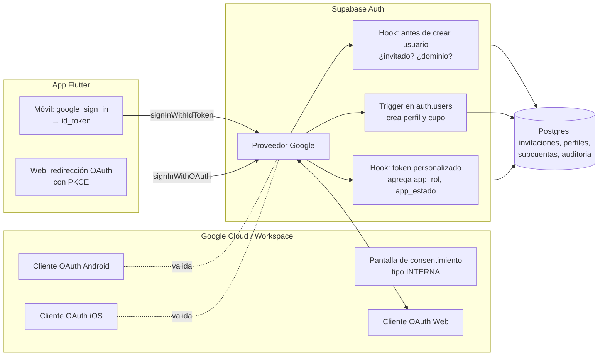
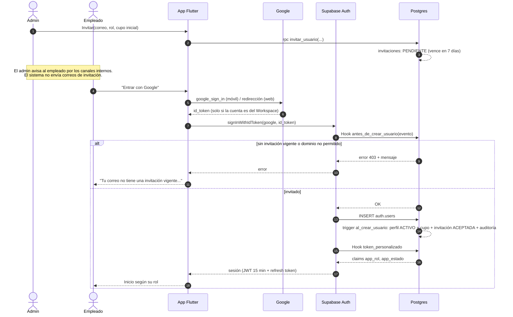

# 04 · Autenticación y OAuth

## 1. Decisiones

| Decisión | Detalle |
|---|---|
| **Solo Google Workspace** (D-12) | No hay correo + contraseña, ni otros proveedores. La contraseña, su política y el segundo factor los gobierna Google Workspace. |
| **Solo por invitación** | Nadie entra si el Administrador no lo invitó antes. No existe registro abierto. |
| **Solo el dominio de RiTech** | La aplicación OAuth de Google se configura como **Interna**: Google rechaza cuentas de fuera de la organización antes de llegar a nosotros. |
| **Si RiTech no tiene organización de Workspace** | La pantalla de consentimiento se crea como **Externa en modo de prueba** (gratis, hasta 100 usuarios de prueba que se registran en Google Cloud). El control real lo sigue haciendo el hook (invitación + dominio o correos permitidos). |
| **Pruebas automáticas** | En local y CI se habilita además correo + contraseña **solo para usuarios de prueba**, porque el ingreso con Google no se puede automatizar. En la nube está prohibido (§5 y [15 §3](15-calidad-pruebas-y-ci-cd.md#3-modo-simulado-y-datos-de-prueba)). |
| **Supabase Auth** administra sesiones | Emite el JWT que usa la app para hablar con la base de datos, Realtime y las Edge Functions. |

> Lo que desaparece de la v2: login con contraseña, bloqueo por intentos
> fallidos, política de contraseñas, código 2FA de demostración,
> recuperación de contraseña y cambio obligatorio de contraseña. Todo eso lo
> hace Google. Se recomienda que el administrador de Workspace **exija la
> verificación en dos pasos** a todas las cuentas de RiTech.

---

## 2. Piezas y cómo se conectan



| Pieza | Dónde se configura | Para qué |
|---|---|---|
| Pantalla de consentimiento **Interna** | Google Cloud Console → APIs y servicios | Solo cuentas del Workspace de RiTech pueden autorizar la app. |
| Cliente OAuth **Web** | Google Cloud Console | Lo usa Supabase para el flujo web y como `serverClientId` en móvil. Su ID y secreto van en Supabase. |
| Clientes OAuth **Android** e **iOS** | Google Cloud Console | Inicio de sesión nativo en móvil. Sus IDs se agregan a la lista de clientes autorizados del proveedor Google en Supabase. |
| Proveedor Google | Supabase → Authentication → Providers | Valida el `id_token` de Google y crea o recupera al usuario. |
| URLs de redirección | Supabase → Authentication → URL Configuration | Dominio web de la app y esquema profundo móvil. Nada más. |
| Hook **antes de crear usuario** | Supabase → Authentication → Hooks (función Postgres) | Rechaza a quien no tenga invitación vigente o no sea del dominio. |
| Hook **token personalizado** | Supabase → Authentication → Hooks (función Postgres) | Agrega el rol y el estado al JWT para que la app arme su navegación. |
| Trigger `al_crear_usuario` | Migración SQL | Crea el perfil con el rol de la invitación y, si es Usuario, su cupo. |

---

## 3. Configuración paso a paso (checklist para una historia técnica)

1. Crear proyecto en Google Cloud **dentro de la organización** de RiTech.
2. Pantalla de consentimiento: tipo **Interna**; alcances `openid`, `email`,
   `profile`. Nada más.
3. Crear cliente OAuth **Web**. Origen autorizado: dominio web de la app.
   URI de redirección: `https://<proyecto>.supabase.co/auth/v1/callback`.
4. Crear cliente OAuth **Android** (paquete + huella SHA-1 de cada llave de
   firma: debug, release y la de Play) y cliente **iOS** (bundle id).
5. En Supabase, habilitar Google con ID y secreto del cliente Web; agregar
   los IDs Android e iOS como clientes autorizados.
6. En Supabase, **URL Configuration**: `Site URL` = dominio web; redirecciones
   permitidas: dominio web y `com.ritech.inversiones://login-callback`.
7. Aplicar las migraciones con los hooks y el trigger (§5–§7) y registrarlos
   en **Authentication → Hooks**.
8. Configurar la **duración del JWT en 900 s** (15 min). Los refresh tokens
   rotan automáticamente.
9. Cargar el correo del **primer administrador** (§9).
10. Probar: cuenta invitada entra; cuenta no invitada del dominio es
    rechazada; cuenta personal de Gmail es rechazada por Google.
11. Verificar que en la nube `auth.proveedores_permitidos` vale `["google"]`
    y que el proveedor de correo está deshabilitado en Supabase Auth (lo
    comprueba la prueba de humo del despliegue).

---

## 4. Flujos

### 4.1 Primer ingreso de un empleado invitado



### 4.2 Ingresos siguientes

El usuario ya existe: **el hook de creación no corre**. Supabase valida el
`id_token`, verifica que la cuenta no esté bloqueada, corre el hook de token
y entrega la sesión. Si la cuenta está suspendida o de baja, Supabase
responde que el usuario está bloqueado y la app muestra: *"Tu cuenta está
suspendida. Comunícate con el administrador."*

### 4.3 Web (panel de administración y uso desde navegador)

Flujo OAuth estándar con **PKCE** (`signInWithOAuth`). El parámetro
`hd=<dominio>` se envía solo como **pista** para que Google preseleccione la
cuenta corporativa; la seguridad real la dan la pantalla Interna y el hook.

```dart
await supabase.auth.signInWithOAuth(
  OAuthProvider.google,
  queryParams: {'hd': 'ritech.com.co', 'prompt': 'select_account'}, // dominio de ejemplo
);
```

### 4.4 Móvil (Android / iOS)

Inicio de sesión **nativo** con el paquete `google_sign_in`, que entrega un
`id_token` que se canjea en Supabase. Es el camino recomendado por Supabase
para Flutter. (La API del paquete cambió en su versión 7; seguir la guía
oficial vigente de Supabase al implementarlo.)

```dart
final google = GoogleSignIn.instance;
await google.initialize(serverClientId: webClientId, clientId: iosClientId);
final cuenta = await google.authenticate();
final idToken = cuenta.authentication.idToken;

await supabase.auth.signInWithIdToken(
  provider: OAuthProvider.google,
  idToken: idToken!,
);
```

### 4.5 Cierre de sesión

1. La app cancela sus suscripciones de Realtime.
2. Borra el token de push del dispositivo (`rpc eliminar_dispositivo`).
3. `supabase.auth.signOut()` (revoca el refresh token).
4. Cierra también la sesión de `google_sign_in` para que el siguiente
   ingreso permita elegir cuenta.

---

## 5. Hook "antes de crear usuario"

Corre **antes** de insertar en `auth.users`, también en altas por OAuth. Si
devuelve un error, el usuario no se crea y el mensaje llega a la app.

```sql
create or replace function private.antes_de_crear_usuario(event jsonb)
returns jsonb
language plpgsql security definer set search_path = ''
as $$
declare
  v_email     text := lower(event->'user'->>'email');
  v_proveedor text := event->'user'->'app_metadata'->>'provider';
  v_dominio   text := split_part(v_email, '@', 2);
begin
  -- En la nube solo 'google'. En local y CI la semilla agrega 'email' para
  -- poder automatizar el ingreso en las pruebas E2E (15 §3). La migración
  -- nunca lo agrega: solo seed.sql, que no se aplica en la nube.
  if not exists (
    select 1 from public.parametros
    where clave = 'auth.proveedores_permitidos'
      and valor ? coalesce(v_proveedor, '')
  ) then
    return private.error_auth(403, 'Solo puedes ingresar con tu cuenta de Google de RiTech.');
  end if;

  if not exists (
    select 1 from public.parametros
    where clave = 'auth.dominios_permitidos'
      and valor ? v_dominio                      -- valor es un arreglo JSON
  ) then
    return private.error_auth(403, 'Solo se admiten cuentas corporativas de RiTech.');
  end if;

  if not exists (
    select 1 from public.invitaciones
    where lower(email) = v_email
      and estado = 'pendiente'
      and expira_en > now()
  ) then
    return private.error_auth(403,
      'Tu correo no tiene una invitación vigente. Pídele una al administrador.');
  end if;

  return '{}'::jsonb;
end;
$$;

-- El servicio de Auth es el único que puede ejecutarlo y leer lo que necesita.
grant execute on function private.antes_de_crear_usuario(jsonb) to supabase_auth_admin;
revoke execute on function private.antes_de_crear_usuario(jsonb) from public, anon, authenticated;
grant usage on schema private to supabase_auth_admin;
grant select on public.invitaciones, public.parametros to supabase_auth_admin;
-- + políticas RLS de SELECT para el rol supabase_auth_admin en esas dos tablas
```

`private.error_auth(codigo, mensaje)` arma
`{"error": {"http_code": codigo, "message": mensaje}}`.

---

## 6. Trigger: al crear el usuario

```sql
create or replace function private.al_crear_usuario()
returns trigger
language plpgsql security definer set search_path = ''
as $$
declare
  v_inv public.invitaciones;
begin
  select * into v_inv from public.invitaciones
  where lower(email) = lower(new.email) and estado = 'pendiente'
  for update;

  insert into public.perfiles (id, email, nombre, rol, estado, invitacion_id)
  values (new.id, lower(new.email),
          coalesce(new.raw_user_meta_data->>'full_name', new.email),
          v_inv.rol, 'activo', v_inv.id);

  update public.invitaciones
     set estado = 'aceptada', aceptada_en = now(), usuario_id = new.id
   where id = v_inv.id;

  if v_inv.rol = 'usuario' then
    perform private.crear_cupo(new.id, v_inv.cupo_inicial);  -- RN-18
  end if;

  perform private.auditar(new.id, 'cuenta.activada',
                          'perfiles', new.id, jsonb_build_object('rol', v_inv.rol));
  return new;
end;
$$;

create trigger al_crear_usuario
after insert on auth.users
for each row execute function private.al_crear_usuario();
```

Si `crear_cupo` no puede asignar el cupo inicial (la bolsa común no alcanza),
crea el cupo en 0 y genera una alerta al administrador. **No** hace fallar el
ingreso.

---

## 7. Hook "token personalizado"

```sql
create or replace function private.token_personalizado(event jsonb)
returns jsonb
language plpgsql stable security definer set search_path = ''
as $$
declare
  v_rol    text;
  v_estado text;
  v_claims jsonb := event->'claims';
begin
  select rol::text, estado::text into v_rol, v_estado
  from public.perfiles where id = (event->>'user_id')::uuid;

  v_claims := jsonb_set(v_claims, '{app_rol}',    coalesce(to_jsonb(v_rol),    'null'::jsonb));
  v_claims := jsonb_set(v_claims, '{app_estado}', coalesce(to_jsonb(v_estado), 'null'::jsonb));
  return jsonb_set(event, '{claims}', v_claims);
end;
$$;
```

Recordatorio ([03 §4.1](03-roles-y-permisos.md#41-el-rol-viaja-en-el-token-para-la-app)):
estos claims son para la **interfaz**. La autorización real consulta
`perfiles` en cada operación.

---

## 8. Sesión en la app

| Tema | Regla |
|---|---|
| Duración del JWT | 15 minutos. `supabase_flutter` lo renueva solo con el refresh token. |
| Almacenamiento (móvil) | La sesión se guarda en **almacenamiento seguro** del sistema (`flutter_secure_storage`: Keychain / Keystore) mediante un `LocalStorage` personalizado de `supabase_flutter`, no en preferencias planas. |
| Almacenamiento (web) | El del navegador (inevitable). Se mitiga con JWT corto y uso en equipos corporativos. |
| Bloqueo de la app | Si la app pasa más de `app.minutos_bloqueo` (defecto 5) en segundo plano, al volver pide **biometría o PIN del dispositivo** (`local_auth`) antes de mostrar datos. Es una protección local, no de servidor. |
| Confirmación de decisiones | Aprobar o rechazar una sugerencia, crear una orden manual o registrar un movimiento de dinero exige **confirmación biométrica** en móvil. En web, un diálogo de confirmación que repite monto y símbolo. |
| Varios dispositivos | Permitidos. Cada uno registra su token de push. |
| Cambio de rol | La app escucha el evento `perfil_actualizado` en su canal y **fuerza la renovación del token** para rearmar la navegación de inmediato. |

---

## 9. El primer administrador

Sin administrador nadie puede invitar a nadie. El arranque se resuelve en el
despliegue, **nunca con credenciales en el código de la app** (como pasaba en
la v2 con `admin@admin.com / 1234`):

1. La migración de arranque lee el correo de una variable de configuración
   del entorno (`ADMIN_INICIAL_EMAIL`) y crea una **invitación** con rol
   `administrador` y vencimiento de 7 días.
2. Esa persona entra con Google y queda como administrador activo.
3. La migración no hace nada si ya existe al menos un administrador (es
   idempotente).

---

## 10. Suspensión y baja

Lo hace la Edge Function `admin-usuarios`, porque necesita la llave secreta
para operar sobre Auth:

```
1. Verifica que quien llama es administrador activo y que no viola RN-50 / RN-51.
2. En una transacción (rpc interna):
     perfiles.estado = 'suspendido'  (o 'baja')
     invalida sus sugerencias vivas; anula sus primeras aprobaciones (RN-56)
     borra sus dispositivos de push
     auditoría
3. Auth Admin API: bloquea al usuario (ban) → no puede renovar su sesión.
4. Publica 'sesion_revocada' en su canal: si tiene la app abierta, se cierra.
```

Efecto combinado:

| Capa | Efecto | Cuándo |
|---|---|---|
| RLS (`private.rol_actual()` devuelve NULL) | No ve ni modifica datos | **Inmediato** |
| Evento `sesion_revocada` | La app abierta cierra sesión | Inmediato si está conectada |
| Bloqueo en Auth | No puede renovar el token ni volver a entrar | Inmediato para renovación; el JWT vigente caduca en ≤ 15 min, pero ya no sirve por RLS |

Reactivar hace lo inverso (desbloquea en Auth, `estado = 'activo'`).
Reincorporar a alguien de baja (CB-06) también desbloquea en Auth y además
le crea un cupo nuevo en 0.

---

## 11. Mensajes de error de ingreso

| Situación | Mensaje |
|---|---|
| Cuenta fuera del Workspace | Lo muestra Google (la app Interna no la admite). |
| Del dominio pero sin invitación / invitación vencida o revocada | "Tu correo no tiene una invitación vigente. Pídele una al administrador." |
| Dominio que no está en `auth.dominios_permitidos` (§5) | "Solo se admiten cuentas corporativas de RiTech." |
| Proveedor que no está en `auth.proveedores_permitidos` (§5, CB-92) | "Solo puedes ingresar con tu cuenta de Google de RiTech." |
| Cuenta suspendida o de baja | "Tu cuenta está suspendida. Comunícate con el administrador." |
| El usuario cerró la ventana de Google | Sin mensaje; vuelve a la pantalla de ingreso. |
| Sin conexión | "No hay conexión. Revisa tu internet e inténtalo de nuevo." |
| Error inesperado | "No pudimos iniciar tu sesión. Inténtalo de nuevo." (el detalle va al registro técnico, no a la pantalla) |

Casos borde de identidad (cambio de correo en Workspace, reingreso tras una
baja, invitación duplicada, etc.) en [12 · Casos borde](12-casos-borde.md#1-identidad-y-acceso).
