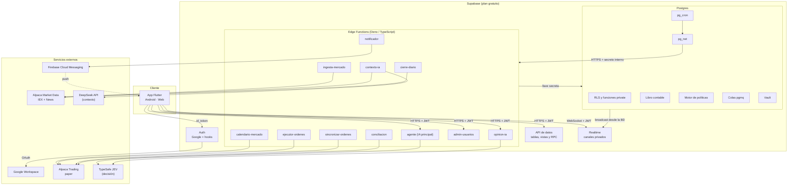

# 05 · Arquitectura

## 1. Vista general



## 2. Principios de diseño

| # | Principio | En la práctica |
|---|---|---|
| A1 | **El dinero se decide en Postgres.** | Libro contable, retenciones, transiciones de estado y motor de políticas son funciones SQL transaccionales. Si dos personas aprueban a la vez, la base de datos serializa. |
| A2 | **Las integraciones viven en Edge Functions.** | Todo lo que habla con Alpaca, DeepSeek, JEV o FCM es TypeScript en Edge Functions, detrás de un adaptador con versión real y simulada. |
| A3 | **La app es presentación.** | El cliente no calcula nada que importe para el dinero. Lee (filtrado por RLS), llama RPC y escucha eventos. |
| A4 | **El cliente nunca habla con el broker ni con las IAs.** | Solo tiene la URL de Supabase y la llave publicable. |
| A5 | **Todo lo que llega de afuera se valida.** | Precios, noticias, respuestas del broker y de las IAs se validan con esquema y con el motor de políticas. |
| A6 | **Programado y reintentable.** | Los procesos corren por `pg_cron`; el trabajo pendiente vive en colas `pgmq`; toda operación externa es idempotente. |
| A7 | **Sin servidores propios y sin costo fijo.** | Todo corre en servicios con capa gratuita. Solo se pagan DeepSeek y JEV (por uso). |
| A8 | **Probable de punta a punta a cualquier hora.** | Cada integración tiene una implementación simulada ([10 §9](10-integracion-bolsa.md#9-proveedores-simulados)); las pruebas E2E no dependen del horario ni de servicios externos. |

---

## 3. Componentes

### 3.1 App Flutter

- **Android** (APK distribuido con Firebase App Distribution, gratis) y
  **web** (Firebase Hosting, gratis) para los tres roles.
- **iOS queda fuera del MVP**: publicar requiere la cuenta de desarrollador
  de Apple, que es paga. El código Flutter queda compatible.
- Paquetes clave: `supabase_flutter`, `google_sign_in`, `flutter_riverpod`,
  `go_router`, `firebase_messaging`, `flutter_local_notifications`,
  `local_auth`, `flutter_secure_storage`, `freezed` / `json_serializable`,
  `integration_test`.

### 3.2 Supabase (plan gratuito)

| Servicio | Uso en RiTech |
|---|---|
| **Auth** | Ingreso con Google, sesiones JWT, hooks de alta y de token, bloqueo de cuentas. |
| **Postgres** | Datos, libro contable, motor de políticas, máquinas de estado, auditoría. RLS en todas las tablas. |
| **API de datos** | Lectura de tablas y vistas (RLS) y ejecución de RPC. |
| **Realtime** | Canales privados con broadcast desde la base de datos. |
| **Edge Functions** | Integraciones: mercado, noticias, IAs, broker, push, administración de Auth. |
| **Cron (`pg_cron`)**, **`pg_net`**, **Colas (`pgmq`)**, **Vault** | Reloj, llamadas a funciones, trabajo confiable, secretos para SQL. |

### 3.3 Servicios externos

| Servicio | Para qué | Costo en el MVP |
|---|---|---|
| **Google Workspace / Google Cloud** | Identidad (OAuth) | Gratis (OAuth) |
| **Alpaca** | Órdenes paper, precios IEX, noticias, calendario | Gratis |
| **DeepSeek** | Contexto a partir de noticias (Sistema 2) | **Pago por uso** (~USD 3/mes) |
| **TypeSafe JEV** | Decisiones tipadas con confianza calibrada (Sistema 1) | **Pago por uso** (~USD 1/mes) |
| **Firebase** | Push (FCM), hosting web, distribución Android, registro de fallos (Crashlytics) | Gratis (plan Spark) |
| **GitHub** | Repositorio, Actions, Projects, wiki | Gratis (ver condiciones en [16 §2](16-arranque-del-repositorio.md#2-decisiones-antes-de-crear-el-repositorio)) |

### 3.4 Límites del plan gratuito de Supabase y cómo se manejan

| Límite | Valor | Cómo se maneja |
|---|---|---|
| Pausa por inactividad | A los 7 días sin actividad | Los trabajos de `pg_cron` generan actividad a diario; además, un flujo de GitHub Actions llama a `ping()` una vez al día ([15 §6](15-calidad-pruebas-y-ci-cd.md#6-flujos-de-github-actions)). |
| Respaldos | **No incluidos** | Respaldo diario cifrado con `supabase db dump` desde GitHub Actions (11 §7). |
| Base de datos | 500 MB | Barras de minuto solo 5 días y solo de símbolos con posiciones; noticias 30 días; contextos 90 días (06 §10). |
| Edge Functions | 500.000 invocaciones/mes; 150 s por ejecución; 2 s de CPU | ~40 mil invocaciones al mes previstas; el contexto de DeepSeek se separa del ciclo de decisión para no acercarse a los 150 s. |
| Realtime | 2 millones de mensajes y 200 conexiones simultáneas | ~0,7 millones de entregas al mes previstas (09 §8). |
| Proyectos | 2 activos | `ritech-mvp` (real) y, opcional, `ritech-demo` (simulado). |

---

## 4. Cómo se conecta cada cosa

| Origen | Destino | Protocolo | Credencial | Para qué |
|---|---|---|---|---|
| App | Supabase Auth | HTTPS | Llave publicable + `id_token` de Google | Iniciar y renovar sesión |
| App | API de datos | HTTPS | JWT del usuario | Leer (RLS) y ejecutar RPC |
| App | Realtime | WebSocket | JWT del usuario | Escuchar sus canales |
| App | Edge Functions `opinion-ia`, `agente` (modo análisis), `admin-usuarios` | HTTPS | JWT del usuario | Acciones que requieren un servicio externo |
| App | FCM | SDK | Configuración pública de Firebase | Obtener el token de push |
| `pg_cron` | Funciones SQL | Directo | — | Vencimientos, verificaciones "¿toca correr?" |
| `pg_cron` / RPC | Edge Functions | `pg_net` HTTPS POST | **Secreto interno** leído de Vault | Despertar procesos |
| Edge Functions | Postgres | supabase-js | **Llave secreta** de Supabase | Escribir resultados, llamar RPC internas |
| `ingesta-mercado`, `cierre-diario` | Alpaca Market Data | HTTPS REST | Llaves de Alpaca | Precios y barras |
| `contexto-ia` | Alpaca News | HTTPS REST | Llaves de Alpaca | Noticias |
| `contexto-ia` | DeepSeek | HTTPS | Llave de DeepSeek | Contexto |
| `agente`, `opinion-ia` | TypeSafe JEV (o Cloudflare Workers AI) | HTTPS | Llave de TypeSafe (o token de Cloudflare) | Decisiones |
| `ejecutor-ordenes`, `sincronizar-ordenes`, `conciliacion`, `calendario-mercado` | Alpaca Trading | HTTPS REST | Llaves de Alpaca (paper) | Órdenes, cuenta, posiciones, calendario |
| `notificador` | FCM HTTP v1 | HTTPS + OAuth2 | Cuenta de servicio de Firebase | Enviar push |
| Postgres | Realtime | `realtime.send` / `realtime.broadcast_changes` | — | Publicar eventos |

**Nunca** existen estas conexiones: App → Alpaca, App → DeepSeek, App → JEV,
modelo de IA → cualquier cosa. Los modelos solo **reciben datos y devuelven
datos** (texto en DeepSeek, respuestas tipadas en JEV); no tienen
herramientas que ejecuten órdenes.

> **Sobre las llaves y la IA.** Los secretos de Edge Functions son del
> proyecto completo. La garantía de que "la IA no toca el broker" es que
> (1) los modelos no reciben llaves ni herramientas, (2) las funciones
> `agente`, `contexto-ia` y `opinion-ia` no importan `_shared/broker/`
> (verificado en CI) y (3) lo único que escriben son evaluaciones y señales,
> que pasan por el motor de políticas y esperan la aprobación de una persona.

---

## 5. Por qué Supabase encaja (y dónde no)

| Necesidad | Cómo se cubre |
|---|---|
| Permisos por rol y por dueño | RLS nativo en Postgres |
| Consistencia del dinero | Transacciones SQL, restricciones `CHECK`, bloqueos de fila |
| Tiempo real | Realtime con broadcast desde la base de datos |
| Procesos programados | `pg_cron` + `pg_net` |
| Trabajo confiable | `pgmq` |
| OAuth corporativo | Auth con Google + hooks |
| Pruebas locales completas | CLI de Supabase con Docker: el mismo stack en el portátil y en CI |
| **Límite**: funciones cortas | 150 s y 2 s de CPU por ejecución: el ciclo de decisión (JEV, milisegundos) va separado del contexto (DeepSeek, segundos) y todo proceso largo se parte en pasos. |
| **Límite**: sin procesos siempre encendidos | Precios cada 15 s por REST en vez de WebSocket. Suficiente para un flujo con aprobación humana. |
| **Límite**: concurrencia de cron | Máximo recomendado 8 trabajos simultáneos: los de alta frecuencia solo hacen una verificación SQL y disparan HTTP asíncrono. |

---

## 6. Catálogo de Edge Functions

| Función | La invoca | Autenticación | Qué hace | Tiempo máx. |
|---|---|---|---|---|
| `ingesta-mercado` | Cron (15 s, horario de mercado) | Secreto interno | *Snapshots* del universo y los ETFs; llama `publicar_cotizaciones` (guarda, emite broadcast, evalúa protecciones virtuales, invalida sugerencias fuera de banda, detecta evento en QQQ). | 20 s |
| `contexto-ia` | Cola `contexto_por_generar` (la llena el agente) + cron 30 min antes de la apertura + analista | Secreto interno o JWT de analista | Descarga noticias de las candidatas, pide el contexto a DeepSeek, lo valida y lo guarda ([07 §4.2](07-agente-ia.md#42-contexto-deepseek)). | 120 s |
| `agente` (IA principal) | Cron (cada `ia.minutos_entre_ciclos`), evento de mercado, admin, analista (análisis de un símbolo) | Secreto interno **o** JWT de analista/admin | Ciclo de decisión ([07 §3](07-agente-ia.md#3-el-ciclo-paso-a-paso)): calidad de datos → métricas → candidatas → JEV → puntaje → señales, sugerencias y alertas. | 60 s |
| `opinion-ia` | App (Usuario, antes de enviar una orden manual) | JWT de usuario | Opinión de JEV sobre una orden manual. | 15 s |
| `ejecutor-ordenes` | `pg_net` al aprobar + barrido por cron (10 s) | Secreto interno | Toma mensajes de `ordenes_por_enviar`; revalida; calcula cantidad; envía al broker con `client_order_id` idempotente. | 60 s |
| `sincronizar-ordenes` | Cron (10 s si hay órdenes vivas) | Secreto interno | Consulta el estado de las órdenes vivas; aplica llenados con `aplicar_llenado`. | 60 s |
| `conciliacion` | Cron (cada `conciliacion.minutos_entre`) + tras el cierre | Secreto interno | Compara efectivo y posiciones del broker con el libro; ante descuadre crítico apaga `trading_activo`. | 60 s |
| `notificador` | `pg_net` al encolar + barrido por cron (10 s) | Secreto interno | Envía push por FCM; elimina tokens inválidos. | 60 s |
| `admin-usuarios` | App (Admin) | JWT de admin | Suspender, reactivar, dar de baja y reincorporar (API de administración de Auth). | 30 s |
| `cierre-diario` | Cron (verifica si ya cerró el mercado hoy) | Secreto interno | Barras diarias, fotos de patrimonio, revisión de rebalanceo, evaluación de sugerencias y candidatas, limpieza. | 150 s |
| `calendario-mercado` | Cron diario | Secreto interno | Calendario, reloj y atributos de los activos de la lista blanca (`fraccionable`, `negociable`); carga inicial de barras históricas. | 120 s |

**Código compartido** (`supabase/functions/_shared/`):

```
_shared/
  broker/       interfaz + alpaca.ts + simulado.ts
  mercado/      interfaz + alpaca.ts + simulado.ts
  noticias/     interfaz + alpaca.ts + simulado.ts
  ia/           contexto (deepseek.ts + simulado.ts) y jev (typesafe.ts + cloudflare.ts + simulado.ts)
  push/         fcm.ts + simulado.ts
  indicadores.ts   métricas y etiquetas (07 §4)
  decision.ts      puntaje compuesto y reglas (07 §6)
  esquemas.ts      validación zod
  auth.ts          secreto interno, JWT + rol
  salud.ts         registro de salud de integraciones
  proveedores.ts   elige real/simulado por variable de entorno y se niega a simular en ENTORNO=mvp
```

---

## 7. Trabajos programados (`pg_cron`)

`pg_cron` trabaja en UTC y el mercado en hora de Nueva York con horario de
verano, feriados y medias jornadas. Los trabajos de alta frecuencia corren
siempre y **preguntan a SQL si les toca** (usando `calendario_mercado`).

| Trabajo | Frecuencia | Condición para actuar | Acción |
|---|---|---|---|
| `ingesta_mercado` | 15 s | Mercado abierto (o hasta 10 min antes de abrir) | HTTP → `ingesta-mercado` |
| `expirar_sugerencias` | 30 s | Siempre | SQL: vence sugerencias; avisa las que están por vencer |
| `sincronizar_ordenes` | 10 s | Existen órdenes vivas | HTTP → `sincronizar-ordenes` |
| `barrer_ejecutor` | 10 s | Cola `ordenes_por_enviar` no vacía | HTTP → `ejecutor-ordenes` |
| `barrer_notificador` | 10 s | Cola `notificaciones_push` no vacía | HTTP → `notificador` |
| `barrer_contexto` | 1 min | Cola `contexto_por_generar` no vacía | HTTP → `contexto-ia` |
| `contexto_preapertura` | 1 min | Faltan 30 min para la apertura y no se ha corrido hoy | Encola contexto de las candidatas del día |
| `ciclo_agente` | 1 min | Ventana de compras abierta, `ia_activa`, pasaron `ia.minutos_entre_ciclos`, no hay otro en curso | HTTP → `agente` |
| `conciliacion` | 1 min | Pasaron `conciliacion.minutos_entre` y (mercado abierto o < 30 min desde el cierre) | HTTP → `conciliacion` |
| `cierre_diario` | 10 min | Ya cerró el mercado hoy y no se ha corrido | HTTP → `cierre-diario` |
| `calendario` | Diario 10:00 UTC | Siempre | HTTP → `calendario-mercado` |
| `limpieza` | Diario 08:00 UTC | Siempre | SQL: retención de 06 §10 |

```sql
select cron.schedule('ingesta_mercado', '15 seconds', $$
  select private.despertar_funcion('ingesta-mercado')
  where private.mercado_en_ventana(interval '10 minutes');
$$);
```

`private.despertar_funcion(nombre)` lee de Vault la URL base y el secreto
interno y hace `net.http_post` sin esperar respuesta.

---

## 8. Colas

| Cola (`pgmq`) | La llena | La vacía | Si falla |
|---|---|---|---|
| `ordenes_por_enviar` | Aprobaciones, órdenes manuales, protecciones virtuales, liquidaciones | `ejecutor-ordenes` | Reaparece tras 60 s; tras 5 lecturas se archiva, la orden pasa a `error_envio` y se alerta. Nunca se duplica en el broker (`client_order_id` = id de la orden). |
| `notificaciones_push` | Triggers de notificaciones | `notificador` | 3 reintentos; luego se descarta (la notificación en la app ya existe). |
| `contexto_por_generar` | El agente (contexto viejo o ausente), preapertura, analista | `contexto-ia` | 2 reintentos; luego la candidata sigue "sin contexto" y se alerta. |

`pg_net` dispara y olvida; la cola garantiza que el trabajo siga ahí hasta
que alguien lo confirme como hecho. El barrido por cron asegura que nada se
quede atrás.

---

## 9. Arquitectura de la app Flutter

### 9.1 Estructura por funcionalidades

```
lib/
  app/            arranque, enrutador (go_router), tema, inyección (Riverpod)
  core/           cliente Supabase, gestor de Realtime, errores y códigos, formato
                  de dinero/fechas, almacenamiento seguro, biometría, push
  features/
    auth/         ingreso con Google (y correo solo en modo pruebas), sesión, bloqueo
    mercado/      cotizaciones, QQQ / QLD / ×2 teórico, estado del mercado
    oportunidades/ candidatas evaluadas por la IA con su explicación
    sugerencias/  bandeja, detalle con explicación, aprobar / rechazar
    cupo/         mi cupo, posiciones, protecciones, historial
    ordenes/      orden manual con opinión de la IA, estado de órdenes
    fondo/        resumen agregado y detalle (analista/admin)
    riesgo/       bandeja del analista, segundas aprobaciones, liquidaciones
    ia/           desempeño y calibración, ciclos, configuraciones de decisión
    alertas/      notificaciones y alertas
    reportes/     exportación CSV
    admin/        usuarios e invitaciones, capital, cupos, rebalanceos,
                  parámetros, lista blanca, interruptores, salud, bitácora
  shared/         widgets comunes
integration_test/ pruebas E2E de la app
test_driver/      arranque de las pruebas E2E en Chrome
```

Cada funcionalidad tiene tres capas: `data/` (repositorios: único lugar que
conoce a Supabase), `domain/` (modelos inmutables), `presentation/`
(páginas, widgets y *providers*).

### 9.2 Estado

- **Riverpod** (D-18).
- Patrón **"foto + eventos"**: se pide la foto por la API, se escucha el
  canal, cada evento trae id y versión y el repositorio vuelve a pedir ese
  registro. Al reconectar, foto completa.
- **Sin actualizaciones optimistas en dinero.**

Detalle en [08 §9](08-estados-y-flujos.md#9-estado-en-la-app) y
[09](09-tiempo-real-y-notificaciones.md).

### 9.3 Enrutamiento y guardas

```
sin sesión                             → /ingreso
sesión con app_estado ≠ activo         → /cuenta-suspendida
ruta /admin/*  y rol ≠ administrador   → /inicio
ruta /riesgo/* y rol ≠ analista (el admin entra en modo lectura) → /inicio
```

---

## 10. Entornos

| Entorno | Supabase | Proveedores | Para qué |
|---|---|---|---|
| **Local** | CLI de Supabase (Docker) | Simulados por defecto; reales opcionales con llaves propias | Desarrollo diario |
| **CI** | CLI de Supabase dentro de GitHub Actions | Simulados siempre | Pruebas en cada cambio |
| **MVP** | Proyecto `ritech-mvp` (gratuito) | Reales: Alpaca paper, DeepSeek, JEV, FCM | Uso real del equipo |
| **Demo** (opcional) | Proyecto `ritech-demo` (segundo proyecto gratuito) | Simulados, con mercado "siempre abierto" | Mostrar el sistema fuera de horario |

- Cada entorno tiene sus propias llaves. Nunca se comparten.
- El **correo + contraseña** para usuarios de prueba solo existe en Local y
  CI (necesario para automatizar el ingreso en las pruebas E2E, porque el
  ingreso con Google no se puede automatizar). En la nube, el hook de alta
  lo rechaza ([04 §5](04-autenticacion-oauth.md#5-hook-antes-de-crear-usuario)).

### 10.1 Secretos

| Dónde | Qué |
|---|---|
| Secretos de Edge Functions (`supabase secrets set`, sincronizados por el despliegue) | `ENTORNO`, `PROVEEDOR_*`, `ALPACA_KEY_ID`, `ALPACA_SECRET_KEY`, `ALPACA_TRADING_URL`, `ALPACA_DATA_URL`, `DEEPSEEK_API_KEY`, `DEEPSEEK_BASE_URL`, `TYPESAFE_API_KEY` (o `CLOUDFLARE_ACCOUNT_ID` + `CLOUDFLARE_API_TOKEN`), `JEV_PROVEEDOR`, `FCM_CUENTA_SERVICIO`, `SECRETO_INTERNO` |
| Vault (para SQL) | `url_funciones`, `secreto_interno` |
| Secretos y variables de GitHub Actions | Ver [16 §4](16-arranque-del-repositorio.md#4-secretos-y-variables) |
| App (`--dart-define`, no son secretos) | `SUPABASE_URL`, llave publicable, IDs de clientes OAuth, configuración de Firebase, `MODO_PRUEBAS` (solo en CI) |
| `.env` local (nunca en git) | Copia de `.env.example` con llaves propias si se quiere usar proveedores reales en local |
| Nunca | Llave secreta de Supabase o llaves de proveedores en la app o en el repositorio |

### 10.2 Integración y entrega continuas

Resumen (detalle en [15](15-calidad-pruebas-y-ci-cd.md)):

| Momento | Qué corre |
|---|---|
| Cada push a una rama / PR | Documentación, app (análisis y pruebas), base de datos y funciones, **E2E completo con proveedores simulados** |
| Merge a `main` | Todo lo anterior + despliegue a `ritech-mvp` (migraciones, funciones, secretos, web, APK) + prueba de humo |
| Cambios en `docs/` en `main` | Publicación automática en la wiki |
| Diario | Mantener activo el proyecto, respaldo cifrado |

Las migraciones son **solo hacia adelante** y viven en
`supabase/migrations/`. Nunca se edita una base de datos en la nube a mano.

---

## 11. Código reutilizable del repositorio v2

El repositorio nuevo arranca vacío. Del repositorio anterior
(`github.com/T0m4s1n/ritech-sas-inversiones`, app Flutter v2 sin backend) se
pueden **copiar** estas piezas:

| Código v2 | Uso en v3 |
|---|---|
| `lib/services/performance_engine.dart` y su prueba | Línea "×2 teórico" y simulación |
| `lib/services/nasdaq_service.dart` → `SimulatedNasdaqSource` | Idea base del proveedor de mercado simulado (caminata determinista) |
| `lib/services/recommendation_engine.dart` | Su regla (±2 % en 30 días) pasa a ser una métrica más (07 §4.1) |
| `lib/controllers/alert_controller.dart` | Lógica de deduplicación (avisar una vez, rearmar), trasladada a SQL |
| `lib/services/report_exporter.dart` y su prueba | Base de la exportación CSV |
| `lib/widgets/*`, `lib/config/app_theme.dart`, `lib/config/app_styles.dart`, `assets/fonts/poppins/` | Interfaz, tema y fuentes |
| Lo demás (login con contraseña, 2FA de demo, controladores en memoria, bitácora en memoria) | **No se copia** |

El identificador de la app nueva es `com.ritech.inversiones` (lo exigen los
clientes OAuth de Android y los enlaces profundos).

---

## 12. Estructura del repositorio nuevo

```
/
├─ CLAUDE.md                 Reglas para agentes de IA (lo primero que se lee)
├─ README.md
├─ .env.example
├─ .gitignore
├─ .gitattributes            Finales de línea LF para scripts y flujos
├─ .github/
│  ├─ ISSUE_TEMPLATE/        historia de usuario, épica, tarea técnica, error
│  ├─ pull_request_template.md
│  ├─ dependabot.yml
│  └─ workflows/             ci.yml, despliegue.yml, wiki.yml, mantenimiento.yml
├─ .specify/                 spec-kit: constitución (memory/), plantillas (templates/ y overrides/) y scripts
├─ .claude/skills/           Comandos de spec-kit para Claude Code (speckit-*)
├─ docs/                     Esta especificación (fuente de verdad) + errores-conocidos.md
├─ backlog/                  Planeación derivada de docs/: requisitos (FR), épicas, historias (HU) y tareas técnicas (TT)
├─ specs/                    Una carpeta por historia (spec.md, plan.md, tasks.md), derivada de docs/ y de backlog/
├─ scripts/
│  ├─ verificar.sh           Corre localmente lo mismo que CI
│  ├─ verificar_docs.py      Enlaces, anclas e identificadores de docs/
│  ├─ publicar_wiki.py       Convierte docs/ en páginas de la wiki
│  └─ github/preparar-github.sh  Etiquetas, hitos y proyecto
├─ lib/  test/  integration_test/  test_driver/  android/  web/   (se crean en E-01)
└─ supabase/                                                        (se crea en E-01)
   ├─ config.toml
   ├─ migrations/            AAAAMMDDHHMMSS_descripcion.sql
   ├─ seed.sql               Solo local/CI: lista blanca, parámetros, usuarios y ayudas de prueba
   ├─ tests/                 pgTAP (RLS, RPC, libro, estados) + e2e/ (escenarios de punta a punta)
   └─ functions/             _shared/ + una carpeta por función (§6)
```

---

## 13. Observabilidad

| Qué | Dónde |
|---|---|
| Registros de Edge Functions | Supabase → Logs |
| Cada ciclo: candidatas, respuestas de JEV, puntajes, costos, latencias | `ciclos_agente` + `evaluaciones_candidatos` |
| Contextos generados y noticias usadas | `contextos_ia` + `noticias` |
| Estado de cada integración | `salud_integraciones` → pantalla **Salud** |
| Historia de cada orden | `ordenes_eventos` |
| Conciliaciones | `conciliaciones` |
| Fallos de la app | Firebase Crashlytics (gratis), sin datos personales ni montos |
| Disponibilidad | Flujo diario de GitHub Actions ([15 §6](15-calidad-pruebas-y-ci-cd.md#6-flujos-de-github-actions)) |

---

## 14. Costo mensual del MVP

| Servicio | Costo |
|---|---|
| Supabase (plan gratuito) | USD 0 |
| Alpaca paper + datos IEX + noticias | USD 0 |
| Firebase (FCM, Hosting, App Distribution, Crashlytics) | USD 0 |
| GitHub (repositorio, Actions, Projects, wiki) | USD 0 (ver [16 §2](16-arranque-del-repositorio.md#2-decisiones-antes-de-crear-el-repositorio)) |
| Google Cloud (OAuth) | USD 0 |
| DeepSeek | ~USD 3 |
| TypeSafe JEV | ~USD 1 |
| **Total** | **~USD 4 al mes** (tope configurable en `ia.presupuesto_mensual_usd`) |
