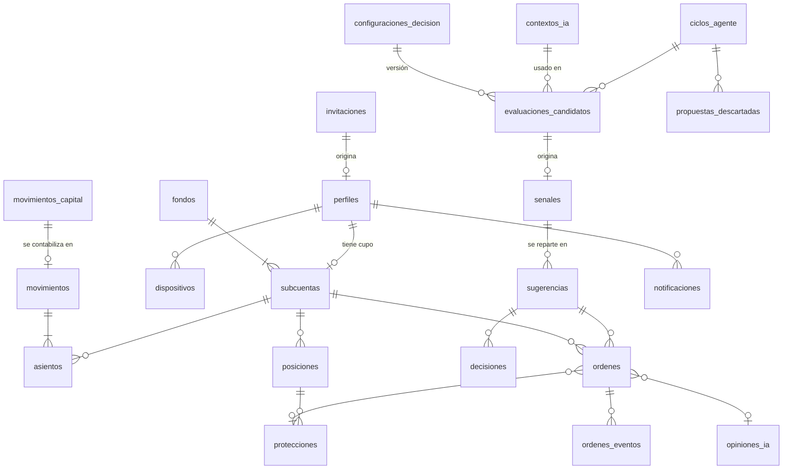

# 06 · Modelo de datos

Esquema de Postgres en Supabase. Las definiciones están en pseudo-DDL: nombres
y tipos son los definitivos; las migraciones reales agregan índices,
comentarios y políticas.

## 1. Convenciones

| Tema | Regla |
|---|---|
| Identificadores | `uuid` generado en la base de datos (`gen_random_uuid()`), salvo tablas de alto volumen (`bigserial`). |
| Fechas | `timestamptz` siempre (UTC). Nombres terminados en `_en` (`creado_en`, `vence_en`). |
| Dinero | `numeric(14,2)` en USD. Nunca `float`. |
| Precios | `numeric(14,4)`. |
| Cantidades de acciones | `numeric(18,9)` (el broker admite hasta 9 decimales en fracciones). |
| Porcentajes | `numeric(5,2)` en puntos (12,50 = 12,5 %). Confianza en `numeric(3,2)` de 0 a 1. |
| Enumeraciones | Tipos `enum` de Postgres (§3). |
| Concurrencia | Tablas que cambian de estado tienen `version int` que sube en cada cambio. Los eventos de tiempo real la incluyen para que la app descarte eventos viejos. |
| Borrado | No se borra nada que tenga valor contable o de auditoría. Los estados terminales reemplazan al borrado. |
| Esquemas | `public`: lo que ve la API (con RLS). `private`: funciones auxiliares e internas, no expuestas. |

---

## 2. Mapa de entidades



---

## 3. Enumeraciones

```sql
rol_app              : usuario | analista | administrador
estado_cuenta        : activo | suspendido | baja
estado_invitacion    : pendiente | aceptada | revocada | vencida

bolsillo             : reserva | arriesgadas | usuarios
tipo_subcuenta       : reserva | arriesgadas | usuarios_comun | cupo | externa | resultados
estado_subcuenta     : abierta | cerrada
concepto_asiento     : efectivo | invertido
tipo_movimiento      : aporte | retiro | asignacion_cupo | reduccion_cupo | cierre_cupo
                     | compra | venta | reparto_ganancia | rebalanceo | ajuste
estado_mov_capital   : registrado | confirmado | anulado

tipo_sugerencia      : compra | venta | rebalanceo
origen_sugerencia    : ia_ciclo | ia_analisis | liquidacion | sistema
estado_sugerencia    : pendiente | pendiente_segunda | aprobada | en_ejecucion
                     | ejecutada | ejecutada_parcial | fallida
                     | rechazada | vencida | invalidada
tipo_decision        : aprobar | rechazar
motivo_rechazo       : no_estoy_de_acuerdo | riesgo_alto | mal_momento
                     | monto_inadecuado | prefiero_otro_activo | otro
nivel_riesgo         : bajo | medio | alto
horizonte            : intradia | dias | semanas

lado                 : compra | venta
origen_orden         : sugerencia | manual | proteccion | liquidacion
clase_orden          : simple | bracket
tipo_orden           : limite | mercado | stop
estado_orden         : creada | enviada | aceptada | parcialmente_llenada | llenada
                     | cancelada | vencida | rechazada | error_envio | desconocida
estado_posicion      : abierta | cerrando | cerrada
tipo_proteccion      : nativa | virtual
estado_proteccion    : pendiente | activa | disparada | cancelada | reemplazada

disparador_ciclo     : programado | evento_mercado | manual | analisis
estado_ciclo         : en_curso | completado | fallido | omitido
veredicto_opinion    : favorable | neutral | desfavorable | sin_opinion

severidad            : info | advertencia | critica
audiencia            : todos | analistas | administradores | usuario
estado_integracion   : ok | degradado | caido
resultado_conciliacion : ok | diferencia_menor | descuadre_critico
```

---

## 4. Libro contable

El corazón del sistema. Tres tablas y una sola función que escribe en ellas.

```sql
fondos (
  id              uuid pk,
  nombre          text not null,
  moneda          char(3) not null default 'USD',
  ia_activa       boolean not null default false,  -- interruptor (RR-14)
  trading_activo  boolean not null default false,  -- interruptor (RR-14)
  motivo_pausa    text,
  pausado_por     uuid references perfiles,
  pausado_en      timestamptz,
  creado_en       timestamptz not null default now()
)
-- Un solo registro (índice único sobre una constante).
-- Los interruptores nacen apagados: el admin los enciende tras el primer aporte (RN-11).

subcuentas (
  id          uuid pk,
  fondo_id    uuid not null references fondos,
  tipo        tipo_subcuenta not null,
  bolsillo    bolsillo,                      -- null en externa y resultados
  usuario_id  uuid references perfiles,  -- solo en tipo 'cupo'; único entre subcuentas abiertas
                                         -- (una persona reincorporada tiene un cupo cerrado y uno abierto)
  efectivo    numeric(14,2) not null default 0,
  invertido   numeric(14,2) not null default 0,
  retenido    numeric(14,2) not null default 0,
  estado      estado_subcuenta not null default 'abierta',
  version     int not null default 1,
  check ((tipo = 'cupo') = (usuario_id is not null)),
  check (tipo in ('externa','resultados') or (efectivo >= 0 and invertido >= 0)),  -- RN-05
  check (retenido >= 0 and retenido <= greatest(efectivo, 0))                     -- RN-05
)
-- Único por fondo para todos los tipos salvo 'cupo'.

movimientos (
  id               uuid pk,
  fondo_id         uuid not null,
  tipo             tipo_movimiento not null,
  referencia_tabla text,          -- 'ordenes', 'movimientos_capital', 'sugerencias'…
  referencia_id    uuid,
  descripcion      text not null,
  parametros       jsonb,         -- p. ej. porcentajes usados en un reparto (RN-08)
  creado_por       uuid references perfiles,  -- null = sistema
  creado_en        timestamptz not null default now()
)

asientos (
  id             bigserial pk,
  movimiento_id  uuid not null references movimientos,
  subcuenta_id   uuid not null references subcuentas,
  concepto       concepto_asiento not null,
  monto          numeric(14,2) not null check (monto <> 0)
)
```

### 4.1 Invariantes

| # | Invariante | Cómo se garantiza |
|---|---|---|
| L1 | La suma de los asientos de un movimiento es **exactamente 0**. | La única función que escribe (`private.registrar_movimiento`) lo verifica, y un *constraint trigger* diferido lo vuelve a verificar al confirmar la transacción. |
| L2 | `subcuentas.efectivo` e `invertido` son la suma de sus asientos. | Solo `registrar_movimiento` los actualiza, en la misma transacción. Un trabajo diario recalcula desde `asientos` y alerta si difieren. |
| L3 | Nadie modifica ni borra asientos o movimientos. | Sin permisos de escritura para ningún rol de la API; trigger que rechaza `UPDATE`/`DELETE`. Las correcciones son movimientos nuevos de tipo `ajuste`. |
| L4 | La suma de `efectivo` de todas las subcuentas (incluidas `externa` y `resultados`) es 0. | Consecuencia de L1. `externa` es negativa por lo aportado neto; `resultados` es negativa por las ganancias netas. |
| L5 | `retenido` no forma parte del libro. | Es un apartado operativo: lo mueven las funciones de aprobación y llenado, no los movimientos. |

### 4.2 Asientos de cada tipo de movimiento

| Movimiento | Asientos |
|---|---|
| `aporte` 10.000 | externa efectivo −10.000 · reserva +5.000 · arriesgadas +2.500 · usuarios_comun +2.500 |
| `retiro` 1.000 | reserva efectivo −1.000 · externa +1.000 |
| `asignacion_cupo` 400 | usuarios_comun efectivo −400 · cupo +400 |
| `reduccion_cupo` / `cierre_cupo` | inverso del anterior |
| `compra` (costo 110,20) | cupo efectivo −110,20 · cupo invertido +110,20 |
| `venta` con ganancia (costo 110,20, recibe 123,20) | cupo efectivo +123,20 · cupo invertido −110,20 · resultados efectivo −13,00 |
| `venta` con pérdida (costo 110,20, recibe 103,40) | cupo efectivo +103,40 · cupo invertido −110,20 · resultados efectivo +6,80 |
| `reparto_ganancia` 13,00 desde un cupo | cupo efectivo −9,75 · reserva +6,50 · arriesgadas +3,25 |
| `rebalanceo` 600 | reserva efectivo −600 · arriesgadas +600 |
| `ajuste` | Libre, con justificación obligatoria; siempre suma 0 |

### 4.3 Capital

```sql
movimientos_capital (
  id                   uuid pk,
  tipo                 text not null check (tipo in ('aporte','retiro')),
  monto                numeric(14,2) not null check (monto > 0),
  subcuenta_origen_id  uuid references subcuentas,     -- retiros (RN-13)
  estado               estado_mov_capital not null default 'registrado',  -- los retiros nacen 'confirmado' (02 §4)
  referencia_externa   text,                           -- id de transferencia / 'paper-inicial'
  nota                 text,
  registrado_por       uuid not null references perfiles,
  registrado_en        timestamptz not null default now(),
  confirmado_en        timestamptz,
  anulado_por          uuid references perfiles,
  anulado_en           timestamptz,
  motivo_anulacion     text,
  movimiento_id        uuid references movimientos     -- al confirmarse
)
```

---

## 5. Tablas por dominio

### 5.1 Identidad

```sql
perfiles (
  id                  uuid pk references auth.users,
  email               text unique not null,              -- en minúsculas; no se edita (RN-58)
  nombre              text not null,
  rol                 rol_app not null,
  estado              estado_cuenta not null default 'activo',
  recibe_sugerencias  boolean not null default true,     -- PM-15
  preferencias_push   jsonb not null default '{}',       -- 09 §5.3
  invitacion_id       uuid references invitaciones,
  suspendido_en       timestamptz,
  baja_en             timestamptz,
  creado_en           timestamptz not null default now(),
  actualizado_en      timestamptz not null default now(),
  version             int not null default 1
)

invitaciones (
  id            uuid pk,
  email         text not null,
  rol           rol_app not null,
  cupo_inicial  numeric(14,2) not null default 0 check (cupo_inicial >= 0),
  estado        estado_invitacion not null default 'pendiente',
  expira_en     timestamptz not null,                 -- defecto: +7 días
  creada_por    uuid references perfiles,             -- null solo para el admin inicial
  usuario_id    uuid references perfiles,
  creado_en     timestamptz not null default now(),
  aceptada_en   timestamptz,
  revocada_en   timestamptz
)
-- Único: una sola invitación 'pendiente' por correo (lower(email)).

dispositivos (
  id            uuid pk,
  usuario_id    uuid not null references perfiles,
  token_fcm     text unique not null,
  plataforma    text not null check (plataforma in ('android','ios','web')),
  creado_en     timestamptz not null default now(),
  ultimo_uso_en timestamptz not null default now()
)
```

### 5.2 Mercado

```sql
lista_blanca (
  bolsillo        bolsillo not null check (bolsillo <> 'reserva'),
  simbolo         text not null,
  nombre          text not null,
  sector          text,                    -- para el contexto y las etiquetas de JEV
  en_nasdaq100    boolean not null default false,
  activo          boolean not null default true,
  fraccionable    boolean,                 -- atributo del activo en Alpaca (sync diario)
  negociable      boolean,                 -- ídem; si pasa a false se desactiva y se alerta
  sincronizado_en timestamptz,
  notas           text,
  actualizado_por uuid references perfiles,
  actualizado_en  timestamptz not null default now(),
  primary key (bolsillo, simbolo)
)
-- Semilla: usuarios → QLD, QQQ · arriesgadas → TQQQ + los ~100 componentes del NASDAQ-100 (10 §12).
-- QQQ se ingiere siempre aunque no esté activo en ningún bolsillo (es la referencia del índice).

cotizaciones (
  simbolo          text pk,
  precio           numeric(14,4) not null,
  bid              numeric(14,4),
  ask              numeric(14,4),
  cierre_anterior  numeric(14,4),
  variacion_dia_pct numeric(7,2),
  volumen_dia      bigint,
  fuente           text not null,          -- 'alpaca-iex'
  momento          timestamptz not null,   -- hora del dato según el proveedor
  recibido_en      timestamptz not null default now()
)

barras_minuto  (simbolo, momento, apertura, maximo, minimo, cierre, volumen)  pk (simbolo, momento)  -- 5 días, solo símbolos con posiciones y ETFs
barras_diarias (simbolo, fecha,   apertura, maximo, minimo, cierre, volumen)  pk (simbolo, fecha)    -- se guardan siempre

calendario_mercado (
  fecha     date pk,
  apertura  timestamptz not null,   -- ya en UTC, con horario de verano resuelto
  cierre    timestamptz not null,
  sesion    text not null check (sesion in ('regular','media_jornada'))
)
```

### 5.3 Agente de IA

```sql
noticias (
  id              bigint pk,                 -- id del proveedor
  simbolos        text[] not null,
  titular         text not null,
  resumen         text,
  fuente          text not null,             -- 'benzinga'
  url             text,
  publicada_en    timestamptz not null,
  recibida_en     timestamptz not null default now()
)
-- Se guardan 30 días. Índice GIN sobre simbolos.

prompts_agente (                             -- prompt de contexto de DeepSeek, versionado
  id             uuid pk,
  proposito      text not null check (proposito in ('contexto')),
  version        int not null,
  texto_sistema  text not null,
  esquema_salida jsonb not null,
  activo         boolean not null default false,   -- uno activo por propósito
  notas          text,
  creado_por     uuid references perfiles,
  creado_en      timestamptz not null default now(),
  unique (proposito, version)
)

contextos_ia (
  id                    uuid pk,
  simbolo               text not null,        -- 'MERCADO' para el contexto general
  estado                text not null check (estado in ('vigente','viejo','no_confiable','sin_noticias')),
  resumen_es            text,                 -- para personas
  contexto_en           jsonb,                -- para JEV: summary, sector_trend, macro_factors,
                                              --   upcoming_events, claims[{text, news_ids[]}]
  noticias_ids          bigint[] not null default '{}',
  noticia_mas_reciente  timestamptz,
  afirmaciones_descartadas int not null default 0,  -- citaban noticias inexistentes
  modelo                text not null,
  prompt_version        int not null,
  tokens_entrada        int, tokens_salida int,
  costo_usd             numeric(10,6),
  generado_en           timestamptz not null default now()
)
-- Se guardan 90 días. El vigente de un símbolo es el más reciente con estado 'vigente'
-- y generado hace menos de ia.contexto_max_minutos (07 §4.2).

configuraciones_decision (                   -- "criterios claros para JEV", versionados
  id            uuid pk,
  version       int unique not null,
  preguntas     jsonb not null,   -- preguntas JEV en inglés con criterios estructurados (07 §6.1)
  etiquetas     jsonb not null,   -- cortes numéricos → etiquetas semánticas (07 §4.3)
  pesos         jsonb not null,   -- por bolsillo (07 §6.2); se valida que sumen 1
  umbrales      jsonb not null,   -- confianza, puntaje, contradicción (07 §6.3)
  estado        text not null check (estado in ('borrador','sombra','activa','retirada')),
  notas         text,
  creado_por    uuid references perfiles,
  creado_en     timestamptz not null default now()
)
-- Exactamente una 'activa'; puede haber una 'sombra' (07 §11).

ciclos_agente (
  id                     uuid pk,
  disparador             disparador_ciclo not null,
  solicitado_por         uuid references perfiles,   -- manual / análisis
  simbolo_foco           text,                       -- análisis bajo demanda
  estado                 estado_ciclo not null default 'en_curso',
  configuracion_version  int,
  modelo_jev             text,                       -- el 'model' devuelto por JEV
  candidatas_evaluadas   int, candidatas_excluidas int,
  senales_emitidas       int,
  tokens_jev             int,
  costo_usd              numeric(10,6),              -- JEV del ciclo
  latencia_ms            int,
  motivo_omision         text,      -- 'mercado_cerrado', 'ia_pausada', 'datos_viejos', 'presupuesto'…
  error                  text,
  iniciado_en            timestamptz not null default now(),
  terminado_en           timestamptz
)

evaluaciones_candidatos (                    -- una fila por candidata por ciclo (y por sombra)
  id                     uuid pk,
  ciclo_id               uuid not null references ciclos_agente,
  configuracion_version  int not null,
  es_sombra              boolean not null default false,
  bolsillo               bolsillo not null,
  simbolo                text not null,
  tipo                   text not null check (tipo in ('entrada','salida')),
  calidad_datos          text not null,      -- 'ok' o motivo de exclusión
  metricas               jsonb,              -- cifras calculadas (07 §4.1)
  estado_enviado         jsonb,              -- etiquetas enviadas a JEV (sin datos personales)
  contexto_id            uuid references contextos_ia,
  estado_contexto        text,               -- vigente / sin_contexto / no_confiable
  respuestas_jev         jsonb,              -- respuestas completas: probabilidades y confianza
  modelo_jev             text,
  puntaje_cuantitativo   numeric(5,4),
  puntaje_compuesto      numeric(5,4),
  aportes                jsonb,              -- peso × valor por dimensión (para explicar)
  contradiccion          numeric(4,3),       -- valor de data_context_conflict
  resultado              text not null,      -- 'elegida', 'elegible_no_elegida', 'descartada:<regla>', 'excluida:<motivo>'
  senal_id               uuid,
  creado_en              timestamptz not null default now()
)

senales (
  id                 uuid pk,
  ciclo_id           uuid not null references ciclos_agente,
  evaluacion_id      uuid not null references evaluaciones_candidatos,
  tipo               tipo_sugerencia not null check (tipo in ('compra','venta')),
  bolsillo           bolsillo not null check (bolsillo in ('arriesgadas','usuarios')),
  simbolo            text not null,
  porcentaje         numeric(5,2) not null,   -- del disponible (compra) o de la posición (venta)
  stop_pct           numeric(5,2),
  objetivo_pct       numeric(5,2),
  horizonte          horizonte,
  confianza          numeric(3,2) not null,   -- confianza de JEV en la decisión
  puntaje            numeric(5,4) not null,   -- puntaje compuesto
  nivel_riesgo       nivel_riesgo not null,   -- derivado de volatilidad y riesgos (código)
  justificacion      text not null,           -- armada por el código (07 §14)
  factores           jsonb not null,          -- aportes, advertencias, titulares usados
  precio_referencia  numeric(14,4) not null,
  vence_en           timestamptz not null,
  creado_en          timestamptz not null default now()
)

propuestas_descartadas (                     -- señales que el motor de políticas rechazó
  id         uuid pk,
  ciclo_id   uuid not null references ciclos_agente,
  propuesta  jsonb not null,
  regla      text not null,     -- 'RR-xx'
  detalle    text,
  creado_en  timestamptz not null default now()
)

opiniones_ia (
  id              uuid pk,
  usuario_id      uuid not null references perfiles,
  subcuenta_id    uuid not null references subcuentas,
  simbolo         text not null,
  lado            lado not null,
  monto           numeric(14,2),
  cantidad        numeric(18,9),
  veredicto       veredicto_opinion not null,
  confianza       numeric(3,2),
  banderas        jsonb,          -- contradicción, evento próximo, sin contexto…
  comentario      text,           -- armado por el código
  respuestas_jev  jsonb,
  modelo_jev      text,
  costo_usd       numeric(10,6),
  creado_en       timestamptz not null default now()
)

evaluaciones_ia (
  sugerencia_id              uuid pk references sugerencias,
  precio_referencia          numeric(14,4) not null,
  precio_al_horizonte        numeric(14,4),
  rendimiento_hipotetico_pct numeric(7,2),  -- lo que habría pasado si se ejecutaba
  rendimiento_real_pct       numeric(7,2),  -- si se ejecutó
  evaluada_en                timestamptz
)
```

### 5.4 Operación

```sql
sugerencias (
  id                 uuid pk,
  tipo               tipo_sugerencia not null,
  origen             origen_sugerencia not null,
  senal_id           uuid references senales,
  ciclo_id           uuid references ciclos_agente,
  bolsillo           bolsillo,
  subcuenta_id       uuid references subcuentas,       -- null en rebalanceo
  posicion_id        uuid references posiciones,       -- ventas
  decide_rol         rol_app not null,                 -- quién decide (03 §4.4)
  destinatario_id    uuid references perfiles,         -- dueño del cupo
  simbolo            text,
  lado               lado,
  monto              numeric(14,2),
  cantidad           numeric(18,9),
  modo_cantidad      text check (modo_cantidad in ('enteras','fraccional')),
  precio_referencia  numeric(14,4),
  banda_pct          numeric(5,2),
  stop_pct           numeric(5,2),  objetivo_pct    numeric(5,2),
  stop_precio        numeric(14,4), objetivo_precio numeric(14,4),
  confianza          numeric(3,2),
  nivel_riesgo       nivel_riesgo,
  horizonte          horizonte,
  justificacion      text not null,
  factores           jsonb,
  detalle            jsonb,           -- rebalanceo: transferencias; liquidación: motivo
  requiere_doble     boolean not null default false,
  estado             estado_sugerencia not null default 'pendiente',
  motivo_estado      text,            -- por qué quedó invalidada / fallida
  vence_en           timestamptz not null,
  parametros         jsonb not null,  -- copia congelada (RN-39)
  creado_en          timestamptz not null default now(),
  decidido_en        timestamptz,
  version            int not null default 1
)

decisiones (
  id                uuid pk,
  sugerencia_id     uuid not null references sugerencias,
  usuario_id        uuid not null references perfiles,
  rol               rol_app not null,
  decision          tipo_decision not null,
  numero            smallint not null check (numero in (1,2)),  -- 1ª o 2ª aprobación
  motivo_codigo     motivo_rechazo,
  motivo_texto      text,
  precio_al_decidir numeric(14,4),
  anulada           boolean not null default false,             -- RN-56
  creado_en         timestamptz not null default now(),
  unique (sugerencia_id, usuario_id)                             -- RN-53
)

ordenes (
  id                       uuid pk,          -- se envía como client_order_id (idempotencia)
  origen                   origen_orden not null,
  sugerencia_id            uuid references sugerencias,
  posicion_id              uuid references posiciones,
  proteccion_id            uuid references protecciones,
  opinion_id               uuid references opiniones_ia,
  subcuenta_id             uuid not null references subcuentas,
  creada_por               uuid references perfiles,
  simbolo                  text not null,
  lado                     lado not null,
  clase                    clase_orden not null,
  tipo                     tipo_orden not null,
  tif                      text not null check (tif in ('day','gtc')),
  cantidad                 numeric(18,9),
  monto_nocional           numeric(14,2),
  precio_limite            numeric(14,4),
  precio_stop              numeric(14,4),
  bracket_stop_precio      numeric(14,4),
  bracket_objetivo_precio  numeric(14,4),
  retencion                numeric(14,2) not null default 0,
  estado                   estado_orden not null default 'creada',
  broker_order_id          text unique,
  broker_estado            text,
  cantidad_llenada         numeric(18,9) not null default 0,
  monto_llenado            numeric(14,2) not null default 0,  -- lo ya aplicado al libro
  precio_promedio_llenado  numeric(14,4),
  comisiones               numeric(14,2) not null default 0,
  motivo_rechazo           text,
  intentos_envio           int not null default 0,
  parametros               jsonb not null,
  creado_en                timestamptz not null default now(),
  enviada_en               timestamptz,
  llenada_en               timestamptz,
  terminada_en             timestamptz,
  version                  int not null default 1,
  check ((cantidad is null) <> (monto_nocional is null))
)

ordenes_eventos (
  id               bigserial pk,
  orden_id         uuid not null references ordenes,
  estado_anterior  estado_orden,
  estado_nuevo     estado_orden not null,
  cantidad_llenada numeric(18,9),
  precio           numeric(14,4),
  detalle          jsonb,     -- respuesta del broker (sin llaves)
  creado_en        timestamptz not null default now()
)

posiciones (
  id                   uuid pk,
  subcuenta_id         uuid not null references subcuentas,
  simbolo              text not null,
  cantidad             numeric(18,9) not null check (cantidad >= 0),
  costo_promedio       numeric(14,6) not null,
  costo_total          numeric(14,2) not null,
  resultado_realizado  numeric(14,2) not null default 0,
  estado               estado_posicion not null default 'abierta',
  abierta_en           timestamptz not null default now(),
  cerrada_en           timestamptz,
  version              int not null default 1
)
-- Único: una posición no cerrada por (subcuenta, símbolo).

protecciones (
  id                  uuid pk,
  posicion_id         uuid not null references posiciones,
  tipo                tipo_proteccion not null,
  cantidad            numeric(18,9) not null,
  stop_precio         numeric(14,4) not null,
  objetivo_precio     numeric(14,4),
  estado              estado_proteccion not null default 'pendiente',
  orden_entrada_id    uuid references ordenes,    -- bracket
  broker_stop_id      text,                       -- pata stop del bracket
  broker_objetivo_id  text,                       -- pata take-profit del bracket
  disparo             text check (disparo in ('stop','objetivo')),
  disparada_en        timestamptz,
  orden_venta_id      uuid references ordenes,
  actualizado_por     uuid references perfiles,
  creado_en           timestamptz not null default now(),
  version             int not null default 1
)
```

### 5.5 Comunicación

```sql
notificaciones (
  id                uuid pk,
  usuario_id        uuid not null references perfiles,
  tipo              text not null,     -- catálogo en 09 §5
  titulo            text not null,
  cuerpo            text not null,
  referencia_tabla  text,
  referencia_id     uuid,
  leida             boolean not null default false,
  push              boolean not null default false,   -- si además va por push
  push_enviado_en   timestamptz,
  creado_en         timestamptz not null default now()
)

alertas (
  id           uuid pk,
  tipo         text not null,        -- caida_fuerte, volatilidad_alta, dato_desactualizado,
                                     -- umbral_posicion, integracion_caida, descuadre,
                                     -- presupuesto_ia, cupo_inicial_no_asignado, …
  origen       text not null check (origen in ('ia','sistema')),
  severidad    severidad not null,
  audiencia    audiencia not null,
  usuario_id   uuid references perfiles,   -- si audiencia = usuario
  titulo       text not null,
  cuerpo       text not null,
  referencia   jsonb,
  clave_dedup  text not null,
  activa       boolean not null default true,
  creado_en    timestamptz not null default now(),
  resuelta_en  timestamptz
)
-- Único: clave_dedup mientras activa (avisar una vez; se "rearma" al resolverse, como en v2).
```

### 5.6 Control y operación del sistema

```sql
parametros (
  clave           text pk,
  valor           jsonb not null,
  tipo            text not null check (tipo in ('numero','texto','lista','booleano')),
  minimo          numeric, maximo numeric,
  descripcion     text not null,
  actualizado_por uuid references perfiles,
  actualizado_en  timestamptz not null default now(),
  version         int not null default 1
)

parametros_historial (
  id bigserial pk, clave text, valor_anterior jsonb, valor_nuevo jsonb,
  cambiado_por uuid, cambiado_en timestamptz, motivo text
)

salud_integraciones (
  integracion      text pk check (integracion in ('alpaca_trading','alpaca_datos','alpaca_noticias',
                                                  'deepseek','jev','fcm')),
  estado           estado_integracion not null default 'ok',
  ultimo_exito_en  timestamptz,
  ultimo_fallo_en  timestamptz,
  fallos_seguidos  int not null default 0,
  ultimo_error     text,
  actualizado_en   timestamptz not null default now()
)
-- degradado: 1–2 fallos seguidos · caido: 3 o más (RR-21)

conciliaciones (
  id                    uuid pk,
  ejecutada_en          timestamptz not null default now(),
  resultado             resultado_conciliacion not null,
  efectivo_broker       numeric(14,2),
  efectivo_libro        numeric(14,2),
  diferencia_efectivo   numeric(14,2),
  detalle_posiciones    jsonb,     -- [{simbolo, cantidad_broker, cantidad_libro, diferencia}]
  accion_tomada         text,      -- 'ninguna', 'trading_pausado', 'aporte_confirmado'…
  revisada_por          uuid references perfiles,
  revisada_en           timestamptz,
  nota                  text
)

patrimonio_diario (
  fecha             date not null,
  subcuenta_id      uuid not null references subcuentas,
  efectivo          numeric(14,2) not null,
  valor_posiciones  numeric(14,2) not null,
  patrimonio        numeric(14,2) not null,
  flujos_netos      numeric(14,2) not null,   -- aportes, asignaciones, repartos…
  rendimiento_dia   numeric(9,6),
  primary key (fecha, subcuenta_id)
)

auditoria (
  id             bigserial pk,
  momento        timestamptz not null default now(),
  actor_id       uuid,              -- null = sistema
  actor_rol      rol_app,
  accion         text not null,     -- 'sugerencia.aprobada', 'parametro.cambiado'… (11 §4)
  entidad        text not null,
  entidad_id     text,
  antes          jsonb,
  despues        jsonb,
  detalle        jsonb,
  origen         text not null check (origen in ('app','sistema','cron','auth')),
  hash_anterior  text not null,
  hash           text not null      -- sha256(hash_anterior || contenido): cadena a prueba de alteraciones
)
```

---

## 6. Vistas y funciones de lectura

| Nombre | Tipo | Qué entrega | Quién |
|---|---|---|---|
| `posiciones_valoradas` | Vista `security_invoker` (respeta RLS) | Posición + último precio + valor + ganancia no realizada + antigüedad del precio | Según RLS |
| `resumen_fondo()` | RPC `security definer` | Por bolsillo: efectivo, valor de posiciones, patrimonio, peso actual, peso objetivo. **Solo agregados.** | Todos (PM-30) |
| `mi_cupo()` | RPC | Efectivo, retenido, disponible, patrimonio, resultado realizado y no realizado, rendimiento TWR del cupo | Usuario |
| `bandeja_riesgo()` | RPC | Sugerencias vivas que decide un analista, con marca de "espera tu segunda aprobación" | Analista, Admin (lectura) |
| `estado_mercado()` | RPC | Abierto / cerrado, próxima apertura o cierre, ventana de compras, frescura de datos | Todos |
| `desempeno_ia(desde, hasta)` | RPC | Tasa de aprobación, rendimiento de aprobadas vs rechazadas, calibración de la confianza de JEV, valor del contexto, costo; por versión de configuración | Analista, Admin |
| `oportunidades(bolsillo)` | RPC | Candidatas del último ciclo con puntaje, confianza, aportes, advertencias y resumen del contexto. El Usuario solo ve el bolsillo de Usuarios. | Todos |

> El resumen del fondo es una función y no una vista con privilegios porque
> Supabase desaconseja vistas `security definer` (se saltan RLS sin que se
> note). Una función deja explícito qué agregados se exponen.

---

## 7. Seguridad a nivel de fila

Todas las tablas de `public` tienen RLS activo. Las políticas de lectura
están en la matriz de [03 §4.3](03-roles-y-permisos.md#43-lecturas-rls-en-todas-las-tablas).
Reglas generales:

1. **Ninguna política de `INSERT`, `UPDATE` o `DELETE` para `authenticated`**
   en tablas de dinero, operación, cuentas, configuración o auditoría.
   Excepciones: `notificaciones.leida` y `dispositivos`, también vía RPC para
   uniformidad.
2. `anon` no tiene acceso a nada, salvo `public.ping()` (actualiza una fila
   de latido y devuelve la hora): lo usa el flujo diario que evita la pausa
   del proyecto gratuito ([15 §6](15-calidad-pruebas-y-ci-cd.md#6-flujos-de-github-actions)).
3. Las Edge Functions usan la llave secreta (se salta RLS) y **solo llaman
   funciones `private`**, que tienen su propia validación.
4. Cada política usa `(select auth.uid())` y `(select private.rol_actual())`
   entre paréntesis para que Postgres evalúe una vez por consulta y no por
   fila.
5. Las políticas se prueban con **pgTAP**: por cada tabla, un caso que
   demuestra que un Usuario no ve filas de otro y que ningún rol escribe
   directo.

---

## 8. Funciones RPC

### 8.1 Llamables desde la app (`public`, `security definer`)

| Función | Rol | Qué hace |
|---|---|---|
| `aprobar_sugerencia(id)` | Según `decide_rol` | Valida y aprueba; en doble aprobación registra la 1ª o completa la 2ª; retiene fondos; encola la orden. |
| `rechazar_sugerencia(id, motivo, texto)` | Según `decide_rol` | Rechaza con motivo. |
| `crear_orden_manual(simbolo, lado, monto, cantidad, stop_pct, objetivo_pct, opinion_id)` | Usuario | Valida en su cupo, retiene, encola. |
| `cancelar_orden(id)` | Usuario (propia) | Pide la cancelación si aún no se llena. |
| `ajustar_proteccion(posicion_id, stop_pct, objetivo_pct)` | Usuario (propia) / Analista (Arriesgadas) | Reemplaza la protección dentro de RR-08. |
| `pausar_sugerencias(pausar)` | Usuario | PM-15. |
| `registrar_dispositivo(token, plataforma)` / `eliminar_dispositivo(token)` | Todos | Push. |
| `marcar_notificaciones_leidas(ids)` | Todos | Solo las propias. |
| `resumen_fondo()`, `mi_cupo()`, `estado_mercado()` | Según §6 | Lectura. |
| `activar_freno(interruptor, motivo)` | Analista, Admin | Apaga `ia_activa` o `trading_activo` (PM-56). |
| `reanudar(interruptor)` | Admin | PM-57. |
| `invitar_usuario(email, rol, cupo_inicial)` / `revocar_invitacion(id)` | Admin | PM-50. |
| `cambiar_rol(usuario_id, rol)` | Admin | PM-51 con RN-50, RN-51, RN-54 a RN-56. |
| `registrar_aporte(monto, referencia, nota)` / `anular_aporte(id, motivo)` | Admin | §3 de [02](02-logica-de-negocio.md#3-de-dónde-sale-el-dinero-aportes). |
| `registrar_retiro(monto, subcuenta_tipo, referencia, nota)` | Admin | RN-12 a RN-15. |
| `asignar_cupo(usuario_id, monto)` / `reducir_cupo(usuario_id, monto)` | Admin | RN-16, RN-17. |
| `solicitar_liquidacion(usuario_id, motivo)` | Admin | Crea sugerencias de venta para analistas (02 §11). |
| `registrar_ajuste(asientos, justificacion)` | Admin | Movimiento `ajuste`; exige que sume 0. |
| `actualizar_parametro(clave, valor, motivo)` | Admin | Valida rango, historial, auditoría. |
| `actualizar_lista_blanca(bolsillo, simbolo, nombre, activo, notas)` | Admin | PM-55. |
| `crear_prompt(proposito, texto, esquema, notas)` / `activar_prompt(id)` | Admin | PM-59 (prompt de contexto de DeepSeek). |
| `crear_configuracion(preguntas, etiquetas, pesos, umbrales, notas)` / `poner_en_sombra(id)` / `activar_configuracion(id)` | Admin | PM-59 (configuración de decisión de JEV; valida que los pesos sumen 1). |
| `lanzar_contexto(simbolos)` | Analista, Admin | Encola la regeneración del contexto. |
| `marcar_conciliacion_revisada(id, nota)` | Admin | Cierra un descuadre revisado. |
| `lanzar_ciclo()` / `lanzar_conciliacion()` | Admin | PM-58 (despierta la función). |

### 8.2 Internas (`private`, solo Edge Functions o triggers)

| Función | Qué hace |
|---|---|
| `rol_actual()`, `es_supervisor()` | Autorización (03 §4.2). |
| `validar_operacion(subcuenta, simbolo, lado, monto, cantidad, stop_pct, confianza, momento)` | **Motor de políticas.** Devuelve la lista de reglas violadas (vacía = OK). |
| `registrar_movimiento(tipo, asientos, referencia, descripcion, parametros)` | Única escritura del libro (L1, L2). |
| `crear_cupo(usuario, monto)` | Subcuenta de cupo + asignación inicial si alcanza. |
| `publicar_cotizaciones(datos)` | Guarda precios, emite broadcast, evalúa protecciones virtuales, invalida sugerencias fuera de banda, detecta evento en QQQ. |
| `registrar_ciclo(...)`, `cerrar_ciclo(...)` | Bitácora del agente y bloqueo contra ciclos simultáneos. |
| `contexto_vigente(simbolo)` / `encolar_contexto(simbolos)` / `guardar_contexto(...)` | Vigencia del contexto, cola `contexto_por_generar` y guardado validado (07 §4.2). |
| `guardar_noticias(datos)` | Inserta noticias sin duplicar por id del proveedor. |
| `configuracion_activa()` | Devuelve la configuración de decisión activa (y la de sombra, si hay). |
| `registrar_evaluacion(...)` | Guarda cada candidata evaluada con sus respuestas de JEV y su resultado. |
| `crear_senal(...)` + `crear_sugerencias_desde_senal(senal_id)` | Valida y reparte una señal en sugerencias por cupo (07 §7). |
| `registrar_propuesta_descartada(...)` | Guarda las señales que el motor de políticas rechazó. |
| `tomar_orden_para_envio(orden_id)` | Bloquea la orden, revalida y la marca `enviada`. |
| `registrar_respuesta_envio(orden_id, broker_order_id, estado)` / `registrar_error_envio(...)` | Resultado del envío. |
| `aplicar_llenado(orden_id, cantidad_total, precio_promedio, estado_broker, comisiones)` | Aplica la diferencia contra lo ya aplicado: libro, posición, retención, protección, reparto de ganancia. Idempotente. |
| `disparar_proteccion_virtual(proteccion_id, precio)` | Crea y encola la orden de venta de protección. |
| `vencer_sugerencias()` | Vencimiento por tiempo y aviso previo. |
| `proponer_rebalanceo()` | RN-33 a RN-35. |
| `registrar_conciliacion(...)` | Resultado y acción (apagar trading si es crítico). |
| `tomar_foto_patrimonio(fecha)` | `patrimonio_diario`. |
| `registrar_salud(integracion, ok, error)` | `salud_integraciones`. |
| `suspender_cuenta`, `reactivar_cuenta`, `dar_de_baja`, `reincorporar` | Parte de base de datos de la Edge Function `admin-usuarios`. |
| `mercado_abierto()`, `mercado_en_ventana(margen)`, `ventana_compras_abierta()` | Horario (RN-41, RR-07). |
| `despertar_funcion(nombre)` | `pg_net` hacia una Edge Function con el secreto interno. |
| `auditar(actor, accion, entidad, id, detalle)` | Agrega a la bitácora encadenando el hash. |
| `publicar_evento(topico, evento, carga)` | Envoltura de `realtime.send`. |

---

## 9. Códigos de error

Las funciones fallan con `raise exception '<CODIGO>'` (y detalle en
`DETAIL`). La app traduce el código; nunca muestra el texto crudo de
Postgres.

| Código | Mensaje en la app |
|---|---|
| `SESION_INVALIDA` | Tu sesión no es válida. Vuelve a ingresar. |
| `NO_AUTORIZADO` | No tienes permiso para esta acción. |
| `NO_EXISTE` | Lo que buscas ya no existe. |
| `ESTADO_INVALIDO` | Esta operación ya cambió de estado. Actualiza la pantalla. |
| `YA_DECIDIDA` | Ya registraste una decisión distinta sobre esta sugerencia. |
| `VENCIDA` | La sugerencia venció. |
| `FUERA_DE_BANDA` | El precio se movió más de lo permitido desde la sugerencia. |
| `MERCADO_CERRADO` | El mercado está cerrado. Abre a las HH:MM. |
| `FUERA_DE_VENTANA` | No se abren compras tan cerca de la apertura o del cierre. |
| `FONDOS_INSUFICIENTES` | No tienes disponible suficiente. |
| `DATO_DESACTUALIZADO` | El precio no está actualizado. Intenta en unos segundos. |
| `TRADING_PAUSADO` | La operación está pausada por el administrador. |
| `IA_PAUSADA` | El agente de IA está pausado. |
| `INTEGRACION_CAIDA` | El broker o los datos de mercado no están disponibles. |
| `MISMO_ANALISTA` | La segunda aprobación debe hacerla otro analista. |
| `ULTIMO_ADMIN` | Debe quedar al menos un administrador activo. |
| `AUTO_ACCION` | No puedes aplicarte esta acción a ti mismo. |
| `CUPO_CON_POSICIONES` | El cupo tiene posiciones u órdenes abiertas. |
| `PARAMETRO_FUERA_DE_RANGO` | El valor está fuera del rango permitido (mín.–máx.). |
| `INVITACION_DUPLICADA` | Ya existe una invitación vigente para ese correo. |
| `CORREO_YA_REGISTRADO` | Ese correo ya tiene una cuenta. |
| `REGLA_RR_xx` | Texto de la regla violada (02 §9). |

---

## 10. Retención de datos

| Datos | Se guardan |
|---|---|
El plan gratuito de Supabase da **500 MB** de base de datos; la retención
está pensada para no acercarse a ese límite.

| Datos | Se guardan |
|---|---|
| Libro, órdenes, sugerencias, decisiones, señales, auditoría, ciclos del agente | Siempre (valor contable y de auditoría) |
| `barras_diarias` (≈100 símbolos) y `patrimonio_diario` | Siempre (unos pocos MB por año) |
| `barras_minuto` | 5 días, solo símbolos con posiciones y ETFs |
| `cotizaciones` | Solo la última por símbolo |
| `noticias` | 30 días |
| `contextos_ia` | 90 días |
| `evaluaciones_candidatos` | 1 año (luego solo las elegidas y las que originaron señales) |
| `notificaciones` leídas | 90 días |
| Mensajes de Realtime (`realtime.messages`) | 72 h (lo gestiona Supabase) |
| Mensajes archivados de colas | 30 días |

Un trabajo semanal registra el tamaño de la base de datos y alerta al admin
al pasar de 350 MB.
