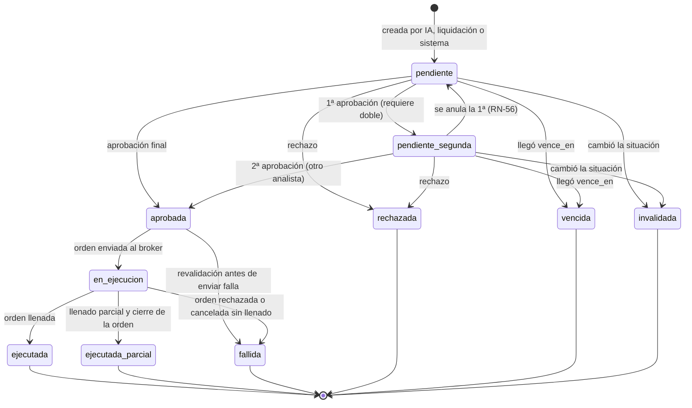
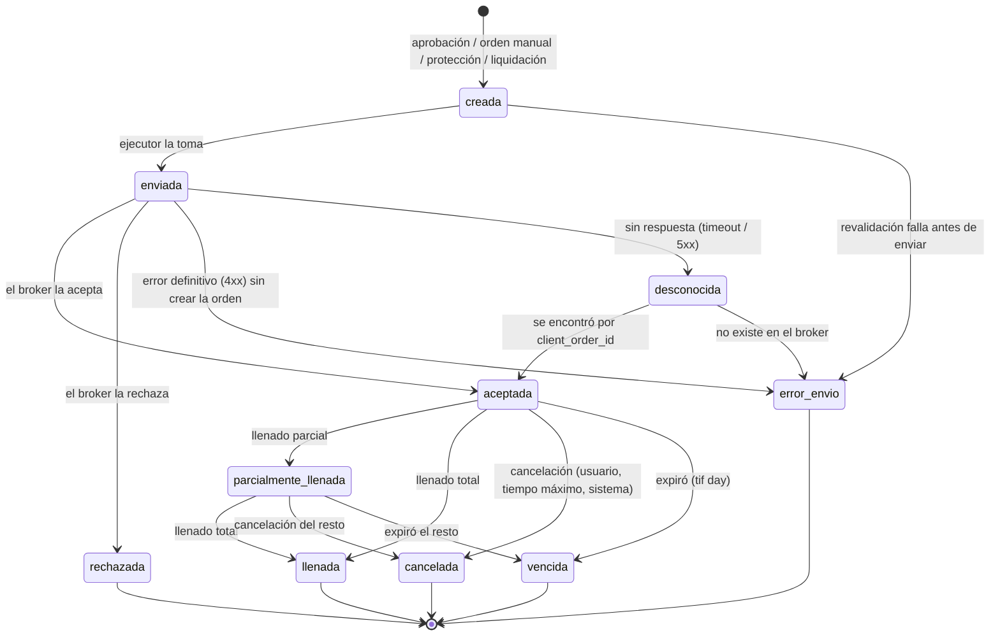
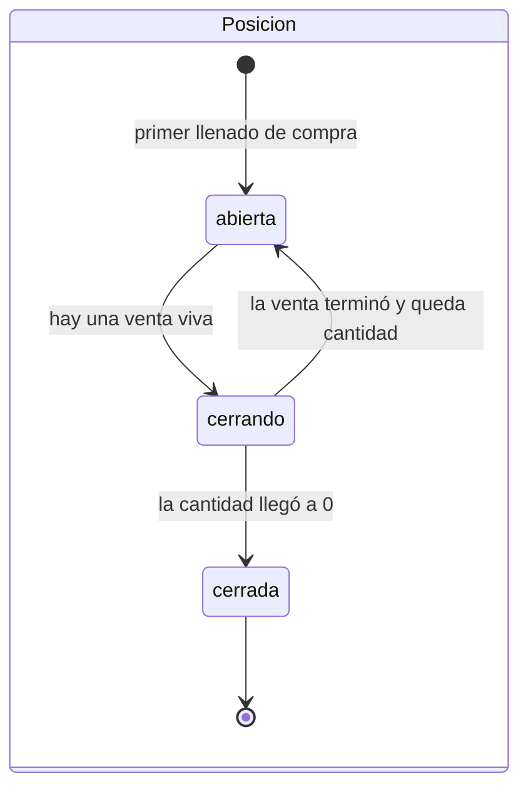
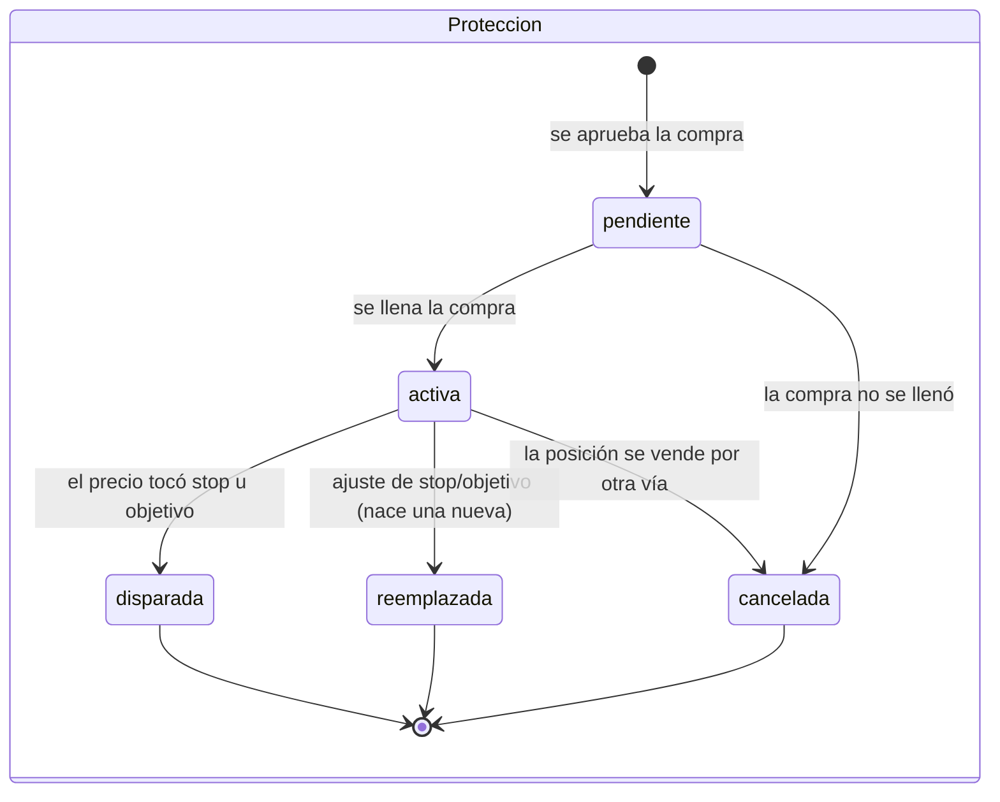
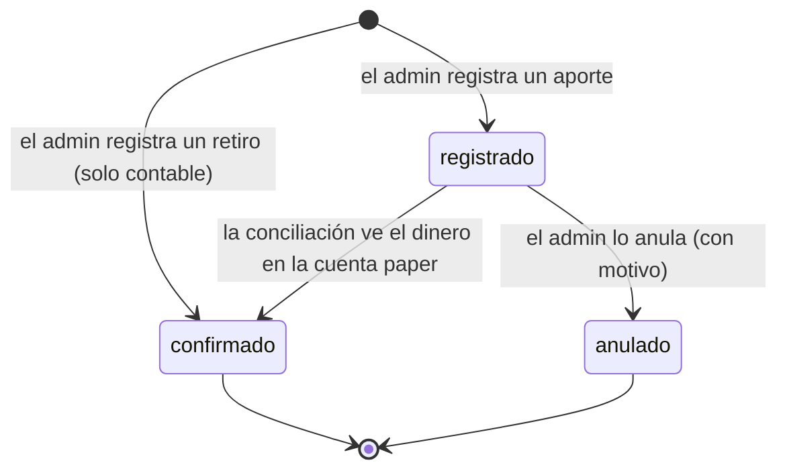
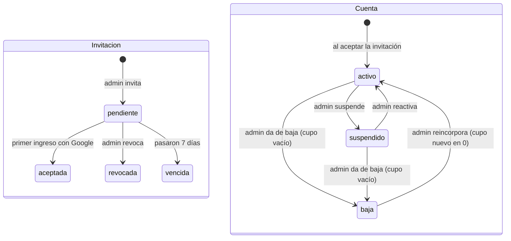
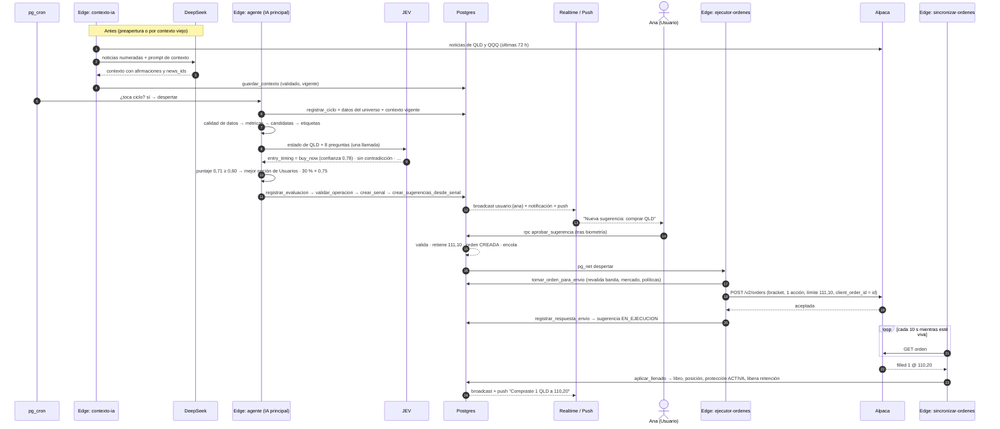

# 08 · Estados y flujos

Cada entidad importante tiene una **máquina de estados**. Las transiciones
las hacen solo funciones de la base de datos (nunca la app directamente), en
una transacción, con bloqueo de fila, auditoría y evento en tiempo real.
Cualquier transición no listada aquí es inválida y falla con
`ESTADO_INVALIDO`.

| Entidad | Estados | § |
|---|---|---|
| Sugerencia | pendiente · pendiente_segunda · aprobada · en_ejecucion · ejecutada · ejecutada_parcial · fallida · rechazada · vencida · invalidada | 1 |
| Orden | creada · enviada · aceptada · parcialmente_llenada · llenada · cancelada · vencida · rechazada · error_envio · desconocida | 2 |
| Posición | abierta · cerrando · cerrada | 3 |
| Protección | pendiente · activa · disparada · cancelada · reemplazada | 3 |
| Movimiento de capital | registrado · confirmado · anulado | 4 |
| Cuenta / invitación | activo · suspendido · baja / pendiente · aceptada · revocada · vencida | 5 |
| Ciclo del agente, integración, mercado, interruptores, conciliación | ver tabla | 6 |

---

## 1. Sugerencia



| De → A | Disparador | Validaciones | Efectos |
|---|---|---|---|
| → `pendiente` | `crear_sugerencias_desde_senal`, `solicitar_liquidacion`, `proponer_rebalanceo` | Motor de políticas | Notificación + push al destinatario (o a todos los analistas / admins); broadcast |
| `pendiente` → `pendiente_segunda` | Analista aprueba y `requiere_doble` | Rol, estado, vencimiento, banda (RR-12), políticas | Decisión nº 1; push a los **otros** analistas: "Requiere tu segunda aprobación" |
| `pendiente`/`pendiente_segunda` → `aprobada` | Aprobación final | Lo anterior + analista distinto (RN-52) + fondos | **Retiene** fondos (RN-23), crea la orden (`creada`), la encola, despierta al ejecutor |
| → `rechazada` | Cualquier decisor rechaza | Rol, estado | Decisión con motivo. En doble aprobación, **un rechazo basta**. |
| → `vencida` | `vencer_sugerencias()` (cada 30 s) | `now() ≥ vence_en` | Notifica; 5 min antes se envía aviso "por vencer" |
| → `invalidada` | Precio fuera de banda (en `publicar_cotizaciones`); titular suspendido o de baja; la posición a vender ya no existe; se apagó `trading_activo` (salvo liquidaciones); el símbolo salió de la lista blanca | — | `motivo_estado` explica por qué; notifica |
| `pendiente_segunda` → `pendiente` | Cambia el rol del analista que dio la 1ª (RN-56) | — | Decisión nº 1 marcada `anulada` |
| `aprobada` → `en_ejecucion` | `ejecutor-ordenes` envía la orden | Revalidación completa | — |
| `aprobada` → `fallida` | La revalidación del ejecutor falla (mercado cerró, banda, salud, interruptor) | — | Libera la retención; notifica con el motivo |
| `en_ejecucion` → `ejecutada` / `ejecutada_parcial` / `fallida` | Refleja el final de la orden | — | Ver §2 |

> **Por qué se invalida en ambas direcciones de precio.** Si el precio se
> movió más que la banda, la situación que analizó la IA ya no existe, aunque
> el precio sea "mejor". El siguiente ciclo decidirá con datos nuevos.

---

## 2. Orden



### 2.1 Correspondencia con los estados de Alpaca

| Estado en Alpaca | Estado nuestro |
|---|---|
| `new`, `accepted`, `pending_new`, `accepted_for_bidding`, `calculated`, `held` | `aceptada` |
| `partially_filled` | `parcialmente_llenada` |
| `filled` | `llenada` |
| `canceled`, `done_for_day` | `cancelada` |
| `expired` | `vencida` |
| `rejected`, `suspended`, `stopped` | `rechazada` |
| `pending_cancel`, `pending_replace`, `replaced` | Se conserva el estado anterior y se registra el evento |

El estado crudo del broker se guarda siempre en `ordenes.broker_estado` y en
`ordenes_eventos`.

### 2.2 Reglas

- **Idempotencia**: el `id` de la orden se envía como `client_order_id`. Si
  el envío queda en duda (`desconocida`), se consulta al broker por ese id
  antes de reintentar. **Nunca** se envía dos veces la misma orden.
- **Llenados**: `aplicar_llenado` recibe la cantidad total llenada y el
  precio promedio que reporta el broker y aplica solo **la diferencia**
  contra lo ya aplicado (`cantidad_llenada`, `monto_llenado`). Llamarla dos
  veces con los mismos datos no hace nada.
- **Tiempo máximo de llenado**: una compra `aceptada` o
  `parcialmente_llenada` durante más de `ejecucion.minutos_max_llenado` se
  cancela; lo llenado se conserva, el resto de la retención se libera.
- **Fin de la orden → sugerencia**: `llenada` → `ejecutada`;
  `cancelada`/`vencida` con algo llenado → `ejecutada_parcial`; sin nada
  llenado, o `rechazada`/`error_envio` → `fallida`.
- **Liberación de retención**: toda orden que termina libera lo que quede
  retenido.

---

## 3. Posición y protección





| Protección | Nativa (acciones enteras) | Virtual (fracciones) |
|---|---|---|
| Dónde vive | En el broker: patas stop y take-profit de la orden *bracket* | En `protecciones`; la vigila `publicar_cotizaciones` cada ~15 s |
| Cómo se dispara | El broker ejecuta la pata; la sincronización la detecta | `disparar_proteccion_virtual` crea una orden de venta a mercado y la encola |
| Si nuestro sistema está caído | **Sigue protegiendo** | No protege hasta que vuelva (riesgo documentado RSG-05) |
| Vender por otra vía | Primero se cancelan las patas en el broker, se espera la confirmación y luego se envía la venta | Se marca `cancelada` y se envía la venta |
| Ajustar | Se reemplazan las patas en el broker | Se crea una fila nueva `activa` y la vieja queda `reemplazada` |

- Una protección disparada **no pide aprobación**: se aprobó junto con la
  compra (D-09). Tampoco la frena `trading_activo = false` (RR-14).
- Al dispararse se notifica al dueño (o a los analistas):
  "Se activó tu stop-loss en QLD a 103,40".

---

## 4. Movimiento de capital



| Tipo | Al registrar | Al confirmar | Al anular |
|---|---|---|---|
| Aporte | Nada en el libro (RN-07) | Movimiento `aporte` con reparto 50/25/25 | Nada que revertir |
| Retiro | Se confirma de inmediato: movimiento `retiro` (02 §4) | — | No se anula; se corrige con un aporte |

La confirmación de un aporte ocurre en la siguiente conciliación (máximo
unos minutos), porque el efectivo ya está en la cuenta paper.

---

## 5. Cuenta e invitación



Efectos de cada transición de cuenta en
[03 §5](03-roles-y-permisos.md#5-reglas-estructurales-sobre-las-cuentas),
[04 §10](04-autenticacion-oauth.md#10-suspensión-y-baja) y
[02 §11](02-logica-de-negocio.md#11-el-empleado-y-su-dinero-a-lo-largo-del-tiempo).

---

## 6. Otros estados

| Entidad | Estados | Transiciones y efectos |
|---|---|---|
| **Ciclo del agente** | `en_curso` → `completado` · `fallido` · `omitido` | Ver [07 §3](07-agente-ia.md#3-el-ciclo-paso-a-paso). Un `en_curso` de más de 5 min pasa a `fallido`. |
| **Contexto** | `vigente` → `viejo` (pasaron `ia.contexto_max_minutos` o llegaron noticias nuevas) · `no_confiable` · `sin_noticias` | Ver [07 §4.2](07-agente-ia.md#42-contexto-deepseek). Un contexto viejo se regenera; mientras tanto la candidata se evalúa "sin contexto". |
| **Configuración de decisión** | `borrador` → `sombra` → `activa` → `retirada` | Una sola activa. La sombra corre sin publicar (07 §11). |
| **Integración** | `ok` ⇄ `degradado` (1–2 fallos seguidos) ⇄ `caido` (≥ 3) | Un éxito vuelve a `ok`. Entrar en `caido` alerta a admin y analistas; con broker o datos `caido` no se crean ni envían órdenes (RR-21). |
| **Mercado** (calculado, no guardado) | `cerrado` → `pre_apertura` (10 min antes) → `abierto_sin_compras` (primeros 5 min) → `abierto` → `cierre_proximo` (últimos 15 min, sin compras) → `cerrado` | Sale de `calendario_mercado`. Feriado: `cerrado` todo el día. Media jornada: cierre 13:00 NY. |
| **Interruptores** | `ia_activa` sí/no · `trading_activo` sí/no | Apagar `ia_activa`: no hay ciclos (las sugerencias vivas siguen). Apagar `trading_activo`: se invalidan las sugerencias vivas (salvo liquidaciones) y no se aprueban ni envían órdenes nuevas; protecciones y liquidaciones siguen. |
| **Conciliación** | `ok` · `diferencia_menor` · `descuadre_critico` | Crítico: apaga `trading_activo` automáticamente y alerta al admin, que revisa y marca como revisada. |

---

## 7. Flujos de punta a punta

### 7.1 Compra sugerida en un cupo



### 7.2 Doble aprobación en Arriesgadas

```
1. La IA propone TQQQ por USD 480 (≥ umbral 400) → sugerencia con requiere_doble.
2. Push a todos los analistas activos.
3. Analista A aprueba → pendiente_segunda. Push a los demás: "Falta una aprobación".
4. Analista A intenta aprobar otra vez → idempotente (no cambia nada).
5. Analista B aprueba → aprobada → retención → orden → ejecución (como 7.1).
   Si B rechaza → rechazada (un rechazo basta).
   Si nadie más decide → vencida.
```

### 7.3 Protección virtual

```
1. Ana compró USD 60 de QLD en fracciones → protección VIRTUAL activa, stop 103,40.
2. ingesta-mercado publica QLD = 103,10.
3. publicar_cotizaciones ve 103,10 ≤ 103,40 → disparar_proteccion_virtual:
   protección DISPARADA · orden de venta a mercado (origen 'proteccion') · encolada.
4. Ejecutor envía (no mira trading_activo ni pide aprobación).
5. Llenado → aplicar_llenado → pérdida absorbida por el cupo (RN-28).
6. Push: "Se activó tu stop-loss en QLD".
```

### 7.4 Venta con ganancia y reparto

```
1. Toma de ganancia (nativa) de 1 QLD a 123,20 → Alpaca llena la pata.
2. sincronizar-ordenes detecta la pata llenada (consulta con órdenes anidadas).
3. aplicar_llenado en una transacción:
     venta: cupo +123,20 efectivo · −110,20 invertido · resultados −13,00
     reparto_ganancia: cupo −9,75 · reserva +6,50 · arriesgadas +3,25
     posición → cerrada · protección → disparada (objetivo)
4. Broadcast a Ana (su cupo), a supervisores (fondo) y resumen agregado.
```

### 7.5 Orden manual con opinión

```
1. Ana arma: comprar USD 150 de QQQ, stop 8 %, objetivo 15 % (valores precargados).
2. App → opinion-ia → validar_operacion OK → JEV con el último contexto vigente
   (< 1 s) → "neutral (confianza 0,58): el índice está cerca de su máximo y el
   riesgo de reversión es alto; considera esperar".
3. Ana confirma con biometría → rpc crear_orden_manual(id generado en la app, …, opinion_id).
4. Si la app reintenta por mala conexión, el mismo id devuelve la misma orden (sin duplicar).
5. Sigue como 7.1 desde la retención.
```

### 7.6 Aporte de capital

```
1. El admin reinicia la cuenta paper de Alpaca con USD 10.000 (fuera de la app).
2. rpc registrar_aporte(10000, 'paper-inicial') → REGISTRADO.
3. Siguiente conciliación: efectivo broker (10.000) ≥ efectivo libro (0) + 10.000 → CONFIRMADO.
4. Movimiento aporte: reserva 5.000 · arriesgadas 2.500 · usuarios_comun 2.500.
5. El admin asigna cupos y enciende ia_activa y trading_activo.
```

### 7.7 Liquidación y baja de un empleado

```
1. El admin suspende a Pedro → cupo congelado, protecciones siguen (02 §11).
2. El admin solicita liquidación → una sugerencia de venta total por posición,
   decide_rol = analista, origen = liquidacion, vencimiento hasta el cierre.
3. Un analista aprueba cada una → se venden (con reparto si hay ganancia).
4. Cupo sin posiciones ni órdenes vivas → el admin da de baja:
   cierre_cupo: cupo → usuarios_comun · subcuenta cerrada · cuenta bloqueada.
```

---

## 8. Carreras y concurrencia (cómo se evitan)

| Situación | Solución |
|---|---|
| Dos analistas aprueban al mismo tiempo | `SELECT … FOR UPDATE` sobre la sugerencia: el segundo espera y ve el estado nuevo. Si era la 1ª aprobación, el segundo completa la 2ª (son distintos). |
| Doble toque en "Aprobar" | `unique (sugerencia_id, usuario_id)` + idempotencia: misma decisión devuelve OK. |
| Dos sugerencias aprobadas compiten por el mismo disponible | Bloqueo de la fila de la subcuenta al retener; la segunda recibe `FONDOS_INSUFICIENTES` si ya no alcanza. |
| El ejecutor corre dos veces con la misma orden (pg_net + barrido) | `tomar_orden_para_envio` bloquea la orden y solo avanza desde `creada`; la cola `pgmq` entrega cada mensaje a un solo consumidor a la vez; `client_order_id` como última red. |
| Llega un llenado repetido | `aplicar_llenado` aplica solo diferencias. |
| La aprobación llega en el mismo segundo del vencimiento | Decide la base de datos con `now()` dentro de la transacción; la hora del teléfono no cuenta. |
| Dos ciclos del agente a la vez | `registrar_ciclo` lo impide (07 §3). |

---

## 9. Estado en la app

### 9.1 Providers principales (Riverpod)

| Provider | Tipo | Contiene |
|---|---|---|
| `sesionProvider` | Stream | Estado de autenticación de `supabase_flutter` |
| `perfilProvider` | AsyncNotifier | Rol y estado (claims + tabla `perfiles`) |
| `conexionProvider` | Notifier | `conectado` / `reconectando` / `sin_conexion` |
| `relojProvider` | Notifier | Desfase entre el reloj del teléfono y el del servidor (para cuentas regresivas exactas) |
| `estadoMercadoProvider` | Notifier con temporizador | Abierto/cerrado, cuenta regresiva, ventana de compras |
| `cotizacionesProvider` | Notifier | Mapa símbolo → último precio y antigüedad |
| `bandejaSugerenciasProvider` | AsyncNotifier | Foto + eventos de las sugerencias vivas del usuario |
| `sugerenciaProvider(id)` | Family | Detalle con su justificación y decisiones |
| `miCupoProvider` | AsyncNotifier | Saldos, posiciones, protecciones |
| `posicionesValoradasProvider` | Derivado | Posiciones × cotizaciones → valor y resultado en vivo |
| `bandejaRiesgoProvider` | AsyncNotifier | Para analistas |
| `resumenFondoProvider` | AsyncNotifier | Agregados por bolsillo |
| `notificacionesProvider` | AsyncNotifier | Lista y contador de no leídas |

### 9.2 Patrón "foto + eventos"

```
al montar:
  foto ← consulta por la API (RLS aplica)
  suscribirse al canal
al llegar evento {tabla, id, version}:
  si version ≤ la que tengo → ignorar (llegó tarde)
  si no → pedir ese registro por la API y reemplazarlo
al reconectar:
  pedir la foto completa otra vez (pudieron perderse eventos)
```

Los eventos llevan **solo identificadores y versión**, nunca montos: el dato
siempre se lee por la API, donde aplica RLS (ver
[09 §4](09-tiempo-real-y-notificaciones.md#4-qué-viaja-en-cada-evento)).

### 9.3 Estados de una acción del usuario

```
inactivo → confirmando (biometría) → enviando → hecho
                 │                       │
                 └── cancelado           └── error (código → mensaje)
```

- Mientras está en `enviando`, el botón se deshabilita y muestra
  "Procesando…". **No hay actualización optimista** en nada que toque dinero.
- La RPC devuelve el registro actualizado: la pantalla se actualiza con eso,
  sin esperar el evento.
- Las órdenes manuales llevan un `id` generado en la app, que hace de clave
  de idempotencia si hay que reintentar.

### 9.4 Sin conexión o con datos viejos

| Situación | Qué ve la persona |
|---|---|
| `reconectando` | Barra superior "Reconectando…"; los datos se ven atenuados |
| `sin_conexion` | "Sin conexión"; los botones de decisión se deshabilitan |
| Precio con más de `mercado.max_antiguedad_cotizacion_seg` | Marca "dato desactualizado" junto al precio; aprobar queda deshabilitado (el servidor igual lo rechazaría) |
| Sesión revocada | Se cierra la sesión y se muestra el motivo |
