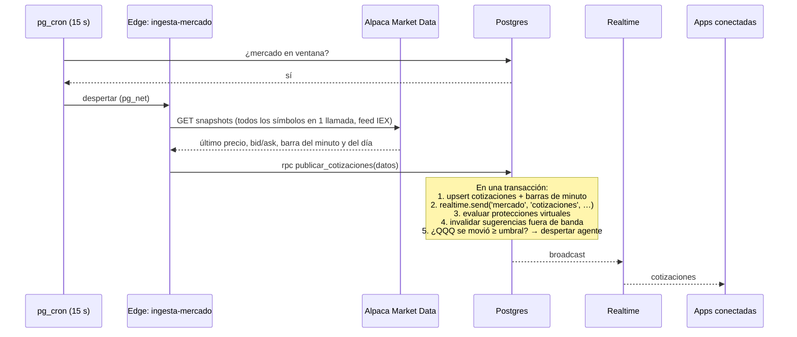

# 09 · Tiempo real y notificaciones

## 1. Qué se ve en vivo

| Dato | Se actualiza | Fuente | Retraso esperado |
|---|---|---|---|
| Precios del universo (~100 componentes del NASDAQ-100) y de QQQ, QLD y TQQQ | Cada ~15 s en horario de mercado | `ingesta-mercado` → broadcast `mercado` | ≤ 20 s desde el dato del proveedor |
| Valor y resultado de posiciones | Con cada precio | Calculado en la app (posiciones × precio) | Igual que los precios |
| Estado del mercado y cuentas regresivas | Cada segundo (reloj local corregido con la hora del servidor) | `estado_mercado()` + `calendario_mercado` | — |
| Sugerencias nuevas y sus cambios de estado | Al ocurrir | Triggers → broadcast | ≤ 1 s |
| Cuenta regresiva de vencimiento y "vigencia" del precio | Cada segundo / con cada precio | Calculado en la app | — |
| Órdenes (enviada, llenada, cancelada…) | Al sincronizarse | `sincronizar-ordenes` (cada 10 s) → broadcast | ≤ 12 s desde el broker |
| Saldos del cupo y del fondo | Al moverse el libro | Triggers → broadcast | ≤ 1 s |
| Notificaciones y alertas | Al crearse | Triggers → broadcast + push | ≤ 1 s en la app, pocos segundos por push |
| Salud de integraciones, conciliaciones, ciclos de IA | Al cambiar | Triggers → broadcast | ≤ 1 s |

> **¿Por qué 15 segundos y no tiempo real al milisegundo?** Porque una
> persona tiene que leer, pensar y aprobar: eso toma minutos. Lo que sí debe
> ser exacto se revalida en el servidor con un precio fresco justo antes de
> enviar la orden (banda de precio, RR-12). Si más adelante se necesita
> precio al segundo, ver §6.

---

## 2. Cómo llegan los precios



- **Una sola llamada** a Alpaca por ciclo para todos los símbolos: ~1.560
  llamadas por día, muy por debajo del límite de 200 por minuto del plan
  gratuito.
- Precio inválido (≤ 0, nulo, no numérico) → se descarta ese símbolo y se
  registra (heredado de la v2, HU-05 CA-3).
- Si Alpaca falla: se registra en `salud_integraciones`; la app sigue
  mostrando el último precio con su antigüedad; al pasar
  `mercado.max_antiguedad_cotizacion_seg` se marca "dato desactualizado" y
  se bloquean aprobaciones y compras (RR-11).
- Fuera de horario no se consulta: se muestra el cierre anterior.
- El feed gratuito es **IEX** (una sola bolsa). Los precios pueden diferir
  unos centavos del consolidado. Es aceptable en paper trading.

---

## 3. Canales y quién los escucha

Todos los canales son **privados** (requieren sesión) y solo la base de
datos publica en ellos. Los clientes **no pueden** enviar mensajes.

| Canal | Quién lo escucha | Eventos |
|---|---|---|
| `mercado` | Todos | `cotizaciones`, `estado_mercado` |
| `fondo` | Todos | `resumen_cambio` (cambió algún agregado por bolsillo) |
| `usuario:{uuid}` | Solo esa persona | `sugerencia`, `orden`, `posicion`, `proteccion`, `cupo`, `notificacion`, `perfil_actualizado`, `sesion_revocada` |
| `supervision` | Analistas y admins | `sugerencia`, `decision`, `orden`, `posicion`, `proteccion`, `subcuenta` (de todo el fondo), `ciclo_agente`, `salud`, `conciliacion`, `alerta` |
| `admin` | Solo admins | `capital`, `rebalanceo`, `invitacion`, `cuenta`, `parametro`, `interruptor` |

Política de autorización sobre `realtime.messages`:

```sql
create policy canales_permitidos on realtime.messages
for select to authenticated
using (
  case
    when (select realtime.topic()) in ('mercado', 'fondo')
      then (select private.rol_actual()) is not null
    when (select realtime.topic()) = 'usuario:' || (select auth.uid())::text
      then (select private.rol_actual()) is not null
    when (select realtime.topic()) = 'supervision'
      then (select private.es_supervisor())
    when (select realtime.topic()) = 'admin'
      then (select private.rol_actual()) = 'administrador'
    else false
  end
);
-- Sin política de INSERT: ningún cliente puede publicar.
```

Suscripciones que abre la app al iniciar sesión:

```
todos:        mercado, fondo, usuario:{mi id}
analista:     + supervision
admin:        + supervision, admin
```

---

## 4. Qué viaja en cada evento

**Regla de oro: los eventos avisan, no informan.** Un evento de entidad lleva
solo lo necesario para saber *qué* cambió; el dato se pide por la API, donde
aplica RLS. Así, aunque un evento llegara a quien no debe, no revelaría
montos.

```json
// evento 'sugerencia' en usuario:{uuid}
{ "tabla": "sugerencias", "id": "5f1c…", "version": 4, "estado": "aprobada" }
```

La excepción son los precios, que son públicos dentro de la empresa y
cambian demasiado seguido para pedirlos uno por uno:

```json
// evento 'cotizaciones' en mercado
{
  "momento": "2026-09-28T14:31:15Z",
  "datos": [
    { "s": "QQQ",  "p": 478.62, "b": 478.60, "a": 478.65, "vd":  0.91 },
    { "s": "QLD",  "p": 110.25, "b": 110.20, "a": 110.30, "vd":  1.83 },
    { "s": "TQQQ", "p":  84.05, "b":  84.00, "a":  84.10, "vd":  2.71 }
  ]
}
```

Cómo los consume la app: patrón "foto + eventos" de
[08 §9.2](08-estados-y-flujos.md#92-patrón-foto--eventos).

Los mensajes de broadcast desde la base de datos se guardan en
`realtime.messages` y Supabase los borra a las 72 h.

---

## 5. Notificaciones

Cada aviso importante se guarda como fila en `notificaciones` (bandeja
dentro de la app, con contador de no leídas) y, según su tipo, también sale
por **push** (Firebase Cloud Messaging).

### 5.1 Catálogo

| Tipo | Para | En la app | Push | Texto del push |
|---|---|---|---|---|
| `sugerencia_nueva` | Dueño del cupo · analistas (Arriesgadas y liquidaciones) · admins (rebalanceo) | ✅ | ✅ | "Nueva sugerencia: comprar QLD" |
| `segunda_aprobacion` | Los otros analistas | ✅ | ✅ | "Una sugerencia de Arriesgadas espera tu aprobación" |
| `sugerencia_por_vencer` | Quien debe decidir | ✅ | ✅ | "Tu sugerencia de QLD vence en 5 minutos" |
| `sugerencia_vencida`, `sugerencia_invalidada` | Quien debía decidir | ✅ | — | — |
| `orden_ejecutada` | Dueño · analistas (Arriesgadas) | ✅ | ✅ | "Se ejecutó tu compra de QLD" |
| `orden_fallida` | Dueño · analistas | ✅ | ✅ | "No se pudo ejecutar tu orden de QLD" |
| `proteccion_disparada` | Dueño · analistas | ✅ | ✅ | "Se activó tu stop-loss en QLD" |
| `cupo_actualizado` | Usuario | ✅ | — | — |
| `alerta_mercado` | Según audiencia | ✅ | solo `critica` | "Alerta: el NASDAQ-100 cae 3,2 % hoy" |
| `integracion_caida` | Admins y analistas | ✅ | ✅ | "El broker no responde. Operación en pausa." |
| `descuadre_conciliacion` | Admins | ✅ | ✅ | "Descuadre con el broker. Operación pausada." |
| `presupuesto_ia` | Admins | ✅ | ✅ (80 % y 100 %) | "La IA consumió el 80 % del presupuesto del mes" |
| `aporte_confirmado`, `cupo_inicial_no_asignado` | Admins | ✅ | — | — |

### 5.2 Reglas del push

- **Sin montos ni saldos en el push**: la pantalla bloqueada la puede ver
  cualquiera. El símbolo sí se muestra; el monto se ve dentro de la app.
- **No se decide desde la notificación**: tocarla abre la app, pide
  biometría y lleva a la pantalla de la sugerencia (`/sugerencias/{id}`).
- Con la app abierta, el aviso se muestra como banner dentro de la app, no
  como notificación del sistema.
- Canales de Android: `sugerencias` (importancia alta), `operaciones`,
  `alertas`.
- iOS recibe por FCM a través de APNs (requiere la llave APNs cargada en
  Firebase).
- Web: en el MVP, solo notificaciones dentro de la app (el push web es
  opcional).

### 5.3 Preferencias

| Categoría | ¿Se puede silenciar el push? |
|---|---|
| Sugerencias (nueva, segunda aprobación, por vencer) | No: son la razón de ser del producto. Para dejar de recibirlas se pausa la recepción de sugerencias (PM-15). |
| Operaciones (ejecutada, fallida, protección) | Sí |
| Alertas de mercado | Sí |
| Operativas de admin (integración, descuadre, presupuesto) | No |

Se guardan en `perfiles.preferencias_push` (jsonb).

### 5.4 Envío

```
trigger crea la fila en notificaciones (push = true según catálogo y preferencias)
  → pgmq.send('notificaciones_push', {notificacion_id})
  → pg_net despierta a notificador (y el barrido de 10 s lo garantiza)
notificador:
  → lee destinatario y sus dispositivos
  → FCM HTTP v1 (token OAuth2 de la cuenta de servicio, cacheado ~55 min)
  → token inválido o no registrado → se borra de dispositivos
  → marca push_enviado_en; confirma el mensaje de la cola
```

### 5.5 Tokens de dispositivo

- Se registran al iniciar sesión y cada vez que FCM los renueva
  (`registrar_dispositivo`).
- Se borran al cerrar sesión, al suspender la cuenta y cuando FCM los
  declara inválidos.
- Un dispositivo sin uso en 60 días se borra.

---

## 6. Evolución: precios al segundo

Si el negocio pide precios al segundo o reaccionar a los llenados sin
esperar la sincronización, se agrega **un proceso siempre encendido** fuera
de Supabase que:

1. Mantiene el WebSocket de Alpaca Market Data (hasta 30 símbolos en el plan
   gratuito: los ETFs y los símbolos con posiciones) y el stream
   `trade_updates` de la cuenta.
2. Llama las **mismas** RPC (`publicar_cotizaciones`, `aplicar_llenado`),
   con las mismas validaciones, limitando la publicación a 1 por segundo por
   símbolo.
3. Reemplaza a `ingesta-mercado` y reduce `sincronizar-ordenes` a un respaldo.

Requiere un servidor siempre encendido, que normalmente es un servicio pago
(las capas gratuitas suelen apagarse por inactividad): por eso queda fuera
del MVP (D-45). Nada más cambia: la
app, las políticas y el libro siguen iguales. Por eso
toda la lógica está en las RPC y no en las funciones de ingesta.

---

## 7. Ciclo de vida de la conexión en la app

| Momento | Qué hace la app |
|---|---|
| Inicio de sesión | Abre los canales de su rol (§3) y pide las fotos iniciales |
| Renovación del token (cada ~15 min) | `supabase_flutter` actualiza el token del socket; no hay que resuscribirse |
| Pérdida de conexión | `conexionProvider = reconectando`; reintentos automáticos |
| Reconexión | Pide las fotos completas otra vez (pudieron perderse eventos) |
| App en segundo plano (móvil) | El sistema operativo puede cerrar el socket; los avisos llegan por push |
| Vuelve a primer plano | Biometría si pasó el tiempo de bloqueo; reconecta; pide fotos |
| `perfil_actualizado` | Fuerza la renovación del token y rearma la navegación |
| `sesion_revocada` | Cierra canales y sesión; muestra el motivo |
| Cierre de sesión | Cierra canales, borra el token de push, `signOut()` |

---

## 8. Volumen estimado

| Concepto | Cálculo | Por mes |
|---|---|---|
| Mensajes de precios | 1 cada 15 s × 6,5 h × 21 días ≈ 32.760, × ~20 personas conectadas | ~650 mil entregas |
| Eventos de entidades | Decenas por día | < 50 mil |
| Push | Decenas por día | < 5 mil |

Dentro del plan gratuito de Supabase (2 millones de mensajes al mes y 200
conexiones simultáneas) y de la capa gratuita de FCM. Con ~100
símbolos, cada mensaje de precios pesa más: si el volumen o el número de
personas crece, enviar solo los símbolos que cambiaron o subir el intervalo.
