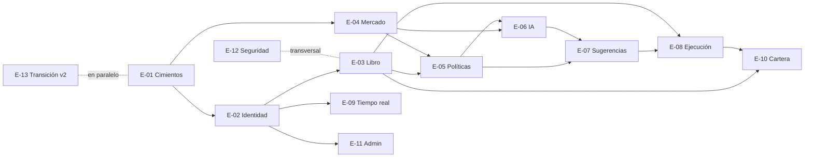

# 14 · Mapa para el backlog

Puente entre esta especificación y el tablero de GitHub Projects. Propone
**épicas**, sus **capacidades** (cada una da una o más historias), las
**dependencias**, un **orden de entregas por valor** y una **definición de
terminado** común. Las historias están en `backlog/` y publicadas como issues
([16 §6](16-arranque-del-repositorio.md#6-crear-el-backlog-en-github)).

---

## 1. Principio: cada entrega aporta valor

- **Desde la primera entrega hay algo tangible**: la app publicada (web y
  APK) que alguien del equipo puede abrir y usar.
- Cada entrega es un **corte vertical**: base de datos + funciones + app +
  pruebas E2E + despliegue. Nada de "primero todo el backend, después las
  pantallas".
- Cada entrega termina **desplegada en el proyecto MVP** con CI en verde y
  una **demostración** escrita (qué se muestra y en qué orden).
- Cada entrega **agrega escenarios E2E** al catálogo de
  [15 §4](15-calidad-pruebas-y-ci-cd.md#4-escenarios-e2e-obligatorios); los
  de entregas anteriores siguen pasando (el sistema nunca queda roto).
- El orden de §4 es una **propuesta inicial**: se refina al crear el backlog,
  sin romper el principio.

---

## 2. Épicas

| ID | Épica | Capacidades principales | Fuente |
|---|---|---|---|
| **E-01** | Cimientos y calidad continua | Repositorio listo ([16](16-arranque-del-repositorio.md)); proyectos Supabase (local, MVP, demo opcional); esquema `private`, extensiones, Vault; esqueleto Flutter (Android + web, `com.ritech.inversiones`, Riverpod, go_router, códigos de error); **proveedores simulados**; **arnés E2E** (backend y app); flujos de CI/CD, wiki y mantenimiento funcionando; despliegue web (Firebase Hosting) y APK (App Distribution); respaldo cifrado; `CLAUDE.md` y registro de errores en uso | [05](05-arquitectura.md), [15](15-calidad-pruebas-y-ci-cd.md) |
| **E-02** | Identidad y acceso | Google Cloud (consentimiento, clientes); ingreso nativo y web; invitaciones y primer admin; hooks y trigger de alta; perfiles, `rol_actual()`, RLS base; guardas de navegación; sesión segura y bloqueo biométrico; suspender, reactivar, baja, reincorporar; cambio de rol | [03](03-roles-y-permisos.md), [04](04-autenticacion-oauth.md) |
| **E-03** | Fondo y libro contable | Libro e invariantes; aportes (con confirmación por conciliación de efectivo) y retiros; cupos; reparto de ganancias; ajustes; `resumen_fondo()`, `mi_cupo()`; fotos diarias y TWR; rebalanceo | [02](02-logica-de-negocio.md), [06 §4](06-modelo-de-datos.md#4-libro-contable) |
| **E-04** | Datos de mercado | Universo NASDAQ-100 (semilla, sectores, carga de 2 años de barras); ingesta cada 15 s; calendario y reloj; atributos de activos; `estado_mercado()`; pantalla de mercado (QQQ vs QLD vs ×2 teórico, universo); dato desactualizado | [09 §2](09-tiempo-real-y-notificaciones.md#2-cómo-llegan-los-precios), [10](10-integracion-bolsa.md) |
| **E-05** | Motor de políticas y configuración | `validar_operacion` (RR-01 a RR-22); parámetros con historial; lista blanca; interruptores y freno; salud de integraciones | [02 §9](02-logica-de-negocio.md#9-motor-de-políticas-reglas-de-riesgo) |
| **E-06** | IA: contexto y decisión | Noticias (Alpaca News); contexto con DeepSeek y su validación; métricas, etiquetas y calidad de datos; adaptador JEV (TypeSafe / Cloudflare / simulado); preguntas, puntaje compuesto y reglas; configuración versionada y modo sombra; pantalla **Oportunidades**; alertas de contradicción; opinión sobre órdenes manuales; análisis bajo demanda; presupuesto; evaluación y calibración | [07](07-agente-ia.md) |
| **E-07** | Sugerencias y decisiones | Señales y reparto en cupos; bandeja del Usuario; bandeja de riesgo; detalle con explicación; aprobar y rechazar; doble aprobación; vencimiento e invalidación; rebalanceo (admin); liquidación (analistas) | [08 §1](08-estados-y-flujos.md#1-sugerencia) |
| **E-08** | Ejecución y broker | Adaptador Alpaca paper y simulado; cola y ejecutor; órdenes manuales; sincronización y `aplicar_llenado`; protecciones nativas y virtuales; ajuste de protección; renovación a los 80 días; conciliación de posiciones y órdenes | [10](10-integracion-bolsa.md), [08 §2](08-estados-y-flujos.md#2-orden) |
| **E-09** | Tiempo real y notificaciones | Canales y políticas; eventos por entidad; gestor de Realtime en la app; bandeja de notificaciones; FCM y dispositivos; preferencias; deep links | [09](09-tiempo-real-y-notificaciones.md) |
| **E-10** | Cartera y reportes | Mi cupo; fondo (resumen y detalle); historial; exportación CSV; reporte diario al admin | [02 §13](02-logica-de-negocio.md#13-cifras-que-muestra-la-app) |
| **E-11** | Administración | Pantallas del admin sobre las capacidades de las demás épicas | [03 §3](03-roles-y-permisos.md#3-qué-ve-cada-rol-pantallas) |
| **E-12** | Seguridad, auditoría y cumplimiento | Bitácora con cadena de hash; pantalla de bitácora; suite RLS transversal; avisos (privacidad, "no es asesoría"); simulacro de restauración; lista de verificación de 11 §10 | [11](11-seguridad-y-auditoria.md) |
| **E-13** | Transición desde la v2 | Copiar del repositorio v2 el motor ×2, widgets, tema, fuentes y exportador, con sus pruebas | [05 §11](05-arquitectura.md#11-código-reutilizable-del-repositorio-v2) |
| ~~E-14~~ | *Retirada* (era "paso a dinero real", fuera del alcance) | — | — |

---

## 3. Dependencias



---

## 4. Entregas por valor (propuesta inicial)

| Entrega | Qué puede hacer alguien al final | Contenido | Demostración | E2E que se agregan |
|---|---|---|---|---|
| **R1 · Ver el mercado en vivo** | Entrar con Google (por invitación) a la app web o Android y ver el NASDAQ-100 moverse, con la comparación QQQ / QLD / ×2 teórico | E-01 completa, E-02 (ingreso, invitaciones, roles, navegación), E-04, E-09 (canal de mercado), E-13 | Tres personas entran con roles distintos y ven menús distintos; un correo no invitado es rechazado; los precios se mueven; en la demo fuera de horario, el mercado simulado | E2E-01, E2E-02, E2E-03 |
| **R2 · El fondo existe** | El admin carga el capital y reparte cupos; cada empleado ve su cupo; todos ven el fondo por bolsillos | E-03 (sin rebalanceo), E-05 (parámetros, interruptores), E-11 (capital, cupos, usuarios), E-12 (bitácora) | Aporte de USD 10.000 confirmado contra la cuenta paper y repartido 50/25/25; asignación de cupos; suspender a alguien lo saca al instante | E2E-04, E2E-05, E2E-14 |
| **R3 · La IA analiza** | Ver en **Oportunidades** qué acciones evalúa la IA, con puntaje, confianza, contexto y contradicciones, en cada ciclo | E-06 (sin opinión), E-05 (salud), alertas de E-09 | Un ciclo real: candidatas, respuestas de JEV, la elegida y por qué; una contradicción señalada; costo del ciclo | E2E-06, E2E-07 |
| **R4 · Decidir y operar en paper** | Recibir sugerencias, aprobarlas o rechazarlas, crear órdenes manuales con opinión, y ver la operación ejecutada y protegida en la cuenta paper | E-07, E-08, E-05 (motor completo), E-10 (mi cupo con posiciones) | Aprobar → orden en Alpaca paper → llenado → protección activa → venta por objetivo → reparto visible en los tres bolsillos; doble aprobación en Arriesgadas | E2E-08 a E2E-12 |
| **R5 · Protegido y avisado** | Recibir push, confiar en que el sistema se detiene solo ante problemas | E-09 (push, preferencias), conciliación con pausa automática, freno de emergencia, alertas operativas | Push con enlace directo; un descuadre forzado pausa el trading; un analista frena la IA | E2E-13, E2E-15 |
| **R6 · Medir y mejorar** | Saber si la IA acierta y ajustarla con datos | Evaluación y calibración, modo sombra, rebalanceo, liquidación y baja, reportes CSV, E-12 completa | Pantalla de calibración con datos de R3–R5; una configuración en sombra comparada con la activa; lista de verificación 11 §10 completa | E2E-16 |

> R3 va **antes** de las sugerencias a propósito: permite ver y medir a la
> IA con datos reales durante semanas antes de que una sola orden llegue al
> broker.

---

## 5. Plantilla de historia de usuario

Existe como formulario de GitHub (`.github/ISSUE_TEMPLATE/historia-de-usuario.yml`).
Campos:

```
Épica: E-xx          Entrega: Rx          Módulos afectados: M-xx, M-yy   (17)

Como <Usuario | Analista | Administrador>
quiero <acción>
para <beneficio>.

Reglas: RN-xx, RR-xx, PM-xx
Criterios de aceptación:
  CA-1  Dado … cuando … entonces …
  CA-2  (caso borde) CB-xx: …
  CA-n  (permiso) Un <rol sin permiso> recibe NO_AUTORIZADO.
Escenario E2E: E2E-xx (nuevo / actualizado)
Técnico: RPC / Edge Function · tablas · RLS · evento en tiempo real · auditoría · códigos de error
Documentación a actualizar: secciones de docs/ que cambian
```

El campo **Módulos afectados** es obligatorio: es lo que usa el agente para
investigar solo lo necesario ([17](17-mapa-de-modulos.md)).

---

## 6. Definición de terminado

Una historia está terminada cuando:

- [ ] Cumple sus criterios de aceptación, incluidos los casos borde citados.
- [ ] `scripts/verificar.sh` pasa completo en local, **incluido el E2E**, y CI está en verde.
- [ ] Agregó o actualizó su escenario E2E si cambió un flujo.
- [ ] Si toca datos: RLS y pruebas pgTAP (dueño correcto, rol incorrecto, escritura directa bloqueada).
- [ ] Si escribe: por RPC, validando rol, dueño, estado y motor de políticas cuando aplique.
- [ ] Si cambia algo visible en vivo: evento en el canal correcto, sin montos en la carga.
- [ ] Si es una acción sensible: registro en `auditoria`.
- [ ] Errores con código del catálogo y mensaje en español.
- [ ] Sin secretos en la app ni en el repositorio.
- [ ] **`docs/` actualizada** si la historia cambió o precisó una regla, y registrada en el historial (13 §4).
- [ ] Si se resolvió un error no trivial, quedó en `docs/errores-conocidos.md`.
- [ ] Desplegada en el proyecto MVP con la prueba de humo en verde.

---

## 7. Trazabilidad y sincronía

- Cada historia cita sus reglas (`RN`, `RR`, `PM`), casos borde (`CB`),
  módulos (`M`) y escenario E2E.
- **Si cambia una historia**, se actualiza `docs/` en el mismo PR.
- **Si cambia `docs/`**, el PR lista las historias afectadas (búsqueda de los
  identificadores en los issues) y se actualizan o comentan.
- La wiki se regenera sola desde `docs/`; nunca se edita a mano.

Reglas completas para agentes en `CLAUDE.md`.
